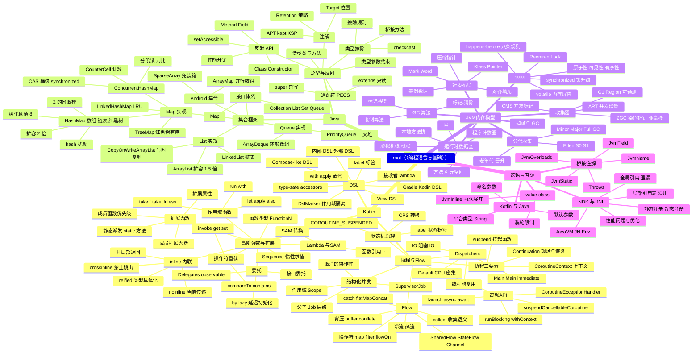

# 第 1 部分：编程语言与基础

## 概览

本部分是整个知识图谱的**语言地基**。它不解决"怎么写业务"，而是回答"**语言本身是怎么工作的**"——只有理解了协程的挂起机制、扩展函数的编译产物、泛型的类型擦除、`HashMap` 的扩容过程、JVM 的内存布局与 JMM 规则，才能在面试中回答出"**为什么这样写**"和"**换一种写法会带来什么代价**"这三个层级的问题。

本部分包含三条主线：

- **Kotlin 线**：[[Kotlin/协程与Flow]]（编译期状态机 + 结构化并发 + 流式数据）、[[Kotlin/高阶函数与扩展]]（零成本抽象的实现原理）、[[Kotlin/DSL]]（用领域语言表达配置的三大基石）。这三条线互相咬合——Flow 的操作符链本身就是高阶函数，而 DSL 的带接收者 lambda 又是高阶函数的进阶形态。
- **Java 线**：[[Java/泛型与反射]]（编译期类型安全与运行时内省的取舍）、[[Java/集合框架]]（数据结构的性能边界）、[[Java/JVM内存模型]]（运行时数据区 + JMM + GC）。这三条线共同决定了"**一段代码在内存里长什么样、多线程下是否安全、什么时候会被 GC 打断**"。
- **互调线**：[[跨语言互调]]。Kotlin 与 Java 的双向调用、Kotlin 特性如何桥接给 Java、JNI/NDK 的原理与性能代价。

**面试权重**：本部分是**面试官的"基本功审查区"**。初级岗会问"协程和线程有什么区别""`ArrayList` 和 `LinkedList` 怎么选"；中级岗会追问"协程的挂起是怎么实现的""`HashMap` 什么时候树化""`volatile` 为什么保证可见性但不保证原子性"；高级岗则会问"JVM 内存模型与 Android 掉帧的关系""Kotlin DSL 的作用域隔离原理""JNI 的引用管理与崩溃排查"。**这些问题的答案不在背诵里，而在"机制 + 代价 + 场景"三段式回答中。**

> [!tip] 面试主线
> 中级 Android 岗在本部分的高频考点：
> 1. **协程的挂起/恢复机制**：CPS 转换 + `Continuation` + 编译期状态机（为什么协程不阻塞线程）
> 2. **结构化并发与取消的协作性**：父子 Job 的三条规则、`CancellationException` 为什么必须重抛
> 3. **Dispatchers 与线程池复用**：`flowOn` 只影响上游、`IO` 与 `Default` 共享线程池
> 4. **Flow 的冷/热流**：`collect` 两次会发生什么、`StateFlow` / `SharedFlow` / `Channel` 的选型
> 5. **`inline` / `noinline` / `crossinline` / `reified`**：为什么需要它们，各自关闭了什么能力
> 6. **扩展函数的静态派发**：编译产物是什么、为什么成员函数永远优先
> 7. **作用域函数选型**：`let` / `apply` / `run` / `with` / `also` 的返回值与 `this`/`it` 差异
> 8. **类型擦除与 PECS**：`? extends` 为什么不能写、`? super` 为什么不能读
> 9. **APT / kapt / KSP** 的区别与选型，运行时反射的性能代价
> 10. **`HashMap` 的扩容与树化**：为什么容量是 2 的幂、链表长度 8 + 容量 64 的双重条件
> 11. **`ConcurrentHashMap` 的线程安全**：CAS + 桶级锁，与 `synchronizedMap` 的锁粒度差异
> 12. **JVM 内存区域与 JMM**：`volatile` 的内存屏障、happens-before 规则、GC 停顿与掉帧

## 知识图谱（Mermaid）

## 子目录导航

| 子目录 | 说明 | 主要笔记 |
| --- | --- | --- |
| [[./Kotlin/协程与Flow\|Kotlin]] | Kotlin 的并发原语与响应式数据流 | [[./Kotlin/协程与Flow]]、[[./Kotlin/高阶函数与扩展]]、[[./Kotlin/DSL]] |
| [[./Java/泛型与反射\|Java]] | Java 的类型系统与运行时内省 | [[./Java/泛型与反射]]、[[./Java/集合框架]]、[[./Java/JVM内存模型]] |
| [[./跨语言互调\|跨语言互调]] | Kotlin / Java / C++ 之间的桥接 | [[./跨语言互调]] |

## 笔记列表

### Kotlin

- [[Kotlin/协程与Flow]]
- [[Kotlin/高阶函数与扩展]]
- [[Kotlin/DSL]]

### Java

- [[Java/泛型与反射]]
- [[Java/集合框架]]
- [[Java/JVM内存模型]]

### 跨语言互调

- [[跨语言互调]]

## 关联部分

- 前置：无（本部分是最底层的基础知识，建议从 [[./README]] 开始）
- 延伸：[[../02-Android核心组件/README]]（语言基础是理解组件生命周期与线程模型的前提）
- 延伸：[[../03-UI开发与用户交互/README]]（Compose DSL 与 Android 自定义 View 的绘制机制）
- 延伸：[[../05-网络与并发/异步方案/Kotlin协程]]（协程与线程模型在网络层与并发编程中的落地）
- 延伸：[[../06-系统原理与性能优化/README]]（JVM 内存模型与 GC 停顿直接决定卡顿与掉帧）
- 延伸：[[../07-架构、工具与生态/README]]（MVVM + StateFlow 的组合是协程最重要的应用场景；Gradle Kotlin DSL 是本部分 DSL 知识的最强工业实践）
