# 第 2 部分：Android 核心组件

## 概览

本部分回答一个问题：**Android 的四个组件是怎么被系统调度、怎么互相通信、怎么拿到系统能力的**。这是从"能写页面"到"能设计 App 骨架"的分水岭。

- **四大组件**：Activity（界面入口 + 任务栈）、Service（无 UI 的组件 + 后台任务）、BroadcastReceiver（事件响应）、ContentProvider（跨进程数据接口）。它们的共同点是**都由 AMS 调度**，生命周期由系统决定，且**都能独立于界面存在**。
- **组件间通信**：Intent 是"**消息 + 路由**"（显式/隐式、action/data/extras、PendingIntent）；Binder 是"**Android 一切 IPC 的底层通道**"（内核驱动 + mmap 一次拷贝 + Binder 线程池）；AIDL 是"**用编译器写 RPC 框架**"（自动生成 Stub/Proxy）。
- **Application 与 Context**：Application 是**进程的代表**（一个进程一个实例，初始化极早）；Context 是**系统环境的能力集合**（`ContextWrapper` 装饰者模式，三种实例对应三种生命周期）。这部分的核心是**生命周期与内存泄漏**。

三条贯穿全部分的主线：

1. **生命周期即一切**——Activity 的重建、Service 的被杀、BroadcastReceiver 的 10 秒、Provider 的极早初始化，全部由系统生命周期驱动。
2. **跨进程是常态**——四大组件天然跨进程，底层全是 Binder；理解 Binder 就理解了 AMS、Provider、AIDL。
3. **版本限制在收紧**——Android 8+ 隐式广播禁令、12+ 后台启动 FGS 限制、13/14+ 的 `exported` 强制、15 的 `dataSync` 6 小时配额，都是面试中的高频"版本差异"题。

> [!tip] 面试主线
> 中级 Android 岗高频考点集中在：**Activity 生命周期与启动模式（singleTask/onNewIntent）**、**onSaveInstanceState 与进程重建**、**Activity Result API 的注册时机**、**前台服务的类型声明与配额限制**、**后台执行限制与 WorkManager 的替代关系**、**广播的静态/动态注册选择与 exported 规范**、**隐式 Intent 的匹配规则与冲突处理**、**PendingIntent 的 IMMUTABLE/ONE_SHOT 语义**、**ContentProvider 的 URI 匹配与初始化时机**、**Binder 的一次拷贝与线程池模型**、**Context 泄漏的典型场景**。进阶题集中在：**AIDL 的类型限制与 1MB 事务上限**、**Binder 线程池耗尽导致的 ANR**、**ContentProvider 的越权访问防护**。

## 知识图谱（Mermaid）

```mermaid
mindmap
  root（（Android核心组件））
    四大组件
      Activity
        生命周期
          onCreate onStart onResume
          onPause onStop onRestart onDestroy
          内存与资源占用
          可见性判定
        启动模式
          standard singleTop singleTask
          singleInstance singleInstancePerTask
          TaskAffinity 任务亲缘性
          Intent Flag 组合
        重建与状态保存
          配置变更 configChanges
          onSaveInstanceState
          savedInstanceState
          ViewModel 扛旋转
          进程被杀后重建
        Fragment 生命周期关系
        Activity Result API
          registerForActivityResult
          注册时机必须早于 STARTED
      Service
        三种类型
          Started Service
          Bound Service
          IntentService 已废弃
          Foreground Service
        生命周期
          onCreate onStartCommand
          onBind onUnbind onDestroy
          START_STICKY 保活真相
        前台服务
          必须发通知 5秒内
          foregroundServiceType
          权限 FOREGROUND_SERVICE_xxx
          dataSync 6小时配额
        后台执行限制
          Android 8 后台启动
          Android 9 后台网络存储
          Doze 与 App Standby
          WorkManager 替代
        线程模型
          回调在主线程
      BroadcastReceiver
        分类
          静态注册 动态注册
          有序广播 无序广播
          本地广播 已废弃
        生命周期
          onReceive 主线程
          10秒限制 goAsync
          交给 WorkManager
        系统限制
          Android 8 隐式广播禁令
          Android 13 exported 标志
          Android 14 必须声明 exported
        安全
          伪造广播 越权
          grantUriPermission
        PendingIntent 广播
      ContentProvider
        四大特点
          对外数据接口
          跨进程 Binder
          极早初始化
          标准化 Cursor 模型
        URI 匹配
          authority path
          pathPrefix pathPattern
          UriMatcher 优先级
        CRUD 四件套
          query insert update delete
          getType MIME
          call 自定义方法
        权限
          exported
          readPermission writePermission
          grantUriPermission
          越权访问防护
        常见系统 Provider
          MediaStore Contacts Calendar
        ContentObserver 变更通知
    组件间通信
      Intent
        组成
          action category data type
          component package extras flags
        显式与隐式
          过滤匹配规则
          CATEGORY_DEFAULT
          data 匹配口诀
        冲突处理
          resolveActivity
          queryIntentActivities
          setPackage
          系统 chooser
        数据传递
          Parcelable 序列化
          大对象用 ID 或 URI
          1MB 事务上限
        PendingIntent
          代理令牌 权限代理
          FLAG_IMMUTABLE
          FLAG_MUTABLE
          FLAG_ONE_SHOT
          FLAG_UPDATE_CURRENT
        安全
          显式 Intent 泄露
          隐式 Intent 劫持
      Binder机制
        本质
          Linux 内核 IPC
          驱动层 libbinder
          与 Socket 对比
        通信流程
          Proxy transact
          ServiceManager
          线程池 onTransact
          Parcel 回传
        一次拷贝
          mmap 共享内存
          两次拷贝对比
        类关系
          IBinder IInterface
          Binder BinderProxy
          本地 fast path
        代理模式
          Stub 事务码分派
          Proxy 序列化
          asInterface
        线程池
          默认 15 线程
          并发调用需线程安全
          耗尽导致 ANR
      AIDL
        语法
          package import interface
          in out inout
          oneway
        编译流程
          aidl 工具
          生成 Stub Proxy
        类型限制
          Parcelable 需 aidl
          不能抛异常
          1MB 上限
        回调接口
          IBinder 反向调用
          linkToDeath
        选型
          AIDL Messenger
          ContentProvider Hilt
    Application与Context
      Application
        一个进程一个实例
        attachBaseContext
        onCreate 初始化预算
        onTerminate 几乎不调
        多进程实例隔离
      初始化时机
        Provider 早于界面组件
        热修复框架利用
      Context 家族
        Context 抽象能力
        ContextWrapper 装饰者
        ContextImpl 实现
        Activity Service Application
      能力与选择
        getApplicationContext
        UI 能力需 Activity
        FLAG_ACTIVITY_NEW_TASK
      内存泄漏
        单例持 Activity
        Handler 延迟消息
        内部类隐式持有
        注册未注销
        Fragment binding
        WeakReference 局限
      检测工具
        LeakCanary
        Memory Profiler
        StrictMode
```

## 子目录导航

| 子目录 | 说明 | 主要笔记 |
| --- | --- | --- |
| [[./四大组件/Activity\|四大组件]] | 界面入口、生命周期与任务栈 | [[./四大组件/Activity]]、[[./四大组件/Service]]、[[./四大组件/BroadcastReceiver]]、[[./四大组件/ContentProvider]] |
| [[./组件间通信/Intent\|组件间通信]] | 消息、路由与跨进程通道 | [[./组件间通信/Intent]]、[[./组件间通信/Binder机制]]、[[./组件间通信/AIDL]] |
| [[./Application与Context\|Application与Context]] | 进程代表与系统能力入口 | [[./Application与Context]] |

## 笔记列表

### 四大组件

- [[四大组件/Activity]]：生命周期全流程、启动模式、配置变更重建、Activity Result API
- [[四大组件/Service]]：Started/Bound/Foreground 三态、前台服务类型与配额、后台执行限制与 WorkManager
- [[四大组件/BroadcastReceiver]]：静态与动态注册、有序广播、Android 8/13/14 的限制演进与广播安全
- [[四大组件/ContentProvider]]：URI 匹配规则、CRUD 实现、跨进程原理、权限与越权防护

### 组件间通信

- [[组件间通信/Intent]]：显式与隐式、过滤匹配规则、Parcelable 传参、PendingIntent 三个 Flag、Intent 安全
- [[组件间通信/Binder机制]]：内核驱动、一次拷贝原理、Binder 线程池、IBinder/IInterface/Binder 关系、Proxy/Stub
- [[组件间通信/AIDL]]：语法与编译流程、同步与 oneway、类型限制、回调接口、AIDL/Messenger/Hilt 选型

### Application与Context

- [[Application与Context]]：Application 生命周期、Provider 初始化时机、Context 家族与能力选择、六大内存泄漏场景

## 关联部分

- 前置：[[../01-编程语言与基础/README]]（Kotlin 协程与 Java 序列化是本部分的前提）
- 延伸：[[../03-UI开发与用户交互/README]]（Activity/Fragment 是 UI 承载者，理解生命周期是 UI 架构的地基）
- 延伸：[[../04-数据存储与处理/README]]（ContentProvider 的数据层实现与序列化原理）
- 延伸：[[../06-系统原理与性能优化/README]]（Binder 通信、内存管理与权限机制的源码级深入）
- 延伸：[[../07-架构、工具与生态/README]]（组件的职责划分如何落地为 MVVM + Hilt 架构）
