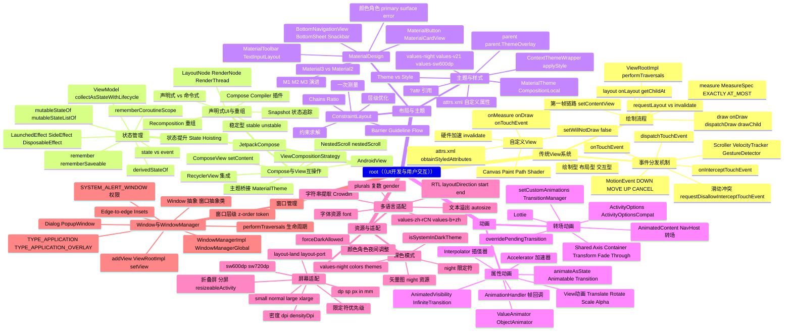

# 第 3 部分：UI 开发与用户交互

## 概览

本部分回答一个问题：**界面是怎么被画出来、用户的触摸又是怎么回到代码里的**。

从两套技术栈的对照来看：

- **传统 View 系统**：命令式地"指挥控件去做某事"，核心是 `measure → layout → draw` 三段式绘制流程与 `dispatchTouchEvent → onInterceptTouchEvent → onTouchEvent` 事件分发机制；理解 `ViewRootImpl.performTraversals` 才能理解掉帧、`requestLayout` 与 `invalidate` 的区别。
- **Jetpack Compose**：声明式地"描述界面应该是什么样"，核心是**重组（Recomposition）**、**快照系统（Snapshot）** 与 **状态提升（State Hoisting）**；编译器插件把 `@Composable` 函数编译成可跳过、可重启的代码块。
- **布局与主题**：`ConstraintLayout` 用一次测量替代层层嵌套；`Theme / Style / ?attr` 构成 Android 资源作用域体系。
- **动画**：View 动画改的是"绘制"，属性动画改的是"属性"，Material Motion 提供转场的统一语言。
- **资源与适配**：限定符（qualifier）规则决定了多语言、平板、横竖屏、深色模式如何落地。
- **窗口管理**：`Window → WindowManager → ViewRootImpl` 是系统与应用的边界，`Type` 决定窗口层级，`token` 决定窗口合法性。

> [!tip] 面试主线
> 第 3 部分是 Android 岗**必问**的一级考点，优先级最高的 5 个问题：
> 1. **绘制流程**：measure/layout/draw 各自做什么？`MeasureSpec` 三个 mode 怎么来的？`requestLayout` vs `invalidate` 区别？——高频出现。
> 2. **事件分发**：三方法责任划分？为什么会有 `ACTION_CANCEL`？滑动冲突怎么解？——高频出现。
> 3. **Compose 重组**：什么会触发重组？重组范围如何缩小？`remember` 的作用？——近三年最高频。
> 4. **状态管理**：`remember` vs `rememberSaveable` vs `ViewModel` 三者的边界？`derivedStateOf` 什么时候用？
> 5. **适配**：`dp` vs `sp`、`values-night` 原理、限定符优先级——考察工程素养。
>
> 加分项：能说清 `ViewRootImpl.performTraversals` 中"一次 requestLayout 引发两次 measure"的根因，能说清 Compose 的 `LayoutNode → RenderNode → RenderThread` 与 View 的 `Canvas → DisplayList → RenderThread` 的异同。

## 知识图谱（Mermaid）

## 子目录导航

| 子目录 | 说明 | 主要笔记 |
| --- | --- | --- |
| [[./传统View系统/绘制流程\|传统View系统]] | measure / layout / draw 三段式绘制与渲染管线 | [[./传统View系统/绘制流程]]、[[./传统View系统/事件分发机制]]、[[./传统View系统/自定义View]] |
| [[./JetpackCompose/声明式UI与重组\|JetpackCompose]] | 声明式 UI、重组机制与状态管理 | [[./JetpackCompose/声明式UI与重组]]、[[./JetpackCompose/状态管理]]、[[./JetpackCompose/Compose与View互操作]] |
| [[./布局与主题/ConstraintLayout\|布局与主题]] | 布局层级优化与主题样式体系 | [[./布局与主题/ConstraintLayout]]、[[./布局与主题/MaterialDesign]]、[[./布局与主题/主题与样式]] |
| [[./动画/属性动画\|动画]] | 属性动画原理与转场动画 | [[./动画/属性动画]]、[[./动画/转场动画]] |
| [[./资源与适配/多语言适配\|资源与适配]] | 限定符规则、多语言、多尺寸、深色模式 | [[./资源与适配/多语言适配]]、[[./资源与适配/屏幕适配]]、[[./资源与适配/深色模式]] |
| [[./窗口管理/Window与WindowManager\|窗口管理]] | Window 体系、窗口层级与系统栏 | [[./窗口管理/Window与WindowManager]] |

## 笔记列表

### 传统 View 系统

- [[传统View系统/绘制流程]]
- [[传统View系统/事件分发机制]]
- [[传统View系统/自定义View]]

### Jetpack Compose

- [[JetpackCompose/声明式UI与重组]]
- [[JetpackCompose/状态管理]]
- [[JetpackCompose/Compose与View互操作]]

### 布局与主题

- [[布局与主题/ConstraintLayout]]
- [[布局与主题/MaterialDesign]]
- [[布局与主题/主题与样式]]

### 动画

- [[动画/属性动画]]
- [[动画/转场动画]]

### 资源与适配

- [[资源与适配/多语言适配]]
- [[资源与适配/屏幕适配]]
- [[资源与适配/深色模式]]

### 窗口管理

- [[窗口管理/Window与WindowManager]]

## 关联部分

- 前置：[[../02-Android核心组件/README]]（Activity / Fragment 是 UI 的宿主，生命周期决定重绘时机）
- 延伸：[[../06-系统原理与性能优化/README]]（Choreographer / Vsync / RenderThread / 掉帧是本部分性能话题的底层原理）
- 延伸：[[../07-架构、工具与生态/README]]（MVVM + ViewModel + StateFlow 是 Compose 状态管理的落地形态）
