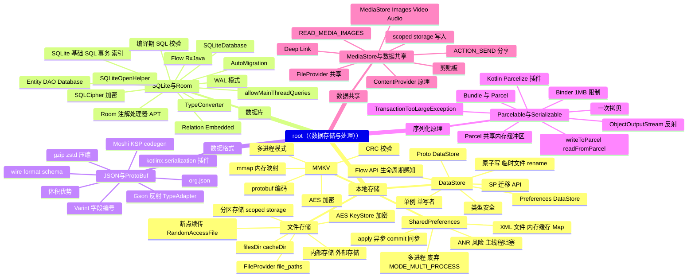

# 第 4 部分：数据存储与处理

## 概览

本部分解决一个核心问题：**App 的数据放在哪、怎么放、怎么取、怎么跨进程/跨应用共享**。Android 的数据存储体系是一套"从轻到重"的分层选型，选错层级往往比写错代码代价更大。

- **Key-Value 存储**：SharedPreferences（XML + 内存缓存，系统级实现，适合几十个 key 的配置项）→ MMKV（mmap + protobuf，微信开源，高并发读写、大 value 场景）→ DataStore（Jetpack 官方，类型安全 + 协程 Flow + 原子写，替代 SP 的首选）。
- **关系型数据库**：SQLite 是系统内置的 C 引擎，Android 封装了 `SQLiteOpenHelper` / `SQLiteDatabase`；Room 在其上做**编译期代码生成 + 编译期 SQL 校验**，把"运行时才炸的 SQL 错误"提前到编译期。
- **文件存储**：内部存储（私有，随应用卸载删除）vs 外部存储（公共，Android 10+ 分区存储受限），配套 `FileProvider` 通过 content URI 安全共享私有文件。
- **数据格式**：JSON（可读、通用、体积偏大）vs ProtoBuf（二进制、体积小、schema 驱动、跨端兼容靠字段编号）。
- **序列化原理**：`Serializable`（Java 原生、反射）vs `Parcelable`（Android、手写 write/read、走共享内存只拷贝一次），以及 `Bundle` / `Binder` 1MB 事务上限带来的 `TransactionTooLargeException`。
- **数据共享**：`ContentProvider`（对外暴露数据的标准四组件）+ `MediaStore`（系统级媒体库，Android 13+ 分区媒体权限）+ `FileProvider` + Intent 分享 + 剪贴板 + Deep Link。

> [!tip] 面试主线
> 中级 Android 岗在数据存储方向的高频考点集中在：**SP 的 apply/commit 区别与 ANR 风险**、**SP 多进程为什么不可靠**、**DataStore 为什么要求单例**、**Room 的注解处理器原理与编译期 SQL 校验**、**Room 迁移策略**、**Parcelable 底层原理与 Binder 1MB 限制**、**ProtoBuf 的 Varint 与 wire format**、**Android 10+ 分区存储下如何读写相册/媒体文件**、**FileProvider 的用法与绝对路径传文件的坑**。
> 高频追问链：
> **"你项目里的用户配置为什么用 DataStore 不用 SP？"** → DataStore 的原子写与类型安全 → **"DataStore 为什么只能有一个实例？"** → 单写者模型 → **"Room 的 @Query 写错了会怎样？"** → APT 编译期校验 → **"怎么给 Room 数据库加密？"** → SQLCipher / 自定义 SupportFactory → **"Parcelable 传大对象会怎样？"** → TransactionTooLargeException。

## 知识图谱（Mermaid）

## 子目录导航

| 子目录 | 说明 | 主要笔记 |
| --- | --- | --- |
| [[./本地存储/SharedPreferences\|本地存储]] | Key-Value 方案的演进与选型 | [[./本地存储/SharedPreferences]]、[[./本地存储/MMKV]]、[[./本地存储/DataStore]]、[[./本地存储/文件存储]] |
| [[./数据库/SQLite与Room\|数据库]] | 关系型存储与 ORM | [[./数据库/SQLite与Room]] |
| [[./数据格式/JSON与ProtoBuf\|数据格式]] | 传输与持久化的数据编码 | [[./数据格式/JSON与ProtoBuf]] |
| [[./序列化原理/Parcelable与Serializable\|序列化原理]] | 进程内对象传递的底层机制 | [[./序列化原理/Parcelable与Serializable]] |
| [[./数据共享/MediaStore与数据共享\|数据共享]] | 跨进程、跨应用的数据暴露 | [[./数据共享/MediaStore与数据共享]] |

## 笔记列表

### 本地存储

- [[本地存储/SharedPreferences]]
- [[本地存储/MMKV]]
- [[本地存储/DataStore]]
- [[本地存储/文件存储]]

### 数据库

- [[数据库/SQLite与Room]]

### 数据格式

- [[数据格式/JSON与ProtoBuf]]

### 序列化原理

- [[序列化原理/Parcelable与Serializable]]

### 数据共享

- [[数据共享/MediaStore与数据共享]]

## 关联部分

- 前置：[[../03-UI开发与用户交互/README]]（UI 层拿到的数据最终都落到本部分描述的存储层）
- 延伸：[[../06-系统原理与性能优化/README]]（存储分区机制、WAL、mmap 与 IO 性能优化的底层交叉）
- 延伸：[[../07-架构、工具与生态/README]]（DataStore/Room 如何在 MVVM + Hilt 架构中被注入与使用）
