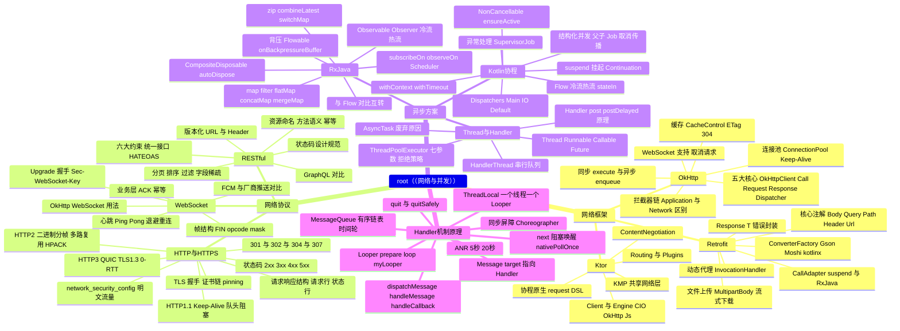

# 第 5 部分：网络与并发

## 概览

本部分解决两个问题：**数据怎么从服务端拿到**、**异步任务怎么不卡主线程**。

- **网络框架**：OkHttp（HTTP 引擎，负责连接/拦截器/缓存/WebSocket）→ Retrofit（声明式接口层，动态代理 + Converter + CallAdapter）→ Ktor（Kotlin 多平台，KMP 场景的一体化方案）。三者是**分层互补**关系，不是三选一。
- **网络协议**：HTTP 的报文结构与状态码 → HTTP/1.1 的 Keep-Alive 与队头阻塞 → HTTP/2 的多路复用与 HPACK → HTTP/3 的 QUIC；HTTPS 的 TLS 握手、证书链与 pinning；WebSocket 的 Upgrade 握手与心跳重连；RESTful 的六大约束与幂等设计。
- **异步方案**：Java 线程与线程池 → Handler/Looper 消息机制 → RxJava 的响应式流与背压 → Kotlin 协程的结构化并发与 Flow。**演进主线是"从手动管理生命周期"走向"由框架托管生命周期"**。
- **Handler 机制原理**：Looper / MessageQueue / Handler 三件套的底层实现，以及**同步屏障**这一面试高频难点。

> [!tip] 面试主线
> 中级 Android 岗高频考点集中在：**OkHttp 拦截器链顺序与缓存原理**、**Retrofit 动态代理与 suspend 实现**、**HTTPS 握手与证书 pinning 风险**、**HTTP/2 多路复用解决什么**、**WebSocket 握手与心跳重连**、**REST 无状态与幂等设计**、**线程池七个参数与执行流程**、**Handler 同步屏障原理**、**协程结构化并发与取消传播**、**Flowable vs Observable 与 zip/combineLatest 区别**。

## 知识图谱（Mermaid）

## 子目录导航

| 子目录 | 说明 | 主要笔记 |
| --- | --- | --- |
| **网络框架** | HTTP 客户端引擎层：连接池、拦截器、缓存 | [[./网络框架/OkHttp]]、[[./网络框架/Retrofit]]、[[./网络框架/Ktor]] |
| **网络协议** | HTTP/HTTPS、WebSocket、RESTful 的协议层 | [[./网络协议/HTTP与HTTPS]]、[[./网络协议/WebSocket]]、[[./网络协议/RESTful]] |
| **异步方案** | 线程、RxJava、协程三种异步模型 | [[./异步方案/Thread与Handler]]、[[./异步方案/RxJava]]、[[./异步方案/Kotlin协程]] |

> 根目录笔记：[[./Handler机制原理]] —— Looper / MessageQueue / Handler 的底层实现与同步屏障。

## 笔记列表

### 网络框架

- [[网络框架/OkHttp]]
- [[网络框架/Retrofit]]
- [[网络框架/Ktor]]

### 网络协议

- [[网络协议/HTTP与HTTPS]]
- [[网络协议/WebSocket]]
- [[网络协议/RESTful]]

### 异步方案

- [[异步方案/Thread与Handler]]
- [[异步方案/RxJava]]
- [[异步方案/Kotlin协程]]

### 根目录

- [[Handler机制原理]]

## 关联部分

- 前置：[[../01-编程语言与基础/README]]（Kotlin 协程、集合、泛型的语言基础）
- 前置：[[../03-UI开发与用户交互/README]]（主线程绘制与事件分发，理解 Handler 的必要性）
- 前置：[[../04-数据存储与处理/README]]（本地缓存与网络缓存的配合）
- 延伸：[[../06-系统原理与性能优化/README]]（渲染机制与 Choreographer 同步屏障、ANR 归因、内存与启动优化）
- 延伸：[[../07-架构、工具与生态/README]]（MVVM + Repository + Hilt 如何组织网络层）
- 延伸：[[../08-企业级工程与运维/README]]（线上抓包、日志监控、APM 与网络质量治理）
- 延伸：[[../09-跨平台与混合开发/README]]（KMP 与 Flutter 混合栈中的网络层统一）
