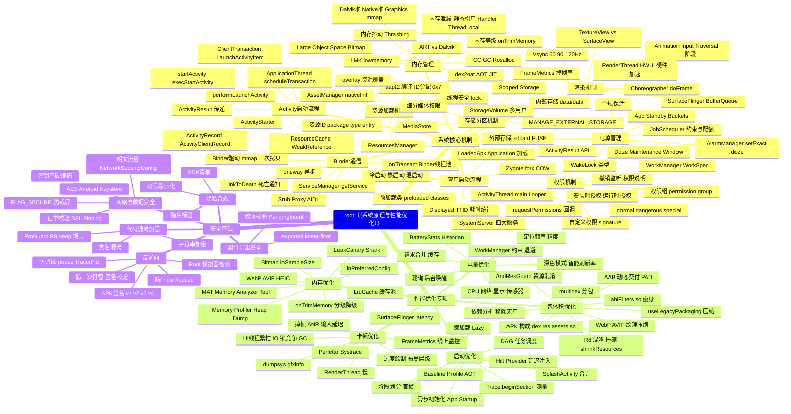

# 第 6 部分：系统原理与性能优化

## 概览

本部分回答两个问题：**Android 系统内部到底是怎么跑的**，以及**怎么把这些运行代价压下去**。

它是整个知识图谱里面试权重最高的一部分。原因是这一层的能力最能区分"会用 API 的工程师"和"理解系统的工程师"：同样写一个 `startActivity()`，只会用的人只知道"页面跳过去了"，理解的人知道**系统侧发生了什么、客户端发生了什么、跨进程通信的代价在哪一毫秒**。

三个板块：

- **系统核心机制**：把 Android 的"分布式操作系统 + 组件化 + 沙箱"设计拆开看。
  - **进程模型**：Zygote 用 `fork` + COW 预热进程，SystemServer 承载四大服务，AMS 负责"我要启动一个 Activity"。
  - **IPC**：Binder 用 `mmap` 实现"一次拷贝"，ServiceManager 做服务路由，Binder 线程池让服务端天然支持并发。
  - **资源与内存**：Resources/AssetManager 如何从 APK 里取数据，ART 的 CC GC 如何工作，什么是内存抖动与内存泄漏。
  - **渲染**：Vsync → Choreographer → RenderThread → SurfaceFlinger 的完整管线，掉帧是怎么产生的。
  - **系统约束**：权限、Doze 省电、分区存储——这三条是"应用不能做什么"的边界。
- **性能优化专项**：把机制知识转成可落地的工程手段，聚焦 **内存、卡顿、启动、包体积、电量** 五个高价值指标。
- **安全基础**：四大组件导出、混淆加固、防逆向、密钥管理、网络与本地数据安全。

> [!tip] 面试主线
> 第 6 部分是**高级 Android 岗的必考区**，也是最容易拉开差距的部分。优先级最高的 8 个问题：
> 1. **冷启动流程**：从点击图标到首帧，完整说出 ActivityThread / AMS / ZygoteProcess / LoadedApk 的协作链，以及 Zygote 为什么用 `fork` 而不是 `exec`。——**必问**。
> 2. **启动优化**：异步初始化、懒加载、DAG 任务调度、Baseline Profile 原理，能给出量化收益。——**必问**。
> 3. **内存泄漏**：能说出至少 5 种成因，能说清 LeakCanary 的引用链分析原理与 Memory Profiler 的排查路径。——**必问**。
> 4. **掉帧与卡顿**：Choreographer 三阶段、`dumpsys gfxinfo`、FrameMetrics、Systrace/Perfetto，能现场讲一次线上掉帧的定位流程。——**必问**。
> 5. **Binder**：一次拷贝 vs Socket 两次拷贝、Binder 线程池并发模型、`linkToDeath` 死亡通知。——**高频**。
> 6. **渲染机制**：Vsync 频率差异、RenderThread 与 UI 线程分离、TextureView vs SurfaceView。——**高频**。
> 7. **Doze / 后台限制**：进入条件、Job/Alarm 被推迟、WorkManager 与 JobScheduler 的关系、合规保活做法。——**高频**。
> 8. **包体积优化**：R8 原理、so 库瘦身、AAB 动态交付、资源压缩。——**中频但易答错**。
>
> 加分项：能说清 **ART 的 Concurrent Copying GC 与 Dalvik 的 mark-sweep 差异**、**ART 与 AOT/JIT 的 dex2oat 流程**、**Scoped Storage 下 targetSdk 30 前后的行为差异**、**`Displayed` 日志与 TTID 的计算口径**。

## 知识图谱（Mermaid）

## 子目录导航

| 子目录 | 说明 | 主要笔记 |
| --- | --- | --- |
| [[./系统核心机制/应用启动流程\|系统核心机制]] | 进程模型、Zygote、SystemServer 与完整启动链路 | [[./系统核心机制/应用启动流程]]、[[./系统核心机制/Activity启动流程]]、[[./系统核心机制/Binder通信]]、[[./系统核心机制/资源加载机制]]、[[./系统核心机制/内存管理]]、[[./系统核心机制/渲染机制]]、[[./系统核心机制/权限机制]]、[[./系统核心机制/电源管理]]、[[./系统核心机制/存储分区机制]] |
| [[./性能优化专项/内存优化\|性能优化专项]] | 内存 / 卡顿 / 启动 / 包体积 / 电量五大指标 | [[./性能优化专项/内存优化]]、[[./性能优化专项/卡顿优化]]、[[./性能优化专项/启动优化]]、[[./性能优化专项/包体积优化]]、[[./性能优化专项/电量优化]] |
| [[./安全基础\|安全基础]] | 组件导出、混淆加固、反逆向、密钥与隐私 | [[./安全基础]] |

## 笔记列表

### 系统核心机制

- [[系统核心机制/应用启动流程]]
- [[系统核心机制/Activity启动流程]]
- [[系统核心机制/Binder通信]]
- [[系统核心机制/资源加载机制]]
- [[系统核心机制/内存管理]]
- [[系统核心机制/渲染机制]]
- [[系统核心机制/权限机制]]
- [[系统核心机制/电源管理]]
- [[系统核心机制/存储分区机制]]

### 性能优化专项

- [[性能优化专项/内存优化]]
- [[性能优化专项/卡顿优化]]
- [[性能优化专项/启动优化]]
- [[性能优化专项/包体积优化]]
- [[性能优化专项/电量优化]]

### 安全基础

- [[安全基础]]

## 关联部分

- 前置：[[../03-UI开发与用户交互/README]]（measure/layout/draw 与 Choreographer 是渲染机制的入口）
- 前置：[[../02-Android核心组件/README]]（四大组件的生命周期与跨进程边界）
- 前置：[[../05-网络与并发/README]]（Handler / Looper / MessageQueue 是启动与渲染链路的地基）
- 延伸：[[../07-架构、工具与生态/README]]（架构模式与 Hilt 的作用域是启动优化的落地面）
- 延伸：[[../08-企业级工程与运维/README]]（线上监控、崩溃与性能采集体系是优化的闭环）
