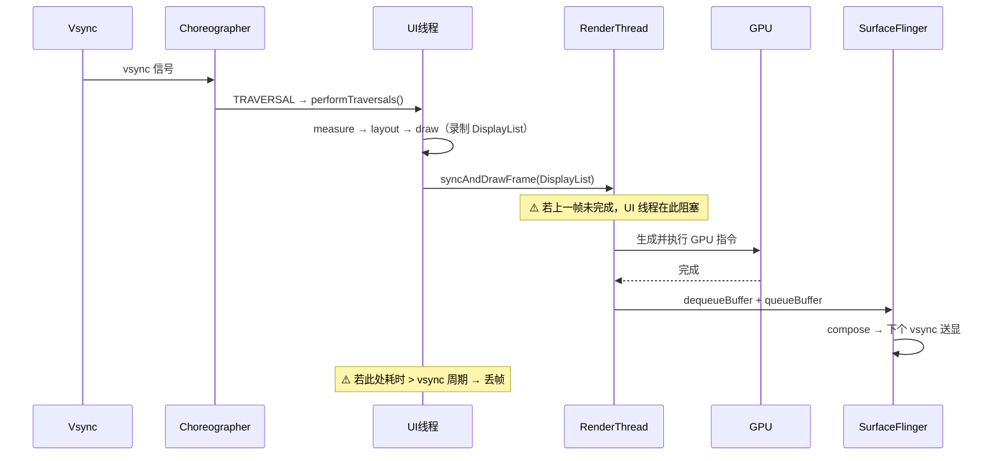

# 卡顿优化

## 一句话定义

卡顿的本质是**"一帧的工作没有在下一个 vsync 到来之前完成"**。定位卡顿必须先分清三种形态——**掉帧（jank）、ANR、输入延迟**——然后沿着 **UI 线程 → RenderThread → GPU** 这条链路，用 **`dumpsys gfxinfo` 看统计 → `framestats` 定位阶段 → Perfetto/Systrace 定位到方法** 三级递进的方法论找到根因。

## 核心原理

### 1. 卡顿的三种形态（**必须先分清**）

| 形态 | 定义 | 用户感知 | 判定标准 | 排查入口 |
| --- | --- | --- | --- | --- |
| **掉帧（Jank）** | 某一帧未在 vsync 周期内完成 | 画面"顿一下"、动画不连贯 | 帧耗时 > vsync 周期（60Hz 为 16.67ms） | `dumpsys gfxinfo` |
| **ANR** | 主线程长时间无响应 | 弹窗"应用无响应"、点击无反应 | **输入 5s / 服务 20s**（详见下文） | `traces.txt` / ANR 报告 |
| **输入延迟** | 事件从产生到被处理的时间长 | 点击"粘"、"跟手性差" | 输入事件的 `dispatch` 到 `handle` 延迟 | Perfetto 的 `Input` slice |

```text
【三者的关系】
  掉帧  = 视觉上的一帧没赶上
  ANR   = 掉帧的极端形态（主线程卡住超过 5s）
  输入延迟 = 事件排队时间（可能帧率正常但点击响应慢）

  ⚠️ 帧率正常 ≠ 体验正常
     主线程每帧 8ms（一帧没掉），但输入事件排在 20 个消息后面
     → 用户依然觉得"点击没反应"
```

### 2. 卡顿的三大来源（**核心归因框架**）

```text
┌──────────────────────────────────────────────────────────────┐
│ ① UI 线程繁忙（最常见）                                       │
│    · 主线程 IO（磁盘 / 网络）                                 │
│    · 复杂计算（大量对象分配、JSON 解析、加密、大量排序）         │
│    · 锁竞争（synchronized / ReentrantLock 阻塞）               │
│    · 布局层级过深、过度绘制（View 数量多）                      │
│    · 布局 inflation（大量 View 创建）                          │
├──────────────────────────────────────────────────────────────┤
│ ② GC 停顿                                                    │
│    · 分配速率过高 → GC 频繁 → STW                             │
│    · 内存抖动（GC 频繁但回收量小）                              │
│    · 大对象（LOS）频繁分配                                     │
├──────────────────────────────────────────────────────────────┤
│ ③ RenderThread / GPU 过载                                     │
│    · UI 线程不忙，但 syncAndDrawFrame 阻塞（RenderThread 慢）    │
│    · 过度绘制（overdraw）→ GPU fill rate 打满                   │
│    · 复杂 Shader / 自定义绘制                                   │
│    · 大量 Bitmap 上传纹理                                       │
│    · 大列表滚动时每帧创建新纹理                                   │
└──────────────────────────────────────────────────────────────┘
```



### 3. 定位工具链（**三级递进，必须掌握**）

#### 3.1 第一级：`dumpsys gfxinfo`（**看统计，判断严重程度**）

```bash
# 查看整体统计
adb shell dumpsys gfxinfo <package.name>

# 查看逐帧数据（framestats）
adb shell dumpsys gfxinfo <package.name> framestats

# 重置计数（每次测量前先 reset）
adb shell dumpsys gfxinfo <package.name> reset
```

**输出解读（关键字段）**：

```text
Total frames rendered: 1523
Janky frames: 87 (5.71%)
50th percentile: 8ms
90th percentile: 14ms
95th percentile: 23ms
99th percentile: 61ms
Number Missed Vsync: 12
Number High input latency: 0
Number Slow UI thread: 45
Number Slow bitmap uploads: 8
Number Slow issue draw commands: 31
Number Frame deadline missed: 87
HISTOGRAM: 5ms=100 6ms=200 7ms=300 ...
```

| 字段 | 含义 | 归因 |
| --- | --- | --- |
| **Janky frames** | 超过 deadline 的帧数与占比 | 总体健康度 |
| **percentile** | 各分位耗时 | **P95/P99 才是体验**（均值会被大量快帧拉低） |
| **Number Missed Vsync** | 漏掉 vsync 的次数 | 主线程或 RenderThread 超时 |
| **Number Slow UI thread** | 主线程慢的帧数 | **主线程问题**（IO / 计算 / 布局） |
| **Number Slow bitmap uploads** | Bitmap 上传纹理慢的帧数 | **图片加载问题**（大图、频繁解码） |
| **Number Slow issue draw commands** | GPU 提交命令慢的帧数 | **渲染复杂度问题**（overdraw、复杂绘制） |
| **HISTOGRAM** | 帧耗时分布直方图 | 看是"普遍慢"还是"偶尔爆" |

> [!tip] **关键判读**
> - **普遍慢（P50 就高）** → 结构性瓶颈（布局过深、每帧都做重活）；
> - **偶尔爆（P99 极高但 P50 低）** → 单次突发（GC、大图解码、首次加载）。

#### 3.2 第二级：`framestats`（**定位到阶段**）

`framestats` 输出 CSV，每行是一帧，列的含义（节选）：

```text
Flags,IntendedVsync,Vsync,OldestInputEvent,NewestInputEvent,
HandleInputStart,AnimationStart,PerformTraversalsStart,DrawStart,
FrameDeadline,FrameStartTime,FrameInterval,
SyncQueued,SyncStart,IssueDrawCommandsStart,SwapBuffers,
FrameCompleted,DequeueBufferStart,QueueBufferStart,GpuCompleted

Flags 含义：
  0  = 正常
  1  = 输入事件到达太晚（不是应用的问题）
  2  = 掉帧（deadline missed）
  4  = 超过 deadline 但在一个 vsync 内（轻微）
  8  = 超过 deadline 且超过一个 vsync（严重）
```

```bash
# 提取每帧耗时并排序，找出最慢的帧
adb shell dumpsys gfxinfo com.demo framestats > framestats.txt

# python 脚本处理思路：
#   duration = FrameCompleted - IntendedVsync
#   输入阶段 = HandleInputStart - IntendedVsync
#   布局绘制 = DrawStart - PerformTraversalsStart
#   同步等待 = SyncStart - SyncQueued     ← 这个大 = RenderThread 慢
#   GPU      = GpuCompleted - SwapBuffers
```

```text
【按阶段归因】
  HandleInputStart - IntendedVsync  大 → 输入事件积压（主线程有长任务）
  PerformTraversalsStart - AnimationStart 大 → 主线程在 ANIMATION 阶段耗时
  DrawStart - PerformTraversalsStart  大 → measure/layout/draw 耗时（布局复杂 / 过度绘制）
  SyncStart - SyncQueued             大 → RenderThread 没准备好（渲染慢）
  IssueDrawCommandsStart - SyncStart  大 → GPU 命令提交慢
  GpuCompleted - SwapBuffers         大 → GPU 执行慢（填充率 / shader）
```

#### 3.3 第三级：Perfetto / Systrace（**定位到方法**）

```text
【工具对比】
  Systrace  : AOSP 自带（已废弃，被 Perfetto 取代），Python 脚本分析
  Perfetto  : Google 的新一代 tracing 平台（perfetto.dev），GUI + SQL
  采集方式  : adb shell perfetto / 图形界面 / Android Studio Profiler

【在 Android Studio 里】
  View > Tool Windows > Profilers > + New Profiler > System Trace
  勾选：Choreographer / FrameTimeline / CPU Scheduling / GPU / Disk / Network

【在 Perfetto UI 里】
  1. 打开 perfetto.dev → "Open a trace"
  2. 加载 .pftrace 文件
  3. 用 SQL 查询：
     SELECT s.name, s.dur FROM slice s
     WHERE s.name LIKE 'doFrame%' ORDER BY s.dur DESC LIMIT 20;
  4. 或者直接用 Timeline 看主线程 Slice 的"火焰图"
```

```bash
# 命令行采集 Perfetto trace
adb shell perfetto -o /data/misc/perfetto-traces/trace -t 10s \
  sched freq idle am wm gfx view binder_driver

# 或使用配置文件的现代写法
adb shell perfetto -o /data/misc/perfetto-traces/trace -t 10s \
  -c /sdcard/perfetto_config.pbtxt
```

#### 3.4 `SurfaceFlinger --latency`（**看真实上屏时间**）

```bash
# 查看某个窗口的每帧时间戳（需要窗口名，通常是 "SurfaceView\x00包名/Activity"）
adb shell dumpsys SurfaceFlinger --latency "com.demo/com.demo.MainActivity"

# 输出三行：
#   1) 刷新周期（ns），如 16666666
#   2) 每一帧的 desiredPresentTime
#   3) 每一帧的 actualPresentTime
# 通过相邻 actualPresentTime 的差值可以算出真实掉帧点
```

**原理**：它给的是**实际送显时间**，而不是"UI 线程画完的时间"。当 **actualPresentTime 与下一个 desiredPresentTime 的差值 > 刷新周期**时，就是**真实的丢帧**（这排除了"画完了但 compositor 慢"和"vsync 抖动"的干扰）。

### 4. `FrameMetrics`：线上掉帧监控（**工程闭环**）

```kotlin
/**
 * ✅ 线上掉帧率采集：基于 FrameMetrics，区分「卡顿帧」与「用户可感知卡顿」
 */
class JankMonitor {

    data class FrameStat(
        val total: Int,
        val jank: Int,
        val highInputLatency: Int,
        val slowDraw: Int,
        val slowUiThread: Int,
        val slowBitmapUpload: Int,
        val p95: Long
    )

    private var total = 0
    private var jank = 0
    private var highInputLatency = 0
    private var slowDraw = 0
    private var slowUiThread = 0
    private var slowBitmapUpload = 0
    private val durations = ArrayDeque<Long>(256)

    /**
     * @param jankThresholdNs 卡顿阈值。60Hz 用 16.67ms；120Hz 应用 8.33ms
     */
    fun onFrame(
        metrics: FrameMetrics,
        jankThresholdNs: Long = 16_670_000L
    ) {
        total++
        val duration = metrics.getMetric(FrameMetrics.TOTAL_DURATION)
        durations.addLast(duration)
        if (durations.size > 256) durations.removeFirst()

        if (duration > jankThresholdNs) jank++
        if (metrics.getMetric(FrameMetrics.INPUT_HANDLING_DURATION) > jankThresholdNs) highInputLatency++
        if (metrics.getMetric(FrameMetrics.LAYOUT_DURATION) > jankThresholdNs) slowDraw++
        if (metrics.getMetric(FrameMetrics.SYNC_DURATION) > jankThresholdNs) slowUiThread++
        if (metrics.getMetric(FrameMetrics.COMMAND_ISSUE_DURATION) > jankThresholdNs) slowBitmapUpload++
    }

    /** 每 60 帧上报一次 */
    fun reportIfNeeded(screen: String): FrameStat? {
        if (total % 60 != 0) return null
        val sorted = durations.sorted()
        val p95 = sorted.getOrElse((sorted.size * 0.95).toInt()) { 0L }
        val stat = FrameStat(
            total = total, jank = jank,
            highInputLatency = highInputLatency,
            slowDraw = slowDraw,
            slowUiThread = slowUiThread,
            slowBitmapUpload = slowBitmapUpload,
            p95 = p95
        )
        APM.report(
            screen = screen,
            jankRate = jank.toDouble() / total,
            p95FrameMs = p95 / 1_000_000.0,
            slowDraw = slowDraw,
            slowSync = slowUiThread,
            slowGpu = slowBitmapUpload
        )
        return stat
    }
}
```

```kotlin
/**
 * ✅ 在 Activity 中挂载监听（API 24+）
 */
class BaseActivity : AppCompatActivity() {

    private val jankMonitor = JankMonitor()

    override fun onCreate(savedInstanceState: Bundle?) {
        super.onCreate(savedInstanceState)
        window.addOnFrameMetricsAvailableListener(
            { _, metrics, _ ->
                jankMonitor.onFrame(metrics)
                jankMonitor.reportIfNeeded(javaClass.simpleName)
            },
            Handler(Looper.getMainLooper())
        )
    }
}
```

### 5. 优化手段（**分类治理**）

#### 5.1 主线程 IO 治理

```kotlin
/**
 * ✅ 主线程 IO 的几种解法
 */
class MainThreadIOGovernor {

    /**
     * ① 用协程切到 IO 线程（最常用）
     */
    suspend fun loadData(): Data = withContext(Dispatchers.IO) {
        val raw = file.readText()             // IO 线程
        JSON.parse(raw)                        // 复杂解析也放 IO（解析很吃 CPU）
    }

    /**
     * ② 预加载：在首屏之前的空闲时间提前读
     *    用 Choreographer 的 postFrameCallback 在首帧后立刻读
     */
    fun prefetch() {
        Choreographer.getInstance().postFrameCallback {
            // 首帧已渲染，用户看不到阻塞
            GlobalScope.launch(Dispatchers.IO) { preloadDiskCache() }
        }
    }

    /**
     * ③ 用 StrictMode 在开发期强制暴露
     */
    fun enableStrictModeForDebug() {
        StrictMode.setThreadPolicy(
            StrictMode.ThreadPolicy.Builder()
                .detectDiskReads().detectDiskWrites().detectNetwork()
                .penaltyLog().penaltyDeath()
                .build()
        )
    }
}
```

#### 5.2 布局层级优化

```text
【布局层级的成本】
  一个 View = 1 个 Java 对象 + 1 个 RenderNode
  measure/layout 是递归的，层级越深递归越深
  层级每多一层：
    · measure：多一次递归调用 + 属性解析
    · layout：多一次 setFrame
    · draw：多一个 RenderNode + 可能的 overdraw

【优化手段】
  ① 用 ConstraintLayout 扁平化层级（替代嵌套 LinearLayout/FrameLayout）
  ② 用 <merge> 减少层级（但需要手动 inflate 时的 parent）
  ③ 用 ViewStub 延迟加载不常显示的视图
  ④ 减少不必要的背景（每个背景都是一层 overdraw）
  ⑤ 自定义 View 合并多个子 View 的绘制
  ⑥ RecyclerView 的 Item 用 ConstraintLayout / 单层布局
  ⑦ <include> + <merge> 复用布局
```

```xml
<!-- ❌ 嵌套布局：3 层 -->
<LinearLayout orientation="vertical">
    <LinearLayout orientation="horizontal">
        <ImageView/>
        <LinearLayout orientation="vertical">
            <TextView/>
            <TextView/>
        </LinearLayout>
    </LinearLayout>
</LinearLayout>

<!-- ✅ 扁平化：1 层 ConstraintLayout -->
<androidx.constraintlayout.widget.ConstraintLayout>
    <ImageView android:id="@+id/icon" .../>
    <TextView android:id="@+id/title"
        app:layout_constraintStart_toEndOf="@id/icon"
        app:layout_constraintTop_toTopOf="parent" .../>
    <TextView android:id="@+id/subtitle"
        app:layout_constraintStart_toStartOf="@id/title"
        app:layout_constraintTop_toBottomOf="@id/title" .../>
</androidx.constraintlayout.widget.ConstraintLayout>
```

#### 5.3 过度绘制（Overdraw）

```text
【什么是过度绘制】
  同一个像素被绘制了多次。
  典型：
    · 窗口有背景色 + 布局有背景色 + 每个 item 有背景色
    · 半透明 View 叠加（阴影、渐变遮罩）
    · 列表项背景色与列表容器背景色相同

【怎么发现】
  · Android Studio → Layout Inspector → "Show Layout Bounds"
  · 开启 GPU 调试："Debug GPU overdraw"（开发者选项）
    → 红色 = 绘制 4 次以上
    → 黄色 = 2~3 次
    → 绿色 = 1 次（理想）
  · adb shell setprop debug.hwui.overdraw show

【优化】
  ① 去掉容器与子 View 重复的背景（只保留最上层的）
  ② 用 windowBackground 覆盖启动页
  ③ 阴影用 elevation 而不是额外的半透明层
  ④ 减少半透明叠加
  ⑤ Compose 中用 Modifier.background 的顺序优化
```

```text
【过度绘制对性能的影响】
  GPU 的填充率（fill rate）是有限资源。
  overdraw = 4 意味着 GPU 要为每个像素着色 4 次
  → 在中低端机上直接导致 GPU 满载 → 掉帧
  → RenderThread 的 "Slow issue draw commands" 会明显升高
```

#### 5.4 列表卡顿专项优化（**高频场景**）

```kotlin
/**
 * ✅ RecyclerView 卡顿优化的完整清单
 */
class OptimizedAdapter : RecyclerView.Adapter<Holder>() {

    override fun onCreateViewHolder(parent: ViewGroup, viewType: Int): Holder {
        // ⚠️ 用 inflate 而不是 findViewById；ViewHolder 复用
        val view = LayoutInflater.from(parent.context)
            .inflate(R.layout.item_demo, parent, false)
        return Holder(view)
    }

    override fun onBindViewHolder(holder: Holder, position: Int) {
        val item = data[position]

        // ① 文本：复用 SpannableStringBuilder，避免每次 new SpannableString
        holder.title.text = item.title

        // ② 图片：用 Glide/Coil，它们内部有内存池 + 生命周期感知 + 自动降采样
        Glide.with(holder.itemView)
            .load(item.imageUrl)
            .override(ITEM_W, ITEM_H)                 // ⚠️ 必须指定尺寸，否则解码原图
            .placeholder(R.drawable.placeholder)
            .dontAnimate()                            // ⚠️ 去掉淡入动画，避免无谓的 invalidate
            .diskCacheStrategy(DiskCacheStrategy.AUTOMATIC)
            .into(holder.image)

        // ③ 避免在 onBind 里做重活（JSON 解析、格式化、复杂计算）
        //    提前在数据层算好
        holder.subtitle.text = item.formattedSubtitle
    }

    override fun onViewRecycled(holder: Holder) {
        super.onViewRecycled(holder)
        // ④ 回收时清理：取消图片请求、停止动画
        Glide.with(holder.itemView).clear(holder.image)
        holder.itemView.clearAnimation()
    }
}
```

```kotlin
/**
 * ✅ DiffUtil：避免全量 notifyDataSetChanged
 */
class SmartDiffCallback(
    private val oldList: List<Item>,
    private val newList: List<Item>
) : DiffUtil.Callback() {

    override fun getOldListSize() = oldList.size
    override fun getNewListSize() = newList.size

    override fun areItemsTheSame(oldPos: Int, newPos: Int) =
        oldList[oldPos].id == newList[newPos].id

    override fun areContentsTheSame(oldPos: Int, newPos: Int) =
        oldList[oldPos] == newList[newPos]
}

// 使用
DiffUtil.calculateDiff(SmartDiffCallback(oldList, newList)).dispatchUpdatesTo(adapter)
```

```text
【列表卡顿的其它要点】
  ① setHasFixedSize(true)          → 尺寸固定时跳过 measure
  ② setItemViewCacheSize(...)      → 增大缓存，减少 create
  ③ RecycledViewPool              → 多个 RecyclerView 共享复用池
  ④ 固定图片尺寸（layout_width/height 或 ConstraintLayout dimensionRatio）
     → 避免图片加载后 requestLayout 触发重新布局
  ⑤ 避免在 onBind 里 setAdapterData
  ⑥ 大量数据用 Paging（按需加载）
  ⑦ 复杂 item 用 Compose 或自定义 View 减少 View 数量
```

#### 5.5 异步化与预取

```kotlin
/**
 * ✅ 预取：提前为下一次可能的滚动加载数据
 */
class ImagePrefetcher(
    private val recyclerView: RecyclerView,
    private val layoutManager: RecyclerView.LayoutManager
) {
    /**
     * 在列表空闲时预加载可见区域之外的图
     */
    fun prefetch() {
        recyclerView.addOnScrollListener(object : RecyclerView.OnScrollListener() {
            override fun onScrollStateChanged(rv: RecyclerView, newState: Int) {
                if (newState == RecyclerView.SCROLL_STATE_IDLE) {
                    // 空闲时才预取，避免与滚动抢 CPU
                    val first = layoutManager.findFirstVisibleItemPosition()
                    val last = layoutManager.findLastVisibleItemPosition()
                    for (i in first..last) {
                        val item = adapter.getItem(i + PREFETCH_COUNT)
                        ImageLoader.preload(item.imageUrl, ITEM_SIZE)
                    }
                }
            }
        })
    }
}
```

#### 5.6 复用（View 层面）

```text
【三种复用层级】
  ① RecyclerView 的 ViewHolder 复用（默认开启）
  ② Compose 的重组跳过（@Stable / @Immutable 参数 + 稳定 lambda）
  ③ 自定义 View 的绘制结果缓存
     · 把复杂的静态内容缓存到 Bitmap，再直接 drawBitmap
     · 典型：带文字阴影的卡片、复杂头像叠加

【Compose 侧的复用】
  · @Stable / @Immutable 标注 → 编译器知道参数不变时可跳过重组
  · 派生状态用 derivedStateOf，避免无关 state 变化引发重组
  · LazyColumn 的 key 要稳定（用 id 而不是 index）
  · 避免在 Composable 里直接 new 列表（每次重组都 new → 触发重组）
```

### 6. ANR 原理（**必考**）

#### 6.1 触发条件

```text
【ANR 的四种类型与阈值】

  ① Input dispatching timed out（输入事件超时）
     阈值：5 秒
     场景：主线程正在处理事件时又来一个输入事件，且 5s 内未处理完
     最常见！

  ② BroadcastReceiver timeout
     阈值：前台 10 秒 / 后台 60 秒
     场景：onReceive 里做了耗时操作

  ③ Service timeout
     阈值：前台 20 秒 / 后台 200 秒（Service 启动超时另有 20s 规则）
     场景：Service 的 onStartCommand / onBind 卡住

  ④ PendingIntent 发送超时
     阈值：10 秒

【关键：谁在计时】
  是 system_server 里的 AMS（ActivityManagerService）计时，
  不是应用自己。AMS 通过 ApplicationThread（Binder 回调）等待应用
  处理完对应的事务，超时就记 ANR。
```

#### 6.2 ANR 的处理链路

```text
  用户点击 → InputDispatcher 分发到应用
      │
      ▼
  应用主线程正在执行耗时任务（Looper 消息堆积）
      │
      ▼
  InputDispatcher 发现 5s 内没收到应用的处理完成确认
      │
      ▼
  通知 AMS → AMS 记录 ANR
      │
      ├─ ① 弹 "应用无响应" 对话框（用户可选"等待"或"关闭应用"）
      ├─ ② 抓取 traces（/data/anr/traces.txt），dump 应用主线程堆栈
      ├─ ③ 打日志 "ANR in <package> (<component>)"
      └─ ④ （有权限时）dump 到 dropbox
```

#### 6.3 ANR 报告怎么分析

```text
【ANR traces 文件的关键部分】
  1) 主线程（"main"）的堆栈 —— ★ 最重要
     找到阻塞点：
       · "main" 处于 BLOCKED（锁等待）→ 看持有锁的线程
       · "main" 处于 RUNNABLE 但栈里有 IO → 主线程 IO
       · "main" 在某个方法里死循环 → 死循环

  2) ANR 原因行
     "Reason: Input dispatching timed out"
     → 说明是输入超时（主线程在处理其它消息）

  3) "held by thread N" 的锁信息
     → 谁持有了主线程在等的锁

  4) CPU 占用最高的几个线程
     → 可能是 GC 线程在跑（内存问题），
        也可能是某个死循环线程（业务问题）

【抓取方式】
  adb shell ls -l /data/anr/
  adb shell cat /data/anr/anr_2024-01-01-00-00-00-000
  adb bugreport /data/bugreport.zip   → 包含 ANR traces + logcat + dumpsys
```

```kotlin
/**
 * ✅ 用 ApplicationExitInfo（API 30+）在下次启动时读取上次的 ANR 原因
 */
class AnrReporter(private val context: Context) {

    fun reportPreviousAnr() {
        val am = context.getSystemService(ApplicationManager::class.java)
        val reasons = am.getHistoricalProcessExitReasons(context.packageName, 0, 10)
        for (info in reasons) {
            when (info.reason) {
                ApplicationExitInfo.REASON_ANR -> {
                    val trace = info.traceInputStream
                    // 解析 trace，提取主线程堆栈
                    APM.report(
                        "anr",
                        "timestamp=${info.timestamp}",
                        "description=${info.description}",
                        "importance=${info.importance}"
                    )
                }
                ApplicationExitInfo.REASON_CRASH -> { /* 崩溃 */ }
                ApplicationExitInfo.REASON_LOW_MEMORY -> { /* 内存不足被杀 */ }
            }
        }
    }
}
```

#### 6.4 避免 ANR 的实践

```text
  ① 主线程绝不做 IO / 网络 / 大计算（StrictMode 强制）
  ② 广播的 onReceive 里只做轻量分发，耗时工作交给 goAsync() + 后台
  ③ Service 的 onStartCommand 不要阻塞
  ④ 耗时操作拆分成小片段，用 Handler 分批处理（避免长任务）
  ⑤ 锁粒度要小，避免持锁期间做 IO
  ⑥ 用 Choreographer 感知卡顿并上报：
     doFrame 的实际开始时间 - 预期时间 > 阈值 → 卡顿
```

```kotlin
/**
 * ✅ Choreographer 卡顿自监控（不依赖 FrameMetrics，API 9+ 都能用）
 */
class ChoreographerJankWatcher : Choreographer.FrameCallback {

    private var lastFrameTime = 0L
    private var thresholdNs = 16_670_000L   // 60Hz

    override fun doFrame(frameTimeNanos: Long) {
        if (lastFrameTime != 0L) {
            val delta = frameTimeNanos - lastFrameTime
            if (delta > thresholdNs * 2) {
                // 连续丢了两帧
                APM.report("jank", "deltaMs=${delta / 1_000_000}")
            }
        }
        lastFrameTime = frameTimeNanos
        Choreographer.getInstance().postFrameCallback(this)
    }

    fun start() = Choreographer.getInstance().postFrameCallback(this)
    fun stop() = Choreographer.getInstance().removeFrameCallback(this)
}
```

## 代码示例

### 1. 卡顿自监控 SDK（完整版）

```kotlin
/**
 * ✅ 完整卡顿监控：Choreographer 感知 + 主线程堆栈抓取 + 上报
 */
object BlockCanary {

    private const val THRESHOLD_NS = 16_670_000L      // 60Hz 一个 vsync
    private const val MAX_LOOP = 5                    // 连续丢帧次数阈值

    private var lastFrameTimeNanos = 0L
    private var loopCount = 0
    private var running = false

    private val frameCallback = Choreographer.FrameCallback { frameTimeNanos ->
        if (lastFrameTimeNanos != 0L) {
            val delta = frameTimeNanos - lastFrameTimeNanos
            // delta 明显大于一个 vsync → 说明这一帧被延迟了
            if (delta > THRESHOLD_NS * 2) {
                loopCount++
                if (loopCount >= MAX_LOOP) {
                    loopCount = 0
                    reportStuck(frameTimeNanos)
                }
            } else {
                loopCount = 0
            }
        }
        lastFrameTimeNanos = frameTimeNanos
        Choreographer.getInstance().postFrameCallback(frameCallback)
    }

    fun start() {
        if (running) return
        running = true
        lastFrameTimeNanos = 0L
        Choreographer.getInstance().postFrameCallback(frameCallback)
    }

    fun stop() {
        running = false
        Choreographer.getInstance().removeFrameCallback(frameCallback)
    }

    /**
     * ✅ 抓取主线程堆栈：定位真正阻塞的位置
     */
    private fun reportStuck(frameTimeNanos: Long) {
        val mainThread = Looper.getMainLooper().thread
        val stack = mainThread.stackTrace
        val topFrames = stack.take(20).joinToString("\n") { "    at $it" }

        // 找到最近的用户代码帧（跳过框架帧）
        val userFrame = stack.firstOrNull {
            it.className.startsWith("com.myapp") && !it.className.contains("android.")
        }

        APM.report(
            event = "block_canary",
            costMs = THRESHOLD_NS * MAX_LOOP / 1_000_000,
            thread = mainThread.name,
            keyFrame = userFrame?.toString() ?: "unknown",
            stack = topFrames
        )
    }
}
```

### 2. Perfetto/Systrace 采集脚本

```bash
#!/usr/bin/env bash
# 采集 15 秒的系统 trace，聚焦帧相关的事件

adb shell perfetto -o /data/misc/perfetto-traces/trace.pftrace -t 15s \
  sched freq idle am wm gfx view binder_driver dalvik disk

# 拉取到本地
adb pull /data/misc/perfetto-traces/trace.pftrace ./trace.pftrace

# 在 perfetto.dev 打开，或用 ui.open("https://perfetto.dev/") 预览
```

```text
【Perfetto UI 的分析路径】
  1. 打开 trace → 左侧选择进程（你的应用）
  2. 看 "Main thread" 泳道：
     · 红色 Slice = 超过 deadline 的帧
     · 找最长的 Slice → 点击展开调用栈
  3. 切到 "FrameTimeline" 轨道：
     · 每个绿色条 = 一帧
     · 条的宽度 = 帧耗时
     · ⚠️ 超过 refresh interval 的会标红
  4. 用 SQL 精确定位：
       SELECT s.name, s.dur/1e6 AS ms FROM slice s
       JOIN thread_track tt ON s.track_id = tt.id
       JOIN thread t ON tt.utid = t.utid
       WHERE t.name = 'main' AND s.dur > 16000000
       ORDER BY s.dur DESC LIMIT 20;
```

### 3. 布局层级与过度绘制的检测

```kotlin
/**
 * ✅ 开发期检测过度绘制与深层级布局
 */
class LayoutDepthChecker {

    /**
     * 遍历 View 树，统计层级深度与 View 总数
     */
    fun check(root: View, maxDepth: Int = 10) {
        var maxRealDepth = 0
        var totalViews = 0
        val deepViews = mutableListOf<String>()

        fun dfs(view: View, depth: Int) {
            totalViews++
            if (depth > maxRealDepth) maxRealDepth = depth
            if (depth > maxDepth) {
                deepViews += "${view.javaClass.simpleName}@depth=$depth"
            }
            if (view is ViewGroup) {
                for (i in 0 until view.childCount) {
                    dfs(view.getChildAt(i), depth + 1)
                }
            }
        }
        dfs(root, 1)

        APM.report(
            "layout_check",
            "maxDepth=$maxRealDepth",
            "totalViews=$totalViews",
            "deepViews=${deepViews.joinToString()}"
        )
    }
}
```

### 4. `FrameMetrics` 完整采集与归因

```kotlin
/**
 * ✅ 用 FrameMetrics 把每一帧拆解到阶段，用于线上归因
 */
class FrameAnalyzer(private val screen: String) {

    private data class FrameRecord(
        val total: Long,
        val input: Long,
        val animation: Long,
        val layout: Long,
        val sync: Long,
        val gpu: Long,
        val deadlineMissed: Boolean
    )

    private val records = ArrayDeque<FrameRecord>(128)

    fun onFrame(metrics: FrameMetrics) {
        records.addLast(
            FrameRecord(
                total = metrics.getMetric(FrameMetrics.TOTAL_DURATION),
                input = metrics.getMetric(FrameMetrics.INPUT_HANDLING_DURATION),
                animation = metrics.getMetric(FrameMetrics.ANIMATION_DURATION),
                layout = metrics.getMetric(FrameMetrics.LAYOUT_DURATION),
                sync = metrics.getMetric(FrameMetrics.SYNC_DURATION),
                gpu = metrics.getMetric(FrameMetrics.GPU_DURATION),
                deadlineMissed = metrics.getMetric(FrameMetrics.DEADLINE) < metrics.getMetric(FrameMetrics.TOTAL_DURATION)
            )
        )
        if (records.size > 128) records.removeFirst()
    }

    /**
     * ✅ 归因：找出 P99 最差的那个阶段
     */
    fun topBottleneck(): String {
        if (records.isEmpty()) return "unknown"
        val avg = records.averageOf { it.total }
        return when {
            records.averageOf { it.input } > avg * 0.3 -> "input（主线程消息积压）"
            records.averageOf { it.layout } > avg * 0.5 -> "layout/draw（布局或过度绘制）"
            records.averageOf { it.sync } > avg * 0.3 -> "sync（RenderThread 慢）"
            records.averageOf { it.gpu } > avg * 0.3 -> "gpu（图形复杂度高）"
            else -> "animation 或未知"
        }
    }

    private inline fun ArrayDeque<FrameRecord>.averageOf(selector: (FrameRecord) -> Long): Double =
        if (isEmpty()) 0.0 else sumOf { selector(it).toDouble() } / size
}
```

### 5. 列表性能优化的完整配置

```kotlin
/**
 * ✅ RecyclerView 性能优化配置
 */
object ListPerformanceTuner {

    fun setup(recyclerView: RecyclerView, adapter: RecyclerView.Adapter<*>) {
        // ① 固定尺寸，跳过不必要的 measure
        recyclerView.setHasFixedSize(true)

        // ② 增大 ViewHolder 缓存（减少 onCreateViewHolder 次数）
        recyclerView.setItemViewCacheSize(20)

        // ③ 共享 RecycledViewPool（多个列表复用同一批 View）
        recyclerView.setRecycledViewPool(sharedPool)

        // ④ 关闭 ItemAnimator 的移动动画（大数据集时省 CPU）
        (recyclerView.itemAnimator as? SimpleItemAnimator)?.supportsChangeAnimations = false

        // ⑤ 预取：让 RecyclerView 提前准备下一屏
        recyclerView.setItemPrefetchEnabled(true)

        // ⑥ 布局管理器优化：固定高度时用 CustomLayoutManager 跳过
        //    不必要的 layout
        recyclerView.layoutManager = LinearLayoutManager(context).apply {
            isItemPrefetchEnabled = true
            initialPrefetchItemCount = 10
        }
    }

    /** 多个列表共享的 RecycledViewPool */
    private val sharedPool = RecyclerView.RecycledViewPool().apply {
        setMaxRecycledViews(0, 20)   // viewType 0 最多缓存 20 个
    }
}
```

## 常见问题 / 面试要点

**读者问：怎么定位一次卡顿？完整流程是什么？**

**AI答：**

1. **第一步：明确现象**。是**掉帧**（画面顿）、**ANR**（弹窗）、还是**输入延迟**（点击粘）？三者排查路径不同。
2. **第二步：看统计，判断严重程度与分布**：
   - `adb shell dumpsys gfxinfo <pkg>` → `Janky frames`、`50th/90th/95th/99th percentile`、`HISTOGRAM`；
   - **P50 就高** → 结构性瓶颈；**P99 极高但 P50 低** → 单次突发（GC、大图）。
3. **第三步：定位到阶段**：
   - `adb shell dumpsys gfxinfo <pkg> framestats` → 逐帧数据；
   - `Slow UI thread` 大 → **主线程问题**；`Slow bitmap uploads` 大 → **图片问题**；`Slow issue draw commands` 大 → **渲染复杂度过高**。
4. **第四步：定位到方法**：
   - Perfetto / Systrace 抓 10~15 秒；
   - 看主线程 Slice 找最长的那个 → 展开调用栈；
   - 如果栈里是 IO → 主线程 IO；如果是计算 → 复杂计算；如果是 `monitor contention` → 锁竞争。
5. **第五步：交叉验证**：
   - Memory Profiler 看是否有 GC 频繁；
   - 如果主线程不忙但仍卡 → 看 `syncAndDrawFrame`（**RenderThread 慢**）与 overdraw。
6. **第六步：修复后验证**，用相同路径（相同机型、相同数据量）复测，并对比 P95/P99 而不只是均值。
7. **面试话术**："**我的排查路径是'统计 → 阶段 → 方法'三级递进：gfxinfo 判断是普遍慢还是偶尔爆，framestats 定位到 Input/Layout/Sync/GPU 哪个阶段，Perfetto 放大到方法级别。关键是别一上来就看 P99，先看分布形状。**"

---

**读者问：卡顿的根因有哪些？怎么分类排查？**

**AI答：**

1. **三大来源**：
   - **UI 线程繁忙**（最常见）：主线程 IO、复杂计算（JSON/加密/排序/大量对象分配）、锁竞争、布局 inflation、过度绘制；
   - **GC 停顿**：分配速率过高、内存抖动（GC 频繁但回收量小）、大对象（LOS）频繁分配；
   - **RenderThread / GPU 过载**：`syncAndDrawFrame` 阻塞、过度绘制、复杂 Shader、大量 Bitmap 纹理上传。
2. **分类排查的关键判据**：
   | 现象 | 指向 |
   | --- | --- |
   | CPU 占用高 + 主线程 Slice 长 | UI 线程繁忙（IO / 计算） |
   | CPU 占用不高但卡 | **RenderThread / GPU 瓶颈**（overdraw、复杂绘制） |
   | GC 事件密集 | 内存问题（详见 [[内存优化]]） |
   | `monitor contention` 出现在栈里 | 锁竞争 |
   | 栈里有 `GC` / `HeapTrim` | 内存压力 |
3. **常见"隐形"根因**：
   - **`TextView.setText` 触发 `requestLayout`**（文本长度变化导致重新 measure）——列表里高频触发；
   - **`notifyDataSetChanged` 全量刷新**；
   - **`Adapter.getItemViewType` 每次新建对象**；
   - **图片加载后尺寸变化触发重新布局**（必须 `override(w, h)`）；
   - **Fragment 切换时的过度动画**；
   - **输入法弹出导致的重布局**（`adjustResize` vs `adjustPan`）。
4. **面试话术**："**我一般先看'CPU 高不高'这一步就能分一半的情况：CPU 高是主线程问题，CPU 不高但卡就是 GPU/RenderThread 问题。这一步能砍掉一半的排查分支。**"

---

**读者问：怎么优化列表（RecyclerView）的卡顿？**

**AI答：**

1. **图片加载（最大的坑）**：
   - **必须 `.override(w, h)`**，否则解码原图 → 内存暴涨 + 上传纹理慢；
   - 用 Glide/Coil（内部有内存池、生命周期感知、自动降采样）；
   - **`.dontAnimate()`** 去掉淡入动画（省一次 invalidate）；
   - `onViewRecycled` 里 `clear()` 取消请求。
2. **列表更新**：
   - 用 **`DiffUtil`** 而不是 `notifyDataSetChanged`；
   - 稳定 `getItemId` + `setHasStableIds(true)`；
   - `itemAnimator` 关掉 `supportsChangeAnimations`。
3. **布局**：
   - Item 用 **ConstraintLayout**（单层）而不是嵌套 LinearLayout；
   - **固定图片尺寸**（避免加载后 `requestLayout`）；
   - `setHasFixedSize(true)`。
4. **ViewHolder 复用**：
   - `setItemViewCacheSize(20)`；
   - 多列表共享 `RecycledViewPool`；
   - `setItemPrefetchEnabled(true)`。
5. **数据量**：
   - 大数据用 **Paging**（按需加载 + 复用）；
   - 复杂 item 考虑 Compose 或自定义 View。
6. **其它**：
   - `onBindViewHolder` 里**不做重活**（格式化、JSON 解析提前到数据层）；
   - 避免在 `onBind` 里频繁创建 Spannable（复用 `SpannableStringBuilder`）；
   - `itemView` 不要在 `onBind` 里 `setOnClickListener`（构造时设一次）。
7. **面试话术**："**列表卡顿我一般按'图片 → 更新 → 布局 → 复用'四步查。图片是头号杀手，因为没指定 override 尺寸就会解码原图，这是 OOM + 掉帧双重问题。**"

---

**读者问：ANR 是什么？原理是什么？怎么避免？**

**AI答：**

1. **定义**：ANR（Application Not Responding）= **主线程长时间无法响应系统**。**由 system_server 的 AMS 计时**，不是应用自己判断的。
2. **四类阈值**：
   | 类型 | 阈值 |
   | --- | --- |
   | **输入事件分发超时** | **5 秒**（最常见） |
   | BroadcastReceiver | 前台 10s / 后台 60s |
   | Service | 前台 20s / 后台 200s |
   | PendingIntent 发送 | 10 秒 |
3. **原理链路**：
   ```text
   用户点击 → InputDispatcher 派发到应用
     → 应用主线程在执行别的耗时任务（消息堆积）
     → InputDispatcher 5s 内收不到处理完成确认
     → 通知 AMS → AMS 记录 ANR
     → 抓 traces（主线程堆栈）→ 弹"应用无响应"对话框
   ```
4. **ANR 报告怎么分析**：
   - 看 **`"main"` 线程的堆栈** → 找到阻塞点；
   - `BLOCKED` → 锁等待（看 `held by thread N`）；
   - 栈里有 IO → 主线程 IO；
   - 栈里有循环 → 死循环；
   - **CPU 最高的线程是 GC 线程** → 内存问题。
5. **怎么避免**：
   - 主线程绝不做 IO / 网络 / 重计算（**StrictMode** 强制）；
   - 广播 `onReceive` 只做分发，耗时工作用 `goAsync()`；
   - `Service.onStartCommand` 不阻塞；
   - 耗时任务**分片**（`Handler.postDelayed` 分批），避免长任务；
   - 锁粒度小，持锁期间不做 IO；
   - **用 `ApplicationExitInfo`（API 30+）在下次启动时回捞上次的 ANR 原因**。
6. **面试话术**："**ANR 的 5 秒是 AMS 在 system_server 里计时的，主线程的消息队列被占满就会触发。排查看 ANR traces 的 main 线程栈：BLOCKED 是锁、IO 是磁盘、RUNNABLE 是死循环，这是最快的三分法。**"

---

**读者问：过度绘制是什么？怎么发现和优化？**

**AI答：**

1. **定义**：**同一个像素被 GPU 绘制了多次**。例如：窗口背景 + 布局背景 + item 背景 + 卡片背景 + 半透明遮罩，同一像素可能画 5 次。
2. **为什么有害**：**GPU 的填充率（fill rate）有限**，过度绘制直接让 GPU 满载 → `Slow issue draw commands` 升高 → 掉帧。**在中低端机上尤其明显。**
3. **怎么发现**：
   - 开发者选项 → **"调试 GPU 过度绘制"（Debug GPU overdraw）**：
     - **红色** = 绘制 4 次以上；
     - **黄色** = 2~3 次；
     - **绿色** = 1 次（理想）；
   - `adb shell setprop debug.hwui.overdraw show`；
   - Layout Inspector → Show Layout Bounds（看层级，不是 overdraw）。
4. **优化**：
   - **去掉重复背景**：容器背景与 item 背景只留一层；
   - 用 `windowBackground` 覆盖启动页（避免白/黑闪 + 一次额外绘制）；
   - **阴影用 `elevation`** 而不是额外的半透明 View；
   - 减少半透明 View 叠加（模糊遮罩、毛玻璃）；
   - Compose 中调整 `Modifier.background` 的顺序（**后面的先画**）。
5. **面试话术**："**过度绘制是'看不见的性能问题'——它不会让 CPU 高，只会让 GPU 忙。所以排查'CPU 不高但卡'时一定要开 GPU overdraw。**"

---

**读者问：`dumpsys gfxinfo` 里的 `Slow UI thread`、`Slow bitmap uploads`、`Slow issue draw commands` 分别说明什么？**

**AI答：**

1. **三个指标的归属**：
   | 指标 | 阶段 | 说明的问题 |
   | --- | --- | --- |
   | **Slow UI thread** | UI 线程 | 主线程没在 deadline 前完成 → **主线程 IO / 计算 / 布局** |
   | **Slow bitmap uploads** | RenderThread | Bitmap 像素上传 GPU 纹理太慢 → **图片太大 / 频繁创建新纹理** |
   | **Slow issue draw commands** | RenderThread → GPU | 提交绘制命令慢 → **绘制指令太多 / overdraw / 复杂 Shader** |
2. **它们之间的关系**：
   - `Slow UI thread` 多 → **应用逻辑问题**（先查主线程 IO、布局层级）；
   - `Slow bitmap uploads` 多 → **图片加载问题**（没 `override` 尺寸、没复用纹理）；
   - `Slow issue draw commands` 多 → **渲染复杂度问题**（overdraw、复杂自定义绘制）；
   - **三者都少但仍 jank** → 可能是 **GC 停顿**或**锁竞争**（需要 Perfetto 看主线程栈）。
3. **实用排查路径**：
   ```text
   dumpsys gfxinfo <pkg>
     → Janky frames 高
     → 看 Slow UI thread 占比
        · 高 → Perfetto 看主线程 Slice → 找 IO / 计算
        · 低 → 看 Slow issue draw commands
                 · 高 → 开 GPU overdraw 找过度绘制
                 · 低 → 看 Slow bitmap uploads
                          · 高 → 检查图片加载配置
                          · 都低 → GC / 锁竞争 / vsync 本身问题
   ```
4. **面试话术**："**这三个指标正好对应三条优化路线：主线程、图片、渲染。用它们可以避免盲目上 Perfetto。**"

---

**读者问：`framestats` 里的时间戳字段分别代表什么？**

**AI答：**

1. **关键字段**：
   - `IntendedVsync`：本帧**应该**开始的 vsync 时间；
   - `Vsync`：实际收到的 vsync 时间；
   - `OldestInputEvent` / `NewestInputEvent`：本帧处理的输入事件的时间范围；
   - `HandleInputStart`：开始处理输入事件；
   - `AnimationStart`：ANIMATION 阶段开始；
   - `PerformTraversalsStart`：TRAVERSAL 阶段开始（measure/layout/draw）；
   - `DrawStart`：绘制开始；
   - `FrameDeadline`：本帧的**截止时间**（= 下一个 vsync）；
   - `SyncQueued` / `SyncStart`：UI 线程与 RenderThread 同步的排队与开始；
   - `IssueDrawCommandsStart` / `SwapBuffers`：GPU 命令提交与 buffer 交换；
   - `FrameCompleted`：整帧完成。
2. **Flags 字段**：
   - `0` 正常；`1` 输入事件到得太晚（**不是应用的问题**）；`2` 掉帧；
   - `4` 超 deadline 但在一个 vsync 内；`8` 超 deadline 且超过一个 vsync。
3. **按阶段差值归因**：
   ```text
   输入阶段  = HandleInputStart - IntendedVsync          大 → 主线程消息积压
   动画阶段  = AnimationStart - HandleInputStart        大 → 动画回调重
   布局绘制  = DrawStart - PerformTraversalsStart        大 → measure/layout/draw 重
   同步等待  = SyncStart - SyncQueued                   大 → RenderThread 没准备好
   GPU 提交  = IssueDrawCommandsStart - SyncStart       大 → 绘制指令太多
   GPU 执行  = GpuCompleted - SwapBuffers               大 → GPU 填充率/shader 问题
   ```
4. **注意**：`Flags == 1` 的帧**不应计入应用的责任**——那是系统侧输入事件排队造成的。
5. **面试话术**："**framestats 是把 `FrameMetrics` 的原始数据落到文本里，非常适合写脚本做批量分析。我一般用它算出每个阶段的 P95，然后看哪个阶段最超标。**"

---

**读者问：怎么在线上监控掉帧率？和本地排查有什么区别？**

**AI答：**

1. **采集方式**：
   - **`FrameMetrics`**（API 24+）：`window.addOnFrameMetricsAvailableListener`，能拿到每个阶段的耗时，是**首选**；
   - **`Choreographer.postFrameCallback`**：自实现，不需要 API 24，但只能感知"帧间隔异常"，拿不到阶段拆解。
2. **上报维度**：
   - **按页面**（screen）、**按设备档位**（高中低端）、**按网络类型**、**按前后台**分组；
   - **看分位数不看均值**：**P95 / P99 才是用户体感的下限**，均值会被大量快帧稀释；
   - 掉帧率 = `jankFrames / totalFrames`，**阈值要按刷新率动态设置**（120Hz 用 8.33ms，不能用 16.67ms）。
3. **与本地排查的区别**：
   | 维度 | 本地 | 线上 |
   | --- | --- | --- |
   | 目的 | **定位根因**（哪个方法慢） | **发现分布**（哪类用户/场景差） |
   | 工具 | Perfetto / Systrace / Memory Profiler | FrameMetrics + APM 上报 |
   | 数据量 | 少量、精细 | 海量、聚合 |
   | 关键指标 | 单帧耗时、调用栈 | **掉帧率、P95/P99、机型分布** |
4. **实战建议**：
   - 线上先按**机型 + 页面 + 场景**切分，找出"少数机型严重掉帧"的定向问题（多半是低端机 + 大图）；
   - 结合**服务端日志**做端到端关联（接口慢 → 列表等待 → 掉帧）；
   - 把**线上 P95** 与**本地复现机型**对齐，才能用 Perfetto 复现。
5. **面试话术**："**本地靠 trace 定位，线上靠 FrameMetrics 找分布。我的做法是先用线上数据定位'哪个机型 + 哪个页面'掉帧最严重，再拿那个机型在本地用 Perfetto 复现。**"

## 关联笔记

- [[../README]]：第 6 部分总览
- [[../系统核心机制/渲染机制]]：Choreographer 三阶段与掉帧的底层成因
- [[内存优化]]：GC 停顿是卡顿的重要来源
- [[../系统核心机制/内存管理]]：ART 的 CC GC 与内存抖动
- [[启动优化]]：启动阶段的卡顿与首帧渲染
- [[电量优化]]：卡顿与高 CPU 是耗电的重要来源
- [[../../07-架构、工具与生态/基础工具链/ADB]]：`dumpsys gfxinfo` 等命令的用法
- [[../../08-企业级工程与运维/日志与监控/性能监控]]：线上 APM 体系与卡顿数据采集

## 参考资料

- AOSP `frameworks/base/core/java/android/view/Choreographer.java`（`doFrame` 与 FrameMetrics）
- AOSP `frameworks/base/core/java/android/view/FrameMetrics.java`（指标常量定义）
- AOSP `frameworks/base/services/core/java/com/android/server/am/ActivityManagerService.java`（ANR 检测）
- AOSP `frameworks/native/services/surfaceflinger/`（SurfaceFlinger latency 统计）
- Perfetto 官方文档：https://perfetto.dev/docs/trace-producers/frametimeline
- Android 官方文档《Optimize jank》：https://developer.android.com/topic/performance/vitals/jank
- Android 官方文档《Overview of frame metrics》：https://developer.android.com/topic/performance/vitals/frame-metrics
- Android 官方文档《Debug your UI》：https://developer.android.com/topic/performance/vitals/debug-ui
