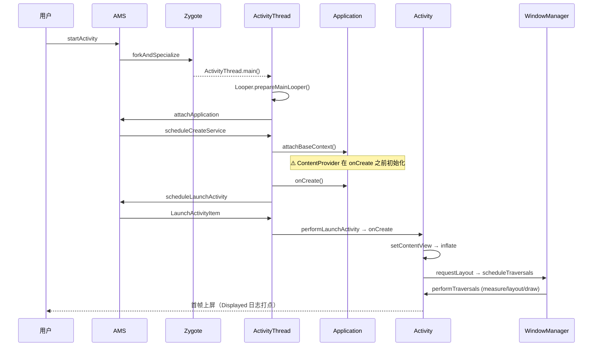

# 启动优化

## 一句话定义

启动优化的本质是**"把启动路径上主线程必须做的事，尽量少地、并行地、预编译地做完"**。它分成四层：**① 减少要做的（裁剪 SDK、懒加载）；② 改变做的时机（异步、延迟）；③ 改变做的顺序（DAG 依赖调度）；④ 让做得更快（Baseline Profile 预编译、布局扁平化）**。衡量指标是 **TTID（Time To Initial Display）** 与 **TTFD（Time To Full Display）**，而不是笼统的"启动时间"。

## 核心原理

### 1. 启动阶段的划分（**必须能默写**）

```text
【冷启动的四个阶段与各自的优化靶点】

  阶段 ①  进程创建
    Zygote fork → RuntimeInit → ActivityThread.main
    ├─ Runtime 初始化（Native 库加载）
    ├─ Looper.prepareMainLooper()
    └─ 绑定 AMS（attach）
    ★ 靶点：这一段基本不可优化（除非用 Baseline Profile 加速 Native 初始化）

  阶段 ②  Application 创建
    LoadedApk.makeApplication → Application.attachBaseContext
      → ContentProvider 初始化（⚠️ 这里会执行第三方 SDK 的 provider）
      → Application.onCreate()
    ★ 靶点：**最大的优化战场**——第三方 SDK 的自动初始化

  阶段 ③  Activity 创建
    performLaunchActivity → onCreate → setContentView → inflate
    ★ 靶点：布局层级、inflate 开销、同步初始化

  阶段 ④  首帧渲染
    requestLayout → scheduleTraversals → measure/layout/draw
      → RenderThread 绘制 → SurfaceFlinger 合成 → 上屏
    ★ 靶点：布局复杂度、过度绘制、首帧前的阻塞任务
```



### 2. 启动耗时的来源（**归因清单**）

| 来源 | 典型耗时 | 说明 |
| --- | --- | --- |
| **类加载 + 校验** | 50~200ms | 加载 dex、验证、优化（dex2oat 已做一部分） |
| **DEX 校验 / 优化** | 30~100ms | 首次安装后的首次启动最慢 |
| **主线程 IO** | 20~100ms | 读 SharedPreferences、读文件、读数据库 |
| **第三方 SDK 初始化** | 100~800ms | 推送、统计、地图、支付、崩溃上报 SDK 的自动初始化 |
| **布局 inflate** | 30~150ms | 层级深、View 多、含自定义 View |
| **代码执行** | 50~300ms | 大量 `if` 判断、反射、注解处理（ ButterKnife / Dagger） |
| **首帧渲染** | 30~100ms | measure/layout/draw + RenderThread |

```text
【启动耗时的经典分布（经验值，冷启动 1.5s 的应用）】
  进程创建 + Application     600ms   ← 三方 SDK 占 70%
  Activity 创建 + inflate    300ms
  首帧渲染                    200ms
  其它（类加载、GC）          400ms
```

### 3. 测量：TTID / TTFD 与工具（**先测量再优化**）

#### 3.1 三个官方口径

```text
【TTID —— Time To Initial Display】
  从进程创建（或从用户点击）到首帧内容渲染出来的时间
  衡量标准：用户"看到 App"的时间
  ★ 这是 Google 官方最看重的启动指标（Vitals 的 Startup metric）

【TTFD —— Time To Full Display】
  从进程创建到 App 完全可用（数据加载完成、可以交互）的���间
  衡量标准：用户"能用 App"的时间
  ★ 需要 App 主动上报（setCustomStartupTraceEnd）

【Displayed 日志】
  系统在首帧渲染完成后自动打印：
    ActivityTaskManager: Displayed com.demo/.MainActivity: +1s234ms
  这是最方便的测量口径
```

```bash
# 方法 1：logcat 里的 Displayed
adb logcat -b main | grep "Displayed"

# 方法 2：am start -W（最标准）
adb shell am start -W -n com.demo/.MainActivity
# 输出：
#   Status: ok
#   LaunchState: COLD
#   TotalTime: 1234        ← 从进程创建到首帧
#   WaitTime: 1290         ← 从点击到首帧
#   Complete

# 方法 3：adb shell am start -S（先强制停止，保证冷启动）
adb shell am start -S -W -n com.demo/.MainActivity
```

#### 3.2 `Trace.beginSection` 打点（**工程级测量**）

```kotlin
/**
 * ✅ 用 Trace 在启动链路上打点，Trace 会出现在 Perfetto 的 trace 里
 */
class StartupTracer {

    companion object {
        const val SECTION_APP_CREATE = "app.onCreate"
        const val SECTION_SDK_INIT = "sdk.init"
        const val SECTION_LAYOUT_INFLATE = "layout.inflate"
    }

    inline fun <T> trace(name: String, block: () -> T): T {
        android.os.Trace.beginSection(name)
        try {
            return block()
        } finally {
            android.os.Trace.endSection()
        }
    }
}

// 用法
tracer.trace(StartupTracer.SECTION_SDK_INIT) {
    PushSdk.init(this)
}
```

```kotlin
/**
 * ✅ 精确测量 TTFD：在数据就绪时主动结束启动 trace
 */
class StartupTraceReporter {

    private var traceStarted = false

    fun onCreate() {
        // Android 12+：系统 API，可直接标注启动区间
        if (Build.VERSION.SDK_INT >= Build.VERSION_CODES.S) {
            traceStarted = true
        }
    }

    /**
     * 首屏数据加载完成时调用
     */
    fun onFullDisplay() {
        if (Build.VERSION.SDK_INT >= Build.VERSION_CODES.S) {
            // ⚠️ 真实的 API 是 startupTraceEnd（系统内部使用，应用侧少用）
        }
        APM.report(
            "startup",
            "ttid=${StartupMetrics.ttid}ms",
            "ttfd=${StartupMetrics.ttfd}ms"
        )
    }
}
```

#### 3.3 Android 12+ 的 `Startup` 系统 API

```kotlin
/**
 * ✅ Android 12+（API 31）系统提供的启动耗时 API
 *    应用可以主动标记启动区间的结束点
 */
object StartupMetrics {

    /** 进程创建时刻（由系统记录） */
    val processStartUptimeMs: Long
        get() = SystemClock.uptimeMillis()

    /** 应用初始化完成时刻 */
    @Volatile
    var appInitDoneUptimeMs = 0L

    /** 首屏数据就绪时刻 */
    @Volatile
    var fullDisplayUptimeMs = 0L

    fun ttidMs(): Long = appInitDoneUptimeMs - processStartUptimeMs
    fun ttfdMs(): Long = fullDisplayUptimeMs - processStartUptimeMs
}
```

### 4. 优化手段一：异步初始化（**AndroidX App Startup**）

```text
【问题】
  Application.onCreate() 里串行执行 N 个 SDK 的 init()，
  每个 50~200ms，累计 800ms，主线程被占满 → 首帧迟迟不上屏。

【App Startup 的解法】
  androidx.startup 提供 Initializer 机制：
  · 用依赖图（Dependency）声明初始化顺序
  · 关键初始化放主线程（immediate = true）
  · 非关键初始化放后台线程（immediate = false）
  · 支持按需初始化（不声明 → 根本不初始化）
```

```kotlin
/**
 * ✅ 自定义 Initializer
 */
class CrashReporterInitializer : Initializer<CrashReporter> {

    override fun create(context: Context): CrashReporter {
        // ⚠️ 这个方法在主线程执行（immediate = true），
        //    或者在 App Startup 的后台线程执行（immediate = false）
        return CrashReporter.install(context)
    }

    /**
     * ✅ 依赖声明：保证在它之前完成
     */
    override fun dependencies(): List<Class<out Initializer<*>>> =
        listOf(NetworkModuleInitializer::class.java)
}
```

```xml
<!-- AndroidManifest.xml：注册 initializer -->
<provider
    android:name="androidx.startup.InitializationProvider"
    android:authorities="${applicationId}.androidx-startup"
    android:exported="false"
    tools:node="merge">
    <meta-data
        android:name="com.demo.CrashReporterInitializer"
        android:value="androidx.startup" />
</provider>
```

```text
【App Startup 的三种初始化时机】
  ① Application 启动时（默认）：Initializer 在 ContentProvider.onCreate 中被调用
     ⚠️ 注意：ContentProvider 的 onCreate 在 Application.onCreate 之前！
  ② Activity/Fragment 启动时：借助 androidx.startup 的 lazy 初始化
  ③ 手动调用：AppInitializer.getInstance(context).initializeComponent(Xxx::class.java)

【⚠️ 顺序陷阱】
  ContentProvider.onCreate → Application.onCreate → Activity.onCreate
  所以放在 ContentProvider 里的初始化（很多 SDK 的自动初始化 Provider）
  反而比 Application.onCreate 更早！
  → 排查启动耗时时，一定要把 ContentProvider 的耗时算进去。
```

### 5. 优化手段二：懒加载（**Lazy**）

```kotlin
/**
 * ✅ 懒加载：只有真正用到时才初始化
 */
class AppContext {

    // ✅ 代理模式：第一次访问时才创建
    val analytics: Analytics by lazy(LazyThreadSafetyMode.SYNCHRONIZED) {
        Analytics(this)
    }

    val push: PushManager by lazy {
        PushManager(this)
    }

    // ✅ 更激进：完全延迟到首次调用（连对象都不预先创建）
    private var _pay: PayManager? = null
    val pay: PayManager
        get() = _pay ?: PayManager(this).also { _pay = it }
}

object ServiceLocator {
    lateinit var appContext: AppContext
}

/**
 * ✅ Kotlin 委托属性
 */
class UserRepository {
    // ✅ by lazy：首次访问时初始化，之后复用
    private val api: UserApi by lazy { RetrofitClient.create() }
}
```

```kotlin
/**
 * ✅ Hilt 的延迟注入（更优雅）
 */
@Module
@InstallIn(SingletonComponent::class)
object NetworkModule {

    /**
     * Provider<T>：调用 provideApi() 时才创建
     */
    @Provides
    @Singleton
    fun provideOkHttp(): OkHttpClient = OkHttpClient.Builder()
        .connectTimeout(10, TimeUnit.SECONDS)
        .build()

    /**
     * Lazy<T>：注入的是"提供者"，调用 .get() 时才真正创建
     */
    @Provides
    @Singleton
    fun provideRetrofit(okHttp: OkHttpClient): Retrofit =
        Retrofit.Builder()
            .client(okHttp)
            .baseUrl(BuildConfig.API_BASE)
            .build()
}

// 使用
@Inject lateinit var retrofit: Retrofit          // 立即创建（启动时）
@Inject lateinit var lazyRetrofit: Lazy<Retrofit> // 延迟创建（用到时）
```

```text
【懒加载的代价（必须说清）】
  ① 首次访问的延迟会转移到你需要的那一刻（可能是用户点击时）
  ② 首次访问在主线程 → 可能造成"点击后才卡一下"
  ③ 因此：懒加载的初始化应该"足够轻"，或者在后台预热

【正确姿势：预热 + 懒加载结合】
  · 首帧渲染完成后（用户看不到的时候）主动预热："空闲时把常用 SDK 初始化好"
  · Choreographer.postFrameCallback { preheat() }   ← 首帧后执行
```

### 6. 优化手段三：启动任务调度（DAG + 依赖）

这是**面试的高频加分点**。

```text
【为什么需要 DAG 调度器】
  ① 串行初始化 → 总耗时 = Σ(每个任务)
  ② 完全并行 → 有依赖关系的任务会出问题（比如网络库没初始化完，SDK 就用了）
  ③ 正确做法 → **拓扑排序 + 并行执行无依赖任务**

  举例：
    Task A: 初始化网络框架（200ms）
    Task B: 初始化日志（50ms）      ← 与 A 无依赖，可并行
    Task C: 上报启动事件（30ms）    ← 依赖 A 和 B
    Task D: 初始化推送（150ms）    ← 依赖 A
    Task E: 初始化支付（300ms）    ← 依赖 A，但不阻塞首屏 → 后台

  串行：200 + 50 + 30 + 150 + 300 = 730ms
  DAG：max(A,B) + C = 200 + 30 = 230ms（关键路径）
```

```kotlin
/**
 * ✅ 启动任务 DAG 调度器
 * 核心：拓扑排序 + 依赖满足后立即在后台线程执行
 */
class StartupTaskGraph {

    /** 任务节点 */
    data class Task(
        val name: String,
        val dependencies: List<String>,
        val priority: Int,          // 数值越小越优先
        val blocking: Boolean,      // 是否阻塞首帧
        val task: () -> Unit
    )

    private val tasks = LinkedHashMap<String, Task>()
    private val completed = mutableSetOf<String>()

    fun add(task: Task) {
        tasks[task.name] = task
    }

    /**
     * ✅ 执行：按拓扑序分层，同层并行
     */
    fun execute() {
        val executor = Executors.newFixedThreadPool(
            minOf(Runtime.getRuntime().availableProcessors(), 4)
        ) { runnable ->
            Thread(runnable, "startup-task").apply { priority = Thread.NORM_PRIORITY - 1 }
        }

        // ① 拓扑排序
        val sorted = topologicalSort()
        if (sorted == null) {
            throw IllegalStateException("启动任务依赖图存在环")
        }

        // ② 分层执行
        var layer = 0
        var currentLayer = sorted.filter { it.dependencies.isEmpty() }
        val done = mutableSetOf<String>()

        while (currentLayer.isNotEmpty()) {
            val latch = CountDownLatch(currentLayer.size)
            for (t in currentLayer) {
                executor.execute {
                    try {
                        android.os.Trace.beginSection("startup.${t.name}")
                        t.task()
                    } catch (e: Throwable) {
                        StartupLogger.e("任务 ${t.name} 失败", e)
                    } finally {
                        android.os.Trace.endSection()
                        latch.countDown()
                    }
                }
            }
            latch.await()
            done.addAll(currentLayer.map { it.name })
            layer++
            currentLayer = sorted.filter { it.dependencies.all { dep -> dep in done } }
        }
        executor.shutdown()
    }

    /**
     * ✅ Kahn 算法的拓扑排序
     */
    private fun topologicalSort(): List<Task>? {
        val indegree = tasks.values.associate { it.name to it.dependencies.size }.toMutableMap()
        val result = mutableListOf<Task>()
        var added = 0

        while (added < tasks.size) {
            // 找出所有依赖已满足的任务
            val ready = tasks.values
                .filter { indegree[it.name] == 0 }
                .sortedBy { it.priority }
            if (ready.isEmpty()) return null   // 有环

            for (t in ready) {
                result.add(t)
                indegree[t.name] = -1   // 标记已加入
                added++
                // 依赖它的任务 indegree 减一
                tasks.values.forEach { dep ->
                    if (t.name in dep.dependencies) {
                        indegree[dep.name] = (indegree[dep.name] ?: 0) - 1
                    }
                }
            }
        }
        return result
    }
}
```

```kotlin
/**
 * ✅ 实际使用
 */
object StartupTasks {

    fun register(graph: StartupTaskGraph) {
        graph.add(StartupTaskGraph.Task(
            name = "network",
            dependencies = emptyList(),
            priority = 0,
            blocking = false,
            task = { RetrofitClient.init() }
        ))
        graph.add(StartupTaskGraph.Task(
            name = "logger",
            dependencies = emptyList(),
            priority = 1,
            blocking = false,
            task = { Logger.init() }
        ))
        graph.add(StartupTaskGraph.Task(
            name = "push",
            dependencies = listOf("network"),
            priority = 2,
            blocking = false,
            task = { PushManager.init() }
        ))
        graph.add(StartupTaskGraph.Task(
            name = "monitor",
            dependencies = listOf("network", "logger"),
            priority = 3,
            blocking = false,
            task = { APM.init() }
        ))
    }
}
```

### 7. 优化手段四：Baseline Profile（**原理题必考**）

```text
【Baseline Profile 是什么】
  一个描述"哪些方法应该被提前编译成机器码"的文本文件
  （baseline-prof.txt），随 APK 一起分发。

【原理】
  没有 Baseline Profile：
    类加载 → dex 校验 → 解释执行 → 热点检测 → JIT 编译 → 机器码
    ⚠️ 首次执行是解释执行（慢），JIT 编译又需要时间
    ⚠️ 冷启动时启动路径上的大量方法都在解释执行状态

  有 Baseline Profile：
    安装时 dex2oat --profile=baseline-prof.txt --quick-compile
      ↓
    oat 文件里预先包含：
      ① 启动路径方法的机器码（跳过解释执行 + JIT 等待）
      ② 校验信息（运行时 dex 校验更快）
      ③ class 初始化信息（<clinit> 的顺序与静态字段默认值预计算）
      ④ 一些方法的 inline 决策（更激进的优化）

【收益来源（面试要能列全）】
  ① 跳过解释执行（最直接）
  ② 跳过 JIT 编译等待
  ③ 跳过 dex 校验（部分）
  ④ 预计算 class 初始化状态 → 减少静态初始化的运行时代码
  ⑤ 更好的内联决策 → 减少方法调用开销
  ★ 实测：启动速度提升 15%~30%（取决于应用复杂度）

【Baseline Profile 不做什么】
  ❌ 不会改变应用逻辑
  ❌ 不是"预加载数据"（那是别的手段）
  ❌ 不能替代 R8 混淆（两者可共存）
```

```text
【如何生成 Baseline Profile】
  方式一：Android Studio 的 Baseline Profile 录制向导
    Profileable release build → 运行 Macrobenchmark →
    生成 baseline-prof.txt → 放到 src/main/baseline-prof.txt

  方式二：手工编写
    格式（每行一个 LHS/RHS 规则）：
      HSPLcom/myapp/MainActivity;->onCreate()V
      Lcom/myapp/NetworkModule;
      +PLcom/myapp/NetworkModule;->init()V

  方式三：AutoBaselineProfile（第三方库，自动收集）
```

```text
【Baseline Profile 相关配置】
  app/build.gradle.kts：
    plugins {
        id("androidx.baselineprofile")   // ⚠️ 需要 AGP 8.0+
    }
    dependencies {
        baselineProfile(project(":app"))
    }
    android {
        buildTypes {
            create("benchmark") {
                isDebuggable = true
                signingConfig = signingConfigs.getByName("debug")
                matchingFallbacks += listOf("release")
            }
        }
    }
```

### 8. 优化手段五：布局与首帧

```kotlin
/**
 * ✅ 首帧优化清单
 */
class SplashOptimization {

    /**
     * ① 用 windowBackground 直接做启动页，避免额外的 SplashActivity
     *    （多一个 Activity = 多一次生命周期 + 多一次布局）
     */
    fun useThemeBackground() {
        // themes.xml:
        // <item name="android:windowBackground">@drawable/splash_bg</item>
        // <item name="android:windowDisablePreview">false</item>
    }

    /**
     * ② 用 setTheme 而不是 ActivityTheme.Starting（兼容旧版本）
     */
    fun applyThemeBeforeSetContentView() {
        // setTheme(R.style.AppTheme) 必须在 super.onCreate 之前或之后但 setContentView 之前
    }

    /**
     * ③ 首帧之后立即预热（用户看不到的时候做）
     */
    fun preheatAfterFirstFrame() {
        Choreographer.getInstance().postFrameCallback {
            // 首帧已上屏，这时候做初始化不会影响首帧
            StartupTasks.executeNonBlocking()
        }
    }

    /**
     * ④ 布局层级扁平化（用 ConstraintLayout 替代嵌套）
     *    inflate 耗时 ∝ View 数量与层级深度
     */
}
```

### 9. 优化手段六：移除无用初始化与裁剪三方 SDK

```text
【排查第三方 SDK 自动初始化的三种途径】
  ① AndroidManifest 里的 <provider>（最常见）
     很多 SDK 通过 ContentProvider 的 onCreate 自动初始化：
       · 崩溃上报：CrashReport.init
       · 推送：FirebaseInitProvider / JPushProvider
       · 统计：UMengInitProvider
     → ✅ 解法：把 provider 的 android:initOrder 调低？不行，正确做法是
        · 用 <meta-data> 关掉它自带的初始化
        · 或在 manifest 中 tools:node="remove" 移除，然后手动异步初始化

  ② ContentProvider 的 onCreate（在 Application.onCreate 之前！）
     → 用 Startup 框架接管

  ③ AAR 里的 so 库的 JNI_OnLoad / static 初始化块
     → 一旦 so 被加载，静态初始化就会执行

【裁剪手段】
  · 依赖分析：./gradlew :app:dependencies 找出无用依赖
  · 排除传递依赖：implementation("xxx") { exclude(group = "yyy") }
  · 只用某个 SDK 的部分模块（按需引入）
  · 反射关闭 SDK 的自动初始化（各家 SDK 都提供了开关）
```

```xml
<!-- ✅ 移除三方 SDK 的自动初始化 Provider，改为手动异步初始化 -->
<provider
    android:name="com.tencent.bugly.crashreport.CrashReportInitProvider"
    android:authorities="${applicationId}.bugly"
    android:exported="false"
    tools:node="remove" />
```

### 10. 优化手段七：dex 与 multidex

```text
【启动时的 dex 相关开销】
  ① 类加载：从 dex 中读取 class → 验证 → linking
  ② dex 校验：APK 首次安装时做完整校验；启动时做部分校验
  ③ multidex（minSdk < 21）：安装时把多个 dex 合并优化

【优化】
  · minSdk ≥ 21：ART 原生支持多 dex，无需 multidex 库
  · Baseline Profile：让 dex2oat 提前编译启动路径
  · R8 开启 optimizations：方法内联、去语法糖
  · 减少启动路径上的类数量（合并小工具类）
  · 避免在启动路径上使用反射（反射会阻止 R8 优化 + 触发额外类加载）
```

## 代码示例

### 1. 完整的启动优化方案（Application + DAG + 首帧预热）

```kotlin
/**
 * ✅ 完整的启动优化 Application
 */
class MyApplication : Application() {

    private val startupGraph = StartupTaskGraph()

    override fun attachBaseContext(base: Context) {
        super.attachBaseContext(base)
        // ⚠️ attachBaseContext 早于 onCreate，这里只能做极轻量的事
        //    （MultiDex.install 必须在 attachBaseContext 里！）
        // MultiDex.install(this)
        StartupMetrics.appInitDoneUptimeMs = SystemClock.uptimeMillis()
    }

    override fun onCreate() {
        super.onCreate()

        // ① 注册启动任务（只声明，不执行）
        StartupTasks.register(startupGraph)

        // ② 执行不阻塞首帧的任务（后台并行）
        startupGraph.execute()

        // ③ 首帧后预热剩余任务
        Choreographer.getInstance().postFrameCallback {
            PreheatManager.preheat()
        }

        // ④ 监控启动耗时
        StartupTraceReporter().onCreate()
    }
}
```

```kotlin
/**
 * ✅ 首帧之后预热（利用用户无感知的时机）
 */
object PreheatManager {

    private val preheated = AtomicBoolean(false)

    fun preheat() {
        if (!preheated.compareAndSet(false, true)) return

        // 在后台线程做，且分批，避免影响接下来的交互
        GlobalScope.launch(Dispatchers.Default) {
            // ① 预创建可能被立刻用到的对象
            ImageLoader.get().preloadDefaultAvatar()

            // ② 预热 WebView（创建 WebView 非常慢，约 100~300ms）
            WebViewPool.preload()

            // ③ 预热 JIT：反射调用一批热点方法
            JITWarmUp.warmUp()

            // ④ 提前发起首屏可能需要的网络请求（预取）
            Prefetcher.prefetchHomeData()
        }
    }
}
```

### 2. `androidx.startup` 完整配置

```kotlin
/**
 * ✅ 用 App Startup 管理初始化依赖
 */
class NetworkModuleInitializer : Initializer<NetworkModule> {
    override fun create(context: Context): NetworkModule {
        return NetworkModule.install(context)
    }
    override fun dependencies(): List<Class<out Initializer<*>>> = emptyList()
}

class PushInitializer : Initializer<PushManager> {
    override fun create(context: Context): PushManager {
        // ✅ 依赖 NetworkModule 先完成
        return PushManager.init(context)
    }
    override fun dependencies(): List<Class<out Initializer<*>>> =
        listOf(NetworkModuleInitializer::class.java)
}

class DeferredPushInitializer : Initializer<Unit> {
    override fun create(context: Context) {
        // ✅ 非关键 SDK：延迟到用户真正使用推送功能时再初始化
        PushManager.init(context)
    }
    override fun dependencies(): List<Class<out Initializer<*>>> = emptyList()
}
```

```xml
<provider
    android:name="androidx.startup.InitializationProvider"
    android:authorities="${applicationId}.androidx-startup"
    android:exported="false"
    tools:node="merge">
    <meta-data
        android:name="com.demo.NetworkModuleInitializer"
        android:value="androidx.startup" />
    <meta-data
        android:name="com.demo.PushInitializer"
        android:value="androidx.startup" />
    <!-- ⚠️ 延迟初始化的 SDK 不在这里注册 -->
</provider>
```

```kotlin
/**
 * ✅ 需要时才初始化（手动触发）
 */
object LazySdk {
    fun initPushIfNeeded(context: Context) {
        AppInitializer.getInstance(context)
            .initializeComponent(PushInitializer::class.java)
    }
}
```

### 3. 启动耗时监控与上报

```kotlin
/**
 * ✅ 启动耗时监控：采集 TTID / TTFD 并上报
 */
class StartupMonitor {

    private val marks = ConcurrentHashMap<String, Long>()

    fun mark(name: String) {
        marks[name] = SystemClock.uptimeMillis()
    }

    fun durationOf(start: String, end: String): Long =
        (marks[end] ?: 0L) - (marks[start] ?: 0L)

    /**
     * ✅ 上报各阶段耗时
     */
    fun report() {
        val processStart = Application.getProcessStartElapsedRealtime()
        val appInit = marks["appInit"] ?: 0L
        val activityCreate = marks["activityCreate"] ?: 0L
        val firstFrame = marks["firstFrame"] ?: 0L
        val fullDisplay = marks["fullDisplay"] ?: 0L

        APM.report(
            event = "startup",
            ttidMs = firstFrame - processStart,
            ttfdMs = fullDisplay - processStart,
            appInitMs = appInit - processStart,
            activityCreateMs = activityCreate - appInit,
            firstFrameMs = firstFrame - activityCreate
        )
    }
}
```

```kotlin
/**
 * ✅ 在 Activity 中打点（首帧完成的准确时机）
 */
class MainActivity : AppCompatActivity() {

    override fun onCreate(savedInstanceState: Bundle?) {
        val t0 = SystemClock.uptimeMillis()
        super.onCreate(savedInstanceState)
        setContentView(R.layout.activity_main)
        StartupMonitor.mark("activityCreate")

        // ✅ 首帧渲染完成的准确时机：DecorView 已 attach 且开始绘制
        window.decorView.viewTreeObserver.addOnDrawListener(
            object : ViewTreeObserver.OnDrawListener {
                private var counted = false
                override fun onDraw() {
                    if (counted) return
                    counted = true
                    StartupMonitor.mark("firstFrame")
                    window.decorView.viewTreeObserver.removeOnDrawListener(this)
                }
            }
        )
    }
}
```

### 4. Baseline Profile 配置与 Macrobenchmark

```kotlin
// app/build.gradle.kts
plugins {
    id("com.android.application")
    id("androidx.baselineprofile")   // ⚠️ 需要 AGP 8.0+
}

android {
    namespace = "com.demo"
    compileSdk = 34

    defaultConfig {
        applicationId = "com.demo"
        minSdk = 24
        targetSdk = 34
    }

    buildTypes {
        release {
            isMinifyEnabled = true
            isShrinkResources = true
            proguardFiles(getDefaultProguardFile("proguard-android-optimize.txt"), "proguard-rules.pro")
        }
        // ⚠️ Baseline Profile 必须用 profileable 的 release 构建来采集
        create("benchmark") {
            initWith(buildTypes.getByName("release"))
            signingConfig = signingConfigs.getByName("debug")
            matchingFallbacks += listOf("release")
            isDebuggable = false
        }
    }
}

dependencies {
    baselineProfile(project(":app"))
}
```

```kotlin
// src/main/baselineprofile/baseline-prof.txt（手工编写示例）
# 启动路径的关键类
HSPLcom/demo/MainActivity;->onCreate()V
Lcom/demo/MainActivity;
HSPLcom/demo/MainActivity;-><init>()V
Lcom/demo/NetworkModule;
HSPLcom/demo/NetworkModule;-><init>()V
+PLcom/demo/NetworkModule;->init()V
HSPLcom/demo/MyApplication;->onCreate()V
Lcom/demo/ui/StartFragment;
HSPLcom/demo/ui/StartFragment;->onCreate()V
```

```kotlin
// benchmark/src/main/java/.../StartupBenchmarks.kt
/**
 * ✅ 用 Macrobenchmark 验证启动优化效果
 */
class StartupBenchmarks {

    @get:Rule
    val startupRule = StartupScenarioRule()

    @Test
    fun startupCold() = startupRule.run {
        pressHome()
        startActivityAndWait()

        // ✅ 断言首帧时间（CI 中防止回退）
        val metrics = instrumentation.metrics
        val ttid = metrics.getMetric("amStartupWarm") ?: 0L
        assertTrue("TTID should be < 800ms, was $ttid", ttid < 800_000_000L)
    }
}
```

## 常见问题 / 面试要点

**读者问：冷启动优化有哪些手段？请按收益排序讲一下。**

**AI答：**

1. **收益排序（从大到小）**：
   - **① 干掉/异步化第三方 SDK 的自动初始化**（通常能省 200~800ms，**收益最大**）；
   - **② 启动任务 DAG 调度**（把串行变并行，省 30%~50% 的总耗时）；
   - **③ 懒加载 + 首帧后预热**（把非首屏必需的工作移出关键路径）；
   - **④ Baseline Profile**（省 100~300ms，且是**长期收益**，对所有用户生效）；
   - **⑤ 布局层级优化 / 减少 inflate 开销**（省 30~150ms）；
   - **⑥ 去掉多余的 SplashActivity**（省一次 Activity 生命周期 + 一次布局，20~80ms）；
   - **⑦ R8 + 减少启动路径上的类**（间接收益）。
2. **必须先说的两个前提**：
   - **先测量再优化**：`logcat` 的 `Displayed` / `am start -W` 拿到基线；
   - **区分冷/热/温启动**，优化目标一定是**冷启动**。
3. **三条铁律**：
   - **主线程绝不做 IO**（StrictMode 强制）；
   - **首帧之前不做任何非必要的工作**；
   - **优化后必须复测**，并防止回退（用 Macrobenchmark 在 CI 里做断言）。
4. **面试话术**："**我一般按'先砍量、再并行、再挪时机、再提速'四步做。第一步砍三方 SDK 的自动初始化，收益最大；第二步用 DAG 把串行改并行；第三步把非关键任务挪到首帧之后；第四步用 Baseline Profile 让编译期提前干活。**"

---

**读者问：启动任务依赖（DAG）怎么设计？**

**AI答：**

1. **为什么需要 DAG**：串行初始化总耗时 = Σ；完全并行会有依赖问题。**DAG + 拓扑排序**能保证"依赖满足就立即执行，无依赖的并行"。
2. **设计三要素**：
   - **节点（Task）**：名字、依赖列表、优先级、是否阻塞首帧、执行体；
   - **边**：依赖关系，必须是 **DAG**（有环要能检测出来并报错）；
   - **分层执行**：用 **Kahn 算法**做拓扑排序，按"层"执行，同层并行（`CountDownLatch` 等齐），下一层再开始。
3. **关键工程决策**：
   - **哪些任务阻塞首帧？** 只放"首屏必须"的（如主题、路由、必须的本地数据）；
   - **线程池大小**：一般 `min(availableProcessors, 4)`，太多会抢 CPU 影响首帧渲染；
   - **任务异常处理**：一个任务失败不能影响其它任务（try-catch 兜住）；
   - **超时**：给非关键任务加超时（如 500ms 超时就放弃），避免拖慢启动。
4. **依赖关系的表达**：常见模式是 **"模块级"依赖**（B 依赖网络库 A），而不是"任务级"，因为模块级的依赖更稳定。
5. **面试话术**："**DAG 调度的价值是'把关键路径压到最短'。串行是所有任务之和，并行是'最长链'。启动优化追求的就是让关键路径最短——所以任务拆分粒度要按依赖关系拆，而不是按类拆。**"

---

**读者问：Baseline Profile 的原理是什么？为什么能加速启动？**

**AI答：**

1. **它是什么**：一个描述"哪些方法要提前编译"的文本文件（`baseline-prof.txt`），随 APK 分发。
2. **原理链路**：
   ```text
   APK 安装时 → dex2oat --profile=baseline-prof.txt --quick-compile
     → 生成的 oat 文件包含：
        ① 启动路径方法的机器码（跳过解释执行与 JIT 等待）
        ② 校验信息（运行时 dex 校验更快）
        ③ class 初始化信息预计算（静态字段默认值、<clinit> 顺序）
        ④ 更好的内联决策
   ```
3. **对比无 Baseline Profile**：
   ```text
   无：类加载 → 校验 → 解释执行（慢！） → 热点计数 → JIT 编译 → 机器码
   有：类加载 → 校验 → 直接就是机器码 ✅
   ```
4. **收益来源（面试要列全）**：
   - 跳过解释执行（**最大头**）；
   - 跳过 JIT 编译的等待时间；
   - 减少 dex 校验开销；
   - 预计算 class 初始化状态（减少静态初始化运行时代码）；
   - 更激进的内联。
5. **注意**：
   - 需要 **AGP 8.0+** 与 `androidx.baselineprofile` 插件；
   - **必须用 profileable 的 release 构建采集**（不能用 debug）；
   - 与 R8 可共存；
   - **不是"预加载数据"**——它只解决"代码编译"，不解决"数据读取"。
6. **面试话术**："**Baseline Profile 是把'运行时编译'的部分工作前移到'安装时编译'。它的本质是用存储空间（APK 变大）换启动时间。而且它对**所有冷启动**都生效，是少数'一次投入、长期收益'的优化。**"

---

**读者问：怎么测量启动耗时？TTID 和 TTFD 有什么区别？**

**AI答：**

1. **TTID（Time To Initial Display）**：进程创建 → **首帧内容渲染出来**。用户"看得到 App"的时间。
2. **TTFD（Time To Full Display）**：进程创建 → **App 完全可用**（首屏数据加载完成、可交互）。用户"用得了 App"的时间。
3. **TTID - TTFD = "白屏/骨架屏期"**，这段时间越长体验越差。
4. **测量手段**：
   - **logcat**：`ActivityTaskManager: Displayed com.demo/.MainActivity: +1s234ms`；
   - **`adb shell am start -W -n com.demo/.MainActivity`**：`TotalTime` ≈ TTID，`WaitTime` 含 AMS 调度；
   - **`adb shell am start -S -W`**：先 force-stop 保证冷启动；
   - **`Trace.beginSection`**：在 Perfetto 里看自己的打点；
   - **Android 12+ 的 `Application.getProcessStartElapsedRealtime()`**。
5. **测量要点**：
   - **必须冷启动**（`am start -S`）；
   - **跑多次取中位数**（单次有噪声）；
   - **区分机型档位**（低端机的数字才有意义）；
   - **排除首次安装的影响**（首次安装后 dex2oat 会让首启变慢）。
6. **面试话术**："**我一定先说'我测的是冷启动，用 am start -S -W，取 10 次的中位数'。然后区分 TTID 和 TTFD——TTFD 优化靠的是让首屏数据更快就绪，TTID 优化靠的是砍掉首帧前的所有非必要工作。**"

---

**读者问：第三方 SDK 的初始化为什么这么慢？怎么处理？**

**AI答：**

1. **慢在哪**：
   - **自动初始化**：很多 SDK 通过 `ContentProvider.onCreate` 自动跑 init（**注意：它在 `Application.onCreate` 之前**）；
   - **网络请求**：SDK 初始化时会立即上报/拉配置（同步等待）；
   - **类加载 + 反射**：大量类要加载、注解要处理；
   - **so 库加载**：`System.loadLibrary` 的 JNI_OnLoad 与静态初始化。
2. **排查方法**：
   - **Perfetto 看 `Application.onCreate` 内的 Slice**，找出哪个 SDK 慢；
   - `adb shell dumpsys package <pkg> | grep -i provider` 找所有 provider；
   - 看 AAR 里的 `AndroidManifest.xml` 有哪些 provider；
   - **ApkAnalyzer / 分析 AAR 的 manifest**。
3. **处理方式（按优先级）**：
   - **① 关闭自动初始化**：SDK 一般提供开关（manifest meta-data 或静态方法），关掉后改成手动异步初始化；
   - **② 移除 Provider**：用 `tools:node="remove"` 移除三方 SDK 的 provider（但要确认 SDK 支持手动 init）；
   - **③ 异步初始化**：放到启动任务 DAG 里，作为非阻塞任务；
   - **④ 首帧后预热**：用 `Choreographer.postFrameCallback` 在首帧后初始化；
   - **⑤ 裁剪 SDK**：不需要的模块直接不引入（`implementation` 按需 + `exclude` 传递依赖）。
4. **面试话术**："**SDK 慢的核心原因是它们把初始化做成了'同步阻塞 + 尽早启动'，因为它们想尽早拿到数据。我的做法是：先在 Manifest 里找所有 provider，再在 Perfetto 里看 onCreate 的 Slice 分布，找出 top 3 干掉它们。**"

---

**读者问：`ContentProvider` 的初始化和 `Application.onCreate` 哪个先？为什么重要？**

**AI答：**

1. **顺序**：`Application.attachBaseContext` → **ContentProvider.onCreate** → `Application.onCreate` → Activity 生命周期。
2. **为什么重要**：
   - **很多第三方 SDK 靠 ContentProvider 自动初始化**（ContentProvider 在 `Application.onCreate` **之前**就跑了）；
   - 所以**你在 `Application.onCreate` 里打点测出来的耗时，可能已经漏掉了 SDK 初始化的时间**；
   - 更糟的是：**你无法在 `Application.onCreate` 里阻止它们**（那时已经晚了）。
3. **怎么办**：
   - **在 Manifest 里排查所有 provider**（包括三方 AAR 合并进来的）；
   - **用 `tools:node="remove"` 移除不需要的 provider**；
   - 或者**用 App Startup 框架接管**（`androidx.startup.InitializationProvider` 本身也是一个 provider，但它是可控的）；
   - **测量时要把 provider 的耗时算进去**。
4. **面试话术**："**这是一个很细的知识点但很能区分水平。ContentProvider 的 onCreate 早于 Application.onCreate，所以三方 SDK 藏在 provider 里的初始化是最容易漏掉的启动耗时。**"

---

**读者问：怎么把首屏加载做得更快（TTFD 优化）？**

**AI答：**

1. **TTFD 的关键路径**：进程创建 → Application → Activity → onCreate → **发起首屏请求** → 接口返回 → 渲染数据 → 首帧上屏。
2. **优化手段**：
   - **③ 接口层面**：
     - **首屏接口合并**：把多个接口合成一个（`/home` 返回聚合数据）；
     - **字段裁剪**：首屏不需要的字段用 DTO 排除（**少解析 = 少耗时**）；
     - **预取**：在 Application 阶段就发起请求（**不等 Activity**）；
     - **缓存命中**：启动时先渲染本地缓存的数据，再刷新（**骨架屏 → 有内容**）；
     - **CDN + 预热**：静态资源提前推到边缘节点。
   - **② 渲染层面**：
     - **骨架屏**：先用占位布局，让首屏"有内容"（降低感知等待）；
     - **数据到了一帧内渲染完**：避免多次 `setText` 触发多次布局（用 `DiffUtil` 或批量更新）；
     - **首屏之外的模块延后渲染**（ViewStub / 可见性监听）。
   - **③ 通信层面**：
     - **预连接（Preconnect）**：启动时就建立 TCP/TLS 连接（DNS + TLS 握手很贵，~100~300ms）；
     - **连接复用**：OkHttp 的 `ConnectionPool`。
3. **感知优化**：
   - **TTID 不变但 TTFD 变短**，用户感知就是"骨架屏时间短"；
   - **TTID 本身也能优化**：如果首屏先用本地缓存渲染出内容，**TTID 也会大幅缩短**。
4. **面试话术**："**TTFD 优化我一般从'数据什么时候到'和'数据到了怎么渲染'两条线入手。数据线：接口合并、字段裁剪、预连接、缓存优先渲染；渲染线：骨架屏、一帧内更新完、非首屏延后。**"

---

**读者问：启动优化常见的坑有哪些？**

**AI答：**

1. **异步化引入的竞态**：把初始化改成异步后，如果 Activity 的 `onCreate` 依赖它，就可能出现 **"数据还没好"的空状态**。
   - 解法：**DAG 声明依赖**，或用 `CompletableDeferred` 等待。
2. **懒加载把延迟转移到点击时**：用户点击"支付"才初始化支付 SDK → **点击后才卡 300ms**，体验更差。
   - 解法：**首帧后预热**，把初始化提前到用户无感知的时候。
3. **多线程初始化的线程安全问题**：并行初始化时共享状态的竞态（`ConcurrentModificationException`、单例半初始化）。
   - 解法：单例用 **`Double-Check Locking` 或 `kotlinx.atomicfu`**；或把有依赖的部分串到同一线程。
4. **抢 CPU**：启动期间起太多线程，反而和首帧渲染抢 CPU。
   - 解法：线程池大小控制在 `min(cores, 4)`，且**首帧渲染前不要占满 CPU**。
5. **Measured 指标失真**：把耗时"挪"到首帧后，但首帧后立刻有用户交互 → 体感没改善。
   - 解法：**看 TTFD 和真实用户反馈**，而不只是 TTID。
6. **回退**：优化没有 CI 守护，下个版本就被改回去。
   - 解法：**用 Macrobenchmark 在 CI 中做断言**（`assertTrue(ttid < 800ms)`）。
7. **测的是热启动**：用 `am start` 而不用 `am start -S`，测出来是热启动，数字很好看但没意义。
8. **只看平均值**：低端机的 P90 卡顿被平均数掩盖。**必须分机型看分位数**。
9. **面试话术**："**启动优化最大的坑是'把问题挪走而不是解决'——异步化、懒加载都只是把耗时挪到了另一个时刻。如果那个时刻正好是用户点击，就会变成'点击卡顿'。所以我坚持'首帧后预热'，而不是'用到才初始化'。**"

## 关联笔记

- [[../README]]：第 6 部分总览
- [[../系统核心机制/应用启动流程]]：冷启动完整时序与 Zygote 机制
- [[../系统核心机制/Activity启动流程]]：Activity 创建与首帧渲染的细节
- [[../系统核心机制/内存管理]]：Baseline Profile 与 dex2oat 的底层机制
- [[卡顿优化]]：首帧卡顿与首屏渲染
- [[内存优化]]：启动阶段的内存初始化与预热
- [[../../07-架构、工具与生态/依赖注入/Hilt]]：`Provider<T>` / `Lazy<T>` 延迟注入
- [[../../07-架构、工具与生态/构建与版本管理/AGP与版本适配]]：AGP 版本与 Baseline Profile 插件

## 参考资料

- AOSP `frameworks/base/core/java/android/app/ActivityThread.java`（`handleBindApplication` / `performLaunchActivity`）
- AOSP `frameworks/base/core/java/android/content/ContentProvider.java`（provider 初始化时机）
- AOSP `art/dex2oat/`（`--profile` / `--quick-compile` 参数）
- Android 官方文档《Improve app startup time》：https://developer.android.com/topic/performance/vitals/startup
- Android 官方文档《Baseline profiles》：https://developer.android.com/topic/performance/baselineprofiles/overview
- Android 官方文档《AndroidX App Startup》：https://developer.android.com/topic/libraries/app-startup
- Android 官方文档《Macrobenchmark overview》：https://developer.android.com/topic/performance/benchmarking/macrobenchmark-overview
- 《Android 性能优化典范》第 8 章 "Android 启动优化"
