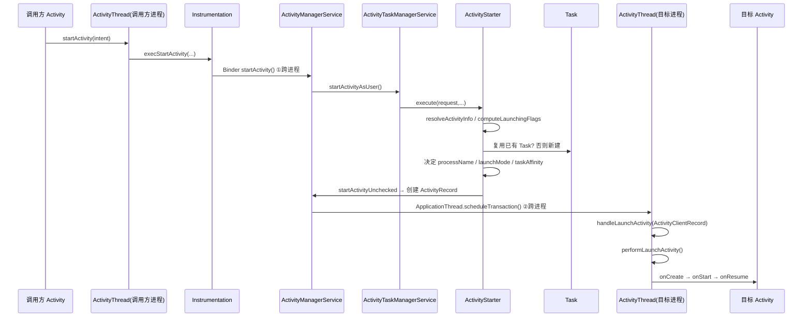

# Activity启动流程

## 一句话定义

`startActivity()` 到 `Activity.onCreate()` 之间隔着**两个进程、三层对象、三次 IPC**。客户端只做"发请求"，真正的状态机在系统侧的 `ActivityTaskManagerService`，真正的对象创建在应用侧的 `ActivityThread`。理解这条链路，才能解释**为什么 `onCreate` 里拿到的 `Intent` 可能是"旧的"、为什么 `ActivityResult` 能跨越进程、为什么 AMS 必须先建 `ActivityRecord`**。

## 核心原理

### 1. 完整链路（**必须能默写的调用链**）



**客户端侧精确调用链**：

```text
Activity.startActivity(Intent)
  └─ Activity.startActivityForResult(intent, -1)
       └─ Instrumentation.execStartActivity(
              this, mMainThread.getApplicationThread(), mToken, this,
              intent, requestCode, options)
              │  ← mToken 是 Activity 的 window token，AMS 用它做权限与归属校验
              │  ← mApplicationThread 是客户端进程的 ApplicationThread（Binder 端点）
              ▼
          [Binder 跨进程]
              ▼
ActivityManagerService.startActivity()
  ├─ 计算 callingUid / callingPackage（来自 Binder 的 caller uid）
  ├─ 权限校验（exported / permission / 分区权限）
  └─ ActivityTaskManagerService.startActivityAsUser()
       └─ ActivityStarter.execute(request, request.starter, options)
            ├─ resolveActivityInfo()      解析目标 ActivityInfo
            ├─ computeLaunchingFlags()   计算 launchMode / resetTask / flags
            ├─ findTask / createTask()   决定 Task 归属
            ├─ 目标进程已存在 → 直接走 ②
            └─ 目标进程不存在 → 先启动进程，再走 ②
                 └─ ProcessList.startProcessLocked → ZygoteProcess.start
```

**回到目标进程**：

```text
[AMS → ApplicationThread.scheduleTransaction]   ← Binder 回调进应用进程
  └─ ActivityThread.scheduleTransaction()
       └─ ClientTransactionManager.executeTransaction(tx)
            └─ LaunchActivityItem.execute()
                 └─ ActivityThread.handleLaunchActivity(item)
                      ├─ performLaunchActivity(activityClientRecord, item)
                      │    ├─ 1. 获取/创建 Application
                      │    │     └─ LoadedApk.makeApplication()
                      │    │          ├─ Application.attachBaseContext()
                      │    │          └─ Application.onCreate()
                      │    ├─ 2. 创建 Activity
                      │    │     └─ mInstrumentation.newActivity(cl, className, intent)
                      │    ├─ 3. onCreate
                      │    │     └─ activity.performCreate(...)
                      │    │          └─ Activity.onCreate(savedInstanceState)
                      │    ├─ 4. onStart
                      │    │     └─ activity.performStart()
                      │    │          └─ Activity.onStart()
                      │    ├─ 5. onPostCreate
                      │    │     └─ activity.onPostCreate()
                      │    └─ 6. onResume
                      │          └─ activity.performResume()
                      │               └─ Activity.onResume()
                      └─ handleResumeActivity()
```

### 2. 关键对象模型（**面试官最爱追问"这几个 Record 有什么区别"**）

| 对象 | 所在进程 | 生命周期 | 作用 |
| --- | --- | --- | --- |
| **`ActivityRecord`** | **system_server**（AMS/ATMS） | 从任务入栈到销毁 | **服务端侧的 Activity 状态**：谁启动的、当前状态（paused/stopped）、intent、结果数据。**AMS 的核心数据模型** |
| **`Task`**（Android 10 后为 `TaskRecord`） | system_server | 一栈 Activity | 任务栈，承载 recent tasks 与返回栈 |
| **`ActivityClientRecord`** | **应用进程**（`ActivityThread`） | 与 Activity 实例同生命 | **客户端侧的 Activity 状态**：持有 `Activity` 弱引用、`intent`、`state`、`parent`。AMS 通过 Binder 下发的就是这个 |
| **`ActivityInfo`** | system_server | 来自 PackageManager | 静态信息：类名、launchMode、theme、exported、permission |
| **`LoadedApk`** | 应用进程 | 与进程同生命 | 持有 APK 路径、`PathClassLoader`、`Application` 实例、Provider 列表、Resources |
| **`ClientTransaction` / `LaunchActivityItem`** | 两端 | 单次事务 | 事务模型：AMS 与客户端之间的一切交互都被抽象为 `ClientTransaction` |

```text
system_server 侧                        应用进程侧
─────────────────                      ─────────────────
Task / TaskRecord                      LoadedApk
  └─ ActivityRecord  ───Binder──────→  ActivityClientRecord
       (服务端状态)      scheduleTransaction   └─ Activity 实例
                                                  └─ ViewRootImpl
```

**为什么要在服务端创建 `ActivityRecord`？**（**高频追问**）

1. **系统是"谁还活着、谁在栈上"的唯一权威**：Activity 可能被配置变更销毁重建、进程被杀后恢复、跨任务跳转。客户端自己维护不了全局状态——每个进程只能看到自己那部分。
2. **统一调度与生命周期决策**：`Activity` 的 `onPause/onStop/onDestroy` 时机由系统决定（而不是由客户端决定），这保证了 **"前台 Activity 唯一"** 这种全局不变式。多个应用进程各自为政就会出现两个 Activity 同时在前台、输入焦点错乱。
3. **跨进程结果与权限校验**：`startActivityForResult` 的结果要回到"发起方进程"，发起方可能已经被杀了；`ActivityRecord` 保存了发起方的 Binder 引用与 `resultTo`，系统可以代为转交。
4. **任务栈与 recent 界面的一致性**：Recents 界面必须准确反映所有应用的任务栈，这只有系统侧能做。
5. **一句话**："**`ActivityRecord` 是服务端维护的 Activity 状态机，客户端只是它的执行体。系统必须先记账，才能统一调度。**"

### 3. `onCreate` / `onStart` / `onResume` 的执行时机

```text
performLaunchActivity()
  ├─ activity.performCreate()      → onCreate()
  ├─ activity.performStart()       → onStart()
  ├─ activity.onPostCreate()       → onPostCreate()
  └─ activity.performResume()      → onResume()

handleResumeActivity()
  └─ onPostResume → onPostCreateOnAnimationEnd（可选）
```

**要点**：

| 回调 | 何时 | 关键约束 |
| --- | --- | --- |
| `onCreate` | `performLaunchActivity` 中，`setContentView` 之前 | **`setContentView` 必须在 `onCreate` 里**；`savedInstanceState` 非 null 表示进程被回收后重建 |
| `onStart` | `onCreate` 之后立即 | 此时界面**还没可见**，但已"可见性可见"；`getActivity().isVisible` 可能仍 false |
| `onResume` | `onStart` 之后 | 界面**即将**可见（真正的可见在下一帧），此时可交互；**此时才能安全地做耗时小动画** |
| `onPostResume` | `onResume` 之后（`handleResumeActivity`） | `Fragment.onResume` 的可靠时机（`onResumeFragments`） |
| `onWindowFocusChanged(true)` | **窗口真正获得焦点**，在首帧之后 | **只有此时才真正"用户可感知界面已渲染"**；此时读控件宽高是正确的 |

> [!warning] 高频坑
> 1. **在 `onResume` 里认为"界面已经显示"是不准确的**。`onResume` 之后还要走一遍 `onPostResume → 首帧渲染 → onWindowFocusChanged`。**要等真正显示完，用 `onWindowFocusChanged(true)` 或 `Choreographer.postFrameCallback`。**
> 2. **在 `onStart` 里做耗时操作会拖慢首帧**，因为首帧渲染排在它后面。
> 3. **`onCreate` 里 `setContentView` 之前不能 `findViewById` 自己布局里的控件**（会 NPE）。

### 4. `ActivityResult` 的传递机制（**AndroidX 后必须掌握**）

#### 4.1 旧机制：`startActivityForResult` / `onActivityResult`

```text
A.startActivityForResult(intent, requestCode)
  → startActivityForResult → Activity.startActivityForResult
     → Instrumentation.execStartActivity(..., requestCode, ...)
        → AMS 记录 resultTo = A 的 ActivityRecord
B.onCreate → B.setResult(resultCode, data) → B.finish()
  → AMS 收到 finish → 找到 resultTo（ActivityRecord）
     → 通过 Binder 调 A 进程的 ApplicationThread
        → A.performActivityResult / ActivityThread.deliverResults
           → A.onActivityResult(requestCode, resultCode, data)
```

**限制**：Google 在 `Activity 1.2` 起**废弃**了 `startActivityForResult` / `onActivityResult`，并于 `Activity 1.3` 移除了这些 API（现在调用会抛异常）。**新代码必须用 ActivityResult API。**

#### 4.2 新机制：ActivityResult API（`androidx.activity`）

```text
A.registerForActivityResult(StartActivityForResult()) { result ->
    // result.resultCode / result.data
}
  → ActivityResultRegistry.register(key, contract, callback)
     → 内部创建一个 Launcher（ActivityResultContract 实现）
        StartActivityForResult.createIntent(context, input) → new Intent
        → ActivityResultRegistry.onLaunch → registry.registerKey
  → launcher.launch(input)
     → ActivityResultRegistry 的 mKeyToCallback 记录 key
     → ActivityCompat.startActivityForResult(activity, intent, requestCode)
        → 最终仍然走 AMS，只是 requestCode 被 ActivityResultRegistry 分配并映射
B.setResult(...) → B.finish()
  → AMS 回调 A 进程 → ActivityResultRegistry.dispatchResult(requestCode, resultCode, data)
     → 通过 keyToCallback 找回真正的 callback 并执行
```

**关键设计**：

- **注册时机**：必须在 Activity **STARTED 之前**（即 `onCreate` 之前或 `onCreate` 中）注册，否则 `IllegalStateException`。这是因为 AndroidX 需要在 `onSaveInstanceState` 前把 requestCode 持久化，以便进程被杀后恢复。
- **key 机制**：`ActivityResultRegistry` 为每个注册分配一个内部 `requestCode`，并把 `(requestCode → key → callback)` 存在 Map 里；`onSaveInstanceState` 时把 pending 的 key 一起保存，进程重建后通过 `restore` 找回。
- **LifecycleOwner 支持**：`registerForActivityResult` 传入 `LifecycleOwner` 时，回调只在 `STARTED` 之后派发。

```kotlin
// ActivityResult API 的完整用法
class DetailActivity : AppCompatActivity() {

    // ① 必须在 onCreate 之前完成注册
    private val pickMedia = registerForActivityResult(
        ActivityResultContracts.PickVisualMedia()
    ) { uri ->
        uri?.let { showImage(it) }
    }

    private val requestPermission = registerForActivityResult(
        ActivityResultContracts.RequestPermission()
    ) { granted ->
        if (granted) doSomething() else showRationale()
    }

    override fun onCreate(savedInstanceState: Bundle?) {
        super.onCreate(savedInstanceState)
        // ② 此处才能 launch
        requestPermission.launch(Manifest.permission.CAMERA)
    }
}
```

### 5. 启动模式（launchMode）与 `ActivityRecord` 的复用

| launchMode | 行为 | 触发 `onCreate`？ | 是否新 ActivityRecord |
| --- | --- | --- | --- |
| `standard` | 每次都新建实例，压在栈顶 | 是 | 是 |
| `singleTop` | 栈顶是同类型则复用，否则新建 | 否（走 `onNewIntent`） | 否 |
| `singleTask` | 栈中已有则清栈并置顶 | 否（`onNewIntent`） | 否（复用） |
| `singleInstance` | 全局唯一，独占一个任务 | 否（`onNewIntent`） | 否 |
| `multipleTask` | 每次新建任务 | 是 | 是 |

**关键理解**：`launchMode` 的判断发生在 **`ActivityStarter` 的 `computeLaunchingFlags`** 阶段，决定了是"复用已有 `ActivityRecord`"还是"新建"。复用时：

- 客户端会收到 **`onNewIntent(intent)`** 而不是 `onCreate`；
- **但 `onRestart → onStart` 仍然会走**（如果是 stop 状态回来的话）；
- `setIntent()` 需要手动调用（`onNewIntent` 里 `getIntent()` 仍返回旧的 Intent，除非调 `setIntent(intent)`）。

> [!danger] 高频坑
> "**`onNewIntent` 里不调 `setIntent()`，`getIntent()` 拿到的是旧的 Intent。**" 这是面试与线上 Bug 的高频点。另外 `onNewIntent` 后需要 `setIntent(intent)` 才能让后续 `getIntent()` 正确。

### 6. `Activity` 启动相关的性能点

| 阶段 | 耗时来源 | 优化 |
| --- | --- | --- |
| `execStartActivity` 前 | Intent 构造、Extras 序列化 | Intent 尽量小，**不要传大 Parcelable**（Binder 缓冲区 1MB，`TransactionTooLargeException`） |
| AMS 侧 | Intent 解析、权限校验、Task 查找 | 应用侧无法优化 |
| 进程创建 | 见 [[应用启动流程]] | 见 [[../性能优化专项/启动优化]] |
| `onCreate` | `setContentView` → inflate | 减少布局层级、`ConstraintLayout`、延迟非首屏 View 的 inflate |
| 首帧 | measure/layout/draw/RenderThread | 见 [[渲染机制]] |

**`TransactionTooLargeException` 的原理**：Binder 传输的 Parcel 共享内核缓冲区（默认 1MB），一次性拷贝进共享内存。**Activity 之间传大 Bundle/List 会直接抛异常**，且 `onSaveInstanceState` 的 Bundle 也有 500KB~1MB 的实际上限。

## 代码示例

### 1. ActivityResult API：跨 Activity 回传结果的正确写法

```kotlin
class MainActivity : AppCompatActivity() {

    // 关键：注册必须发生在 onCreate 之前（Activity STARTED 之前）
    private val editResult = registerForActivityResult(
        ActivityResultContracts.StartActivityForResult()
    ) { result ->
        if (result.resultCode == Activity.RESULT_OK) {
            val name = result.data?.getStringExtra(EditActivity.RESULT_NAME)
            binding.nameText.text = name
        }
    }

    override fun onCreate(savedInstanceState: Bundle?) {
        super.onCreate(savedInstanceState)
        binding = ActivityMainBinding.inflate(layoutInflater)
        setContentView(binding.root)

        binding.editButton.setOnClickListener {
            editResult.launch(
                Intent(this, EditActivity::class.java)
                    .putExtra(EditActivity.EXTRA_INPUT, binding.nameText.text.toString())
            )
        }
    }
}

// 被启动方：设置结果并结束
class EditActivity : AppCompatActivity() {
    companion object {
        const val EXTRA_INPUT = "input"
        const val RESULT_NAME = "name"
    }

    override fun onCreate(savedInstanceState: Bundle?) {
        super.onCreate(savedInstanceState)
        val input = intent.getStringExtra(EXTRA_INPUT).orEmpty()

        binding.save.setOnClickListener {
            // setResult 必须在 finish 之前调用
            setResult(RESULT_OK, Intent().putExtra(RESULT_NAME, input.trim()))
            finish()   // finish 之后 AMS 才会把结果回传给发起方
        }
    }
}
```

### 2. 自定义 `ActivityResultContract`：封装"启动 + 解析结果"

```kotlin
/**
 * 自定义契约：启动一个页面并返回处理后的业务结果。
 * 优势：调用方只关心业务类型，不需要手工解析 Intent 的字符串。
 */
class SignResultContract : ActivityResultContract<String, Boolean>() {

    // 把输入类型转成启动 Intent
    override fun createIntent(context: Context, input: String): Intent =
        Intent(context, SignActivity::class.java)
            .putExtra(SignActivity.EXTRA_PAYLOAD, input)

    // 解析返回结果
    override fun parseResult(resultCode: Int, intent: Intent?): Boolean =
        resultCode == Activity.RESULT_OK && intent?.getBooleanExtra(SignActivity.EXTRA_SIGNED, false) == true
}

// 使用
class PayActivity : AppCompatActivity() {
    private val sign = registerForActivityResult(SignResultContract()) { signed ->
        if (signed) binding.payButton.isEnabled = true
    }
}
```

### 3. 监听 Activity 启动耗时（自建 TTID 打点）

```kotlin
class StartupMetrics {

    private var processStart = 0L
    private var activityCreateStart = 0L
    private var firstFrame = 0L

    /** 在 Application 最早可用时调用，记录进程起点 */
    fun markProcessStart() {
        processStart = SystemClock.uptimeMillis()
    }

    /** Activity.onCreate 前调用 */
    fun markActivityCreateStart() {
        activityCreateStart = SystemClock.uptimeMillis()
    }

    /** 首帧真正渲染完成后调用 */
    fun markFirstFrame() {
        if (firstFrame != 0L) return
        firstFrame = SystemClock.uptimeMillis()
        val total = firstFrame - processStart
        val pre = activityCreateStart - processStart
        val post = firstFrame - activityCreateStart
        StartupReporter.report(total, pre, post)   // 上报 P50/P90
    }
}

// 在 Activity 中挂接
class MainActivity : AppCompatActivity() {
    override fun onCreate(savedInstanceState: Bundle?) {
        StartupMetrics.markActivityCreateStart()
        super.onCreate(savedInstanceState)
        setContentView(R.layout.activity_main)
    }

    override fun onWindowFocusChanged(hasFocus: Boolean) {
        super.onWindowFocusChanged(hasFocus)
        // 窗口拿到焦点 ≈ 首帧已上屏，是最可靠的"用户可感知完成"时机
        if (hasFocus) StartupMetrics.markFirstFrame()
    }
}
```

### 4. 处理 `onNewIntent`：避免拿到旧 Intent

```kotlin
class SingleTaskActivity : AppCompatActivity() {

    override fun onNewIntent(intent: Intent) {
        super.onNewIntent(intent)
        // 关键：必须手动 setIntent，否则 getIntent() 仍返回旧 Intent
        setIntent(intent)
        handleIntent(intent)
    }

    override fun onCreate(savedInstanceState: Bundle?) {
        super.onCreate(savedInstanceState)
        // onCreate 与 onNewIntent 都要处理，避免逻辑分散
        handleIntent(intent)
    }

    private fun handleIntent(intent: Intent) {
        val id = intent.getStringExtra("id") ?: return
        loadDetail(id)
    }
}
```

### 5. 安全的跨进程传参：避免 `TransactionTooLargeException`

```kotlin
object SafeTransfer {

    /**
     * 大数据不要直接塞进 Intent/Bundle（Binder 事务缓冲区约 1MB）。
     * 正确做法：只传一个轻量 ID，数据落盘或走 ContentProvider 查询。
     */
    fun putLargeData(context: Context, key: String, payload: ByteArray) {
        // 写入应用私有目录
        val file = File(context.cacheDir, "transfer/$key.bin")
        file.parentFile?.mkdirs()
        file.writeBytes(payload)
    }

    fun newIntentWithKey(context: Context, key: String): Intent =
        Intent(context, DetailActivity::class.java)
            .putExtra("file_key", key)   // 只传 key
}
```

## 常见问题 / 面试要点

**读者问：从 `startActivity()` 到 `onCreate()` 完整讲一遍调用链。**

**AI答：**

按"三段"讲，每段点名类：

**第一段：客户端发起（应用进程）**
1. `Activity.startActivity(intent)` → `Activity.startActivityForResult(intent, -1)`；
2. → `Instrumentation.execStartActivity(this, mMainThread.getApplicationThread(), mToken, this, intent, requestCode, options)`。注意这里传了 **`mToken`（窗口 token）** 和 **`mApplicationThread`（Binder 端点）**；
3. → Binder 跨进程到系统侧。

**第二段：系统决策（system_server）**
4. → `ActivityManagerService.startActivity()`：取 caller uid（Binder 携带）、做权限与 exported 校验；
5. → `ActivityTaskManagerService.startActivityAsUser()`；
6. → **`ActivityStarter.execute()`**：`resolveActivityInfo()` 解析目标、`computeLaunchingFlags()` 计算 launchMode 与 flags、复用或创建 `Task`、**创建 `ActivityRecord`**、确定目标 `processName`；
7. → `ProcessList.startProcessLocked()`：目标进程不存在则 `ZygoteProcess.start()` → `forkAndSpecialize` 创建进程（见 [[应用启动流程]]）。

**第三段：客户端执行（目标进程）**
8. → AMS 通过 **`ApplicationThread.scheduleTransaction()`** 下发 **`ClientTransaction`（`LaunchActivityItem`）**；
9. → `ActivityThread.handleLaunchActivity()` → **`performLaunchActivity()`**；
10. → `LoadedApk.makeApplication()`（`Application.attachBaseContext` → `ContentProvider.onCreate` → `Application.onCreate`）；
11. → `mInstrumentation.newActivity()` 创建实例 → `onCreate` → `onStart` → `onResume`。

**一句话总结**："**客户端只负责'发请求'，系统负责'记账与调度'，客户端再负责'执行'。跨了两次进程边界。**"

---

**读者问：为什么必须在服务端（AMS）创建 `ActivityRecord`？不能在客户端建吗？**

**AI答：**

1. **`ActivityRecord` 是服务端的状态机**，不是简单的数据副本。它承载"当前状态（RESUMED/PAUSED/STOPPED）"、"谁启动的（resultTo）"、"intent"、"主题与配置"等，**由 AMS 独占维护和修改**。
2. **全局不变式只有系统能保证**：例如"**任一时刻最多一个 Activity 是 RESUMED 且有输入焦点**"。如果各应用进程自己维护 Activity 状态，两个应用的前台 Activity 会同时"以为自己是前台"，焦点、返回键、音量键都会出错。
3. **任务栈是跨进程的**：Task 里可能有 A 应用的 Activity 和 B 应用的 Activity（`taskAffinity` 相同）。返回栈、Recents 界面、`onBackPressed` 的分发目标，都必须由系统统一计算。
4. **结果传递需要服务端中转**：发起方进程可能已被杀死。`ActivityRecord.resultTo` 持有发起方的 Binder 引用，服务端可以在发起方进程恢复后仍能把结果送达（AndroidX 的 `ActivityResultRegistry` 正是基于这个机制在进程重建后恢复 pending 结果）。
5. **权限与安全**：系统必须在服务端（而不是客户端）做 exported / permission / callingPackage 校验，否则任何应用都能伪造启动请求。
6. **一句话**："**客户端是不可信的执行者，服务端是唯一可信的调度者。**"

---

**读者问：`onCreate` → `onStart` → `onResume` 分别在什么时候执行？`onResume` 时界面已经显示了吗？**

**AI答：**

1. **执行顺序与位置**：`performLaunchActivity()` 内依次调用 `performCreate()`（`onCreate`）、`performStart()`（`onStart`）、`onPostCreate()`、`performResume()`（`onResume`），全部发生在 `handleLaunchActivity` 阶段，也就是**首帧渲染之前**。
2. **`onResume` 时界面还没显示**。`onResume` 之后还有：`onPostResume` → 布局与首帧渲染 → `RenderThread` 绘制 → SurfaceFlinger 上屏 → `onWindowFocusChanged(true)`。所以：
   - `onResume` 之后立刻 `view.width` 可能还是 0；
   - `onResume` 里启动的动画，第一帧可能还没出现，用户会看到"动画延迟一帧才动"。
3. **正确做法**：
   - 要等"可见"：用 `onWindowFocusChanged(hasFocus=true)`，或 `Choreographer.getInstance().postFrameCallback {}`；
   - 要等"真正画完"（含 RenderThread）：用 `ViewTreeObserver.OnDrawListener` + `removeOnDrawListener`；
   - 要等"完全稳定"（数据加载完成）：用 `ViewCompat.setOnPreDrawListener`。
4. **面试话术**："**`onResume` 是生命周期状态，`onWindowFocusChanged` 才是可见性状态。这两个时机不等价，是新手最常犯的错。**"

---

**读者问：`ActivityResult` 是怎么跨进程传回来的？新旧 API 有什么区别？**

**AI答：**

1. **旧链路**：`startActivityForResult` → AMS 记录 `resultTo`（发起方 `ActivityRecord`）→ 被调方 `setResult()` + `finish()` → AMS 通过 Binder 回调发起方进程 → `Activity.onActivityResult(requestCode, resultCode, data)`。
2. **新链路（ActivityResult API）**：`registerForActivityResult(contract) { result -> }`：
   - `ActivityResultRegistry` 为每个注册分配内部 `requestCode`，保存 `requestCode → (key → callback)`；
   - `launch()` → `contract.createIntent()` 构造 Intent → 最终仍走 AMS 的 `startActivityForResult` 老路；
   - 但 AMS 回调回来后，AndroidX **拦截**了 `onActivityResult`，改为 `ActivityResultRegistry.dispatchResult(requestCode, resultCode, data)`，通过内部映射找到真正的 `key` 与 `callback`；
   - 进程被杀死重建时，`onSaveInstanceState` 会保存 pending 的 key，重建后从 `savedInstanceState` 恢复映射，因此**不会丢失结果**（这正是旧 API 做不到的）。
3. **为什么 Google 废弃旧 API**：
   - `requestCode` 只能是 16 位（`startActivityForResult` 的参数是 `int`，低 16 位有效），有溢出风险；
   - 旧 API 无法在进程重建后恢复结果；
   - 旧 API 与 `Fragment` 的 `requestCode` 容易冲突；
   - 旧 API 无法支持 `LifecycleOwner` 感知的回调派发。
4. **必答的注册时机约束**：**必须在 Activity `STARTED` 之前注册**（即 `onCreate` 之前或 `onCreate` 中），否则抛 `IllegalStateException`。因为 `ActivityResultRegistry` 需要在 `onSaveInstanceState` 之前完成注册才能持久化 key。
5. **自定义 Contract**：继承 `ActivityResultContract<I, O>`，实现 `createIntent()` 与 `parseResult()`，把 Intent 的字符串解析收敛到一处。

---

**读者问：为什么 `onNewIntent` 之后 `getIntent()` 还是旧的？**

**AI答：**

1. **原因**：Android 只在**首次创建** Activity 时把 Intent 存入 `Activity.mIntent`。`onNewIntent` 被调用时，系统把新 Intent 作为**参数**传进来，但**不会自动覆盖** `mIntent` 字段——这是为了兼容（很多 App 依赖 `getIntent()` 在 `onCreate` 里的值稳定）。
2. **正确写法**：
   ```kotlin
   override fun onNewIntent(intent: Intent) {
       super.onNewIntent(intent)
       setIntent(intent)   // 必须手动覆盖
       handleIntent(intent)
   }
   ```
3. **更稳妥的写法**：把业务入口统一到一个方法，`onCreate` 和 `onNewIntent` 都调用它（避免 `onNewIntent` 分支漏处理）：
   ```kotlin
   override fun onCreate(s: Bundle?) { super.onCreate(s); handleIntent(intent) }
   override fun onNewIntent(i: Intent) { super.onNewIntent(i); setIntent(i); handleIntent(i) }
   ```
4. **哪些 launchMode 会走 `onNewIntent`**：`singleTop`、`singleTask`、`singleInstance`（以及 `FLAG_ACTIVITY_REORDER_TO_FRONT` 场景）。
5. **加分点**：`singleTask` 的 `onNewIntent` 之前，系统会先清掉它上面的 Activity（`clearTop` 语义），所以此时 `onRestart → onStart` 也会走。

---

**读者问：Activity 启动时携带的数据太大怎么办？**

**AI答：**

1. **原理**：Activity 之间的数据通过 **Intent → Parcel → Binder 事务缓冲区**传输。Binder 的事务缓冲区是内核里的共享内存，默认约 **1MB**（`TransactionTooLargeException` 由此抛出）。`onSaveInstanceState` 保存的 Bundle 也有类似上限（实践中 500KB 左右就危险）。
2. **解决方案**：
   - **只传 ID**：Intent 里放一个轻量主键，目标页面自己查询数据；
   - **落盘 + 文件路径**：大 JSON/图片写入 `cacheDir`，传路径；
   - **ContentProvider**：暴露一个查询接口，按需拉取分页数据；
   - **全局单例/仓库**：如果是同进程，直接用进程内 Repository，不走 Binder（最省）。
3. **排查**：`TransactionTooLargeException` 的堆栈会明确指向 `Parcel.writeXXX`。常见元凶：`Bitmap` 直接塞进 Intent（应该传路径或 URI）、`ArrayList<Serializable>`、大 `ArrayList<Bundle>`。
4. **加分**："**`Bundle` 超过 500KB 还会在 `onSaveInstanceState` 时触发 `TransactionTooLargeException`，因为它也要通过 Binder 传给系统进程保存。**"

---

**读者问：`ActivityStarter` 做了什么？为什么要有这个类？**

**AI答：**

1. **职责**：`ActivityStarter` 是 AMS/ATMS 内部的**启动决策器**，把"启动一个 Activity"这个动作拆解为可独立测试的步骤：
   - `resolveActivityInfo()`：根据 Intent 解析目标 `ActivityInfo`（含 `taskAffinity`、`launchMode`、`theme`）；
   - `computeLaunchingFlags()`：根据 launchMode 与 Intent flags 计算最终的启动 flags（如 `FLAG_ACTIVITY_NEW_TASK`、`CLEAR_TOP`、`SINGLE_TOP`）；
   - `findTask()` / `createTask()`：决定复用哪个 `Task`；
   - `setTaskFromReuseOrCreateNewTask()`：处理 `taskAffinity` 与 `FLAG_ACTIVITY_NEW_TASK`；
   - `createActivityRecord()`：创建服务端 `ActivityRecord`；
   - `startActivityUnchecked()`：真正发起进程创建与客户端回调。
2. **为什么拆出来**：启动逻辑极其复杂（涉及 Task 复用、Intent flag 优先级、多用户、split-screen、分屏、freeform、多窗口）。拆成独立类后，**每个决策点可以单测**，且历史 bug 大多集中在 flags 计算上，隔离后好定位。
3. **Android 10 之后的调整**：任务栈相关职责被拆到 `ActivityTaskManagerService` / `TaskSupervisor`，`ActivityStarter` 相应移到 `ActivityTaskManagerService` 内部，但核心职责不变。
4. **面试话术**："**AMS 是'决策层'，`ActivityStarter` 是'决策算法的实现'。我把启动流程理解成：AMS 收集上下文（谁发起、什么 Intent、什么 uid）→ ActivityStarter 做纯计算（算出目标 Task、flags、processName）→ 执行层做副作用（起进程、发事务）。**"

---

**读者问：`singleTask` 和 `singleTop` 有什么区别？`taskAffinity` 又是什么？**

**AI答：**

1. **`singleTop`**：仅当目标 Activity 是**当前栈顶**时复用（`onNewIntent`），否则新建实例压栈。**同一任务栈内可能有多个该 Activity 实例**。
2. **`singleTask`**：在整个**任务栈中**查找（不限于栈顶）。找到则复用并把它**置顶**（同时清掉其上方的 Activity，`clearTop` 语义）；找不到则新建。**一个任务栈内最多一个**。
3. **`taskAffinity`**：Activity 所属任务的"亲和性"标识，默认是应用的包名。它决定：
   - Activity 被启动时应该放进哪个 `Task`（**相同 affinity 的 Activity 会被放进同一个任务栈**）；
   - **多任务/多窗口场景下**，相同 affinity 的 Activity 会聚在一起；
   - `FLAG_ACTIVITY_NEW_TASK` + 指定 affinity 时，可以把 Activity 放进已存在的对应任务里（而不是新建）。
4. **典型陷阱**：第三方 SDK 用 `singleTask` + `taskAffinity=""` 来创建独立任务（老罗文的一贯做法），会让返回栈行为异常、返回键行为诡异。**如果应用内出现"返回键回不到上一级"，优先排查 taskAffinity。**
5. **`singleInstance`**：Android 5.0 后基本废弃，官方不推荐。

---

**读者问：Activity 启动失败会有哪些异常？为什么 `exported` 配错会崩？**

**AI答：**

1. **`SecurityException`**：`exported=false` 的 Activity 被其他应用显式启动；或缺少所需权限；或 `Intent` 的 `component` 与 `action` 冲突（`ACTION_VIEW` 的隐式 Intent 解析到了 exported=false 的 Activity）。
2. **`ActivityNotFoundException`**：Intent 无法解析到任何 Activity（`resolveActivity` 返回 null）。
3. **`IllegalStateException`（ActivityResult）**：在 Activity 已经 `STARTED` 之后才调用 `registerForActivityResult`。
4. **`TransactionTooLargeException`**：Intent 携带数据过大（见前题）。
5. **`exported` 崩溃的具体原因**（Android 12 强制要求）：
   - Manifest 中声明了 `intent-filter` 但**没有显式写 `android:exported`** → 编译期直接报错（`android:exported` needs to be explicitly specified）；
   - 显式写了 `exported="false"` 但又用 `intent-filter` 声明了 action → 运行时 `ActivityStarter` 抛 `SecurityException`。
6. **正确做法**：有 `intent-filter` 且需要被外部唤起（如深链）→ `exported="true"` 并加 `android:permission`；纯内部 → `exported="false"` 且不加 `intent-filter`。

## 关联笔记

- [[应用启动流程]]：进程创建与 `Application` 初始化的完整链路
- [[Binder通信]]：`scheduleTransaction` 背后的跨进程通道
- [[权限机制]]：`exported` 与权限校验是启动失败的两大原因
- [[渲染机制]]：`onResume` 之后的首帧渲染时机
- [[../README]]：第 6 部分总览
- [[../../07-架构、工具与生态/Jetpack库/Lifecycle与ViewModel]]：生命周期感知与状态恢复
- [[../../03-UI开发与用户交互/传统View系统/绘制流程]]：`setContentView` 之后的绘制链路

## 参考资料

- AOSP `frameworks/base/core/java/android/app/ActivityThread.java`（`handleLaunchActivity` / `performLaunchActivity`）
- AOSP `frameworks/base/services/core/java/com/android/server/wm/ActivityStarter.java`
- Android 官方文档《Activity Result API》：https://developer.android.com/training/activity-result
- Android 官方文档《Activity lifecycle》：https://developer.android.com/guide/components/activities/activity-lifecycle
- 《Android 高级编程》第 4 版 · 第 4 章 "Activity 与 UI"
