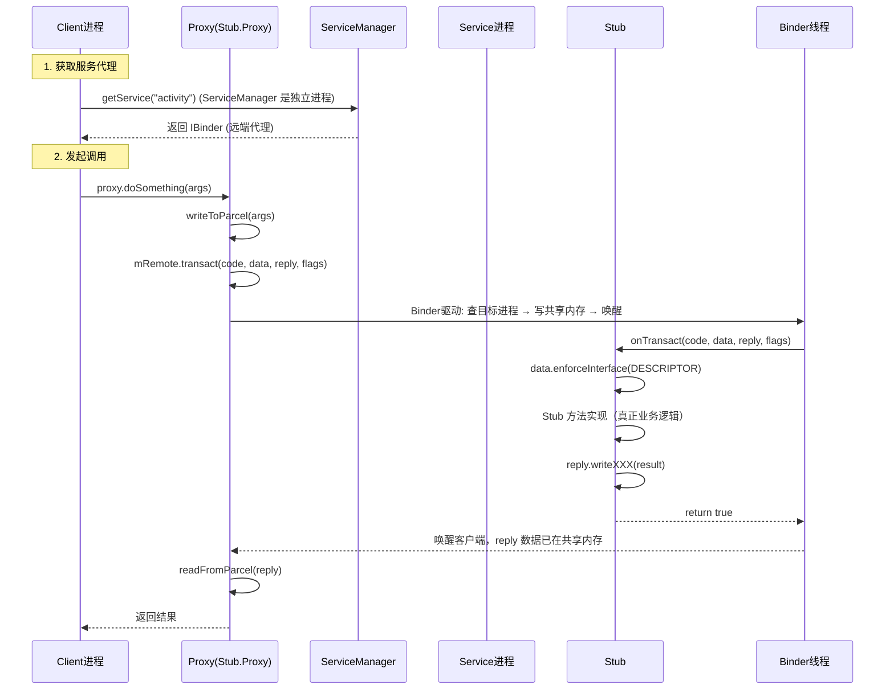

# Binder通信

## 一句话定义

Binder 是 Android 的**进程间通信（IPC）内核机制**：它通过 **`mmap` 把用户空间的一段内存映射到内核空间**，让发送方把参数"写一次"就完成传输，接收方直接从共享内存读——这就是所谓的"**一次拷贝**"。配合 **ServiceManager**（服务路由表）与 **Binder 线程池**（服务端并发模型），构成了 Android 四大组件跨进程调用的完整体系。

## 核心原理

### 1. 为什么需要 Binder：Socket 不够用

Android 有大量组件需要跨进程通信（AMS、PMS、WMS、ContentProvider、Service、广播……），而且这些通信**极其频繁**（每个 Activity 启动都要多次跨进程）。

| 方案 | 数据拷贝次数 | 线程模型 | 安全性 | 能否传对象 | Android 采用 |
| --- | --- | --- | --- | --- | --- |
| **Socket** | **2 次**（sendto → 内核缓存 → recvfrom → 用户空间） | 需自己管理线程与连接 | 靠 UID/PID 过滤 | 只能传字节流 | 仅用于网络/RPC |
| **共享内存（裸 mmap）** | 0 次 | 需自己加锁 | 需自己做权限 | 可直接传对象（但要自己同步） | 少量场景（如 SurfaceFlinger） |
| **Binder** | **1 次** | 内核提供线程池 | 内核级 UID 校验 | **直接传对象（Parcel）** | **系统全面采用** |

**"一次拷贝"的准确含义**（**面试最容易讲错的地方**）：

```text
【Socket：两次拷贝】
  用户态 A                      用户态 B
     │ write()                     │ read()
     ▼                             ▲
  ┌───────────────────────────────��─────────────────┐
  │ 内核空间: socket buffer (A → B)                  │
  └──────────────────────────────────────────────────┘
        拷贝1: A用户态 → 内核        拷贝2: 内核 → B用户态

【Binder：一次拷贝】
  用户态 A                      用户态 B
     │ transact()                  │ onTransact()
     ▼                             ▲
  ┌──────────────────────────────────────────────────┐
  │ 内核空间: Binder 共享内存 (mmap)                  │
  │   ┌────────────────────────────────────┐         │
  │   │ 事务缓冲区: 目标进程地址 + 数据     │         │
  │   │  ← 发送方 write() 只做一次拷贝     │         │
  │   └────────────────────────────────────┘         │
  │   Binder 驱动: 查目标进程 → 写目标地址 → 唤醒    │
  └──────────────────────────────────────────────────┘
        拷贝1: A用户态 → 共享内存     B用户态直接 mmap 读取，0 拷贝
```

**关键**：Binder 共享内存是**一次性映射**（`mmap`）到双方用户空间。发送方 `write()` 时把数据从自己的用户空间拷进共享内存（**这唯一的一次拷贝**），接收方进程早已把这块共享内存映射到自己的地址空间，直接读即可，**不再拷贝**。

**Binder 驱动（`/dev/binder`）在这个过程中做的四件事**：

1. **查表**：根据 `handle`（一个 int 指针）找到目标进程中的 `Binder` 对象；
2. **拷贝**：把事务数据拷进共享内存的事务缓冲区；
3. **标记**：写入目标进程需要处理的节点（`binder_node`）；
4. **唤醒**：如果目标线程在等待，唤醒它；否则把工作加入目标进程的待处理队列，并可能启动一个 Binder 线程。

### 2. Binder 通信的完整链路（**必背**）



**分步骤展开**：

#### 步骤 1：`getService` —— 从 ServiceManager 拿到 IBinder

```text
Client 进程
  └─ ServiceManager.getService("activity")
       │  ← ServiceManager 是 system_server 里的一个独立"服务"
       │    它自己通过 ioctl("/dev/binder", BINDER_SET_CONTEXT_MGR) 注册
       │  ← 所有 getService 都是一次 IPC（第一次会慢）
       ▼
  返回 IBinder（一个 int handle，本质是 Binder 对象在 driver 中的地址）
```

**ServiceManager 的特殊性**：
- 它是 **system_server 进程内的第一个 Binder 服务**，通过 `binder` 驱动注册为 "context manager"；
- 它维护一张 `ServiceManager::AddService` 的**全局服务表**（key → IBinder）；
- **它的 `getService` 走的是特殊的 `ServiceManager::getService` ioctl**，不是普通 Binder 事务；
- Android 8.0 之后为了安全性，**服务名不再直接暴露**给普通应用：`getService` 会先检查 calling uid 是否允许访问该服务（`android.os.IServiceManager` 的 `checkService`）。**第三方应用能拿到的服务非常有限**。

#### 步骤 2：`transact` —— 真正的跨进程调用

```text
Proxy.doSomething(args)
  → mRemote.transact(TRANSACTION_doSomething, _data, _reply, 0)
      → _data.writeInterfaceToken(DESCRIPTOR)   // 接口标识，防串扰
      → _data.writeStrongBinder(...)              // 写 Binder 对象
      → _data.writeString(...)                    // 写参数
      → mRemote.transact(...)                     // 进入驱动
          → ioctl(fd, BINDER_WRITE_READ, &binder_read_write)
```

#### 步骤 3：`onTransact` —— 服务端执行

```text
Binder 线程（不是主线程！）
  → Stub.onTransact(code, data, reply, flags)
      → data.enforceInterface(DESCRIPTOR)   // 校验接口标识
      → switch (code) {
            case TRANSACTION_doSomething:
                result = doSomething(data.readInt());
                reply.writeInt(result);
                return true;
        }
```

> [!warning] **关键结论（高频面试点）**
> **`onTransact` 运行在 Binder 线程池的线程上，不是主线程。**
> 这意味着：
> - Service 的 `onTransact` 里**可以安全地做耗时操作**（不会卡主线程）；
> - 但如果 `onTransact` 里直接更新 UI，**必须切回主线程**（`Handler` / `CoroutineScope(Dispatchers.Main)`）；
> - 如果 Service 组件本身（`Service.onStartCommand` 等）的方法里做耗时操作，**那是在主线程**，要区别对待。

### 3. AIDL 生成的 Stub / Proxy 源码结构（**面试要能默写结构**）

```java
// IMyService.aidl
interface IMyService {
    int add(int a, int b);
    void notify(String msg);   // oneway
}
```

**AIDL 编译后生成 `IMyService.java`**，结构如下（**这是面试最常考"贴代码"**）：

```java
public interface IMyService extends android.os.IInterface {

    // 静态内部类：DESCRIPTOR 与 TRANSACTION 码
    public static abstract class Stub extends android.os.Binder implements IMyService {

        // 唯一标识，onTransact 里 enforceInterface 校验用
        private static final java.lang.String DESCRIPTOR = "com.example.IMyService";

        // 每个方法对应一个唯一的事务码（TRANSACTION_xxx）
        public static final int TRANSACTION_add = (android.os.IBinder.FIRST_CALL_TRANSACTION + 0);
        public static final int TRANSACTION_notify = (android.os.IBinder.FIRST_CALL_TRANSACTION + 1);

        // 构造函数：默认走 attachInterface 注册到 Binder 驱动
        public Stub() {
            this.attachInterface(DESCRIPTOR, new java.lang.String[] {
                "add", "notify"
            });
        }

        // ② 服务端真正的业务实现（由你实现）
        @Override public int add(int a, int b) throws android.os.RemoteException {
            return 0;
        }

        @Override public void notify(String msg) throws android.os.RemoteException {
        }

        // ① 服务端分发器：Binder 线程池线程调用它
        @Override
        protected boolean onTransact(int code, android.os.Parcel data,
                                      android.os.Parcel reply, int flags)
                throws android.os.RemoteException {
            switch (code) {
                case TRANSACTION_add:
                    data.enforceInterface(DESCRIPTOR);   // 校验调用方接口
                    int a = data.readInt();
                    int b = data.readInt();
                    int _result = this.add(a, b);       // 调业务方法
                    reply.writeInt(_result);             // 回写结果
                    return true;
                case TRANSACTION_notify:
                    data.enforceInterface(DESCRIPTOR);
                    java.lang.String msg = data.readString();
                    this.notify(msg);
                    return true;   // oneway 方法不应写 reply
                default:
                    return super.onTransact(code, data, reply, flags);
            }
        }

        // 静态工厂：把 IBinder 转成 IMyService（判断是本地还是远端）
        public static IMyService asInterface(android.os.IBinder obj) {
            if ((obj==null) || (obj instanceof IMyService)) {
                return (IMyService)obj;
            }
            android.os.IBinder iin = obj.queryLocalInterface(DESCRIPTOR);
            if (iin != null) return (IMyService)iin;
            return new IMyService.Stub.Proxy(obj);
        }
    }

    // 客户端代理
    public static class Proxy implements IMyService {
        private final android.os.IBinder mRemote;

        public Proxy(android.os.IBinder remote) { this.mRemote = remote; }

        @Override public int add(int a, int b) throws android.os.RemoteException {
            android.os.Parcel _data = android.os.Parcel.obtain();
            android.os.Parcel _reply = android.os.Parcel.obtain();
            try {
                _data.writeInterfaceToken(DESCRIPTOR);
                _data.writeInt(a);
                _data.writeInt(b);
                // 同步调用：flags = 0
                boolean _status = mRemote.transact(Stub.TRANSACTION_add, _data, _reply, 0);
                if (!_status) {
                    throw new android.os.RemoteException("Method add is unimplemented.");
                }
                _reply.readException();
                int _result = _reply.readInt();
                return _result;
            } finally {
                _reply.recycle();
                _data.recycle();
            }
        }

        @Override public android.os.IBinder asBinder() { return this.mRemote; }
    }
}
```

**必须能说出的三点**：

1. **`Stub` 继承 `Binder` 并实现接口**，服务端用 `attachInterface` 注册；`Proxy` 持有远端 `IBinder`。
2. **`asInterface` 做了"本地 vs 远端"判断**：`queryLocalInterface(DESCRIPTOR)` 能查到 → 说明是同进程，直接返回 Stub（**零 IPC**）；查不到 → 返回 `Proxy`（走 Binder）。**这就是 AIDL 同进程调用自动退化的原理**。
3. **`TRANSACTION_` 码**：`FIRST_CALL_TRANSACTION + n`，保证方法唯一对应。

### 4. Binder 线程池模型（**核心原理题**）

**服务端注册 Binder 实体后，Binder 驱动会为它准备一个线程池**，专门处理到达的 IPC 请求。

```text
Binder 驱动 (每个进程一个)
  │
  ├─ mThreads: 最多 15 个线程（默认 BINDER_MAX_THREADS = 15）
  │    ├─ Binder Thread #1  ← 等待 BINDER_THREAD_ENTER
  │    ├─ Binder Thread #2
  │    └─ ... （空闲时挂起等待，不占 CPU）
  │
  └─ mReadyToRun / mPendingDispatches:
       客户端发起 transact 时：
         ├─ 目标进程有空闲 Binder 线程 → 立刻唤醒它
         └─ 没有空闲线程 → 事务放入 pending 队列，
            等某个 Binder 线程处理完再唤醒
```

**线程池参数**：

```java
// 应用层可以配置（通过 ActivityManager.setProcessThreadLimits）
// 也可以通过 manifest 间接调整：
// android:process 数量过多 → 进程数上限受 Zygote 的 "zygote max processes" 限制

// 系统层：
// ActivityThread.main() 中：
//   Process.setArgV0 / sSystemThread true
//   Process.setThreadPriority(Process.THREAD_PRIORITY_URGENT_DISPLAY);
```

| 概念 | 含义 | 面试要点 |
| --- | --- | --- |
| **Binder 线程** | 由 Binder 驱动创建，不是应用自己创建的 | 它们**继承应用的优先级**，但优先级是 `THREAD_PRIORITY_DEFAULT`，**不是主线程的 `URGENT_DISPLAY`** |
| **线程池大小** | 每个进程默认最多 **15** 个 Binder 线程 | 超出后事务会排队；**这也是"Service 被并发调用"的来源** |
| **并发安全** | `onTransact` 会被**多个线程并发**调用 | **Service 的实现必须线程安全！** 这是 Service 面试高频坑 |
| **线程数上限的调整** | `ActivityManager.setProcessThreadLimits()` | 需要 `MANAGE_PROCESS_LIMIT` 权限（系统应用） |

**"Binder 线程池实现并发"怎么理解？**（**高频追问**）

1. 客户端 A 调用 `service.add()` → 占用 Binder 线程 #1 执行。
2. 客户端 B **同时**调用 `service.add()` → 驱动发现还有空闲的 Binder 线程 #2 → **立刻唤醒它执行**，**不会等 #1 完成**。
3. 因此 **Binder 天然支持服务端的多线程并发处理**，不需要应用自己创建线程池。
4. **但这带来两个陷阱**：
   - **Service 实现的成员变量必须线程安全**（否则两个调用互相污染）；
   - **onTransact 不是主线程**，所以在里面更新 UI 必须切线程；
   - **如果 Service 的某个方法执行很慢，会占用一个 Binder 线程**；如果 15 个都被慢调用占满，后续所有 IPC（不只是这个 Service 的）都会排队——**这是"系统 IPC 卡顿"的常见原因**。

> [!tip] 面试话术
> "**Binder 的并发模型是'一个 Binder 实体对应一个内核管理的线程池'，每个到达的事务会唤醒一个空闲线程处理。这就是为什么 Service 的 `onTransact` 必须自己保证线程安全，也是为什么 AMS/PMS 的线程池配置（`setProcessThreadLimits`）会影响所有应用。**"

### 5. 同步调用 vs `oneway` 异步调用

| 特性 | 同步调用（默认） | `oneway`（异步） |
| --- | --- | --- |
| `transact` flags | `0` | `IBinder.FLAG_ONEWAY`（1） |
| 是否等待返回 | **是**，调用线程阻塞在 `transact` 直到服务端 `onTransact` 返回 | **否**，立即返回 |
| 返回值 | 有返回值 | **必须声明为 `void`** |
| 异常传播 | `RemoteException` 会抛给调用方 | **异常无法传回，调用方拿不到** |
| Parcel | 需要 `reply` | 不需要 `reply` Parcel |
| 典型用法 | 查询、获取数据 | 通知、事件上报（"我通知你一下，你慢慢处理"） |

```java
// AIDL 中声明 oneway
interface INotifyService {
    oneway void onEvent(String eventId);   // 必须 void
}
```

**AIDL 的 `oneway` 关键字**：

```java
// 生成代码中 flags 变成 FLAG_ONEWAY
boolean _status = mRemote.transact(Stub.TRANSACTION_onEvent, _data, null, 1);
```

**关键规则**：
- `oneway` 方法**必须返回 void**（有返回值会被 AIDL 编译器拒绝）；
- `oneway` 方法的参数会**在 transact 返回前完成拷贝**，所以**不要在 oneway 里传大对象**；
- **`oneway` 的服务端执行线程不保证是主线程**，也不保证顺序（同一客户端的多个 oneway 调用，服务端侧是按发送顺序执行的，但跨客户端不保证）。

**实战选择**：
- **通知类**（埋点上报、状态变更通知）→ `oneway`。
- **查询类**（读取数据、校验）→ 同步。
- **耗时操作** → 同步调用 + 服务端内部异步处理 + `oneway` 回调结果，或者直接用 `ListenableFuture`/`Callback`。

### 6. Binder 的引用计数与死亡通知（**`linkToDeath`**）

**问题**：客户端拿到了服务端的 `IBinder`，但服务端进程可能随时被杀（比如被 LMK 回收）。客户端怎么知道？

**Binder 的引用计数机制**（内核维护）：

```text
每个 Binder 对象在内核有一个 binder_node：
  ├─ refs（引用计数）
  ├─ binder_proc（所属进程）
  └─ has_strong_ref / has_weak_ref

- 客户端持有 IBinder → 强引用（strong ref），服务端进程不能被完全回收（Binder 会 pin 住进程）
- linkToDeath 注册 → 也是一种引用
- 当引用计数归零 → 对象回收
```

**但"进程被杀了"不等于"引用计数归零"**——因为客户端还持有引用。所以需要**死亡通知机制**。

#### 6.1 `linkToDeath` / `unlinkToDeath`

```java
public interface IBinder {
    /** 注册死亡回调。当服务端进程死亡时回调 binderDied()。 */
    public void linkToDeath(DeathRecipient recipient, int flags) throws RemoteException;
    public boolean unlinkToDeath(DeathRecipient recipient, int flags);
}

public interface DeathRecipient {
    void binderDied();
}
```

**服务端主动通知客户端死亡**：

```java
// 服务端在 onDestroy 中通知
@Override
public void onDestroy() {
    // 主动断开
    if (mDeathRecipient != null) {
        mDeathRecipient.linkToDeath(...);
    }
    super.onDestroy();
}
```

**客户端监听服务端死亡**：

```java
class RemoteServiceConnection implements ServiceConnection {

    private final IBinder.DeathRecipient deathRecipient = new IBinder.DeathRecipient() {
        @Override
        public void binderDied() {
            // 服务端进程已死：重连 / 降级 / 提示用户
            Log.w(TAG, "远程服务进程已死亡，尝试重连");
            scheduleReconnect();
        }
    };

    @Override
    public void onServiceConnected(ComponentName name, IBinder service) {
        try {
            // 关键：注册死亡通知
            service.linkToDeath(deathRecipient, 0);
        } catch (RemoteException e) {
            // 服务端已经死了（竞态）
            scheduleReconnect();
        }
    }

    @Override
    public void onServiceDisconnected(ComponentName name) {
        // 进程异常死亡时回调（不是 unbind 导致的）
        scheduleReconnect();
    }

    @Override
    public void onBindingDied(ComponentName name) {
        // Android 8.0+：应用被更新导致绑定失效，需要重新 bindService
        scheduleReconnect();
    }
}
```

**三种回调的区别（高频细节点）**：

| 回调 | 触发时机 | 含义 |
| --- | --- | --- |
| `onServiceConnected` | 服务端 `onBind` 返回后 | 正常连接成功 |
| `onServiceDisconnected` | **服务端进程异常死亡** | 需要重连；**主动 `unbindService` 不会触发** |
| `onBindingDied` | Android 8.0+，**客户端应用被更新**导致绑定失效 | 需要重新 `bindService` |

#### 6.2 主动断开：`Binder.unlinkToDeath` / `kill`

```java
// 服务端主动断开所有客户端的死亡监听（配合 unbind）
@Override
public void onDestroy() {
    // 服务端可以主动 kill 掉客户端持有的引用
    // 但通常用 unlinkToDeath 让客户端能收到 binderDied
    super.onDestroy();
}
```

#### 6.3 `LocalBroadcastManager` 与全局广播的区别

与 Binder 死亡通知相关的一个实用点：
- **系统级广播**（`ACTION_BATTERY_CHANGED` 等）由系统发出，跨进程，**不能注册接收者**（只能动态 `registerReceiver`）；
- **普通广播** `sendBroadcast` 是**全局的**，任何应用都能注册接收（Android 8+ 后需显式指定包名或用 `LocalBroadcastManager`）；
- **LocalBroadcastManager** 只在进程内分发，**不走 Binder**，效率高但不跨进程（且已废弃，官方推荐改用 `Flow` 或 `StateFlow`）。

### 7. Binder 的其他关键机制

| 机制 | 说明 | 面试价值 |
| --- | --- | --- |
| **`Parcelable` vs `Serializable`** | Parcelable 是 Android 专用，**专为 Binder 设计**：只序列化"有值"的字段、支持 `writeInterfaceToken`、`CREATOR` 反射重建 | 高频对比题 |
| **`Binder.clearCallingIdentity()`** | 在 Binder 线程里**临时恢复调用方的身份**（uid/pid），让服务端能用调用方的权限去访问资源 | **非常高频且实用的知识点** |
| **`Binder.restoreCallingIdentity()`** | 恢复回服务端身份 | 同上 |
| **Binder FD 传输** | 通过 `Parcel.writeFileDescriptor` 传递文件描述符（如 `ContentProvider` 打开的文件、socket） | 中频 |
| **多线程 `oneway` 的顺序** | 同一客户端发起的多个 oneway，服务端按顺序处理 | 中频 |
| **Binder 的 `getCallingUid`** | 在服务端获取调用方 uid，用于**权限校验**（比"信任传入的 uid 参数"安全） | 高频 |
| **`ServiceManager` 的 `checkService`** | Android 8+ 起，非系统应用访问敏感服务会被拒绝 | 中频 |

**`clearCallingIdentity` 的典型用法**（**高频追问**）：

```java
@Override
public void onTransact(int code, Parcel data, Parcel reply, int flags) {
    // 当前 Binder 线程的身份是"服务端进程"（uid=system 或本应用）
    int callingUid = Binder.getCallingUid();   // 拿到真正的调用方 uid

    // 需要以"调用方"身份访问其私有资源时：
    long identity = Binder.clearCallingIdentity();
    try {
        // 此时代码以服务端 uid 运行，可以访问服务端的数据目录
        readCallingUserData();
    } finally {
        Binder.restoreCallingIdentity(identity);
    }
}
```

> **注意**：`clearCallingIdentity` **只在 Binder 线程中有效**（因为调用方身份是保存在线程的 `mCallingIdentity` 里的）。在主线程调用没有意义。

## 代码示例

### 1. AIDL 接口定义

```java
// IPlayerService.aidl  (放在 src/main/aidl/com/example/ipc/)
package com.example.ipc;

interface IPlayerService {
    // 同步：返回值给调用方
    int getCurrentPosition();

    // oneway：必须 void，调用方不等待
    oneway void onPlayStateChanged(int state);

    // 传递 Binder 对象（支持回调）
    void registerListener(IPlayerListener listener);
}
```

```java
// IPlayerListener.aidl
package com.example.ipc;

interface IPlayerListener {
    oneway void onProgress(int position);
}
```

### 2. 服务端实现（注意线程安全与线程切换）

```kotlin
class PlayerService : Service() {

    private val binder = object : IPlayerService.Stub() {

        // onTransact 运行在 Binder 线程池线程上，不是主线程！
        override fun getCurrentPosition(): Int {
            // 访问共享状态必须线程安全
            return positionState.get()
        }

        override fun onPlayStateChanged(state: Int) {
            // oneway 调用，同样在 Binder 线程
            // 需要更新 UI 必须切回主线程
            mainHandler.post { uiListener?.onStateChanged(state) }
        }

        override fun registerListener(listener: IPlayerListener?) {
            synchronized(listenerLock) {
                this.listener = listener
            }
        }
    }

    // 用 AtomicInteger 保证跨 Binder 线程的可见性与原子性
    private val positionState = AtomicInteger(0)
    private val listenerLock = Any()
    private var listener: IPlayerListener? = null
    private val mainHandler = Handler(Looper.getMainLooper())

    override fun onBind(intent: Intent?): IBinder = binder
}
```

### 3. 客户端绑定与死亡监听（**完整可用**）

```kotlin
object RemotePlayer {

    private const val TAG = "RemotePlayer"
    private var service: IPlayerService? = null
    private var bound = false

    private val connection = object : ServiceConnection {
        override fun onServiceConnected(name: ComponentName, binder: IBinder) {
            service = IPlayerService.Stub.asInterface(binder)
            bound = true
            registerDeathListener(binder)
        }

        override fun onServiceDisconnected(name: ComponentName) {
            service = null
            bound = false
            // 服务端进程死了：重连
            Handler(Looper.getMainLooper()).postDelayed({ bind(context) }, 1000)
        }

        override fun onBindingDied(name: ComponentName) {
            // Android 8+：本应用被更新，需要重新绑定
            service = null
            bound = false
        }
    }

    private val deathRecipient = IBinder.DeathRecipient {
        // 服务端进程死亡
        service = null
        bound = false
    }

    private fun registerDeathListener(binder: IBinder) {
        try {
            binder.linkToDeath(deathRecipient, 0)
        } catch (e: RemoteException) {
            // 竞态：注册时服务端已死
            service = null
            bound = false
        }
    }

    fun bind(context: Context) {
        if (bound) return
        context.bindService(Intent(context, PlayerService::class.java), connection, Context.BIND_AUTO_CREATE)
    }

    fun unbind(context: Context) {
        if (!bound) return
        context.unbindService(connection)
        bound = false
    }
}
```

### 4. `oneway` 通知 + 回调（完整链路）

```kotlin
class MainActivity : AppCompatActivity() {

    private val listener = object : IPlayerListener.Stub() {
        // 运行在 Binder 线程
        override fun onProgress(position: Int) {
            runOnUiThread { binding.progressBar.progress = position }
        }
    }

    override fun onCreate(savedInstanceState: Bundle?) {
        super.onCreate(savedInstanceState)
        RemotePlayer.bind(this)
    }

    override fun onStart() {
        super.onStart()
        RemotePlayer.service?.registerListener(listener)
        // oneway：不等待结果，立即返回
        RemotePlayer.service?.onPlayStateChanged(STATE_PLAYING)
    }

    override fun onStop() {
        super.onStop()
        RemotePlayer.unbind(this)
    }
}
```

### 5. 用 `clearCallingIdentity` 跨用户读取数据（系统级示例）

```kotlin
class UserDataService : Service() {

    private val binder = object : IUserData.Stub() {
        override fun getUserProfile(userId: Int): String? {
            // 拿到真实调用方 uid，做权限判断（不要相信传入参数）
            val callingUid = Binder.getCallingUid()

            // 以服务端身份访问服务端私有目录（如系统账号数据）
            val identity = Binder.clearCallingIdentity()
            try {
                return queryProfileFromSystemData(userId)
            } finally {
                Binder.restoreCallingIdentity(identity)
            }
        }
    }

    override fun onBind(intent: Intent?): IBinder = binder
}
```

### 6. `Parcelable` 的高效实现（**对比 Serializable 的关键点**）

```kotlin
@Parcelize
data class UserInfo(
    val id: Long,
    val name: String,
    val avatarUrl: String
) : Parcelable
// Parcelize 由插件自动实现 writeToParcel / CREATOR，
// 只序列化实际字段，且能高效处理 List/Map/Parcelable 嵌套。

// 传统写法（了解原理）：
// override fun writeToParcel(dest: Parcel, flags: Int) {
//     dest.writeLong(id)
//     dest.writeString(name)
//     dest.writeString(avatarUrl)
// }
// override fun createFromParcel(source: Parcel): UserInfo {
//     val id = source.readLong()
//     val name = source.readString()!!   // 顺序必须与写入严格一致
//     val url = source.readString()!!
//     return UserInfo(id, name, url)
// }
```

## 常见问题 / 面试要点

**读者问：Binder 通信的完整流程是什么？**

**AI答：**

按 5 步讲，每步点名：

1. **获取服务代理**：客户端 `ServiceManager.getService("activity")`（ServiceManager 是 system_server 中注册为 "context manager" 的特殊 Binder 服务，通过 `ioctl(BINDER_SET_CONTEXT_MGR)` 注册），返回 `IBinder`（一个 int handle）。
2. **发起调用**：`Proxy.doSomething(args)` → `writeToParcel` 把参数序列化进 `Parcel` → `mRemote.transact(code, data, reply, flags)` → `ioctl(BINDER_WRITE_READ)` 进入驱动。
3. **驱动处理**：`/dev/binder` 驱动根据 handle 查到目标进程中的 `Binder` 对象 → 把事务数据**拷贝一次**进共享内存的事务缓冲区 → 写入目标进程的 `binder_node` → 唤醒目标进程的 Binder 线程（没有空闲线程则入 pending 队列）。
4. **服务端分发**：目标进程的某个 **Binder 线程**（不是主线程）被唤醒 → `Stub.onTransact(code, data, reply, flags)` → `data.enforceInterface(DESCRIPTOR)` 校验接口 → `switch(code)` 分发到具体方法 → 执行业务 → `reply.writeXXX(result)`。
5. **结果返回**：驱动唤醒客户端线程 → `Proxy` 从 `reply` 中 `readXXX` → 返回给调用方。

**加分句**："**注意 `onTransact` 在 Binder 线程池线程上执行，这既是 Service 可以安全做耗时操作的原因，也是 Service 实现必须线程安全的原因。**"

---

**读者问：Binder 为什么能"一次拷贝"？和 Socket 的"两次拷贝"差在哪？**

**AI答：**

1. **Socket 两次拷贝**：发送方 `write()` → 数据从用户空间拷进内核 socket buffer（拷贝 1）→ 接收方 `read()` → 数据从内核 buffer 拷回用户空间（拷贝 2）。
2. **Binder 一次拷贝**：Binder 在进程启动时用 `mmap` 把一块**内核共享内存**映射到**所有进程**的用户空间。发送方 `transact` 时把数据拷进这块共享内存（**唯一的一次拷贝**）；接收方进程早已把这块内存映射到自己的地址空间，`Parcel` 读取时**直接读自己的地址空间**，**不再拷贝**。
3. **Binder 驱动做的不是拷贝，而是"调度"**：查表（handle → 目标进程）、写目标进程待处理节点、唤醒线程。
4. **本质**：Binder 把"数据搬运"从"每次调用"降级为"一次 mmap + 一次写"，并且**共享内存的地址在两个进程里是同一个物理页**。
5. **附加收益**：Binder 内核级校验（uid、pid、selinux），比 Socket 手动过滤 uid 可靠；且能**直接传对象**（通过 `Parcel` 的类型化读写），Socket 只能传字节流。

---

**读者问：Binder 线程池的并发模型是什么？为什么 Service 要线程安全？**

**AI答：**

1. **模型**：每个进程里注册 Binder 实体时，Binder 驱动为其维护一个**线程池**（默认最多 **15** 个 Binder 线程，`BINDER_MAX_THREADS`）。客户端发起事务时：
   - 有空闲 Binder 线程 → **立刻唤醒**其中一个执行；
   - 全部忙 → 事务进入 `pending` 队列，等有线程空闲再派发。
2. **并发性**：因此**多个客户端可以同时调用同一个 Service 而互不阻塞**，Binder 天然提供服务端并发，不需要应用自己起线程池。
3. **为什么 Service 必须线程安全**：
   - `onTransact` 被**多个 Binder 线程并发调用**；
   - Service 的成员变量、集合、缓存会被多线程同时访问；
   - 典型 Bug：`onTransact` 里用 `ArrayList` 累加数据 → 丢数据或 `ConcurrentModificationException`；用非线程安全的 `HashMap` → 数据错乱。
4. **正确做法**：
   - 纯数据操作 → `AtomicInteger` / `ConcurrentHashMap`；
   - 复合操作 → `synchronized` 或 `ReentrantLock`；
   - 状态聚合 → `AtomicReference` + CAS；
   - 复杂逻辑 → `HandlerThread` / 协程串行化到单一执行器。
5. **加分**："**还有一个常见坑：`onTransact` 里做耗时操作会长期占用一个 Binder 线程。如果同一个进程注册了多个 Binder 实体且都用满了 15 个线程，其他 IPC（包括系统发来的回调）都会排队——线上表现为'系统调用全部卡住'。**"

---

**读者问：`oneway` 是什么？和同步调用有什么区别？什么时候用？**

**AI答：**

1. **区别**：
   - **同步**：`transact(..., reply, 0)`，调用线程阻塞直到服务端返回；能拿到返回值；异常 `RemoteException` 能传回。
   - **`oneway`**：`transact(..., null, FLAG_ONEWAY)`，**立即返回**，不等待；**必须声明为 `void`**（AIDL 层面强制）；**异常无法传回**。
2. **适用场景**：**通知/上报类**——埋点上报、状态变更推送、日志上报、"我告诉你一件事，你慢慢处理"。**不适合需要返回值或需要感知失败的场景。**
3. **注意事项**：
   - `oneway` **不保证服务端在哪个线程执行**（通常也是 Binder 线程，但不是主线程）；
   - `oneway` 的**参数在 `transact` 返回前就完成了拷贝**，所以**不要在 oneway 里传大对象**；
   - `oneway` **不会因为服务端异常而通知调用方**，所以重要操作必须自己做失败处理。
4. **顺序性**：**同一客户端**发起的多个 `oneway` 调用，服务端按发送顺序处理；但**跨客户端不保证顺序**。

---

**读者问：Service 挂了客户端怎么知道？`linkToDeath` 是什么原理？**

**AI答：**

1. **为什么需要**：客户端持有的 `IBinder` 是**内核引用**，它会"pin"住服务端进程使其不被回收，但**无法反映"进程异常死亡"**（例如 native crash、被 LMK 杀了）。
2. **`linkToDeath` 机制**：客户端向内核注册一个 **`DeathRecipient`**（死亡接收者）。内核在服务端进程死亡时，遍历所有注册了接收者的 `binder_node`，调用它们的 `binderDied()`。
3. **三种回调要分清**：
   - **`onServiceDisconnected`**：服务端进程**异常死亡**时回调（主动 `unbindService` **不会**触发）；
   - **`onBindingDied`**（Android 8.0+）：**客户端应用自身被更新**导致绑定失效，需要重新 `bindService`；
   - **`binderDied`**：通过 `linkToDeath` 注册的回调，服务端进程死亡时触发。
4. **注册时机**：在 `onServiceConnected` 里注册；注册时可能抛 `RemoteException`（说明服务端恰好在这一刻死了），要处理这个竞态。
5. **正确响应**：
   - 清理本地缓存（`service = null`）；
   - 退避重连（不要立即重连，会造成"死亡-重连-再死亡"的抖动，用指数退避）；
   - 降级到本地实现或提示用户；
   - **不要在 `binderDied` 里做重活**，它运行在客户端的 Binder 线程上。

---

**读者问：`Parcelable` 和 `Serializable` 有什么区别？**

**AI答：**

1. **`Serializable`（Java 原生）**：
   - 使用 Java 对象序列化，**通过反射**读取字段；
   - 会序列化**所有字段**，包括 `transient` 之外的（不区分 null 与默认值）；
   - **不保证跨版本兼容**，字段增删直接破坏兼容；
   - 性能差（反射 + 大量额外对象）；
   - **不能传 Binder 对象**。
2. **`Parcelable`（Android 专用）**：
   - **为 Binder 传输专门设计**：在 `writeToParcel` 里**按顺序显式写字段**，读取时按同样顺序读，**零反射**；
   - **只写有值的字段**（可以跳过 null），体积更小；
   - **可以内嵌 Binder 对象**（`writeStrongBinder`），支持跨进程回调；
   - **性能比 Serializable 高一到两个数量级**（实测序列化 1000 个对象的差距非常明显）。
3. **AIDL 参数必须用 Parcelable**（或 AIDL 支持的基本类型、`List<Parcelable>` 等）。
4. **现代写法**：用 `@Parcelize` 注解 + `kotlin-parcelize` 插件自动生成，避免手写出错。
5. **面试话术**："**`Serializable` 是'把对象图整个拍平成字节流'，通用但慢且脆弱；`Parcelable` 是'按契约把数据搬到共享内存'，专用但快。跨进程场景没有理由用 Serializable。**"

---

**读者问：`Binder.clearCallingIdentity()` 有什么用？**

**AI答：**

1. **原理**：Binder 线程在执行服务端逻辑时，**当前身份是服务端的**（uid/pid），但内核里保存了"调用方身份"。`clearCallingIdentity()` 会**临时清空**这个调用方身份，让后续代码以服务端 uid 运行；用完必须 `restoreCallingIdentity(identity)` 恢复。
2. **用途**：
   - **服务端代表调用方访问调用方的私有资源**（如读取调用方的联系人、访问其专属文件）；
   - **系统服务中**（如 `ActivityManagerService`）代表某个 uid 执行特权操作；
   - **跨用户/跨应用数据隔离场景**下做"身份代入"。
3. **限制与坑**：
   - **只在 Binder 线程中有效**（调用方身份保存在线程上下文里），主线程调用没有意义；
   - **必须用 try-finally 恢复**，否则线程被复用时身份会串；
   - **滥用有安全风险**：等于给了服务端"以任何人身份操作"的权限，系统代码里必须严格校验 `getCallingUid()`。
4. **典型代码**：
   ```java
   long identity = Binder.clearCallingIdentity();
   try {
       // 以服务端身份执行
   } finally {
       Binder.restoreCallingIdentity(identity);
   }
   ```

---

**读者问：同进程的 AIDL 调用会走 Binder 吗？**

**AI答：**

1. **不会**。`Stub.asInterface(binder)` 的实现：
   ```java
   IMyService iin = obj.queryLocalInterface(DESCRIPTOR);
   if (iin != null) return (IMyService) iin;   // 同进程：直接返回本地 Stub
   return new IMyService.Stub.Proxy(obj);      // 跨进程：返回 Proxy
   ```
2. **机制**：客户端 `Service` 通过 `bindService` 拿到的是**本进程的 Binder 对象**，`queryLocalInterface` 能查到本地注册的接口，于是直接返回 `Stub` 实例。
3. **结果**：同进程调用是**普通 Java 方法调用**，零 IPC、零拷贝、零线程切换，**但 `onTransact` 也不会被调用**——所以如果你把逻辑写在 `onTransact` 里，同进程场景就拿不到！
4. **重要推论（面试高频坑）**：
   - **AIDL 接口方法里写业务逻辑**（在 `Stub` 的方法实现里），不要写在 `onTransact` 的 `switch` 里；
   - `onTransact` 里只做分发；
   - 跨进程与同进程**行为要一致**，否则本地调试正常、跨进程线上崩。
5. **加分**："**这也解释了为什么 `ContentProvider` 的 `query` 在同进程访问时也走 `Binder`——因为 `ContentProvider` 客户端永远通过 `ContentProviderClient` 拿的是远端代理（除非用 `ContentProviderClient.acquireUnstableContentProviderClient` 本地路径）。**"

---

**读者问：面试时让你现场画 Binder 通信流程，怎么画？**

**AI答：**

30 秒画出这张图，并补 3 句：

```text
┌─────────────── Client 进程 ───────────────┐  ┌────────── Server 进程 ──────────┐
│                                            │  │                                 │
│  Proxy.doSomething()                       │  │  Binder 线程 #3                  │
│    ├─ writeToParcel(args) → Parcel         │  │    └─ Stub.onTransact(code,...)  │
│    ├─ mRemote.transact(code, data, reply)  │  │         ├─ enforceInterface()    │
│    │      └─ ioctl(BINDER_WRITE_READ)      │  │         ├─ switch(code) 分发     │
│    │            ┌───────────────────────┐ │  │         └─ 业务方法执行          │
│    │            │ /dev/binder 驱动      │ │  │                                 │
│    │            │  1.查 handle→目标进程 │ │  │                                 │
│    │            │  2.拷贝 data→共享内存│ │  │                                 │
│    │            │  3.写 binder_node    │ │  │                                 │
│    │            │  4.唤醒目标 Binder 线程│ │  │                                 │
│    │            │       (1次拷贝)       │ │  │                                 │
│    │            └───────────────────────┘ │  │                                 │
│    └─ readFromParcel(reply) ← 共享内存直读 │  │                                 │
└────────────────────────────────────────────┘  └─────────────────────────────────┘
```

**必须补的 3 句**：
1. "**数据只拷贝一次**：发送方写进 mmap 共享内存，接收方直接读自己的映射地址。"
2. "**`onTransact` 跑在 Binder 线程池线程上，不是主线程。**"
3. "**Binder 线程池默认 15 个线程，服务端天然支持并发，所以 Service 实现必须线程安全。**"

## 关联笔记

- [[应用启动流程]]：`scheduleTransaction` 走的就是 Binder 事务
- [[Activity启动流程]]：`ActivityRecord` 与 `ActivityClientRecord` 的跨进程同步
- [[权限机制]]：权限校验发生在服务端（AMS/PMS）
- [[内存管理]]：Binder 事务缓冲区与 `TransactionTooLargeException`
- [[../README]]：第 6 部分总览
- [[../../07-架构、工具与生态/基础工具链/ADB]]：`adb shell dumpsys` 查看 Binder 状态
- [[../../02-Android核心组件/README]]：Service / ContentProvider 的跨进程边界

## 参考资料

- AOSP `frameworks/native/libs/binder/Binder.cpp` 与 `Parcel.cpp`
- AOSP `frameworks/base/core/java/android/os/Binder.java`（`transact` / `clearCallingIdentity` / `DeathRecipient`）
- AOSP `frameworks/base/core/java/android/os/ServiceManager.java`（`getService` / `checkService`）
- Android 官方文档《Service》：https://developer.android.com/develop/background-work/services/basics
- 《Android 系统揭秘》第 3 版 · 第 3 章 "服务端进程之间的通信"
