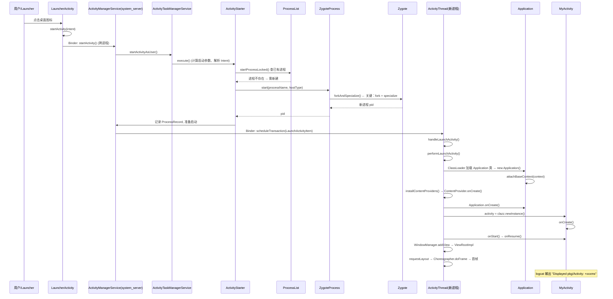

# 应用启动流程

## 一句话定义

应用启动是"**用户点击图标 → 系统拉起新进程 → 创建 Application → 创建 Activity → 绘制首帧**"这条链路的总和。它的耗时几乎全部由**进程创建**和**主线程上的类加载 / IO / 代码执行**构成，因此启动优化的本质就是：**把不需要的初始化挪出主线程，把必须的初始化变成 DAG 上的可并行任务。**

## 核心原理

### 1. 冷启动 / 热启动 / 温启动的判定

面试官最常问的第一个问题不是"怎么优化"，而是"**你测的是哪一种启动？**"——答错这一句，后面所有优化数字都不可信。

| 类型 | 触发条件 | 进程状态 | 是否新建进程 | 典型耗时 | 优化关注点 |
| --- | --- | --- | --- | --- | --- |
| **冷启动** | 进程不存在或已被系统回收 | 进程不存在 | **是**，需要 `fork` + Application 全量初始化 | 500ms ~ 2s+ | 进程创建、Application 初始化、首帧渲染 |
| **热启动** | 进程还在，只是 Activity 被销毁 | 进程存活 | 否 | < 200ms | Activity 重建 + 首帧渲染 |
| **温启动** | 进程在，但 Activity 栈被清空（返回桌面后再次进入） | 进程存活 | 否（可能重建进程，若进程被回收则退化为冷启动） | 200ms ~ 500ms | Activity 重建 + 部分系统服务恢复 |
| **温启动特例** | Activity 还在，只是从后台回到前台 | 进程 + Activity 都存活 | 否 | < 100ms | 几乎无优化空间 |

**判定方法（工程口径）**：

- `adb shell am start -W -n pkg/.Activity` → 看 `TotalTime` / `WaitTime` / `Complete`，其中 `TotalTime` ≈ `Displayed` 耗时。
- `adb shell dumpsys activity processes | grep <pkg>` → 看 `Pid` 是否存在、`lastActivityTime`。
- 看 logcat 的 `Displayed` 日志（API 24+ 每次启动都有）。
- 关键区分点：**`Process` 是否存在**。这是冷热启动的唯一硬标准，其余都是衍生。

```text
冷启动 vs 温启动 vs 热启动 —— 决策树

用户点击 Launcher 图标
        │
        ▼
  <pkg> 进程是否存活？
        │
   ┌────┴────┐
   │         │
  否        是
   │         │
   ▼         ▼
冷启动     Activity 实例是否还在栈上？
(新进程)        │
          ┌────┴────┐
          │         │
         是         否
          │         │
          ▼         ▼
     热启动        温启动
  (直接 resume)  (重建 Activity)
```

### 2. Zygote：Android 进程世界的"孵化器"

Zygote 是 Android 用来**批量复制进程**的特殊服务。它自己是一个由 `init` 启动的原生进程（`app_process`），做了两件关键的事：

1. **预加载**：把系统中最常用的类和资源提前加载进自己的地址空间。
2. **fork**：当需要启动新进程时，`fork()` 出一个子进程——子进程**共享**父进程的内存页（写时复制），因此几乎零成本地"继承"了预加载成果。

```text
┌──────────────────────────────────────────────────────────────┐
│                       Zygote 进程 (app_process)              │
│  - preload: SystemServer / ActivityThread / 常用 framework 类 │
│  - preload resources: framework-res.apk / android.jar 资源   │
│  - 启动 Socket 服务: /dev/socket/zygote（抽象 socket）        │
│  - 挂载到 /data（uid 0）                                    │
└───────────────┬──────────────────────────────────────────────┘
                │ fork()（Copy-On-Write）
     ┌──────────┼──────────┐
     ▼          ▼          ▼
 ┌────────┐ ┌────────┐ ┌────────┐
 │ app1   │ │ app2   │ │system_ │
 │ uid=10101│ │uid=10102│ │server  │
 └────────┘ └────────┘ └────────┘
```

#### 2.1 为什么用 `fork` 而不是 `exec`（**高频追问**）

这是本章最经典的"为什么"题，标准答案分三层：

| 方案 | 做法 | 优点 | 致命缺点 |
| --- | --- | --- | --- |
| `fork` + COW | 子进程共享父进程页表，写时才复制 | **启动极快**：类已加载、资源已解析、JIT 已预热 | 共享内存有 COW 写时复制开销；父进程不能有线程（fork 只复制调用线程，其他线程会丢失） |
| `exec` | fork 后立刻 exec 新程序 | 内存完全隔离、无 COW | **要重新加载一切**：动态链接、class 加载、dex 校验、资源解析全部重来，启动慢一个数量级 |
| `fork` + 重新 exec 自己的 zygote | 子进程 exec `app_process` | 隔离性同 exec | 仍然丢掉预加载，等于没用 Zygote |

**核心矛盾**：Android 启动速度的核心矛盾是"**进程隔离**"与"**启动速度**"的对立。

- Zygote 用 `fork` 拿到了速度，代价是**必须接受 COW 的写时复制惩罚**。
- 关键在于：**fork 之后子进程立刻 `exec` 替换掉 zygote 的镜像**——`ZygoteProcess.forkAnd specialize` 中调用 `RuntimeInit` → `ZygoteInit.zygoteInit` → 反射调用 `Application.main()`。所以最终子进程并不保留父进程的内存布局，**安全隔离依然成立**，只是**类加载与资源预热成果以"已解析的元数据"形式被继承了一部分**（更准确地说：预加载的类在 fork 后因为 COW 变成私有，且 Android 6.0 后 Zygote 采用了 **pre-fork 之后在子进程中重新 link 共享库**的方式）。
- 换句话说：**Zygote 用"fork 共享内存"换来了"类加载器已就绪 + 运行时已初始化"的状态**，这是它快的原因。

> [!warning] 追问陷阱
> 如果面试官接着问"**那 fork 出来的子进程怎么保证不共享内存导致信息泄漏？**"，回答：
> 1. fork 之后子进程立刻通过 `ZygoteInit.zygoteInit()` 走 **specialize** 流程，与 zygote 断开共享；
> 2. 子进程会 `unshare`/重置部分共享内存区域（如 `gDev`、共享的 `Socket`）；
> 3. Android 4.x 之后引入 **zygote 预 fork（prefork）** 机制：在 `zygote64` 中预先 fork 出多个子进程待命，避免 fork 时与其他线程竞争，缩短启动时间；
> 4. **最核心**：zygote 与子进程之间是"**父子关系**"，子进程 exec 后 zygote 就不再持有它的地址空间；zygote 自身 uid 是 root，但子进程会被降权到应用 uid（`setuid`/`setgid`），并被 `SELinux` 域 `app_zygote` 限制，**无法访问其他应用的数据目录**。

#### 2.2 预加载类（preloaded classes）

Zygote 启动时通过 `ZygoteInit.preloadClasses()` 与 `preloadResources()` 完成预热：

- **`preload-classes`**：一个文本文件，列出需要预加载的类名（数千个），在 zygote 进程中全部 `Class.forName` + 校验链接。
- **`preload-res` / `framework-res.apk`**：系统资源包被预加载并解析，避免每个进程都重新解析 `resources.arsc`。

预加载带来的收益：类加载（ClassLoader + dex 校验 + linking）通常是冷启动里**最大的单块耗时之一**，预加载把它变成了"复制页表"级别的开销。

> **zygote64 与 zygote**：Android 5.0 引入 `zygote64`（64 位）并与 `zygote`（32 位）并行。系统按应用是否 64 位纯进程来选择 fork 源。`zygote64_32` 是"64 位 Zygote 可启动 32 位应用"的混合模式（Android 12+ 引入，用于 16KB 页大小适配）。

### 3. SystemServer：系统的"进程管理器"

Zygote fork 出的第一个关键进程是 **SystemServer**，它的 `main()` 里做三件事：

1. 启动 **Binder 驱动**（`Binder.init()`）并把自己注册为 **ServiceManager 的守护进程**；
2. 启动系统 **Java 服务层**（`SystemServer.startOtherServices()`）；
3. 进入 `Looper.loop()` 永久驻留。

**四大核心服务**（面试必背）：

| 服务 | 完整类名 | 职责 | 面试要点 |
| --- | --- | --- | --- |
| **AMS** | `ActivityManagerService` | Activity/Service/BroadcastReceiver/Provider 的生命周期与调度；进程管理、启动 Activity | `startActivity` 的服务端入口；`ProcessList` 决定进程生死 |
| **PMS** | `PackageManagerService` | 应用安装、卸载、解析、权限授予、UID 分配 | 权限检查、系统签名校验、安装包校验 |
| **WMS** | `WindowManagerService` | 窗口、Input、显示、旋转、状态栏 | 窗口层级、焦点、key event 分发起点 |
| **ATMS** | `ActivityTaskManagerService` | Android 10 拆分出来的**任务栈管理**（Task/ActivityRecord），AMS 把"任务相关"职责委派给它 | 面试加分点，能说出 AMS 与 ATMS 的分工 |

补充常见服务：`PowerManagerService`（电源）、`BatteryService`、`StorageManagerService`、`ConnectivityService`、`AlarmManagerService`、`JobSchedulerService`、`InputManagerService`、`UserController`（多用户）、`GraphicsService`。

```text
SystemServer 启动顺序（AOSP 简化）
  1. startBootstrapServices()
       - ActivityManagerService (AMS)  ← 先起，因为后面都要用
       - PowerManagerService
       - PackageManagerService (PMS)
  2. startCoreServices()
       - BatteryService / UsageStats / ...
  3. startOtherServices()   ← 耗时大头
       - WindowManagerService (WMS)
       - ActivityTaskManagerService (ATMS)
       - JobSchedulerService / AlarmManagerService / ...
  4. SystemServer.main() → Looper.loop() 永久驻留
```

### 4. 冷启动完整时序（**核心，必须能默写**）



对应的**客户端侧关键方法链**（面试要能点名）：

```text
ActivityThread.main()
  ├─ Looper.prepareMainLooper()
  ├─ ActivityThread.currentActivityThread = this
  ├─ attach(false)   ← 向 AMS 注册此进程（Binder 回 AMS）
  ├─ Instrumentation.init(...)
  ├─ LoadedApk.makeApplication(...)   ← Application 创建
  ├─ Looper.loop()   ← 主线程消息循环启动

[AMS 回调] scheduleTransaction()
  └─ handleLaunchActivity(ActivityClientRecord)
       └─ performLaunchActivity(...)
            ├─ getApplication()  ← 触发 LoadedApk.makeApplication()
            │    ├─ Application.attachBaseContext(context)
            ├─ installContentProviders()
            │    └─ ContentProvider.onCreate()
            ├─ mInstrumentation.newActivity(...)
            ├─ activity.onCreate(savedInstanceState)
            ├─ activity.onStart()
            ├─ activity.onResume()
            └─ 之后 performResumeActivity → onPostResume
```

### 5. Application 创建的细节（**LoadedApk 才是主角**）

很多人以为 `Application` 是系统直接 new 出来的，其实不是。真正干活的是 **`LoadedApk`**：

```text
LoadedApk（每个 APK 在进程内对应一个实例）
  ├─ mApplication: Application       ← 真正的 Application 实例
  ├─ mClassLoader: PathClassLoader   ← 应用的 ClassLoader
  ├─ mApplicationInfo: ApplicationInfo
  ├─ mActivityThread: WeakReference<ActivityThread>
  └─ mProviderMap: ProviderInfo[]    ← manifest 中声明的 ContentProvider

LoadedApk.makeApplication()
  ├─ mInstrumentation.newApplication(cl, appClass, appContext)
  ├─ app.attach(context)             ← 内部调 attachBaseContext(context)
  ├─ mActivityThread.mBoundApplication / mInitialApplication = app
  └─ 之后 Application.onCreate() 在 handleBindApplication() 中调用
```

**关键顺序（高频）**：

```text
Application 构造器
      ↓
Application.attachBaseContext(context)     ← Context 还没完全可用，别做重活
      ↓
ContentProvider.onCreate()                ← 早于 Application.onCreate()！
      ↓
Application.onCreate()                    ← 最常见的初始化埋点位置
```

> [!danger] 高频坑
> **`ContentProvider.onCreate()` 比 `Application.onCreate()` 更早执行**。这意味着：
> - 第三方 SDK 如果在 ContentProvider 里做初始化（如热修复 SDK、部分埋点 SDK），它会比你的 `Application.onCreate()` 更早跑，且**拿不到你在 onCreate 里设置的全局状态**；
> - 反过来，你在 `Application.onCreate()` 里初始化了某个依赖，而该依赖被某个 ContentProvider 提前用到 → 会 NPE。
> - 面试话术："**Provider 的时机早于 Application.onCreate，所以 SDK 的初始化位置需要和接入方确认，不能想当然。**"

### 6. 启动耗时统计：三个口径

| 指标 | 来源 | 含义 | 局限 |
| --- | --- | --- | --- |
| **`Displayed` 日志** | `ActivityManagerService` 在首帧绘制后打印：`Displayed com.example/.MainActivity: +1s234ms` | **进程启动 → 首帧可见**的总耗时（含进程创建） | 只在完整冷启动时可靠；热启动也会打印但口径不同 |
| **TTID**（Time To Initial Display） | `ActivityMetricsLogger`，基于 `Displayed` 派生，可拆分 `preDisplayed` / `postDisplayed` | 官方 APM 口径，线上可采集 | 需要接入 `ActivityMetricsLogger` 或系统 Trace |
| **`am start -W`** | `adb shell am start -W -n pkg/.Activity` | 输出 `WaitTime`（AMS 侧等待）/ `TotalTime`（总耗时） | 命令行工具，非线上口径 |

```bash
# 1. 看 Displayed（最常用）
adb logcat -b events | grep -i displayed
# ActivityManager: Displayed com.example/.MainActivity: +842ms

# 2. am start -W 精确测量
adb shell am start -W -n com.example/.MainActivity
# Status: ok
# Activity: com.example/.MainActivity
# TotalTime: 842
# WaitTime: 861
# Complete

# 3. 代码内埋点（区分各阶段）
adb shell dumpsys gfxinfo com.example framestats
```

**TTID 的拆分口径**（Android 12+ 引入的 `ActivityMetricsLogger`）：

```text
preDisplayed  = 进程创建 + Application 创建 + Activity 创建耗时
postDisplayed = 首帧渲染（含 inflate / measure / layout / draw + RenderThread）
TTID          = preDisplayed + postDisplayed
```

这是线上启动优化的**主要抓手**：先看 pre 还是 post 占比，再决定优化方向。

### 7. 冷启动耗时的四大来源（**优化的靶子**）

```text
冷启动总耗时
  ├── 进程创建（Zygote fork + specialize）
  │     ├─ fork 本身（快，<10ms）
  │     ├─ specialize：加载 zygote 共享库、RuntimeInit、创建 ClassLoader
  │     └─ Application 类加载（含 dex 校验 + linking）
  ├── Application 初始化
  │     ├─ 类加载（第三方 SDK 引入大量类）
  │     ├─ 文件 IO（SharedPreferences 读取、DB 打开、so 加载）
  │     ├─ 反射 / 动态代理 / 注解处理（网络库、序列化库最重）
  │     └─ 网络初始化（HttpClient、证书链）
  ├── Activity 创建
  │     ├─ setContentView → LayoutInflater.inflate（XML 解析 → View 实例化）
  │     ├─ View 构造、measure/layout
  │     └─ ViewModel / LiveData / 依赖注入初始化
  └── 首帧渲染
        ├─ Choreographer 第一帧
        ├─ RenderThread 录制 DisplayList
        ├─ HWUI 编译 shader / 纹理上传
        └─ SurfaceFlinger 合成 + 显示
```

**排查方法论**：

1. 先用 `Displayed` 确定总量级；
2. 用 `Trace.beginSection()` 在 `Application.attachBaseContext` / `onCreate` / `Activity.onCreate` / 首帧四个点打桩；
3. 用 **Perfetto / System Trace** 看主线程 Slice 分布，找出最长的那几个 Slice；
4. 如果 `Application` 阶段长 → 看类加载与 IO；如果是 `Activity` 阶段长 → 看 inflate 与布局层级；如果是首帧长 → 看 overdraw 与 GPU。

## 代码示例

### 1. 启动阶段打桩：精确拆分 TTID

```kotlin
class DemoApplication : Application() {

    override fun attachBaseContext(base: Context) {
        // 阶段 1：进程创建刚结束，Context 还没完全可用
        Trace.beginSection("App_attachBaseContext")
        super.attachBaseContext(base)
        Trace.endSection()
    }

    override fun onCreate() {
        // 阶段 2：Application 初始化
        Trace.beginSection("App_onCreate")
        super.onCreate()
        AppStartup.schedule(this)   // 把非必需初始化挪到启动任务图里
        Trace.endSection()
    }
}

object DemoActivity : Activity() {
    override fun onCreate(savedInstanceState: Bundle?) {
        // 阶段 3：Activity 创建
        Trace.beginSection("Activity_onCreate")
        super.onCreate(savedInstanceState)
        setContentView(R.layout.activity_main)
        Trace.endSection()
    }

    override fun onPostResume() {
        super.onPostResume()
        // 阶段 4：首帧（doFrame 之后才是真正"用户可见"）
        Choreographer.getInstance().postFrameCallback {
            Trace.endSection()   // 与 Activity_onCreate 段合并计算首帧耗时
        }
    }
}
```

### 2. 自研启动任务调度器（DAG + 线程池）

```kotlin
/**
 * 启动任务 DAG 调度器。
 * 每个任务声明依赖，调度器保证：依赖未完成时，本任务不执行；
 * 无依赖关系的任务可以并行，从而压缩启动总耗时。
 */
class StartupTaskGraph private constructor(
    private val mainExecutor: Executor,
    private val backgroundExecutor: ExecutorService
) {

    private val tasks = LinkedHashMap<String, StartupTask>()
    private val done = mutableSetOf<String>()
    private val running = mutableSetOf<String>()

    data class StartupTask(
        val name: String,
        val dependencies: List<String>,
        val runOnMainThread: Boolean,
        val action: () -> Unit
    )

    fun add(
        name: String,
        dependsOn: List<String> = emptyList(),
        runOnMainThread: Boolean = false,
        action: () -> Unit
    ) = apply {
        require(name !in tasks) { "任务名重复: $name" }
        tasks[name] = StartupTask(name, dependsOn, runOnMainThread, action)
    }

    /** 拓扑执行；依赖满足即立即派发，无依赖关系的任务并行。 */
    fun execute() {
        var progress = true
        while (progress) {
            progress = false
            for (task in tasks.values) {
                if (task.name in done || task.name in running) continue
                val satisfied = task.dependencies.all { it in done }
                if (!satisfied) continue

                running += task.name
                progress = true
                val executor = if (task.runOnMainThread) mainExecutor else backgroundExecutor
                executor.execute {
                    try {
                        task.action()
                    } catch (t: Throwable) {
                        Log.e("Startup", "任务 ${task.name} 执行失败", t)
                    } finally {
                        synchronized(this) { done += task.name }
                        // 唤醒后续等待者
                        synchronized(tasks) { tasks.notifyAll() }
                    }
                }
            }
            // 等待至少一个任务完成，避免忙等
            if (running.isNotEmpty() && progress) {
                synchronized(tasks) { tasks.wait(50) }
            }
        }
    }

    companion object {
        fun create(): StartupTaskGraph = StartupTaskGraph(
            mainExecutor = { it.run() },
            backgroundExecutor = java.util.concurrent.Executors.newFixedThreadPool(4) { r ->
                Thread(r, "startup-worker").apply { isDaemon = true }
            }
        )
    }
}
```

### 3. 用 androidx.startup 声明式初始化（替代手写 Application 反射）

```kotlin
// 1) 定义一个 Initializer，实现 androidx.startup.Initializer
class NetworkInitializer : androidx.startup.Initializer<Unit> {
    override fun create(context: Context) {
        // 依赖 OkHttpClient 的初始化可以放在这里，但仍是主线程！
        // 若耗时，应自己在内部切线程
        AppGraph.okHttp = OkHttpClient.Builder()
            .connectTimeout(5, TimeUnit.SECONDS)
            .build()
    }

    override fun dependencies(): List<Class<out androidx.startup.Initializer<*>>> = emptyList()
}

// 2) 在 manifest 中声明，androidx.startup 会自动生成 InitializationProvider
//    注意：这个 Provider 的 onCreate 早于 Application.onCreate！
```

```xml
<provider
    android:name="androidx.startup.InitializationProvider"
    android:authorities="${applicationId}.androidx-startup"
    android:exported="false"
    tools:node="merge">
    <meta-data
        android:name="com.example.NetworkInitializer"
        android:value="androidx.startup" />
</provider>
```

### 4. 冷启动优化：把重活挪到首帧之后

```kotlin
class DemoApplication : Application() {

    private val lazyWork = AtomicBoolean(false)

    override fun onCreate() {
        super.onCreate()

        // 必须主线程、且首帧前必须完成的部分（保持极短）
        AppCompatDelegate.setDefaultNightMode(Mode.NIGHT_FOLLOW_SYSTEM)

        // 首帧之后统一执行：此时用户已经看到界面，不影响 TTID
        Choreographer.getInstance().postFrameCallback {
            scheduleIdleWork()
        }
    }

    private fun scheduleIdleWork() {
        if (!lazyWork.compareAndSet(false, true)) return
        // 用空闲优先队列，等主线程闲下来再跑
        IdleHandler.queueIdle {
            PushSdk.init(this)
            AnalyticsSdk.init(this)
            MapSdk.init(this)
        }
    }
}

/** 简易 IdleHandler：复用主线程 Looper 的空闲时机。 */
object IdleHandler {
    private val queue = java.util.concurrent.ConcurrentLinkedQueue<Runnable>()

    fun queueIdle(task: Runnable) {
        queue.offer(task)
        schedule()
    }

    private fun schedule() {
        Looper.getMainLooper().queueIdle {
            // 一次尽量多执行，摊薄调度开销
            var count = 0
            while (count < 10) {
                val task = queue.poll() ?: break
                task.run()
                count++
            }
            if (queue.isNotEmpty()) schedule()
        }
    }
}
```

## 常见问题 / 面试要点

**读者问：冷启动、热启动、温启动有什么区别？各自耗时差多少？**

**AI答：**

1. **区分的唯一硬标准是"进程是否存活"**：
   - **冷启动**：进程不存在 → 系统必须走完整的 `fork → specialize → Application → Activity → 首帧`。
   - **温启动**：进程存活但 Activity 不在 → 只做 Activity 重建 + 首帧。
   - **热启动**：进程和 Activity 都在 → 只是 `onRestart → onStart → onResume`，几乎无成本。
2. **典型耗时**（中端机、release 包）：冷启动 800ms ~ 2s；温启动 200 ~ 500ms；热启动 < 100ms（具体与机型强相关，务必用 `am start -W` 在自己的目标机型上实测）。
3. **面试话术**："**我优化前会先明确口径：我们线上监控的启动耗时是 `Displayed` 的 P90 冷启动，区分冷/热；热启动不纳入优化目标，因为它的瓶颈在系统侧（AMS 调度），不是应用侧。**"
4. **常见坑**：
   - 用 Debug 包测启动 → 结论完全无效（Debug 开启了 JIT、多线程调试、禁用 R8、每个方法插桩）。**必须用 release + `minifyEnabled true` 测**。
   - 用 `am start` 反复测冷启动而没有先杀进程 → 实际测的是温启动。正确做法：`adb shell am force-stop <pkg>` 或 `adb shell am kill <pkg>` 后再启动。
   - 首次安装后的第一次启动（"安装完成 → 首次启动"）会额外包含 **dex 校验、so 库解压、Profile 编译**，比普通冷启动慢 30% ~ 100%，需要单独看。

---

**读者问：Zygote 是什么？为什么用 `fork` 而不是 `exec`？**

**AI答：**

1. **Zygote 是 Android 的"进程孵化器"**：一个 uid 为 root 的原生进程（`app_process` 启动），做了两件事——**预加载常用 framework 类与系统资源**、**通过 fork 快速复制出应用进程**。它通过 `/dev/socket/zygote` 抽象 socket 接收 `system_server` 发来的"请创建进程"命令。
2. **为什么不用 exec**：
   - `exec` 会**清空整个地址空间**，重新走一遍动态链接、class 加载、dex 校验、资源解析——这些正是启动耗时的大头。用 exec 等于把 Zygote 的全部预加载工作作废。
   - `fork` 走 **Copy-On-Write**：父子进程共享物理页，只有写入时才真正复制。预加载的类与解析好的资源表因此"零成本继承"。
3. **那 fork 不会造成进程间内存泄漏吗？**（追问）会，所以 Android 做了三层处理：
   - fork 后子进程立刻执行 **specialize** 流程（`ZygoteInit.zygoteInit` → `RuntimeInit` → 反射 `Application.main`），**与 zygote 断开共享**；
   - 子进程被 `setuid` 降权到应用 uid，并置于 `app_zygote` SELinux 域，**无法访问其他应用数据**；
   - zygote 自身只在 fork 阶段短暂持有子进程镜像，且 **zygote 进程内严格限制线程数**（fork 只复制调用线程），配合 **prefork 机制**（Android 5.0+ 在 `zygote64` 中预 fork 出空闲子进程待命）避免 fork 时的锁竞争。
4. **一句话总结**："**Zygote 用 fork 的 COW 特性换取启动速度，用 specialize + SELinux 沙箱保证隔离，是 Android 在'速度'与'安全'之间做的一次工程妥协。**"

---

**读者问：SystemServer 是什么？它启动了哪些服务？AMS 做什么？**

**AI答：**

1. **SystemServer 是 Android 系统最核心的 Java 层常驻进程**，由 Zygote fork 而来。它 `main()` 里依次：`Binder.init()` 初始化 Binder 驱动 → `SystemServer.startBootstrapServices()` → `startCoreServices()` → `startOtherServices()` → `Looper.loop()` 永久驻留。
2. **四大服务**（必背）：
   - **AMS（ActivityManagerService）**：组件生命周期调度、**进程管理（ProcessList）**、启动 Activity、系统事件的决策中心。
   - **PMS（PackageManagerService）**：应用安装/卸载、Manifest 解析、**权限授予**、UID 分配、签名校验。
   - **WMS（WindowManagerService）**：窗口、焦点、输入、显示、旋转。
   - **ATMS（ActivityTaskManagerService）**：Android 10 从 AMS 拆出，负责 **Task 栈 / ActivityRecord 的管理**，AMS 把"任务相关"委派给它。
3. **AMS 在启动链路中的角色**：`startActivity` 的**服务端入口**。客户端的 `Activity.startActivity` 经 Binder 调到 AMS，AMS 再经 `ActivityStarter` 计算启动参数、经 `ProcessList` 决定是否新建进程，最后把 `LaunchActivityItem` 事务回调给目标进程的 `ActivityThread`。
4. **加分回答**："AMS 是典型的**跨进程状态机 + 决策中心**，它自己不做任何 UI/业务，而是维护 `ActivityRecord`（服务端视角的 Activity 状态）、`ProcessRecord`（进程状态）、`ProcessList`（LRU 进程队列）三张表；所有跨进程状态变更都通过 Binder 同步调用完成，因此 AMS 所在进程的负载会直接影响所有应用的启动速度——这也是为什么 AMS 线程池要单独配置、不能被业务阻塞。"

---

**读者问：从点击图标到看到界面，完整流程是什么？**

**AI答：**

按四段讲，每段点名关键类：

1. **Launcher 发起**：`LauncherActivity.startActivity(intent)` → `Instrumentation.execStartActivity` → Binder 调到 **AMS**。
2. **AMS 决策**：`ActivityTaskManagerService.startActivityAsUser` → **`ActivityStarter.execute()`**（解析 Intent、算 target task、决定 launch mode、算进程名）→ `ProcessList.startProcessLocked` 判断进程是否需要新建 → 需要则调 **`ZygoteProcess.start()`** → `ZygoteProcess.forkAndSpecialize` → **fork** → specialize → 反射调用 `Application.main()` → 新进程的 **`ActivityThread.main()`** 启动 `Looper`。
3. **客户端回调**：`ActivityThread.attach` 时向 AMS 注册，AMS 通过 **`ApplicationThread.scheduleTransaction`** 下发 **`ClientTransaction`（LaunchActivityItem）** → `ActivityThread.handleLaunchActivity` → **`performLaunchActivity`**：
   - `LoadedApk.makeApplication()` → `new Application()` → **`attachBaseContext`** → **`installContentProviders()` → ContentProvider.onCreate()`** → **`Application.onCreate()`**；
   - `mInstrumentation.newActivity()` → `Activity.onCreate()` → `onStart()` → `onResume()`。
4. **首帧**：`WindowManager.addView` → `ViewRootImpl.setView` → `requestLayout` → `Choreographer.doFrame` → 主线程 `measure/layout/draw` 录制 DisplayList → **RenderThread** 渲染 → SurfaceFlinger 合成上屏 → AMS 打印 **`Displayed` 日志**。

**必须强调的三个细节**：
- **`ContentProvider.onCreate()` 早于 `Application.onCreate()`**（因为 `installContentProviders` 在 `makeApplication` 之后、`onCreate` 之前调用）。
- **`onStart()` 在 `onCreate()` 之后、`onResume()` 之前**，三者都在 `performLaunchActivity` 的 `onResume` 阶段完成（`onStart` 由 `handleStartActivity` 或 `performLaunchActivity` 内联调用）。
- **`Displayed` 打点在首帧渲染完成后**，不是 `onResume` 时。

---

**读者问：`Application.onCreate()` 里到底应该做什么？第三方 SDK 怎么初始化？**

**AI答：**

1. **`onCreate()` 应该做的**：
   - **只做"首帧前必须完成"的事**：设置主题/夜间模式、注册崩溃处理器（要在最前面）、初始化日志、初始化 DI 容器（但只创建轻量组件）。
   - **原则**：**任何超过 50ms 的操作都应该被挪走**。
2. **不应该做的**：
   - 网络请求（哪怕是异步，OkHttp 的 `SSLContext` 初始化 + 证书链加载就要几十毫秒）；
   - 大量类加载（引入 Retrofit/Gson/Glide/Room 的类，第一次 `new` 时的静态初始化 + 校验是隐形大头）；
   - 数据库打开与迁移（`SQLiteDatabase.openOrCreateDatabase` 是同步 IO）；
   - SharedPreferences 首次 `getSharedPreferences` + `commit()`（`apply` 好一些但 `getSharedPreferences` 本身会等磁盘）；
   - 第三方 SDK 的全量初始化（推送、地图、统计、支付）。
3. **第三方 SDK 初始化三板斧**：
   - **异步初始化**：SDK 提供 `initAsync` 或自己包一层 `Thread`；
   - **延迟初始化**：`by lazy` / `Lazy<T>`，首次真正用到时才创建；
   - **懒到首帧后**：`Choreographer.postFrameCallback` + 空闲队列。
4. **面试话术**："**我给每个 SDK 都建了一张'启动影响面评估表'：SDK 名、初始化耗时、是否必须前置、能否异步、能否延迟、失败降级策略。启动专项第一件事就是把'必须前置'的收敛到 3 个以内。**"

---

**读者问：冷启动有哪些优化手段？请按收益排序并说明原理。**

**AI答：**

按"收益/成本"排序（真实项目经验）：

1. **移除不必要的初始化**（收益最大，通常能砍掉 30%~50%）：排查所有 SDK 的 `init`，能用 `provider` 配置关掉的关掉；关闭不需要的 `ContentProvider` 自动化初始化（第三方 SDK 常常靠 Provider 自动初始化，这是最隐蔽的开销）。手段：`tools:node="remove"` 移除 Provider、`<meta-data>` 开关。
2. **异步化 + DAG 调度**：把非必需初始化放到**线程池**，并用**有向无环图**表达依赖，让无依赖任务并行。收益通常 100~300ms。
3. **懒加载（Lazy）**：把"可能这一页用不到"的模块延迟到首次访问。`by lazy(LazyThreadSafetyMode.SYNCHRONIZED)` + Hilt 的 `@Inject Lazy<Repo>`。
4. **Baseline Profile / AOT 预编译**（Android 9+ / Play）：提前把启动路径上的关键方法编译成本地代码，避免 JIT/解释执行，同时**减少 dex 校验与类加载**。收益在低端机上是 100ms+ 量级。
5. **布局与渲染优化**：`setContentView` 的 inflate 耗时 → 减少层级、`ConstraintLayout` 替代嵌套、`AsyncLayoutInflater` 慎用（异步 inflate 有闪烁问题）；减少 overdraw；首屏只渲染可见内容。
6. **Activity 数量与跳转**：去掉多余的 `SplashActivity`（用系统 `windowBackground` + `postSplashScreenTheme` 替代），减少 `Intent` 透传层。
7. **包体积与类加载**：R8 压缩 + `shrinkResources` 减小 dex 与资源体积，间接加快 dex 校验与资源解析；把启动路径上的类放在 dex 前面（`dexlayout`）。
8. **避免主线程 IO**：`SharedPreferences` 用 `apply()` 而非 `commit()`；数据库、文件读取全部异步。

**验证口径**："**所有优化必须在 release 包、真机、多机型（至少一台中低端）、多次冷启动取中位数上验证。Debug 包的启动数据没有参考价值。**"

---

**读者问：启动任务有依赖关系，怎么设计？会不会死锁？**

**AI答：**

1. **设计模型**：把每个初始化动作抽象成**任务节点（Task）**，声明它的**依赖集合（dependencies）**。整体构成一张 **DAG（有向无环图）**。
2. **调度算法**：**拓扑排序 + 并行派发**。每次扫描所有"依赖已全部完成"且"未开始"的任务，立即派发到线程池；任务完成后标记并唤醒下一轮。有依赖关系的串行，无依赖的并行。
3. **死锁风险与规避**：
   - **循环依赖** → 启动时直接崩溃。做法：**构建期校验**（用 `kapt`/编译插件在编译期检测环），或运行时检测到环立即降级为串行执行并打日志告警。
   - **主线程任务与后台任务互相等待** → 死锁。规则：**主线程任务不允许 `CountDownLatch.await` 等待后台任务**；依赖用"数据依赖"而非"线程等待"表达——后台任务完成后通过 `StateFlow`/`CompletableDeferred` 发布结果，主线程任务只依赖它时用 `runBlocking` 也要设超时。更稳的做法是：**主线程只做极短的串行段，剩下的全部并行 + 幂等回调**。
   - **任务抛异常** → 必须有**兜底**：每个任务包一层 `try-catch`，失败降级（记录 + 跳过），**不能让一个非关键 SDK 拖垮整个启动**。
4. **面试加分**："**我还会给任务打优先级（关键路径 / 非关键路径），关键路径上的任务优先占用线程池资源；非关键任务如果发现启动窗口已经关闭（比如已经过了 500ms），就直接放弃或推迟到 idle。**"

---

**读者问：`Displayed` 日志和 TTID 有什么区别？线上怎么采集？**

**AI答：**

1. **`Displayed`**：AMS 在 Activity 首帧渲染完成后打印，格式 `Displayed com.example/.MainActivity: +842ms`。它是**端到端的完整冷启动耗时**（含进程创建），是最通用的口径。
2. **TTID（Time To Initial Display）**：Android 12+ 的 `ActivityMetricsLogger` 引入的官方口径，可把总耗时拆成：
   - `preDisplayed`：`processStart`（进程创建）+ `activityCreate`（Application + Activity 创建）
   - `postDisplayed`：首帧渲染（inflate/measure/layout/draw/RenderThread）
   - `TTID = pre + post`
3. **线上采集方式**：
   - Android 12+：调用 `ActivityMetricsLogger.register()`，在 `onActivityPreCreated` / `onActivityPostCreated` / `onActivityFullyDrawn` 回调里取 `getMetrics()`，得到结构化数据；
   - 兼容方案：`Application.registerActivityLifecycleCallbacks` 在 `onActivityCreated` 打点 + `Choreographer.postFrameCallback` 打点，自行计算；
   - 更轻的方案：直接读 `ActivityManager` 埋点日志（`adb logcat -b events`）。
4. **口径纪律**："**采集时必须记录 '是否冷启动'（进程存活与否）和设备档位，否则 P50/P90 会混在一起毫无意义。**"

---

**读者问：为什么 `fork` 出来的应用进程启动还是慢？瓶颈在哪？**

**AI答：**

1. **fork 之后仍有大量串行工作**：
   - **specialize 阶段**：`ZygoteInit.zygoteInit` → 加载 zygote 共享库（`libandroid_servers.so` 等）→ `RuntimeInit` → 创建应用的 `PathClassLoader`；
   - **Application 类加载**：应用自己的 dex 校验（`dex2oat` 未命中时是解释执行 + 校验）；
   - **资源初始化**：`AssetManager.nativeInit`、解析 `resources.arsc`、主题与 `AppCompat` 资源加载（`AppCompatDelegate` 会额外加载 AppCompat 自己的资源与主题映射，**很贵**）；
   - **`Application.onCreate` 的用户代码**；
   - **`Activity` 的 inflate + measure/layout**。
2. **定位方法**：Perfetto 抓一段冷启动，看主线程 Slice：
   - Slice 名是 `ClassLoader` / `Verify` / `Open dex` → **类加载与 dex 校验**问题（解法：Baseline Profile、减少启动路径类、dexlayout 调整、R8）；
   - Slice 名是具体方法名且耗时长 → **用户代码**问题（解法：异步化、懒加载）；
   - Slice 名是 `inflate` / `Measure` / `Layout` → **布局**问题（解法：层级优化、ConstraintLayout、减少首屏 View）。
3. **一句话**："**fork 只解决了'进程从无到有'，解决不了'应用代码在做什么'。启动优化 80% 的收益来自第二部分。**"

---

**读者问：Application 和 Activity 的初始化顺序是怎样的？有什么坑？**

**AI答：**

1. **准确顺序**：
   ```text
   Application 构造器
     → Application.attachBaseContext(context)
     → ContentProvider.onCreate()          ← 比 Application.onCreate 更早！
     → Application.onCreate()
     → Activity.onCreate()
     → Activity.onStart()
     → Activity.onResume()
     → onPostResume
     → 首帧渲染完成（Displayed 打点）
   ```
2. **坑 1**：`ContentProvider` 比 `Application.onCreate` 更早。如果某个 SDK 靠 `ContentProvider` 自动初始化，它会在你的全局变量准备好之前运行。
3. **坑 2**：`attachBaseContext` 里 `Context` 尚未完全可用（`getApplicationContext()` 可用，但 `getResources()` 依赖的资源还未完全初始化），**不要在 attachBaseContext 里做重活**，它比 `onCreate` 更早但也更容易踩坑。
4. **坑 3**：多进程应用。每个进程都会创建**独立的 Application 实例**，且 `onCreate` 会被调用多次（主进程 + 远程进程）。做全局单例初始化时要加**进程判断**：
   ```kotlin
   override fun onCreate() {
       super.onCreate()
       val isMainProcess = Process.myProcess() == Application.getProcess()
       if (isMainProcess) { /* 只在主进程做 */ }
   }
   ```
5. **坑 4**：`Application.onCreate` 在主线程，**任何阻塞都会直接变成用户可见的启动卡顿**。

---

**读者问：什么是 Baseline Profile？原理是什么？**

**AI答：**

1. **是什么**：一个描述"**启动与常用路径上的方法集合**"的 profile 文件（`baseline-prof.txt`），通过 `androidx.profileinstaller` 打包进 APK。Play 商店在安装/更新时（以及设备空闲时）用它做 **AOT 预编译**，把这些方法编译成机器码放进 `base.apk` 的 DEX 段。
2. **原理（三个层面的收益）**：
   - **减少解释执行/JIT 时间**：关键方法第一次调用就是本地代码，不用等 JIT 编译；
   - **减少类加载与验证开销**：预编译产物包含了类的校验信息，运行时 dex 校验更快；
   - **提前优化（ dexopt 的 `--quick-compile` 模式）**：生成更紧凑、更易加载的代码。
3. **生成方式**：本地用 `Macrobenchmark` + `BaselineProfileRule` 生成；线上用 Play 的自动生成（Play Console → Performance insights）。也可以手写 `baseline-prof.txt`。
4. **注意事项**：
   - Profile 只对**启动路径**有效，路径外的代码不会受益；
   - 覆盖率不足时收益有限；
   - 需要 `androidx.profileinstaller` 依赖 + `profileable` 标记；
   - **收益依赖机型**：低端机 JIT 时间占比高，收益最大（可达 100ms+），高端机可能只有 20~50ms。
5. **面试话术**："**Baseline Profile 和 R8 是互补的：R8 负责'删掉不用的'，Baseline Profile 负责'把要用的提前编译好'。前者减小体积和加载量，后者减小运行时的解释/JIT 成本。**"

## 关联笔记

- [[Activity启动流程]]：`startActivity` 之后的完整链路，是本文的延续
- [[Binder通信]]：AMS 与客户端之间的跨进程通道
- [[内存管理]]：启动阶段加载的类与对象直接决定内存水位
- [[../性能优化专项/启动优化]]：本文的方法论落地为具体工程方案
- [[渲染机制]]：首帧渲染的完整管线与耗时构成
- [[../README]]：第 6 部分总览
- [[../../07-架构、工具与生态/依赖注入/Hilt]]：Hilt 的 `Lazy<T>` 延迟注入与启动优化
- [[../../07-架构、工具与生态/基础工具链/ADB]]：`am start -W` 等启动测量命令

## 参考资料

- AOSP `frameworks/base/core/java/android/app/ActivityThread.java`（`main` / `handleLaunchActivity` / `performLaunchActivity`）
- AOSP `frameworks/base/core/java/android/os/ZygoteInit.java` 与 `ZygoteProcess.java`（fork / specialize / preload）
- Android 官方文档《The app startup process》：https://developer.android.com/topic/performance/vitals/slow-startup
- Android 官方文档《Baseline profiles》：https://developer.android.com/topic/performance/baselineprofiles/overview
- 《Android 高级编程》第 4 版 · 第 25 章 "Android Wear OS 与其他 Android 版本"（进程与启动原理部分）
