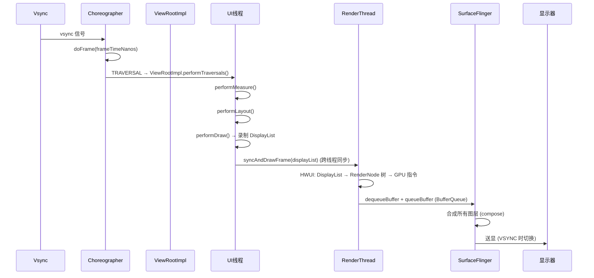

# 渲染机制

## 一句话定义

Android 的渲染是一套 **"以 Vsync 为节拍器"** 的流水线：显示器的 **VSYNC 信号**触发 **`Choreographer`** 的 `doFrame`，它按 **Animation → Input → Traversal** 三个阶段依次执行回调；主线程完成 `measure/layout/draw` 并录制 **DisplayList**，**RenderThread** 再把它翻译成 GPU 指令，最后由 **SurfaceFlinger** 合成多个图层后送屏。任何一环耗时超过一个 vsync 周期（16.67ms @60Hz），就会**丢帧**。

## 核心原理

### 1. Vsync：为什么要有它

```text
【没有 Vsync 的问题】
  CPU 绘制完成 ──→ 立即送显
  显示器正在扫描上一帧（撕裂 Tearing）
  CPU 绘制速度 ≠ 屏幕刷新速度 → 画面撕裂、不流畅

【有 Vsync 的模型】
  VSYNC ──┬── VSYNC ──┬── VSYNC ──┬── VSYNC
         │            │            │
    ┌────▼────┐  ┌────▼────┐  ┌────▼────┐
    │ Frame 1 │  │ Frame 2 │  │ Frame 3 │   ← 每 16.67ms 一个"绘制截止时间"
    │ 0~16ms │  │16~33ms │  │33~50ms │
    └─────────┘  └─────────┘  └─────────┘
         │
         ▼
   屏幕在 VSYNC 到来时切换到这一帧（无缝、无撕裂）
```

| 屏幕刷新率 | Vsync 周期 | 每秒帧数 | 单帧预算（60% 留给业务） |
| --- | --- | --- | --- |
| 60 Hz | 16.67 ms | 60 fps | ~10 ms |
| 90 Hz | 11.11 ms | 90 fps | ~6.7 ms |
| 120 Hz | 8.33 ms | 120 fps | ~5 ms |
| 144 Hz | 6.94 ms | 144 fps | ~4.2 ms |

**关键结论**：**刷新率越高，单帧预算越紧张**。从 60Hz 切到 120Hz，**每帧可用时间减半**——这就是为什么"高刷屏上更卡"的体感来源，也是为什么 120Hz 设备对性能优化要求更高。

**Android 的刷新率适配**：
- `Display.getRefreshRate()` 返回当前刷新率；
- `WindowManager.LayoutParams.preferredRefreshRate`（或 `preferredDisplayModeId`）可让某个 Activity/窗口请求特定刷新率；
- Android 11+ 的 **`Surface.setFrameRate()`** 可以按内容动态调整（如视频 24fps 内容在 120Hz 屏上按 30/60 分组呈现）；
- Android 12+ 的**自适应刷新率**（LTPO 设备）支持系统在 1Hz~120Hz 之间动态切换。

### 2. Choreographer：Android 的帧调度器（**核心原理题**）

```text
┌──────────────────────────────────────────────────────────┐
│                     Choreographer                        │
│                                                          │
│  mFrameCallbacks (普通)  mCallbacks (ViewRootImpl)       │
│  mInputCallbacks (Input) mTraversalCallbacks (Traversal) │
│  mCompatCallbacks                                     │
│                                                          │
│  postFrameCallback() → mFrameCallbacks                   │
│  postInputCallback()  → mInputCallbacks                  │
│  postTraversalCallback() → mTraversalCallbacks            │
│  postCallbackDelayed() → mCallbacks (延迟执行)             │
└──────────────────────────────────────────────────────────┘
```

#### 2.1 `doFrame` 的三个阶段（**必背**）

```java
// AOSP Choreographer.doFrame()
void doFrame(long frameTimeNanos, int frame, ...) {

    // 阶段 1：ANIMATION —— 执行动画（属性动画、Transition）
    mLastFrameTimeNanos = frameTimeNanos;
    for (int i = 0; i < mAnimationCallbacks.size(); i++) {
        mAnimationCallbacks.get(i).runAnimation(frameTimeNanos);
    }
    // 处理动画结束标记（mFrameFinished）
    if (mFrameFinished) { ... }

    // 阶段 2：INPUT —— 处理输入事件
    mLastInputEventTimeNanos = frameTimeNanos;
    for (int i = 0; i < mInputCallbacks.size(); i++) {
        mInputCallbacks.get(i).runInputEvent(frameTimeNanos);
    }

    // 阶段 3：TRAVERSAL —— 布局与绘制（最重）
    mLastTraversalTimeNanos = frameTimeNanos;
    for (int i = 0; i < mTraversalCallbacks.size(); i++) {
        mTraversalCallbacks.get(i).doTraversal(frameTimeNanos);
    }
    // 通知 Vsync 接收器：帧已提交
    mFrameInteracted = false;
    ...
}
```

| 阶段 | 回调类型 | 注册方法 | 内容 |
| --- | --- | --- | --- |
| **ANIMATION** | `FrameCallback`（动画回调） | `ValueAnimator`、`Transition`、属性动画 | 计算动画插值、设置属性 |
| **INPUT** | `InputEventCallback` | `InputEventReceiver`、ViewRootImpl | 分发触摸事件（**先处理输入，再处理布局，保证事件响应及时**） |
| **TRAVERSAL** | `TraversalCallback` | `ViewRootImpl`（`scheduleTraversals`） | `measure → layout → draw` |

> [!tip] 为什么顺序是 Animation → Input → Traversal？
> 1. **动画优先**：动画的插值需要基于最新的帧时间，且动画可能在本次改变布局；
> 2. **输入次之**：用户输入的响应延迟比画面更新更敏感，先处理输入能保证点击及时响应；
> 3. **遍历最后**：布局绘制依赖前面动画/输入产生的新状态。

#### 2.2 Choreographer 的驱动源

```text
Choreographer.doFrame() 的调用来源（按优先级）：

1. VSYNC 事件（DisplayEventReceiver）
   └─ native 收到 vsync → Choreographer 回调 → scheduleFrame() → doFrame()
   ✅ 正常路径

2. 没有 vsync 时的 fallback
   └─ ThreadPoolExecutor.scheduleAtFixedRate（每 16ms 轮询）
   └─ 或 Handler.postDelayed（系统繁忙时降级）
   ⚠️ 这条路径是"尽力而为"，会掉帧
```

**`Choreographer.getInstance()` 必须在有 Looper 的线程上获取**，否则抛异常。

#### 2.3 `requestAnimationFrame` 与 `Choreographer.postFrameCallback`

```java
// View.requestAnimationFrame —— 最终走到 Choreographer.postCallback(CALLBACK_ANIMATION)
public void requestAnimationFrame(Runnable animationRunnable) {
    attachInfoIfNeeded();
    if (mAttachInfo != null) {
        ViewRootImpl.attachInfo = ...;
        mAttachInfo.mViewRootImpl.getChoreographer().postCallback(
            Choreographer.CALLBACK_ANIMATION, animationRunnable, null);
    } else {
        // 没有 attachInfo 时，会在 attach 时补一次
        mPendingAnimations.add(animationRunnable);
    }
}
```

**两者的等价关系**：

| API | 所属 | 回调阶段 | 用途 |
| --- | --- | --- | --- |
| `View.requestAnimationFrame(runnable)` | View | ANIMATION | View 级别的下一帧回调 |
| `Choreographer.postFrameCallback(runnable)` | 框架 | ANIMATION | 等价，但直接用框架 API |
| `Choreographer.postFrameCallbackDelayed(runnable, delayMs)` | 框架 | ANIMATION | 延迟到下一帧之后 |
| `Choreographer.postInputCallback` | 框架 | INPUT | 输入事件预处理 |
| `Choreographer.postTraversalCallback` | 框架 | TRAVERSAL | 在布局绘制前执行 |

**`postFrameCallback` 只能执行一次**（不是循环），需要循环要用 `postFrameCallback` 里再 `postFrameCallback`。

### 3. View 的渲染流程（**与第 3 部分衔接**）



**`ViewRootImpl.performTraversals()` 的三个动作**：

```java
void performTraversals() {
    // 1. performMeasure —— 计算尺寸
    //    注意：可能触发两次 measure（requestLayout 之后）
    performMeasure(widthMeasureSpec, heightMeasureSpec);

    // 2. performLayout —— 摆放位置
    performLayout(lp.width, lp.height);

    // 3. performDraw —— 绘制
    performDraw();
}
```

**一次 requestLayout 引发两次 measure 的根因**（**面试高频**）：

```text
invalidate()  →  只重绘（requestLayout = false）
                → ViewRootImpl.scheduleTraversals()
                → performMeasure → performLayout → performDraw

requestLayout()  →  requestLayout = true
                → ViewRootImpl.requestLayout()
                → mLayoutRequested = true → scheduleTraversals()
                → performMeasure
                → performLayout
                → performDraw
                ↓
        若在 performLayout 中又调用了 requestLayout()
                → 下一帧又要重新 measure + layout
                → measure 被执行两次
```

> 详见 [[../../03-UI开发与用户交互/传统View系统/绘制流程]]。

### 4. RenderThread 与硬件加速（**高频原理题**）

```text
【软件渲染（Software Rendering）】
  UI 线程 → Canvas 直接调用 Skia → CPU 光栅化 → Bitmap
  ❌ 全部在主线程，绘制耗时直接阻塞 UI

【硬件加速（HWUI，Android 4.0+ 默认开启）】
  UI 线程                      RenderThread
  ─────────                  ────────────
  Canvas.drawXXX()
    → 记录绘制命令
    → 生成 DisplayList
        │  (syncAndDrawFrame 跨线程同步)
        ▼
  什么都不做                   DisplayList → RenderNode 树
                               → 遍历生成 GPU 绘制指令
                               → OpenGL ES / Vulkan
  ✅ 主线程只负责"描述"，真正的绘制在 RenderThread
```

**RenderThread 的关键点**：

1. **UI 线程与 RenderThread 分离**：UI 线程只负责构建 `DisplayList`（一份"绘制指令清单"），RenderThread 负责把它变成 GPU 指令并执行。
2. **同步点**：`ViewRootImpl.syncAndDrawFrame()` 等待 RenderThread 完成上一帧的工作（`mSyncBuffer`），**所以 RenderThread 太慢会反过来拖慢 UI 线程**（下一帧的 `scheduleTraversals` 会等待）。
3. **RenderThread 卡顿的表现**：UI 线程本身不忙，但 `syncAndDrawFrame` 阻塞 → 帧率下降。**这是"主线程不忙但界面卡"的典型原因**（大量 overdraw、复杂 shader、大量图片上传纹理）。
4. **RenderThread 的工作项**：
   - **同步**：等 UI 线程录制完 DisplayList；
   - **准备**：遍历 RenderNode 树，编译 shader、准备纹理；
   - **绘制**：执行 GPU 指令；
   - **交换**：`queueBuffer` 把 buffer 交给 SurfaceFlinger。
5. **硬件加速的开关**：`View.setLayerType(LAYER_TYPE_SOFTWARE, null)` 可对单个 View 关闭硬件加速（此时它走软件绘制，在 RenderThread 里用 CPU 光栅化）。

**硬件加速下仍走 CPU 的场景**：
- **Canvas 的 `drawBitmapMesh` / `drawVertices` 之前的部分操作**；
- **`Paint` 的某些高级效果**；
- **自定义 `View` 中直接访问 `Bitmap` 像素做 `getPixel/setPixel`**（强制软件层）；
- **`setLayerType(LAYER_TYPE_SOFTWARE)`** 的 View；
- **自定义 `View` 绘制超大文本**（部分实现）。

### 5. SurfaceFlinger 与 BufferQueue（**加分项**）

```text
应用进程                        SurfaceFlinger
┌──────────────────────┐      ┌────────────────────────────┐
│ Surface               │      │                            │
│  └─ BufferQueue       │      │  Layer 1: App Window        │
│      ├─ mBuffers (3个) │◄────►│  Layer 2: 状态栏           │
│      ├─ 消费者 dequeue │      │  Layer 3: 导航栏           │
│      └─ 生产者 queue   │      │  ...                        │
└──────────────────────┘      │  ↓ compose (GPU)            │
       │                       │  ↓                           │
       │                       │  显示控制器 (Display)        │
       ▼                       └────────────────────────────┘
  SurfaceFlinger 合成结果
```

**BufferQueue 的生产者/消费者模型**：

| 角色 | 持有者 | 职责 |
| --- | --- | --- |
| **生产者（Producer）** | 应用进程（`Surface`） | `dequeueBuffer()` 拿到一块 buffer → 绘制 → `queueBuffer()` 提交 |
| **消费者（Consumer）** | SurfaceFlinger | `acquireBuffer()` 拿到已提交的 buffer → 合成 → 释放 |

**关键机制**：
- **三缓冲（triple buffering）**：避免生产与消费互相等待；
- **`BufferSlot` 与 fence**：`queueBuffer` 时传入一个 `BufferFence`，告诉消费者"这块 buffer 什么时候可以安全读取"（GPU 异步渲染的同步手段）；
- **没有 Vsync 时提交**：如果应用在 Vsync 之前就 queue 了 buffer，SurfaceFlinger 会在下一个 Vsync 才合成显示（**所以画面更新最快也是"下一帧"**）。

### 6. TextureView vs SurfaceView（**面试必考**）

| 维度 | **SurfaceView** | **TextureView** |
| --- | --- | --- |
| **底层** | 独立的 `Surface`（有自己的图层） | 是一个普通 `Texture`，内容作为**当前窗口的纹理**参与绘制 |
| **绘制方式** | **直接向自己的 Surface 提交 buffer**（不走 View 的 DisplayList） | 走标准 View 绘制流程 → DisplayList → GPU 纹理 |
| **Z 轴层级** | **在窗口层级的特定位置**（默认在窗口**上方**，可 `setZOrderOnTop` 调整到最上） | 完全遵循普通 View 的层级（**在兄弟 View 之下/之上由 z-order 决定**） |
| **透明** | 默认**不支持透明**（`setZOrderMediaOverlay` 可部分支持） | **完全支持透明**与旋转/缩放/动画 |
| **与 View 动画** | **不能直接做缩放/旋转/位移动画**（不是 View 体系的一部分） | **可以**，像普通 View 一样做属性动画 |
| **性能** | **更好**：不参与 View 绘制，不触发 View 树重绘 | **更差**：每次内容更新都要走一遍 View 的绘制 + GPU 合成 |
| **输入事件** | 默认**不接收**触摸事件（`SurfaceView` 本身），但可重写 `onTouchEvent` | 正常接收 |
| **典型场景** | **视频播放、相机预览、游戏** | 需要动画/透明/与 UI 融合的场景（如卡牌 AR 效果、直播弹幕在视频上） |

**关键原理**：

```text
SurfaceView 的 "Surface 洞" 机制：
  Window 的 Surface（由 SurfaceFlinger 合成）
    ┌─────────────────────────────┐
    │  应用窗口层                  │
    │   ┌───────────────────┐     │  ← SurfaceView 在这里挖了一个"洞"
    │   │  (透明区域)         │     │     洞口的 z-order 被设置为
    │   │                   │     │     BELOW / ABOVE 窗口层
    │   └───────────────────┘     │
    │                             │
    └─────────────────────────────┘
           + SurfaceFlinger 合成时，这个洞是透明的，
             SurfaceView 自己的 Surface 从窗口层"下面"或"上面"透出来
```

**面试话术**："**`SurfaceView` 是'独立图层'，走 BufferQueue 直通 GPU，效率高但不能做 View 动画；`TextureView` 是'普通 View'，能动画能透明但每次更新都要走 View 绘制流程，性能差一档。**"

### 7. Compose 的渲染流程（**与传统 View 的对比，加分项**）

```text
【传统 View】
  UI 线程:
    invalidate → performTraversals
      → measure → layout → draw
      → 逐个 View 调用 onDraw，生成 DisplayList
      → syncAndDrawFrame → RenderThread
  RenderThread:
    DisplayList → GPU 指令

【Compose】
  UI 线程:
    State 变化 → 重组（Recomposition）
      → ComposeNode 树更新
      → LayoutNode 计算布局
      → DisplayList（通过 Recording / DisplayList 录制）
      → syncAndDrawFrame → RenderThread
  RenderThread:
    RenderNode 树 → GPU 指令
```

**相同点**：
- **都走 `Choreographer` 的 TRAVERSAL 阶段**；
- **都有 UI 线程 / RenderThread 分离**；
- **最终都生成 `RenderNode` 树交给 RenderThread**（View 的每个 View 对应一个 RenderNode；Compose 的每个 LayoutNode 也对应一个 RenderNode）；
- **都受 Vsync 节奏约束**。

**不同点**：

| 维度 | View | Compose |
| --- | --- | --- |
| **触发重绘** | `invalidate()`（命令式） | State 变化 → 重组（声明式） |
| **绘制指令来源** | 每个 View 的 `onDraw` | Compose 的 `DrawModifier` 链 |
| **跳过机制** | 无（`invalidate` 即全量重绘该子树） | **重组跳过**（编译器生成的可跳过 lambda）+ **布局跳过** |
| **View 树 vs 节点树** | View 树（同时承担布局与绘制） | ComposeNode（语义）→ LayoutNode（布局）→ RenderNode（绘制） |

**关键性能点**：
- **重组（Recomposition）不一定在主线程**（Compose 的重组可以在**后台线程**执行，但布局与绘制必须在主线程）；
- **稳定类型（`@Stable` / `@Immutable`）**让 Compose 能跳过不必要的重组；
- **`derivedStateOf`** 减少无效重组。

### 8. 掉帧的计算与统计

```text
【掉帧的定义】
  理想：一帧在 vsync 到来时完成并上屏
  实际：第 N 帧的工作在第 N+1 个 vsync 之后才完成
       → 第 N+1 帧被跳过（dropped）
       → 用户看到的是"画面停了一下"

【掉帧率的计算】
  掉帧率 = 丢帧数 / 总帧数
  jank rate = (总帧数 - 掉帧数) / 总帧数   （jank 率）
```

**Android 定义的 jank 等级（`FrameMetrics` / `Window.OnFrameMetricsAvailableListener`）**：

| 等级 | 含义 | 阈值（60Hz） |
| --- | --- | --- |
| **JANK_SEVERITY_NONE** | 无卡顿 | < 1 vsync |
| **JANK_SEVERITY_MISSING_VSYNC** | 漏掉一个 vsync | ≥ 1 vsync |
| **JANK_SEVERITY_MISSING_VSYNC_2** | 漏掉两个 vsync | ≥ 2 vsync |
| **JANK_SEVERITY_MISSING_VSYNC_3+** | 漏掉三个以上 | ≥ 3 vsync |
| **JANK_SEVERITY_DEADLINE_EXCEEDED_BY_SMALL_MARGIN` | 超出 deadline 但在一个 vsync 内 | — |
| **JANK_SEVERITY_DEADLINE_EXCEEDED_BY_LARGE_MARGIN` | 超出 deadline 且超过一个 vsync | — |

**`FrameMetrics` 提供的关键指标**：

| 指标 | 常量 | 含义 |
| --- | --- | --- |
| **总耗时** | `TOTAL_DURATION` | 从 vsync 到本帧完成的总时间 |
| **输入处理** | `INPUT_HANDLING_DURATION` | INPUT 阶段耗时 |
| **动画** | `ANIMATION_DURATION` | ANIMATION 阶段耗时 |
| **布局与绘制（Measure/Layout/Draw）** | `LAYOUT_DURATION` | TRAVERSAL 中的 measure/layout/draw |
| **同步（UI ↔ RenderThread）** | `SYNC_DURATION` | `syncAndDrawFrame` 的等待时间 |
| **命令 issue** | `COMMAND_ISSUE_DURATION` | RenderThread 提交 GPU 命令的耗时 |
| **GPU 完成** | `SWAP_BUFFERS` / `GPU_DURATION` | GPU 实际执行时间 |
| **帧率** | `FRAME_RATE` | 实际帧率 |
| **是否为 jank** | `JANK` | 布尔 |

**采集方式**：

```java
// API 24+：按 Activity 采集
getWindow().addOnFrameMetricsAvailableListener(listener, handler);

// 全局采集（API 24+）
WindowMetrics.addWindowMetricsListener(...);

// 命令行
adb shell dumpsys gfxinfo <pkg> framestats
adb shell dumpsys gfxinfo <pkg> reset
```

### 9. 为什么不能在主线程做 IO？

```text
主线程做 IO 的后果链：

  主线程执行 IO（read/write 阻塞）
        │
        ▼
  主线程被阻塞 100ms
        │
        ▼
  Choreographer 的 doFrame 无法按时执行
        │  （因为 Handler 的消息在同一个 Looper 上排队）
        ▼
  当前帧的 TRAVERSAL 阶段被跳过
        │
        ▼
  Choreographer 记录"这一帧没做完"
        │
        ▼
  下一个 vsync 时才绘制 → 丢帧
        │
        ▼
  如果 IO 持续 > 5s → ANR
```

**更深一层**：
- **磁盘 IO 是不可中断的阻塞**（`read()` 会进入内核等待），**不会像 CPU 计算那样被抢占**，所以主线程一旦进去就"卡死"在那儿；
- **StrictMode** 可以在 debug 包里直接检测主线程 IO 与网络访问：
  ```kotlin
  // 启动时开启
  StrictMode.setThreadPolicy(
      StrictMode.ThreadPolicy.Builder().detectDiskReads().detectDiskWrites()
          .detectNetwork().penaltyLog().build()
  )
  ```
  线上可以用 `StrictMode.VmPolicy` 配合 `DeathRecipient` 在检测到违规时**直接杀进程**（"StrictMode Kill"模式）。

**面试话术**："**主线程做 IO 会直接阻塞 Handler 消息队列，导致 Choreographer 的 doFrame 无法执行，丢帧甚至 ANR。而 StrictMode 就是官方给的检测手段。**"

## 代码示例

### 1. 帧率监控与掉帧统计（**线上 APM 的基础**）

```kotlin
class FrameMonitor(private val activity: Activity) {

    private val frameDurations = ArrayDeque<Long>(128)
    private var lastFrameTime = 0L
    private var totalFrames = 0
    private var jankFrames = 0

    fun start() {
        activity.window.addOnFrameMetricsAvailableListener(
            frameMetricsListener, Handler(Looper.getMainLooper())
        )
    }

    private val frameMetricsListener = OnFrameMetricsAvailableListener { _, metrics, _ ->
        val totalDuration = metrics.getMetric(FrameMetrics.TOTAL_DURATION)
        // totalDuration 单位是纳秒
        val durationMs = totalDuration / 1_000_000.0

        totalFrames++
        // 以设备刷新率的一半作为"卡顿"阈值（业界常用 16.67ms 的固定值也可）
        val jankThresholdMs = 16.67
        if (durationMs > jankThresholdMs) {
            jankFrames++
        }

        frameDurations.addLast(totalDuration)
        if (frameDurations.size > 128) frameDurations.removeFirst()

        if (totalFrames % 60 == 0) {
            val jankRate = jankFrames.toDouble() / totalFrames
            val p95 = frameDurations.sorted().get((frameDurations.size * 0.95).toInt().coerceAtMost(frameDurations.lastIndex))
            APM.report(
                screen = activity.javaClass.simpleName,
                jankRate = jankRate,
                p95FrameMs = p95 / 1_000_000.0
            )
        }
    }

    fun stop() {
        activity.window.removeOnFrameMetricsAvailableListener(frameMetricsListener)
    }
}
```

### 2. `Choreographer` 的正确使用（**首帧感知**）

```kotlin
object FirstFrameWatcher {

    /**
     * ✅ 在首帧渲染完成后回调。
     * 比 onResume 更准确（onResume 后界面还没画出来）。
     */
    fun awaitFirstFrame(onFirstFrame: () -> Unit) {
        Choreographer.getInstance().postFrameCallback {
            onFirstFrame()
        }
    }

    /**
     * ✅ 等待"界面真正可见"（窗口获得焦点）。
     */
    fun awaitWindowFocus(activity: Activity, onVisible: () -> Unit) {
        activity.window.decorView.viewTreeObserver.addOnWindowFocusChangeListener(
            object : ViewTreeObserver.OnWindowFocusChangeListener {
                override fun onWindowFocusChanged(hasFocus: Boolean) {
                    if (hasFocus) {
                        activity.window.decorView.viewTreeObserver
                            .removeOnWindowFocusChangeListener(this)
                        onVisible()
                    }
                }
            }
        )
    }

    /**
     * ✅ 在每帧的 TRAVERSAL 之前执行（比 postFrameCallback 更早）。
     * 适合"每帧都要做的事"（如埋点、动画同步）。
     */
    fun onEachFrame(block: (frameTimeNanos: Long) -> Unit) {
        Choreographer.getInstance().postFrameCallback { frameTimeNanos ->
            block(frameTimeNanos)
            onEachFrame(block)   // 递归注册，实现循环
        }
    }
}
```

### 3. `TextureView` 与 `SurfaceView` 的实现对比

```kotlin
// ✅ SurfaceView：视频播放
class VideoSurfaceView(context: Context, attrs: AttributeSet? = null) :
    SurfaceView(context, attrs), SurfaceHolder.Callback {

    private var mediaPlayer: MediaPlayer? = null

    init {
        holder.addCallback(this)
        // 关键：让 Surface 独立于窗口层级，性能更好
        setZOrderMediaOverlay(true)   // 置于其他媒体层之上
    }

    override fun surfaceCreated(holder: SurfaceHolder) {
        mediaPlayer = MediaPlayer().apply {
            setSurface(holder.surface)
            setDataSource("/sdcard/video.mp4")
            prepareAsync()
            setOnPreparedListener { start() }
        }
    }

    override fun surfaceChanged(holder: SurfaceHolder, format: Int, w: Int, h: Int) {}

    override fun surfaceDestroyed(holder: SurfaceHolder) {
        mediaPlayer?.release()
        mediaPlayer = null
    }
}
```

```kotlin
// ✅ TextureView：需要透明/动画的场景
class CameraTextureView(context: Context, attrs: AttributeSet? = null) :
    TextureView(context, attrs), TextureView.SurfaceTextureListener {

    private var cameraDevice: CameraDevice? = null

    init {
        surfaceTextureListener = this
    }

    override fun onSurfaceTextureAvailable(st: SurfaceTexture, w: Int, h: Int) {
        // TextureView 可以直接做 View 动画
        animate().rotationY(180f).setDuration(500).start()
        openCamera()
    }

    override fun onSurfaceTextureSizeChanged(st: SurfaceTexture, w: Int, h: Int) {}

    override fun onSurfaceTextureDestroyed(st: SurfaceTexture): Boolean {
        closeCamera()
        return true   // 返回 true 表示由 TextureView 释放 SurfaceTexture
    }

    override fun onSurfaceTextureUpdated(st: SurfaceTexture) {}
}
```

### 4. 自定义 View 的绘制优化（**避免过度绘制**）

```kotlin
/**
 * ✅ 硬件加速下，onDraw 会被记录为 DisplayList 并在 RenderThread 重放。
 * 但 onDraw 里做以下操作会破坏这个机制（每次都要重新执行）：
 *   - Canvas.getDrawBitmap / getMatrix / getClipPath 等读操作
 *   - Paint.getTextWidths 等
 *   - 直接访问 Bitmap 像素
 *   - 绘制超过 10000 个 path
 * 解决办法：把这些计算提前做好缓存起来。
 */
class OptimizedChartView @JvmOverloads constructor(
    context: Context, attrs: AttributeSet? = null, defStyle: Int = 0
) : View(context, attrs, defStyle) {

    /** 预计算的 Path，避免在 onDraw 里做复杂运算 */
    private val cachedPath = Path()
    private var cachedWidth = 0
    private var cachedHeight = 0

    private val paint = Paint(Paint.ANTI_ALIAS_FLAG).apply {
        style = Paint.Style.STROKE
        strokeWidth = 4f
        color = Color.RED
    }

    override fun onSizeChanged(w: Int, h: Int, oldw: Int, oldh: Int) {
        super.onSizeChanged(w, h, oldw, oldh)
        if (w != cachedWidth || h != cachedHeight) {
            cachedWidth = w
            cachedHeight = h
            rebuildPath(w, h)   // ✅ 只在尺寸变化时计算
        }
    }

    private fun rebuildPath(w: Int, h: Int) {
        cachedPath.reset()
        cachedPath.moveTo(0f, h.toFloat())
        for (i in 0..100) {
            val x = w * i / 100f
            val y = h / 2f + kotlin.math.sin(i * 0.2) * h / 4f
            cachedPath.lineTo(x, y)
        }
    }

    override fun onDraw(canvas: Canvas) {
        super.onDraw(canvas)
        canvas.drawPath(cachedPath, paint)   // ✅ 只做绘制指令
    }
}
```

### 5. StrictMode：检测主线程 IO（**线上也能用**）

```kotlin
class StrictModeInitializer {

    /**
     * ✅ Debug 包：只打日志。
     * Release 包：用 VmPolicy 的 penaltyDeath，在检测到违规时直接杀进程，
     *    配合 Crash 上报，线上也能发现主线程 IO。
     */
    fun init(isDebug: Boolean) {
        if (isDebug) {
            StrictMode.setThreadPolicy(
                StrictMode.ThreadPolicy.Builder()
                    .detectDiskReads()
                    .detectDiskWrites()
                    .detectNetwork()
                    .detectCustomSlowCalls()
                    .penaltyLog()
                    .penaltyDeath()      // Debug 包：直接崩，强制暴露问题
                    .build()
            )
        } else {
            // Release：只对特别严重的（自定义慢调用）启用 death
            StrictMode.setVmPolicy(
                StrictMode.VmPolicy.Builder()
                    .detectLeakedClosableObjects()
                    .detectLeakedRegistrationObjects()
                    .detectFileUriExposure()
                    .penaltyLog()
                    .build()
            )
        }
    }
}
```

## 常见问题 / 面试要点

**读者问：Choreographer 的工作原理是什么？`doFrame` 里做了哪几件事？**

**AI答：**

1. **角色**：Choreographer 是 Android 的**帧调度器**，它把每一帧的工作组织成三个阶段，统一由 vsync 信号驱动。
2. **驱动源**：`DisplayEventReceiver` 收到显示器的 **VSYNC 中断** → 回调到 Choreographer → `scheduleFrame()` → `doFrame(frameTimeNanos)`。在无 vsync 的极端情况下会退化为 16ms 轮询（尽力而为，必然掉帧）。
3. **`doFrame` 的三个阶段（顺序固定）**：
   - **ANIMATION**：执行 `FrameCallback`（属性动画、Transition）——动画要基于最新帧时间计算插值；
   - **INPUT**：处理输入事件（`InputEventCallback`）——把输入放在布局之前，保证点击响应及时；
   - **TRAVERSAL**：`ViewRootImpl.performTraversals()` → measure → layout → draw（最重的一步）。
4. **回调注册 API**：`postFrameCallback`（ANIMATION）、`postInputCallback`（INPUT）、`postTraversalCallback`（TRAVERSAL）、`postCallbackDelayed`（延迟）。
5. **面试话术**："**Choreographer 把'什么时候干活'的问题从应用层收归框架：应用不再自己算时间，而是把工作挂到 vsync 的节拍上。`postFrameCallback` 是'下一帧'，不是'现在'。**"

---

**读者问：掉帧是怎么产生的？怎么排查一次卡顿？**

**AI答：**

1. **产生机理**：一帧的工作（ANIMATION + INPUT + TRAVERSAL + RenderThread）必须在下一个 vsync 之前完成。超过预算 → **本帧被跳过**，下一个 vsync 才显示 → 用户看到"顿一下"。**连续多帧超预算 → 明显卡顿**。
2. **四大来源**：
   - **UI 线程繁忙**（主线程 IO、复杂计算、大量对象分配、布局层级过深）；
   - **GC 停顿**（内存抖动，CC GC 的 STW）；
   - **RenderThread 慢**（复杂 shader、大量 overdraw、纹理上传、`syncAndDrawFrame` 等待）；
   - **主线程锁竞争**（多线程抢锁、`synchronized` 阻塞）。
3. **排查流程（面试要能完整说）**：
   - **第一步：确定是"掉帧"还是"ANR"还是"输入延迟"**（现象不同，排查路径不同）；
   - **第二步：`adb shell dumpsys gfxinfo <pkg>`** → 看 `Janky frames`、`50th/90th/95th/99th percentile`、`HISTOGRAM`、`MISSING_VSYNC` 计数；
   - **第三步：`adb shell dumpsys gfxinfo <pkg> framestats`** → 逐帧数据，定位是哪个阶段超时（Input / Animation / Draw / Sync / GPU）；
   - **第四步：Perfetto / System Trace 抓一段** → 看主线程 Slice 找出耗时最长的调用；看 `RenderThread` 的 Slice 看是不是渲染慢；
   - **第五步：结合 Memory Profiler 看是否 GC 导致**；
   - **第六步：定位到具体代码后修复并验证**。
4. **加分工具**：`adb shell dumpsys SurfaceFlinger --latency <windowName>` 可以拿到指定窗口的每帧时间戳（用于计算丢帧点）。
5. **面试话术**："**我排查卡顿的标准动作是：先看 `gfxinfo` 的 percentile 判断严重程度和丢帧分布，再看 `framestats` 定位到具体阶段（Draw 超时=主线程，Sync 超时=RenderThread 慢，GPU 超时=图形复杂度过高），最后用 Perfetto 把那段 Slice 放大到方法级别。**"

---

**读者问：为什么主线程卡住，界面就不动？不能在主线程做 IO 吗？**

**AI答：**

1. **为什么不动**：
   - UI 的**所有绘制工作都在主线程**（measure/layout/draw → DisplayList 录制）；
   - 主线程同时也是 **Handler 消息队列的处理线程**；
   - `Choreographer.doFrame` 本身就是一个 Handler 消息；
   - 主线程被阻塞 → **doFrame 无法执行** → 没有新的 DisplayList → RenderThread 没有新内容 → SurfaceFlinger 拿到的还是上一帧 → **画面静止**。
2. **为什么 IO 特别危险**：
   - 磁盘/网络 IO 是**不可中断的阻塞等待**（进入内核睡眠），**不会因为 CPU 调度而让出**；
   - CPU 密集计算虽然也慢，但线程可以被抢占（只是仍然占用 CPU）；
   - 主线程 IO 阻塞 100ms = 掉 6 帧（60Hz）。
3. **StrictMode 的检测**：
   - `detectDiskReads/ detectDiskWrites / detectNetwork`；
   - Debug 包 `penaltyLog()` 打日志，`penaltyDeath()` 直接崩；
   - Release 包可以用 `VmPolicy` + `penaltyDeath` 配合崩溃上报，**线上也能发现**。
4. **正确做法**：
   - IO 全部放 `Dispatchers.IO` / `Executor`；
   - 主线程只做"结果渲染"；
   - 确实必须主线程的极小操作（如读 SharedPreferences 的内存缓存）要评估耗时。

---

**读者问：RenderThread 是什么？它和 UI 线程怎么协作？硬件加速是怎么实现的？**

**AI答：**

1. **RenderThread** 是每个应用进程里的一个**独立渲染线程**（`RenderThread` 继承 `Thread`），由 `ViewRootImpl` 持有。
2. **协作流程**：
   - UI 线程：`Canvas.drawXXX()` **不是真的绘制**，而是**记录绘制命令**到 `DisplayList`；
   - UI 线程调用 `syncAndDrawFrame()`：把 DisplayList 交给 RenderThread，并**等待** RenderThread 完成上一帧（通过 `mSyncBuffer` 与 fence 同步）；
   - RenderThread：遍历 `RenderNode` 树 → 生成 GPU 指令 → 调用 OpenGL ES / Vulkan 绘制 → `queueBuffer` 提交给 SurfaceFlinger。
3. **硬件加速（HWUI）**：Android 4.0 起默认开启。它把绘制拆成"**命令录制（主线程）**"和"**命令执行（RenderThread + GPU）**"两段，主线程只负责"描述"而非"执行"。
4. **为什么分离有意义**：
   - 主线程只做轻量的命令录制 → 帧率更高；
   - RenderThread 与 UI 线程**并行**，一个忙另一个还能干活。
5. **但不是完全解耦（面试加分）**：`syncAndDrawFrame` 是一个**同步点**——**RenderThread 太慢会反过来阻塞 UI 线程**。这是"主线程 CPU 占用很低但界面依然卡"的典型原因（大量 overdraw、复杂 Shader、大量 Bitmap 纹理上传）。
6. **关闭硬件加速的场景**：`setLayerType(LAYER_TYPE_SOFTWARE, null)`，此时 View 走软件绘制（在 RenderThread 中用 CPU 光栅化），支持 Canvas 的全部高级特性但慢。

---

**读者问：`TextureView` 和 `SurfaceView` 有什么区别？各自的适用场景？**

**AI答：**

1. **本质区别**：
   - **`SurfaceView`**：拥有**独立的 `Surface`**（独立的 BufferQueue），直接向 GPU 提交 buffer，**不参与 View 系统的绘制流程**；
   - **`TextureView`**：是一个**普通 View**，其内容是一张纹理，走标准 View 绘制流程（DisplayList → RenderNode）。
2. **对比表**：

| 维度 | SurfaceView | TextureView |
| --- | --- | --- |
| 性能 | **高**（直通 GPU） | 较低（每次更新都走 View 绘制） |
| 透明 | 不支持（`setZOrderMediaOverlay` 部分支持） | **完全支持** |
| View 动画（缩放/旋转/位移） | **不支持** | **支持** |
| Z 轴 | 在窗口层级中的特殊位置 | 遵循普通 z-order |
| 输入事件 | 默认不处理，需重写 | 正常处理 |
| 适用场景 | **视频播放、相机预览、游戏** | 需要动画/透明/与 UI 融合（AR 特效、弹幕叠加） |

3. **SurfaceView 的"洞"机制**：它在窗口 Surface 上"挖"一个透明区域，自己独立的 Surface 从这个洞里透出来（z-order 可配置在窗口层之上或之下）。
4. **面试话术**："**选择依据只有两条：要不要动画/透明，要极致性能。视频和相机用 SurfaceView，因为不需要 View 动画且要省电省 CPU；需要和 UI 混合动效就用 TextureView。**"

---

**读者问：90Hz / 120Hz 屏幕对性能有什么影响？**

**AI答：**

1. **单帧预算减半**：60Hz 是 16.67ms，90Hz 是 11.11ms，120Hz 是 8.33ms。**同样一段耗时逻辑，在 120Hz 下更容易掉帧**。
2. **"卡顿"体感更明显**：因为掉一帧的间隔从 16.67ms 缩到 8.33ms，人眼更容易察觉"不跟手"。
3. **功耗更高**：GPU 每秒要提交更多帧 → 渲染功耗上升；屏幕本身的功耗也上升。
4. **适配方式**：
   - 应用不需要特殊处理，**系统会自动按屏幕刷新率调度**；
   - 若某页面想固定刷新率：`window.attributes.preferredRefreshRate = 120f`；
   - Android 11+ 可用 `Surface.setFrameRate()` 按内容动态调整（视频 30fps 内容在 120Hz 屏上按 30/60 呈现，省电且减少撕裂）；
   - Android 12+ 的 **LTPO 自适应刷新率**支持 1Hz~120Hz 动态切换（静态内容降到 1Hz）。
5. **面试话术**："**高刷不是免费的：它把性能预算压缩了一半。所以做高刷适配时，必须在 120Hz 下重新跑一遍卡顿率，而不是拿 60Hz 的数据说事。**"

---

**读者问：`requestAnimationFrame` 和 `Choreographer.postFrameCallback` 有什么区别？`postFrameCallback` 怎么用？**

**AI答：**

1. **本质等价**：`View.requestAnimationFrame(runnable)` 内部就是 `Choreographer.postCallback(CALLBACK_ANIMATION, runnable, null)`，只是多了一层"如果没有 attachInfo 就先挂起，attach 时补执行"的处理。
2. **区别**：
   - `View.requestAnimationFrame` 是 View 层的 API，且**只有在 View 已 attach 到窗口后才会真正注册**；
   - `Choreographer.postFrameCallback` 直接用框架 API，**在 `onCreate` 里就能注册**（但回调会在第一帧时执行）；
   - `Choreographer` 还有 `postInputCallback`、`postTraversalCallback`、`postCallbackDelayed` 等其他阶段与延迟版本。
3. **执行时机**：`postFrameCallback` 的回调在**下一帧的 ANIMATION 阶段**执行（即 `doFrame` 的最前面），**此时上一帧的画面已经上屏**。
4. **一次性语义**：`postFrameCallback` **只执行一次**，不是循环。需要每帧都做，必须在回调里再次注册。
5. **典型用途**：
   - **感知首帧完成**（比 `onResume` 准确）；
   - **测量控件真实尺寸**（`postFrameCallback` 里 `view.width` 已有效）；
   - **与 vsync 同步的动画循环**。
6. **代码**：
   ```kotlin
   Choreographer.getInstance().postFrameCallback {
       // 下一帧
   }
   ```

---

**读者问：`postFrameCallback` 里拿到的 `view.width` 是 0 吗？什么时候能拿到真实尺寸？**

**AI答：**

1. **在 `onCreate` 里同步取是 0**，因为还没走 measure/layout。
2. **`postFrameCallback` 的回调里可以拿到真实尺寸**：它在**下一帧的 ANIMATION 阶段**执行，而该帧的 TRAVERSAL 阶段（measure/layout）发生在**上一帧**。所以：
   - `onCreate` → `setContentView` → `requestLayout`；
   - 第 1 帧的 TRAVERSAL 完成 measure/layout；
   - 第 2 帧的 ANIMATION 阶段执行 `postFrameCallback` → 此时 `view.width` **已经有值**。
3. **更早拿到尺寸的方式**：
   - `ViewTreeObserver.OnGlobalLayoutListener`（在布局完成后回调，能拿到尺寸，但可能触发多次，需 `remove`）；
   - `doOnPreDraw`（Kotlin 扩展，`androidx.core.view`）——**推荐**，只回调一次且在绘制前：
     ```kotlin
     view.doOnPreDraw { /* 这里 width/height 已确定 */ }
     ```
4. **最佳实践**：新项目统一用 `doOnPreDraw`；需要与 vsync 对齐的动画用 `postFrameCallback`。

## 关联笔记

- [[../性能优化专项/卡顿优化]]：掉帧定位与优化的工程实践
- [[内存管理]]：GC 停顿是掉帧的重要来源
- [[应用启动流程]]：首帧渲染是启动耗时的最后一块
- [[../../03-UI开发与用户交互/传统View系统/绘制流程]]：`measure/layout/draw` 的细节
- [[../README]]：第 6 部分总览
- [[../../03-UI开发与用户交互/JetpackCompose/声明式UI与重组]]：Compose 的重组与绘制
- [[../../07-架构、工具与生态/基础工具链/AndroidStudio]]：Profiler / Layout Inspector

## 参考资料

- AOSP `frameworks/base/core/java/android/view/Choreographer.java`（`doFrame` 三阶段）
- AOSP `frameworks/base/core/java/android/view/ViewRootImpl.java`（`performTraversals` / `syncAndDrawFrame`）
- AOSP `frameworks/native/libs/gui/` 与 `frameworks/native/libs/ui/`（RenderThread、HWUI）
- Android 官方文档《Frame timing》：https://developer.android.com/topic/performance/vitals/render
- Android 官方文档《Optimize jank》：https://developer.android.com/topic/performance/vitals/jank
- 《Android 性能优化典范》第 4 章 "Android 渲染机制"
