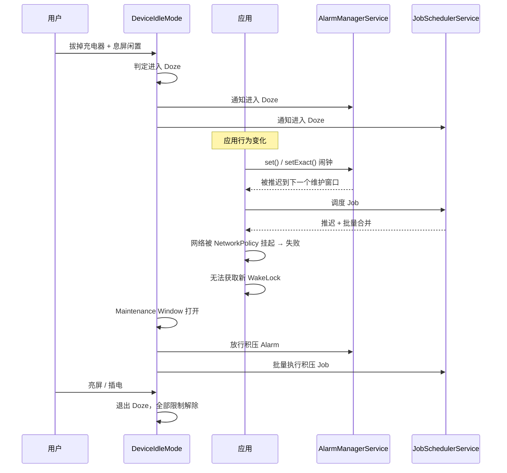
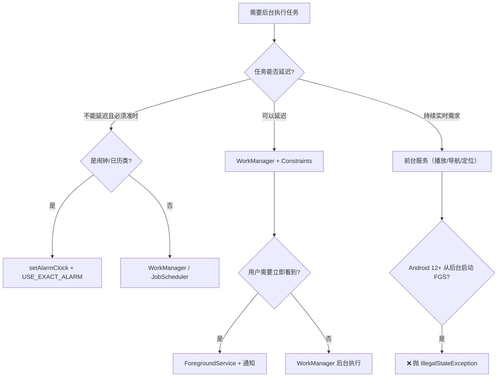

# 电源管理

## 一句话定义

Android 的电源管理本质是**"用系统的调度器代替应用的定时器"**。当设备进入 Doze 或 App Standby 后，系统会把应用的 **Alarm 推迟、Job 批量执行、网络访问受限、WakeLock 被禁止**，逼着开发者把后台任务交给 **`JobScheduler` / `WorkManager`** 这类系统调度框架。理解电源管理的关键不是记住 API，而是明白一条铁律：**你写的后台定时任务，在系统眼里是"消耗者"，系统只保证"必要者"能被执行。**

## 核心原理

### 1. 电量的四大来源与系统的应对策略

```text
设备电量消耗的四大来源（面试总纲）
┌──────────────────────────────────────────────────────────────┐
│ 1. CPU —— 计算、后台唤醒、轮询、定时任务                        │
│    对策：JobScheduler 批量/延迟、App Standby 降频              │
│ 2. 射频网络 —— 信号弱时反复重传、移动数据、频繁 ping            │
│    对策：Doze 下网络访问被挂起、Batched 策略                     │
│ 3. 显示 / GPU —— 屏幕常亮、高刷新率、过度绘制                    │
│    对策：Doze 中屏幕关闭、WakeLock 分类管理                      │
│ 4. 传感器 —— GPS 高频、BLE 扫描、计步、心率                     │
│    对策：传感器批处理、Doze 中限制后台传感器访问                 │
└──────────────────────────────────────────────────────────────┘
```

> [!tip] 面试主线
> 电源管理的问题几乎总是被翻译成两个问题：**"我的后台任务为什么没跑？"** 和 **"我的应用为什么费电？"**。前者是 Doze/Standby 的限制，后者是四大来源的治理。

### 2. WakeLock：让 CPU 不睡的"锁"

```text
【两种语义】
  PARTIAL_WAKE_LOCK  → 只保持 CPU 运行，屏幕可关（后台任务最常用）
                       ⚠️ 忘记 release 会持续耗电，且 Doze 永远无法进入
  SCREEN_BRIGHT/DIM/FULL → 保持屏幕点亮（FULL 已废弃，会阻止屏幕超时）
```

| 类型 | 常量 | 作用 | 备注 |
| --- | --- | --- | --- |
| **部分唤醒** | `PARTIAL_WAKE_LOCK` | CPU 保持运行，屏幕关闭 | **后台任务最常用**；需 `setReferenceCounted(false)` |
| **屏幕变暗** | `SCREEN_DIM` | 屏幕保持点亮但变暗 | 配合 `onAfterRelease` |
| **屏幕明亮** | `SCREEN_BRIGHT` | 屏幕保持点亮 | 亮度不衰减 |
| **完全唤醒** | `FULL_WAKE_LOCK` | 屏幕 + 键盘灯亮 | **已废弃（deprecated）** |
| **按需唤醒** | `onDemand` | 探测设备支持的最弱唤醒级别 | Android 13+ 引入，可降功耗 |

**必须知道的细节**：`acquire(timeout)` 一定要带超时；`release()` 一定要在 `finally`；tag 要带包名前缀；Android 9+ 后台应用申请 wakelock 会失败；Doze 中**禁止获取新 wakelock**。

### 3. Doze 模式（**核心原理题，必问**）

#### 3.1 进入与退出条件

```text
【进入条件（必须全部满足）】
   ① 用户主动断开充电（不是插着充电器的状态）
   ② 设备"闲置"：屏幕关闭 且 超过一定时间没有运动传感器事件
   ③ 应用不在前台，且所有 Activity 已 onStop
   → 系统在下一个维护窗口把设备推入 Doze

【退出条件（任一满足即退出）】
   ① 用户重新插上充电器      ② 用户唤醒屏幕 / 解锁
   ③ 应用通过白名单被拉入前台 ④ 系统维护窗口到达并执行完
   ⑤ setExactAndAllowWhileIdle 的闹钟到点
```

#### 3.2 Doze 的六大限制（**必背表格**）

| 限制 | 具体表现 | 面试说明 |
| --- | --- | --- |
| **① 网络受限** | 进程网络访问被挂起（`NetworkPolicy` 拦截），请求抛 `IOException` | Doze 中所有网络请求失败，**"同步失败"的最大来源** |
| **② Alarm 推迟** | 普通闹钟不再唤醒设备，被推迟到下一个维护窗口 | `setExact()` 在 Doze 中**不保证唤醒**（Android 6.0+） |
| **③ Job 批量** | `JobScheduler` 任务被推迟并打包批量执行 | 耗电越多的应用，批量延迟越久 |
| **④ 禁 wakelock** | Doze 中无法获取新 wakelock，已有 wakelock 在维护窗口被强制释放 | |
| **⑤ 后台服务受限** | 后台 Service 无法启动/被停止；后台广播被拦截 | 叠加 Android 8+ 的后台执行限制 |
| **⑥ 维护窗口** | 系统定期打开窗口，集中执行积压的 Job、Alarm、网络请求 | Doze 不是"完全不干活"，而是"**攒着一起干**" |



#### 3.3 Doze vs App Standby

| 维度 | **Doze** | **App Standby** |
| --- | --- | --- |
| 适用对象 | **整个设备** | **单个应用** |
| 触发条件 | 设备闲置（全局） | 应用长时间未使用（**按 bucket**） |
| 主要限制 | 网络挂起、Alarm 推迟、Job 批量 | 更严格的 Job 配额、更长的 Alarm 延迟 |
| 关系 | Doze 进入时会把符合条件的应用降级到 Standby bucket | Standby 应用即使设备不空闲也被限制 |

### 4. App Standby Buckets（四档配额模型）

Android 9（API 28）引入。系统按应用的使用频率分到四个 bucket，直接决定后台任务的延迟容忍度：

| Bucket | 准入条件 | Job 配额（近似） | 延迟容忍 |
| --- | --- | --- | --- |
| **active** | 刚被使用 / 有前台 Activity 或前台服务 | **无限制** | 立即 |
| **working** | 最近几分钟内使用过 | 每 2 分钟约 10 个 | 约 2 分钟 |
| **frequent** | 一天内使用过数次 | 每小时约 10 个 | 15 分钟 ~ 数小时 |
| **rare** | 很久未使用 | 每小时约 2 个 | 约 24 小时 |

**关键 API**：`ApplicationManager.getAppStandbyBucket()` 查询自身 bucket；`setAppStandbyBucket()` 主动降级（一般不建议）。

### 5. AlarmManager：精确但"不可靠"的闹钟

| API | 唤醒设备 | Doze 中行为 | 精确度 | 适用场景 |
| --- | --- | --- | --- | --- |
| `set()` | ✅ | **被推迟**到维护窗口 | 不精确 | 心跳、轮询（尽量别用） |
| `setExact()` | ✅ | **不保证**（Android 6.0+ 降级） | 精确 | 相对准时（仍非绝对） |
| `setExactAndAllowWhileIdle()` | ✅ | **例外**：仍会触发（**每 9 分钟一次配额**） | 精确 | 后台准点执行（IM 心跳、日程提醒） |
| `setAlarmClock()` | ✅ | **不受限**（闹钟前临时放行网络与 wakelock） | 精确 | **闹钟、闹钟类应用**（唯一合法豁免） |
| `setAndAllowWhileIdle()` | ❌ | 不被推迟 | 不精确 | 不需唤醒设备的低优先级任务 |

**时基类型**：`RTC_WAKEUP`（墙钟，受改时间影响）/ `ELAPSED_REALTIME_WAKEUP`（开机时长，不受改时间影响）。

**Android 12+ 精确闹钟限制**：`SCHEDULE_EXACT_ALARM`（特殊权限，需引导用户开启）、`USE_EXACT_ALARM`（API 33+，仅限闹钟类，审核严格）；无权限时后台调 `setExact` 会抛 `SecurityException` → 必须用 `canScheduleExactAlarms()` 检查并降级。

### 6. JobScheduler 与 WorkManager

#### 6.1 JobScheduler 的约束

| 约束 | API | 含义 |
| --- | --- | --- |
| 网络类型 | `setRequiredNetworkType()` | `NONE`/`ANY`/`UNMETERED`/`NOT_ROAMING`/`CELLULAR` |
| 充电 | `setRequiresCharging(true)` | 只在充电时执行（**最适合大文件上传**） |
| 设备空闲 | `setRequiresDeviceIdle(true)` | 只在 Doze 维护窗口执行 |
| 存储空间 | `setRequiresStorageNotLow(true)` | 空间不足不跑 |
| 超时 | `setOverrideDeadline(ms)` | 到期后系统强制执行 |
| 延迟 | `setMinimumLatency(ms)` | 最早多久后执行（系统可批量） |
| 周期性 | `setPeriodic(interval, flex)` | 最小周期 **15 分钟** |

**调度逻辑**（`JobSchedulerService`）：系统综合约束满足情况、Standby Bucket 配额、Doze 状态、全局电量策略、`overrideDeadline` 是否到期、同 UID 的 Job 合并来决定执行时机。

#### 6.2 WorkManager 与 JobScheduler 的关系

```text
【分层关系】
   WorkManager (androidx.work)
        │ 提供：持久化（进程被杀/重启后继续）、链式依赖、约束、重试退避
        │ 实现：Android 5.0+ 底层用 JobScheduler；4.x 用 AlarmManager + Receiver
        ▼
   JobScheduler / AlarmManager → 系统调度器（受 Doze / Standby / 配额约束）
```

| 维度 | **WorkManager** | **JobScheduler** |
| --- | --- | --- |
| 抽象层级 | 面向业务（声明式） | 系统调度 API |
| 持久化 | ✅ `WorkSpec` 存 Room | ❌ 进程死即丢 |
| 链式依赖 | ✅ `then` | ❌ |
| 唯一任务 | ✅ `ExistingWorkPolicy` | ❌ 需自行 cancel |
| 重试退避 | ✅ 内置 | 需自行 `setBackoffCriteria` |
| 选型 | **默认选它** | 需要精确控制时 |

**`ExistingWorkPolicy` 四种策略**：`KEEP`（忽略新请求）/ `REPLACE`（取消旧的）/ `APPEND`（追加到链尾）/ `APPEND_OR_REPLACE`（追加，链已失败则替换）。

**WorkManager 的现实约束**：周期任务最短 15 分钟；不是准实时工具；`doWork()` 有 10 分钟上限；Android 16 起默认按 Job 调度。

### 7. 后台保活：合规做法 vs 违规保活



| 需求 | 正确方案 |
| --- | --- |
| 定时同步（可延迟） | `WorkManager` + `NetworkType.CONNECTED` |
| 大文件上传 | `WorkManager` + `setRequiresCharging` + `setRequiresStorageNotLow` |
| 闹钟提醒 | `AlarmManager.setAlarmClock()` + `FLAG_IMMUTABLE` |
| 用户可见的持续任务 | **前台服务** + 常驻通知 + `foregroundServiceType` |
| 用户主动发起的可中断长任务 | **User-Initiated Work**（`setExpedited`） |

**违规保活**：后台启动前台服务（Android 12+ 抛 `ForegroundServiceStartNotAllowedException`，例外仅 5 种）、`setPeriodic` < 15 分钟、`setExact` < 9 分钟、双进程互拉、滥用 `USE_EXACT_ALARM`。

### 8. 电源管理的整体优化思路

```text
【四大来源 → 四大治理手段】
  CPU    → 合并任务（WorkManager 批量）、降低频率（Standby 桶）
           消除轮询（push 替代 pull）、按需唤醒而非定时唤醒
  网络    → 缓存与条件请求、批量上传、指数退避重连、优先 Wi-Fi
  显示    → 深色模式、降低刷新率、避免后台常亮
  传感器  → 降低采样频率、批量获取、只在必要时开启
```

详见 [[../性能优化专项/电量优化]]。

## 代码示例

### 1. 安全的 WakeLock 封装

```kotlin
object WakeLockUtil {

    /**
     * ✅ 以超时方式获取 wakelock：即使业务崩溃没走 release，
     *    系统也会在超时后自动释放，避免"永久耗电 + Doze 无法进入"。
     */
    fun runWithWakeLock(context: Context, tag: String, timeoutMs: Long = 60_000L, block: () -> Unit) {
        val pm = context.applicationContext.getSystemService(PowerManager::class.java)
        // ⚠️ tag 必须带包名前缀，避免与其它应用的 wakelock tag 冲突
        val wakeLock = pm.newWakeLock(PowerManager.PARTIAL_WAKE_LOCK, "MyApp::$tag")
        // 关闭引用计数：多次 acquire 不叠加，避免 release 次数不匹配
        wakeLock.setReferenceCounted(false)
        try {
            wakeLock.acquire(timeoutMs)
            block()
        } finally {
            if (wakeLock.isHeld) wakeLock.release()
        }
    }
}
```

### 2. WorkManager：唯一工作 + 约束 + 退避

```kotlin
/**
 * ✅ 合规的后台同步实现。
 * 要点：唯一工作名防重复排队 / 约束声明调度条件 / 指数退避重试
 */
class MessageSyncWorker(context: Context, params: WorkerParameters) : CoroutineWorker(context, params) {

    override suspend fun doWork(): Result {
        return try {
            val repo = RepositoryProvider.get(applicationContext)
            repo.upload(repo.fetchPendingMessages())
            Result.success()
        } catch (e: IOException) {
            Result.retry()      // 网络异常：交给系统按退避策略重试
        } catch (e: Exception) {
            Result.failure()    // 业务异常：重试也没意义
        }
    }

    companion object {
        private const val UNIQUE_NAME = "message_sync"

        fun enqueue(context: Context) {
            val constraints = Constraints.Builder()
                .setRequiredNetworkType(NetworkType.CONNECTED)
                .setRequiresBatteryNotLow(true)   // 低电量不跑
                .setRequiresStorageNotLow(true)   // 空间不足不跑
                .build()

            val request = OneTimeWorkRequestBuilder<MessageSyncWorker>()
                .setConstraints(constraints)
                .setBackoffCriteria(BackoffPolicy.EXPONENTIAL, 30, TimeUnit.SECONDS)
                .build()

            WorkManager.getInstance(context).enqueueUniqueWork(
                UNIQUE_NAME, ExistingWorkPolicy.KEEP, request
            )
        }
    }
}
```

### 3. JobScheduler：充电 + Wi-Fi 下的大文件上传

```kotlin
class BigFileUploadJobService : JobService() {

    override fun onStartJob(params: JobParameters): Boolean {
        thread {
            val ok = doUpload()
            jobFinished(params, !ok)   // needsReschedule = 失败则重新排队
        }
        return true   // false = 工作仍在后台运行，需要 onStopJob 回调
    }

    override fun onStopJob(params: JobParameters): Boolean = true

    companion object {
        fun schedule(context: Context) {
            val job = JobInfo.Builder(1001, ComponentName(context, BigFileUploadJobService::class.java))
                .setRequiredNetworkType(JobInfo.NETWORK_TYPE_UNMETERED)
                .setRequiresCharging(true)
                .setRequiresStorageNotLow(true)
                .setBackoffCriteria(60_000L, JobInfo.BACKOFF_POLICY_EXPONENTIAL)
                .build()
            (context.getSystemService(Context.JOB_SCHEDULER_SERVICE) as JobScheduler).schedule(job)
        }
    }
}
```

### 4. 合规的前台服务（Android 14+ 需要 type）

```kotlin
/**
 * ✅ 前台服务必须：5 秒内 startForeground 并展示通知；
 *    Android 14+ 必须声明 foregroundServiceType 与对应权限
 */
class LocationTrackingService : Service() {

    override fun onCreate() {
        super.onCreate()
        // ⚠️ Android 12+：后台启动 FGS 会抛异常，必须来自用户可见的场景
        startForeground(
            NOTIFICATION_ID,
            buildNotification(),
            ServiceInfo.FOREGROUND_SERVICE_TYPE_LOCATION   // Android 14+
        )
    }

    override fun onStartCommand(intent: Intent?, flags: Int, startId: Int) = START_STICKY

    private fun buildNotification(): Notification {
        val channel = NotificationChannel("tracking", "位置追踪", NotificationManager.IMPORTANCE_LOW)
        getSystemService(NotificationManager::class.java).createNotificationChannel(channel)
        return Notification.Builder(this, "tracking")
            .setContentTitle("正在后台定位")
            .setSmallIcon(R.drawable.ic_location)
            .build()
    }

    companion object { private const val NOTIFICATION_ID = 1001 }
}
```

```xml
<!-- Android 14+ 必须声明类型与权限 -->
<uses-permission android:name="android.permission.FOREGROUND_SERVICE" />
<uses-permission android:name="android.permission.FOREGROUND_SERVICE_LOCATION" />

<service
    android:name=".LocationTrackingService"
    android:exported="false"
    android:foregroundServiceType="location" />
```

## 常见问题 / 面试要点

**读者问：Doze 是什么？它是怎么触发的？进入后限制了什么？**

**AI答：**

1. **定义**：Doze 是 Android 6.0（API 23）引入的**系统级深度省电模式**。它把"设备闲置"标准化，并在这个状态下对所有应用施加统一限制。
2. **进入条件（必须同时满足）**：① 设备**未连接充电器**；② 屏幕关闭且**无传感器活动**（用户不动设备）；③ 应用全部进入后台。满足后由 `DeviceIdleMode` 在下一个维护窗口推入 Doze。
3. **退出条件**：插上充电器、亮屏/解锁、应用被拉入前台（白名单）、维护窗口执行结束。
4. **六大限制（核心）**：
   - **网络访问被挂起**（`NetworkPolicy` 拦截）→ 所有网络请求失败；
   - **Alarm 被推迟**到维护窗口，`setExact` 不再保证唤醒；
   - **Job 被批量推迟**（Batched）；
   - **禁止获取新的 WakeLock**（已有 wakelock 在维护窗口被强制释放）；
   - **后台服务受限**（后台 Service / 广播被拦截）；
   - **维护窗口**（默认每 15 分钟 ~ 数小时一次）集中放行积压任务。
5. **Doze 与 App Standby 的区别**：Doze 是**设备级**（整机闲置），App Standby 是**应用级**（按使用频率分桶）。Doze 触发时，符合条件的应用会被降级到 Standby 桶。
6. **面试话术**："**Doze 的设计哲学是'不禁止你干活，只是不让你随时随地高频干活'——系统把积压的任务攒起来，在维护窗口批量执行。所以时效能变差但电量守住了。**"

---

**读者问：WorkManager 和 JobScheduler 是什么关系？该用哪个？**

**AI答：**

1. **关系**：**WorkManager 建立在 JobScheduler 之上**（API 14+ 用 JobScheduler，API 14 以下用 `AlarmManager` + `BroadcastReceiver` 模拟）。
2. **WorkManager 多出来的能力**：
   - **持久化**：`WorkSpec` 存在 Room 数据库里，**进程被杀、设备重启后任务仍在**（JobScheduler 一杀就没）；
   - **链式依赖**：`OneTimeWorkRequest` 可以 `then` 串成工作链；
   - **唯一工作**：`enqueueUniqueWork` + `ExistingWorkPolicy`（KEEP / REPLACE / APPEND / APPEND_OR_REPLACE）；
   - **重试退避**：内置 `Result.retry()` + `BackoffPolicy.EXPONENTIAL`；
   - **Kotlin 协程支持**：`CoroutineWorker`。
3. **JobScheduler 多出来的能力**：更细的约束（`setRequiresDeviceIdle`、`NETWORK_TYPE_CELLULAR`）、系统级配额与批次控制的可见性。
4. **选型建议**：
   - **默认选 WorkManager**（绝大多数业务后台任务）；
   - 需要"精确到分钟"且是闹钟类 → `AlarmManager.setAlarmClock`；
   - 需要在 Doze 的维护窗口做整理 → `JobScheduler.setRequiresDeviceIdle(true)`；
   - 需要用户可见的持续任务 → **前台服务**。
5. **面试话术**："**`JobScheduler` 是系统 API，`WorkManager` 是业务框架。WorkManager 解决的是'任务不能丢'和'任务如何依赖'，`JobScheduler` 解决的是'什么时候跑'。二者不是替代关系，是上下层关系。**"

---

**读者问：应用需要保活，后台常驻怎么做才合规？**

**AI答：**

1. **先纠正认知**：**"保活"本身不是需求，后台常驻不是好实践**。Google Play 政策明确禁止"无功能价值的后台常驻"，国内大厂也普遍在治理。面试时先说这句，能拿分。
2. **合规路径（按优先级）**：
   - **可延迟任务** → `WorkManager` + `Constraints`；
   - **需要准时** → `AlarmManager.setExactAndAllowWhileIdle()`（有 9 分钟配额），或闹钟类用 `setAlarmClock`；
   - **用户可见的持续任务**（播放、导航、持续定位、下载）→ **前台服务** + 常驻通知 + `foregroundServiceType`；
   - **用户主动发起的可中断任务** → **User-Initiated Work**（`setExpedited(OutOfQuotaPolicy.RUN_AS_NON_EXPEDITED_WORK_REQUEST)`）。
3. **Android 12+ 的硬限制**：**后台启动前台服务会抛 `ForegroundServiceStartNotAllowedException`**，例外只有 5 种场景（高优先级 FCM、用户交互触发的服务、精确闹钟等）。
4. **Android 14+ 的新增要求**：必须声明 `foregroundServiceType` 及对应的 `FOREGROUND_SERVICE_*` 权限，且 `startForeground` 必须在 **5 秒内**调用，否则抛异常 / ANR。
5. **违规手段（要能识别）**：双进程互拉、`setExact` 高频轮询（< 9 分钟）、`setPeriodic` 小于 15 分钟、从 BroadcastReceiver 启动 FGS、滥用 `USE_EXACT_ALARM`。
6. **面试话术**："**保活的本质是让系统认为你的后台任务'有价值'。系统的限额逻辑是 '用户可见 → 给资源；用户不可见 → 收敛资源'。所以最优解不是对抗系统，而是把后台任务设计成'用户能感知的功能'（比如上传进度可见、闹钟可见），这样走的是正规通道，稳定性反而最好。**"

---

**读者问：WakeLock 有哪些类型？什么时候该用？**

**AI答：**

1. **四种类型**：
   - `PARTIAL_WAKE_LOCK`：只保持 CPU 运行，屏幕可关。**后台任务的标准选择**。
   - `SCREEN_DIM`：屏幕保持点亮但变暗。
   - `SCREEN_BRIGHT`：屏幕保持点亮。
   - `FULL_WAKE_LOCK`：屏幕 + 键盘灯，**已废弃**（会阻止屏幕超时）。
2. **使用规范**：
   - **必须带超时**：`wakeLock.acquire(timeout)`；
   - **必须 try-finally 释放**；
   - **tag 带包名前缀**（`"MyApp::Upload"`）；
   - **`setReferenceCounted(false)`** 避免 release 次数不匹配；
   - **不要在 `onCreate` 长期持有**。
3. **Android 9+ 的限制**：后台应用申请 wakelock 会失败；`PARTIAL_WAKE_LOCK` 之外的部分类型在后台被忽略。
4. **Doze 中**：**禁止获取新 wakelock**，且已有的会在维护窗口被强制释放。
5. **面试话术**："**WakeLock 是最后手段，不是常态。绝大多数'需要 CPU 干活'的场景应该用 WorkManager/JobScheduler 让系统来唤醒；只有'必须立刻且持续'的场景（比如音频播放、持续导航）才用 wakelock 或前台服务。**"

---

**读者问：`setExact`、`setExactAndAllowWhileIdle`、`setAlarmClock` 有什么区别？**

**AI答：**

1. | API | 唤醒设备 | Doze 中 | 特殊权益 |
   | --- | --- | --- | --- |
   | `set()` | ✅ | 被推迟 | 无 |
   | `setExact()` | ✅ | **不保证**（Android 6.0+） | 无 |
   | `setExactAndAllowWhileIdle()` | ✅ | **可触发** | 每 9 分钟一次配额；唤醒时获得临时豁免 |
   | `setAlarmClock()` | ✅ | **不受限** | 系统 UI 显示闹钟图标；Doze 中获得临时豁免 |
2. **`setAlarmClock` 是唯一"设计给用户可见功能"的闹钟 API**，状态栏显示闹钟图标，Play 商店对滥用有审核。
3. **Android 12+ 精确闹钟权限**：
   - `SCHEDULE_EXACT_ALARM` → **特殊权限**，需用户到设置页开启；
   - `USE_EXACT_ALARM`（API 33+）→ 安装即授予，但**仅限闹钟/日历类核心功能**，审核严格；
   - **无权限时在后台调用 `setExact` 会抛 `SecurityException`** → 必须用 `canScheduleExactAlarms()` 检查并降级。
4. **PendingIntent 注意事项**：Android 12+ 必须加 `FLAG_IMMUTABLE`；请求码要唯一，否则会覆盖之前的闹钟。
5. **面试话术**："**精确闹钟是稀缺资源，系统按'每 9 分钟一次'的配额发。`setAlarmClock` 是唯一被官方豁免的，因为它服务的是用户可见的闹钟功能。**"

---

**读者问：App Standby Buckets 是什么？四档分别有什么限制？**

**AI答：**

1. **定义**：Android 9（API 28）引入。系统按应用的**使用频率**分到四个 bucket，直接决定后台任务的配额与延迟容忍度。
2. **四档**：
   - **active（活跃）**：刚使用过 / 有前台 Activity / 前台服务 → **无限制**；
   - **working（使用中）**：几分钟内用过 → 每 2 分钟约 10 个 Job；
   - **frequent（常用）**：一天内用过数次 → 每小时约 10 个 Job，延迟约 15 分钟 ~ 数小时；
   - **rare（少用）**：很久没用 → 每小时约 2 个 Job，延迟可达 24 小时。
3. **判定依据**：前台 Activity、前台服务、通知交互、`ContentProvider` 查询、显式 `startService` 等"用户可见价值"行为；每次使用都会把应用**向 active 方向提权**。
4. **应用能做什么**：查询自己的 bucket（`ApplicationManager.getAppStandbyBucket()`）、主动降级自己（一般不建议）；**不能绕过**——这是系统侧策略。
5. **面试话术**："**Standby Bucket 本质是系统给每个应用的'后台信用分'。信用分低 → 后台任务被推迟到深夜 → 用户白天打开应用时数据是最新的。这就是为什么'打开一次'能显著改善后续后台同步体验。**"

---

**读者问：Doze 下网络被限制了，那我的同步任务怎么办？**

**AI答：**

1. **确认现象**：Doze 中应用的**网络访问被挂起**（`NetworkPolicy` 拦截），请求会失败并抛 `IOException`/`SocketException`，而不是"变慢"。
2. **三种解法（按推荐度）**：
   - **改用系统推送**：把"拉取"改成"推送"（FCM / 长连接），**不依赖网络唤醒**——这是根治；
   - **用 WorkManager + `NetworkType.CONNECTED` 约束**：系统会在网络可用且允许的窗口执行，**失败时返回 `Result.retry()`**，系统按退避重试；
   - **申请临时豁免**：`setExactAndAllowWhileIdle` 唤醒时会获得临时网络豁免；或引导用户授予"忽略电池优化"（仅限核心功能）。
3. **不要做**：把网络请求放在 `while(true)` 的后台 Service 里轮询——**这正是 Doze 要消灭的模式**。
4. **工程实践**：
   - 网络请求**必须处理失败重试**，不能假设"一定成功"；
   - 用 **WorkManager 的退避策略**，而不是固定间隔重试；
   - 关键数据同步用 `setRequiresCharging` + `UNMETERED` 组合，把"必要"与"不必要"分开。
5. **面试话术**："**Doze 断网不是 bug，是设计。正确的姿势是'让系统决定何时联网'（WorkManager + Constraints），而不是'我自己一直盯着网络'。**"

---

**读者问：JobScheduler 的周期性任务为什么最小是 15 分钟？我想每分钟同步怎么办？**

**AI答：**

1. **API 限制**：`PeriodicWorkRequest` 与 `JobInfo.setPeriodic` 的最小周期是 **15 分钟**（API 24+ 就是 15 分钟，之前是 1 小时）。**小于 15 分钟会抛 `IllegalArgumentException`**。
2. **原因（系统视角）**：周期性唤醒设备 = 反复打断 Doze = 反复让 CPU 无法休眠 = **每个用户的设备都在为你的应用付出电量代价**。15 分钟是系统权衡"同步时效性"与"全体用户电量"的结果。
3. **正确做法**：
   - **时效性要求高 → 改用推送**（FCM / 长连接），由服务端在数据变化时主动推；
   - **需要拉取但可延迟 → WorkManager 一次性任务 + 事件触发**（如网络变化、数据变更后 enqueue）；
   - **必须周期 → 用 15 分钟的 `PeriodicWorkRequest`**，并配合 `setRequiresBatteryNotLow` / `NetworkType.UNMETERED` 让系统挑最合适的时机；
   - **能接受"打开应用时同步" → 在前台触发一次性同步**。
4. **反面做法**：`AlarmManager.setExact` 每分钟一次 —— 在 Doze 中有 **9 分钟配额**，超出后请求被忽略；且这种"高频唤醒"是 Google Play 与厂商治理的重点。
5. **面试话术**："**'每分钟同步'这个需求本身就该被质疑——为什么需要每分钟？是数据真的每分钟都变，还是产品设计没做好？如果真需要，说明应该用推送而不是轮询。**"

---

**读者问：怎么给应用做电量优化？有哪些抓手？**

**AI答：**

1. **先定位，再优化**：用 `dumpsys batterystats --charged <pkg>` 拿到 **UID 耗电排名**与 **wakelock / 网络 / 唤醒来源**；用 **Battery Historian** 看时间维度曲线。
2. **四大来源对应四大抓手**：
   - **CPU**：消除轮询 → 改 push；合并任务 → WorkManager 批量；降低频率 → Standby/Job 配额；按需唤醒而非定时唤醒；
   - **网络**：缓存 + 条件请求（监听网络变化而非定时拉取）；批量上传；**指数退避**重连（不要固定 1s）；优先 Wi-Fi；
   - **显示**：深色模式；降低刷新率（`Surface.setFrameRate` / `preferredRefreshRate`）；避免后台常亮；
   - **传感器**：降低采样频率；**批量获取**（一次请求多个位置）；只在必要时开启（到位后立刻停）。
3. **常见反模式清单**：`Handler` 死循环轮询、`while(true) { sleep }` 的 Service、高频定位（1s 一次）、每次失败固定间隔重连、无节制的 wakelock、后台轮询位置/传感器。
4. **兜底**：注册 `PowerManager.ACTION_BATTERY_CHANGED` 或用 `BatteryManager` 读电量，低电量时主动降级（停轮询、停上报）。
5. **面试话术**："**电量优化不是玄学，是把'每时每刻都在消耗'的四类行为（CPU、网络、显示、传感器）变成'按需消耗'。我一般先用 batterystats 找出 Top 3 的消耗项，再针对性改，而不是一上来就无脑加缓存。**"

---

**读者问：Doze 和 App Standby 有什么区别？App Standby 的 bucket 是怎么判定的？**

**AI答：**

1. **粒度不同**：
   - **Doze 是设备级**——整机进入闲置状态，所有应用一起被限制；
   - **App Standby 是应用级**——系统逐个评估每个应用的"用户价值"，只有低价值应用被限制。
2. **触发条件不同**：
   - Doze 需要"**未充电 + 屏幕关闭 + 无传感器活动**"；
   - App Standby **不要求设备空闲**——一个应用即使在设备活跃时也可能因为长期未被打开而进入 Standby。
3. **限制强度不同**：
   - Doze 直接**挂起网络访问**、禁止新 wakelock；
   - App Standby 主要是**收紧 Job 配额、延长 Alarm 延迟**，一般不直接断网。
4. **相互关系**：Doze 进入时，系统会把符合条件的应用**降级到 Standby 的低档 bucket**（通常 `rare`），于是两层限制叠加。
5. **bucket 的判定依据（AOSP `AppStandbyHelper`）**：
   - 用户交互事件（打开 Activity、前台服务、点击通知、`ContentProvider` 查询、显式 `startService`）会**给应用"加分"**，把它向 `active` 迁移；
   - **只有"用户可见价值"的行为才算分**——后台自己跑的 Job 不加分；
   - 长时间没有任何加分 → 向 `rare` 迁移。
6. **开发能做什么**：
   - 查询自身 bucket：`ApplicationManager.getAppStandbyBucket()`；
   - **不能自行提权**（没有"申请进入 active"的 API）；
   - 唯一有效的"提权"方式：**让用户打开你的应用 / 使用你的前台功能**。
7. **面试话术**："**Doze 管的是'设备睡着了怎么办'，Standby 管的是'这个用户最近用不用你'。前者是全局开关，后者是逐应用评分。两者叠加才是完整的省电图景。**"

---

**读者问：什么是 User-Initiated Work？和普通 WorkManager 有什么区别？**

**AI答：**

1. **是什么**：Android 12（API 31）引入的**用户主动发起的可中断后台任务**。用户点"导出"、"下载"、"同步"这类按钮时，任务必须**立即开始**，且允许在应用退到后台后继续跑。
2. **API**：
   ```kotlin
   val request = OneTimeWorkRequestBuilder<ExportWork>()
       .setExpedited(OutOfQuotaPolicy.RUN_AS_NON_EXPEDITED_WORK_REQUEST)
       .setConstraints(Constraints.Builder().build())
       .build()
   WorkManager.getInstance(context).enqueue(request)
   ```
3. **与普通 WorkManager 的区别**：
   | 维度 | 普通 Work | User-Initiated Work |
   | --- | --- | --- |
   | 启动时机 | 系统择机调度 | **用户触发后立即执行** |
   | 执行时长 | 有配额限制 | **最长 10 分钟**（普通是几分钟） |
   | 执行位置 | 受 Doze/Standby 约束 | **享有豁免**（在 Doze 中也能跑） |
   | 配额 | 按 bucket 计算 | 有独立的"用户触发"配额 |
   | 中断 | 系统可随时停止 | **用户可主动取消**（`workManager.cancelAllWork()`） |
4. **`OutOfQuotaPolicy` 两个值**：
   - `RUN_AS_NON_EXPEDITED_WORK_REQUEST`：配额用尽时**降级为普通任务**继续排队（用户体验连续）；
   - `THROW`：配额用尽直接**抛异常**。
   - **推荐前者**（避免用户点击后无反应）。
5. **典型场景**：导出视频、大文件下载、批量上传、长时间的数据打包——**都是"用户明确要求，现在就要"**的场景。
6. **面试话术**："**User-Initiated Work 填的是 WorkManager 长期以来的缺口：以前用户点了'导出'，任务要排队等系统赏脸；现在可以'立即执行 + 允许 10 分钟 + 在 Doze 里也能跑 + 用户可取消'，这才是好的交互预期。**"

---

**读者问：`setExactAndAllowWhileIdle` 的"每 9 分钟一次配额"具体是什么？不遵守会怎样？**

**AI答：**

1. **配额机制**：当设备处于 Doze 时，`setExactAndAllowWhileIdle` 的闹钟**不会把设备从 Doze 里频繁拉出来**——系统给它一个**大约每 9 分钟（600 秒）一次**的唤醒额度。
2. **超出配额的后果**：
   - 系统会**推迟**后续的 `setExactAndAllowWhileIdle` 闹钟，**不抛异常、不 crash**，只是不准；
   - 应用侧**收不到回调** → 必须自己处理"这次没被叫醒"的情况（如记录时间戳、下次补做）。
3. **为什么要有配额**：
   - 如果允许任意频繁的精确唤醒，Doze 就形同虚设；
   - 9 分钟是系统权衡"IM 消息的实时性需求"与"整机休眠收益"的结果；
   - **对比**：`setAlarmClock` 完全不受此限制，因为它是**用户可见功能**（闹钟），系统的态度是"必须准"。
4. **工程实践**：
   - **IM 类应用**（需要收消息的实时性）：用 `setExactAndAllowWhileIdle` + **服务端配合重试**，或干脆改用**长连接**（更省电，因为长连接是系统级维护的，不需要反复唤醒）；
   - **日程/提醒类**：用 `setAlarmClock`；
   - **普通数据同步**：用 WorkManager。
5. **面试话术**："**这个配额是 Doze 的核心调节阀之一——它不禁止你精确唤醒，但限制你精确唤醒的频率。所以凡是依赖它的功能，都必须有'这次没被叫醒'的兜底逻辑。**"

---

**读者问：怎么申请"忽略电池优化"（白名单）？合规吗？**

**AI答：**

1. **是什么**：用户可以授权某个应用"**不受电池优化限制**"，即该应用不受 Doze 的网络挂起、Alarm 推迟、Job 批量等限制。
2. **申请方式（没有弹窗，必须跳设置页）**：
   ```kotlin
   // ✅ 先检查是否已授权
   if (powerManager.isIgnoringBatteryOptimizations(packageName)) return true

   // ✅ 跳转到"忽略电池优化"的应用详情页
   val intent = Intent(Settings.ACTION_REQUEST_IGNORE_BATTERY_OPTIMIZATIONS).apply {
       data = Uri.parse("package:$packageName")
   }
   startActivity(intent)
   ```
3. **Manifest 需要的权限**：
   ```xml
   <uses-permission android:name="android.permission.REQUEST_IGNORE_BATTERY_OPTIMIZATIONS" />
   ```
4. **合规性（关键）**：
   - **Google Play 政策**：只有**核心功能**类应用可以引导用户申请豁免——闹钟、日历、导航、健身/运动追踪、IoT 设备控制、**企业 MDM**、**即时通讯/VoIP 通话**；
   - **❌ 不允许**：普通内容/社交/工具类应用；
   - 滥用会被**下架或拒绝审核**；
   - **国内应用市场**同样有类似限制，且**系统会主动把用户拉回设置页**（"应用需自启动"）。
5. **更好的替代方案（优先用这些）**：
   - **推送**（FCM）：不依赖设备唤醒，最省电；
   - **前台服务**（用户可见的持续任务）；
   - **WorkManager**（可延迟任务）；
   - **`setAlarmClock`**（闹钟类）。
6. **面试话术**："**白名单是'最后手段'，而且要向用户解释为什么需要。我的经验是：能用推送就不用白名单，因为白名单意味着你的 App 会持续消耗用户的电，用户一旦发现就会立刻关掉，反而更糟。**"

## 关联笔记

- [[../README]]：第 6 部分总览
- [[../性能优化专项/电量优化]]：四大耗电来源的完整治理手段与工具链
- [[../性能优化专项/内存优化]]：`onTrimMemory` 与内存压力下的资源释放
- [[../系统核心机制/内存管理]]：LMK 杀进程与后台进程回收策略
- [[../系统核心机制/应用启动流程]]：启动阶段与后台任务调度的衔接
- [[../../05-网络与并发/异步方案/Kotlin协程]]：协程作用域与任务取消
- [[../../02-Android核心组件/四大组件/Service]]：前台服务与后台服务限制
- [[../../08-企业级工程与运维/日志与监控/性能监控]]：线上功耗与后台任务存活率监控

## 参考资料

- AOSP `services/core/java/com/android/server/deviceidle/`（`DeviceIdleMode`、`DeviceIdleJobScheduler`）
- AOSP `services/core/java/com/android/server/job/`（`JobSchedulerService`、`JobStatus` 配额计算）
- AOSP `services/core/java/com/android/server/alarm/`（`AlarmManagerService` 的 doze 降级逻辑）
- Android 官方文档《Optimize for doze》：https://developer.android.com/training/monitoring-device-state/doze-standby
- Android 官方文档《Use JobScheduler》：https://developer.android.com/develop/background-work/background-tasks/persistent/getting-started/define-work
- Android 官方文档《WorkManager 概述》：https://developer.android.com/topic/libraries/architecture/workmanager
- 《Android 性能优化典范》第 9 章 "Android 省电优化"
