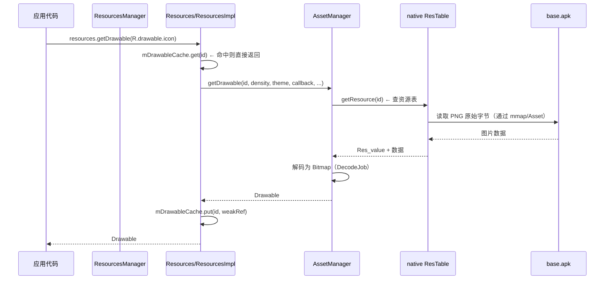

# 资源加载机制

## 一句话定义

Android 的资源加载是一条 **"编译期分配 ID → 运行期按 ID 查表 → 按需解码成对象"** 的流水线：`aapt2` 把 `res/` 目录编译成二进制资源表 `resources.arsc` 并给每个资源分配一个 `0x7f` 开头的整数 ID；运行时 `Resources` 持有一张 **ID → 数据** 的表，`AssetManager` 负责真正从 APK 里读取原始数据。理解这条链，才能解释**为什么资源 ID 可以被混淆**、**为什么 Drawable 会 OOM**、**为什么 `Resources.getDrawable` 偶尔很慢**。

## 核心原理

### 1. 整体架构：四个关键角色

```text
┌──────────────────────────────────────────────────────────────┐
│                          应用进程                             │
│                                                              │
│  Context.getResources()  ──►  Resources                       │
│     │  (每个 ResourcesImpl 对应一个 ResourcesKey)             │
│     │                          │                             │
│     │                          ├── mResourcesImpl (AssetManager)│
│     │                          ├── mTheme                       │
│     │                          └── TypedArray / Drawable 缓存   │
│     ▼                                                          │
│  ResourcesManager（单例，进程级）                              │
│     ├─ mResMap: ResourcesKey → ResourcesImpl                  │
│     ├─ mResourceImpls: 弱引用缓存                              │
│     └─ synchronized(this)  ← 线程安全锁                       │
│                              │                               │
│  AssetManager ───────────────┴──► native: ResTable             │
│     │                                   │                     │
│     │ nativeInit(apk路径, 资源ID)         │ 读取 resources.arsc│
│     ▼                                   ▼                     │
│  assets/ 目录                        ResTable 资源表           │
└──────────────────────────────────────────────────────────────┘
          │
          │ 文件 IO
          ▼
   /data/app/xxx/base.apk
   /data/app/xxx/base.apk (资源表在文件尾部)
```

| 角色 | 职责 | 关键字段/方法 |
| --- | --- | --- |
| **`AssetManager`** | APK 资源的"文件句柄 + 解析器"，负责打开 APK、定位资源表、按 ID 读取原始数据 | `nativeInit()`、`nativeGetResourceString`、`open()`、`getResourceUris` |
| **`Resources`** | 对外的资源访问门面，管理**主题**、**缓存**、**TypedArray** | `getString`、`getDrawable`、`getLayout`、`getTheme` |
| **`ResourcesImpl`** | `Resources` 的真正实现（API 29+ 引入，替代旧的 `Resources` 内部逻辑） | `mResDir`、`mOverlayDirs`、`mResources`（AssetManager） |
| **`ResourcesManager`** | 进程级单例，管理**所有** `Resources` 实例的创建与缓存 | `getResources(ResourcesKey)`、`mResMap`、`synchronized` |

### 2. 编译期：`aapt2` 与资源 ID 的分配（**面试重点**）

#### 2.1 aapt2 的编译流程

```text
源码资源                        构建产物
────────────                    ──────────
res/layout/main.xml       ──►   res/layout/main.xml（编译后的二进制 XML）
res/values/strings.xml    ──►   resources.arsc 的一部分（字符串池 + 类型规格）
res/drawable-xxhdpi/a.png ──►   res/drawable-xxhdpi/a.png（原样保留）
res/mipmap/ic.png         ──►   res/mipmap/xxxhdpi/ic.png

全部汇总进：
  base.apk
   ├── AndroidManifest.xml（编译后的二进制 XML）
   ├── classes.dex
   ├── resources.arsc    ← 资源表：所有资源的 ID、配置、值
   ├── res/              ← 资源文件本体（图片、布局、动画等）
   └── assets/
```

**aapt2 的两个阶段（Compile + Link）**：

| 阶段 | 输入 | 输出 | 说明 |
| --- | --- | --- | --- |
| **Compile** | 单个资源文件 | `.flat` 文件 | 把 XML 编译成二进制、把字符串池化、把 `9.png` 转成 NinePatch、把矢量图转成二进制 |
| **Link** | 所有 `.flat` + manifest | `resources.arsc` + `R.java` | **分配资源 ID**、合并配置变体、生成 `R` 类、校验引用 |

#### 2.2 资源 ID 的构成（**必背**）

```text
资源 ID = 0xPPTTEEEE

  PP  = Package ID (0x01 = 系统 framework, 0x7f = 应用)
  TT  = Type ID  (1=attr, 2=id, 3=string, 4=layout, 5=drawable, 6=array, ...)
  EEEE= Entry ID (同一 type 下的具体条目序号)

例：
  0x7f040001 → package=0x7f(应用), type=04(layout), entry=0x0001
  0x7f050003 → package=0x7f(应用), type=05(drawable), entry=0x0003
  0x01010000 → package=0x01(系统), type=01(attr), entry=0x0000
  0x0f000000 → 动态资源（overlay / 运行时加载）
```

> **面试话术**："**资源 ID 只是一个整数索引，真正的信息全在 `resources.arsc` 这张表里。这张表由 aapt2 在链接期生成，所以我们可以安全地改变资源 ID 的数值而不影响运行——这就是资源混淆（AndResGuard）的理论基础。**"

#### 2.3 `resources.arsc` 的内部结构

```text
resources.arsc
├─ ResTable_header
│   ├─ packageCount
│   └─ globalValueStringPool      ← 全局字符串池（所有字符串去重）
├─ ResStringPool (全局)
├─ ResTable_package[]
│   ├─ ResTable_typeSpec[]        ← 每个 type 的条目数量（配置无关）
│   │    └─ flags / configChanges / entryCount
│   └─ ResTable_type[]            ← 每个 type 在每种配置下的一份
│        ├─ ResTable_config       ← 限定符（density/locale/sdkVersion/screenSize...）
│        ├─ ResTable_typeEntry[]  ← 实际条目
│        │    ├─ key (string index)
│        │    ├─ flags
│        │    ├─ Res_value        ← 简单值（int/bool/string...）
│        │    └─ ResTable_map      ← 复杂值（style/array/reference → 指向另一个 type 的条目）
│        └─ ResTable_sparseTypeEntry[]
└─ ResStringPool (每个 package 一个)
```

**关键点**：
- **同一个资源在不同配置下有多份条目**（如 `drawable-hdpi` 与 `drawable-xhdpi`），运行时按当前 `ResTable_config` 选择**最佳匹配**；
- **引用型资源（style/array/reference）不是直接存值，而是指向另一个 type 的 entry**，这形成了一个"资源引用图"；
- **解析 `resources.arsc` 本身是有成本的**——这就是 Zygote 要**预加载资源**（`preload-res`）的原因。

### 3. 运行期：资源加载的完整链路



#### 3.1 `ResourcesManager` 的线程安全（**高频追问**）

```java
// AOSP 简化
public final class ResourcesManager {
    private static ResourcesManager sInstance;

    /** 全局锁：保护 mResMap 与 mResourceImpls */
    private final ArrayMap<ResourcesKey, WeakReference<ResourcesImpl>> mResourceImpls = ...;
    private final ArrayMap<ResourcesKey, ResourcesImpl> mResMap = ...;

    public Resources getResources(ResourcesKey key) throws NotFoundException {
        synchronized (this) {
            // 1. 查缓存
            final ResourcesImpl resources = mResMap.get(key);
            if (resources != null) return resources;

            // 2. 创建新的 ResourcesImpl（会调用 AssetManager.nativeInit）
            final ResourcesImpl impl = createResourcesImpl(key);
            ...
            return impl;
        }
    }
}
```

**要点**：
- **`ResourcesManager` 是进程级单例**，`getResources` 用 **`synchronized(this)`** 保护，所以**同一时刻只有一个线程在创建 `Resources`**；
- `ResourcesKey` 由 **`(资源包路径, 资源ID, overlayDirs, 显示密度, 显示 Locale, ...)`** 组成——**只要这些中任何一个不同，就是不同的 `Resources` 实例**；
- **常见陷阱**：`Context.getResources()` 在不同 `Context`（如 `createConfigurationContext`）下会返回**不同的 `Resources` 实例**，这会影响缓存命中；
- **多语言/多密度切换**：调用 `createConfigurationContext(config).getResources()` 会**新建一套 `Resources`**，旧的要等 GC 回收——频繁切换会造成内存抖动。

#### 3.2 `AssetManager` 的初始化

```java
// AOSP 简化
public final class AssetManager {
    private long mNativeHandle;   // native ResTable 指针

    /** 打开 APK 并解析资源表 */
    @UnsupportedAppUsage
    public AssetManager() {
        synchronized (sSync) {
            if (sSystemAssetManager == null) {
                sSystemAssetManager = new AssetManager();
                // 加载 framework-res.apk（系统资源）
                sSystemAssetManager.nativeSetUpAssetPath(...);
            }
        }
    }

    /** 显式初始化：传入 apk 路径与资源 ID */
    AssetManager(long nativeHandle) { ... }
}
```

**`AssetManager` 的三个核心能力**：

```java
// 1. 打开原生资源（assets/ 目录）
InputStream open(String fileName, int accessMode);

// 2. 按资源 ID 读取原始数据
String getResourceString(int resId);
int getResourceInt(int resId);

// 3. 反查资源 ID ← 名称
int getResourceIdentifier(String name, String defType, String defPackage);
```

**`getResourceIdentifier` 的性能问题（高频）**：
- 它需要**遍历整张资源表做字符串匹配**，是 O(n) 的字符串比较，**比 `getDrawable(id)` 慢一到两个数量级**；
- **绝不要在循环或滚动列表的 `onBindViewHolder` 里调用**；
- **替代方案**：`@DrawableRes` 注解 + 生成的 `R` 常量（编译期就变成 int），或 `Resources.getIdentifier` 缓存结果。
- **R8 的 `-keep` 规则**：`getResourceIdentifier` 引用的资源名若被混淆，会导致运行时找不到——所以用 `getResourceIdentifier` 时必须保留资源名（`-keepclassmembers class * { <fields>; }` 或使用 `androidResources { noCompress ... }` + 资源混淆工具关闭）。

### 4. 资源缓存体系（**Drawable OOM 的根因**）

```text
Resources 内部缓存
├─ mDrawableCache:  SparseArray<WeakReference<ConstantState>>  ← ★ 核心
├─ mColorDrawableCache:  SparseArray<WeakReference<ConstantState>>
├─ mColorStateListCache:  SparseArray<WeakReference<ConstantState>>
├─ mBooleanConstantStateCache / mIntConstantStateCache
└─ mLayoutInflaterCache:  SparseArray<LayoutInflater.Factory2>  ← 布局缓存
```

#### 4.1 `ConstantState` 与 `Drawable` 的关系（**核心概念**）

```text
Drawable（DrawableContainer）
  └─ mDrawableState / ConstantState
       ├─ Bitmap (可能是同一份，被多个 Drawable 共享)
       ├─ ColorStateList
       └─ 各种状态数据

Drawable.State (int[])
        │
        ▼  selectDrawable()
DrawableContainer
        │
        ▼
ConstantState.newDrawable()  →  创建新的 Drawable 实例，但共享 Bitmap
```

**关键点**：
- **`Drawable` 对象是轻量的**（只是状态 + 指向 `ConstantState` 的引用）；
- **真正占内存的是 `ConstantState` 里的 `Bitmap`**；
- `ConstantState` 被缓存（`mDrawableCache`），而 `Drawable` 实例本身是**每次 `getDrawable()` 都新建**的（`newDrawable()`）——这就是为什么 `getDrawable` 很快但**每次调用仍然有对象分配**；
- `mDrawableCache` 存的是 **`WeakReference<ConstantState>`**，所以**Bitmap 有可能被 GC 回收**（`WeakReference` 不阻止回收）——这既是省内存的设计，也是"Drawable 重新加载会突然卡一下"的原因。

#### 4.2 为什么 Drawable 会 OOM（**高频面试题**）

```text
OOM 的因果链：
  1. Bitmap 的像素数据在 native heap（Android 8.0 之前在 Dalvik heap）
  2. 一张 1920×1080 的 ARGB_8888 Bitmap = 1920×1080×4 = 8.3 MB
  3. 列表里 100 张图 = 830 MB → 早就超过 memoryClass
  4. Resources.mDrawableCache 用 WeakReference 缓存 ConstantState，
     但 Bitmap 可能被多个 Drawable 共享 → 引用计数复杂
  5. GC 压力下 Bitmap 未及时回收 → OOM
```

**面试答法**：
1. **Bitmap 内存 = 宽 × 高 × 每像素字节数**（`ARGB_8888` = 4 字节，`RGB_565` = 2 字节，`ARGB_4444`/`ALPHA_8` = 1 字节）。
2. **Android 8.0 之前 Bitmap 像素数据在 Dalvik heap**（占用 `dalvik` 内存配额，容易 OOM 且 GC 压力大），**8.0 之后像素数据移到 native heap**（不再受 `dalvik` 配额限制，但受进程总内存与 native 内存限制）。
3. **OOM 的常见根因**：
   - 一次性解码大图（未用 `inSampleSize` 缩放）；
   - 列表未回收（`onViewRecycled` 未清理）；
   - `mDrawableCache` 中缓存了大量 `ConstantState`；
   - 变换操作（`Bitmap.createBitmap`）产生新 Bitmap 而旧的仍在缓存里；
   - `decodeStream` 未指定 `inJustDecodeBounds`，无法计算采样率。
4. **对策**：`inSampleSize` 缩放、`inPreferredConfig` 降位深、`LruCache` + 内存复用池、主动 `recycle()`（**8.0 后不推荐手动 recycle**）、用 `ImageDecoder`/Glide 的自动采样。详见 [[../性能优化专项/内存优化]]。

### 5. `resources.arsc` 与 APK 体积的关系

```text
APK 体积构成（典型）
├─ classes.dex          20% ~ 50%
├─ resources.arsc        5% ~ 15%   ← 字符串池 + 类型表 + 索引
├─ res/                 20% ~ 40%   ← 图片、布局、音视频
├─ assets/               5% ~ 20%
├─ lib/                  5% ~ 20%   ← so 库
└─ 其他                   2% ~ 5%
```

**减小 `resources.arsc` 的手段**：
1. **删除未使用的资源**（`shrinkResources true` 依赖 R8 的资源分析，只在代码引用被分析时生效）；
2. **减少字符串数量**：把硬编码字符串提取到 `strings.xml`（这会让 `arsc` 变大但有利于多语言）——**注意这是一对矛盾**，取决于需求；
3. **用 `values-vXX` 限定符减少重复**：同一资源的多语言版本是"多份条目"而非"多份文件"，只增加 `arsc` 不增加 `res/` 体积；
4. **资源混淆（AndResGuard）**：把 `resources.arsc` 加密并重命名资源路径，**需要修改 `aapt` 工具链**，且必须保证运行时用的是同一套资源表。

**注意**：**`shrinkResources` 依赖代码引用分析**。如果资源是通过 `getIdentifier` 动态获取的，R8 无法分析到，**这些资源不会被移除**，还会因为混淆而失效。

### 6. 资源 overlay（覆盖）机制

**什么是 overlay**：系统允许用另一个 APK 的资源**覆盖**目标 APK 的同名资源。两种方向：

```text
【RRO（Runtime Resource Overlay，运行时资源覆盖）】
  目标：系统级或第三方 APK 的资源被"注入"
  实现：/overlay/ 目录 + OverlayManager
  例子：字体覆盖、UI 微调（国内 ROM 常用）

【ROAR / 静态 overlay】
  构建期把 overlay 的资源合并进目标 APK
```

**覆盖的匹配规则**：overlay 必须**声明与目标完全相同的资源名**（资源名 + 类型 + 限定符），否则不生效。

**应用开发中的影响**：
- **你的应用也可以做 overlay**（`android:targetPackage` + `android:isStatic`），但需要 `android.permission.OVERLAY_PACKAGES` 等系统权限，普通应用不行；
- **调试时注意**：某些 ROM 会对第三方应用做 overlay，导致你在模拟器/原生环境测正常的 UI 在真机上不一样。

### 7. 资源加载的性能问题与优化

| 问题 | 原因 | 优化 |
| --- | --- | --- |
| **首次 `getDrawable` 很慢** | 需要从 APK 读取 + 解码 PNG + 建立 `ConstantState` | 预热（`Resources.getDrawable` 在启动后 idle 做一次）；或直接用 `VectorDrawable` |
| **`getIdentifier` 慢** | 遍历资源表做字符串匹配 | 用 `R` 常量；或自建 `name → id` 的 `HashMap` 缓存 |
| **布局 inflate 慢** | XML 二进制解析 + 反射创建 View + 递归 inflate 子 View | 减少层级；`ConstraintLayout`；`AsyncLayoutInflater`（有闪烁风险）；ViewBinding |
| **资源切换（多语言/深色）后卡顿** | 需要新建 `Resources` 实例并重新解析 | 缓存 `Resources`；避免频繁切换 |
| **Drawable 缓存导致内存高** | `ConstantState` 缓存了 Bitmap | 用 `LruCache` 管理自绘图片；对大图用采样降尺寸 |
| **`resources.arsc` 过大** | 资源过多 | `shrinkResources`；拆分模块；AAB 按需下发 |

### 8. 相关 API 的边界与陷阱

| API | 说明 | 陷阱 |
| --- | --- | --- |
| `Resources.getDrawable(id)` | API 21 前建议用 `getDrawable(id, theme)` | 主题相关的资源（`?attr`）必须带 theme 参数 |
| `Context.getDrawable` | API 21+ | 同上 |
| `Resources.getColor(id, theme)` | 建议用这个而非 `getColor(id)` | 同上 |
| `TypedArray` | 批量读取属性 | **必须 `recycle()`**（API 33 起 `recycle()` 已废弃但仍可调用） |
| `Resources.Theme` | 主题容器 | `applyStyle` 会**叠加**而不是替换 |
| `createConfigurationContext` | 生成新配置的 `Resources` | **每个实例都持有一份 `ResTable` 引用**，频繁创建会内存泄漏 |
| `Resources.getSystem()` | 系统资源 | 只读；不能替换 |

## 代码示例

### 1. 资源加载的正确姿势（避免 `getIdentifier`）

```kotlin
object ResUtils {

    /** ✅ 推荐：用 R 常量，编译期即为 int，零查找开销 */
    fun icon(context: Context): Drawable? =
        context.getDrawable(R.drawable.ic_home, context.theme)

    /**
     * ⚠️ 谨慎：getIdentifier 需要遍历整张资源表，O(n) 字符串匹配。
     * 若必须使用，结果一定要缓存。
     */
    private val idCache = ConcurrentHashMap<String, Int>()

    fun drawableId(name: String, type: String = "drawable"): Int {
        return idCache.getOrPut("$type/$name") {
            val id = Resources.getIdentifier(name, type, BuildConfig.APPLICATION_ID)
            if (id == 0) throw Resources.NotFoundException("找不到资源: $type/$name")
            id
        }
    }
}
```

### 2. 自定义 `AssetManager` 读取 assets 资源

```kotlin
class AssetReader(private val context: Context) {

    /** 读取 assets 下的文本（小文件用） */
    fun readText(name: String): String? = try {
        context.assets.open(name).use { it.readBytes().toString(Charsets.UTF_8) }
    } catch (e: IOException) {
        null
    }

    /** ✅ 大文件必须流式读取，禁止 readBytes() 一次性进内存 */
    fun readLines(name: String): Sequence<String> = try {
        context.assets.open(name).bufferedReader().lineSequence()
    } catch (e: IOException) {
        emptySequence()
    }

    /** 读取 assets 下的二进制文件并计算 MD5（防篡改常用） */
    fun assetMd5(name: String): String? = try {
        val md = MessageDigest.getInstance("MD5")
        context.assets.open(name).use { input ->
            val buffer = ByteArray(8 * 1024)
            while (true) {
                val read = input.read(buffer)
                if (read <= 0) break
                md.update(buffer, 0, read)
            }
        }
        md.digest().joinToString("") { "%02x".format(it) }
    } catch (e: Exception) {
        null
    }
}
```

### 3. 资源内存占用分析（**回答"apk 体积与资源的关系"**）

```kotlin
object ResourceAnalyzer {

    /** 统计 APK 中各类型资源占用的体积 */
    fun analyzeApk(apkPath: String): Map<String, Long> {
        val result = mutableMapOf<String, Long>()
        ZipFile(apkPath).use { zip ->
            zip.entries().asSequence().forEach { entry ->
                val category = categorize(entry.name)
                result[category] = (result[category] ?: 0L) + entry.size
            }
        }
        return result.toSortedMap()
    }

    private fun categorize(name: String): String = when {
        name.startsWith("res/") -> "res"
        name.startsWith("assets/") -> "assets"
        name == "resources.arsc" -> "resources.arsc"
        name.endsWith(".dex") -> "dex"
        name.startsWith("lib/") -> "so"
        name.endsWith(".xml") -> "manifest/xml"
        else -> "other"
    }

    /** 计算一张 Bitmap 实际占用的内存（字节） */
    fun bitmapMemory(width: Int, height: Int, config: Bitmap.Config): Long =
        width.toLong() * height.toLong() * bytesPerPixel(config)

    private fun bytesPerPixel(config: Bitmap.Config): Int = when (config) {
        Bitmap.Config.ARGB_8888 -> 4
        Bitmap.Config.RGB_565 -> 2
        Bitmap.Config.RGB_4444, Bitmap.Config.ARGB_4444 -> 2
        Bitmap.Config.ALPHA_8 -> 1
        Bitmap.Config.RGBA_F16 -> 8
        else -> 4
    }
}
```

### 4. 多配置 `Resources` 的正确使用（**避免内存泄漏**）

```kotlin
class LocaleManager(private val context: Context) {

    private var cachedResources: Resources? = null
    private var cachedConfig: Configuration? = null

    /**
     * ✅ 缓存 Resources 实例：每次 createConfigurationContext 都会新建一套资源表，
     * 频繁创建会导致内存抖动（尤其是切换语言时）。
     */
    fun resourcesFor(locale: Locale): Resources {
        val current = cachedConfig
        if (current != null &&
            current.getLocales().get(0) == locale &&
            cachedResources != null
        ) {
            return cachedResources!!
        }

        val config = Configuration(context.resources.configuration).apply {
            setLocale(locale)
            setLayoutDirection(locale)
        }
        val newResources = context.createConfigurationContext(config).resources
        cachedConfig = config
        cachedResources = newResources
        return newResources
    }

    /** 释放：避免持有旧的 ResTable */
    fun release() {
        cachedResources = null
        cachedConfig = null
    }
}
```

### 5. 资源引用的 `TypedArray` 与主题属性

```kotlin
/**
 * ✅ 用 TypedArray 批量读取自定义属性，正确回收。
 */
fun Context.resolveCustomAttrs(attrs: IntArray): TypedArray {
    val ta = obtainStyledAttributes(attrs, R.styleable.CustomView)
    try {
        val color = ta.getColor(R.styleable.CustomView_cvColor, Color.RED)
        val radius = ta.getDimensionPixelSize(R.styleable.CustomView_cvRadius, 0)
        // 使用 color / radius
        return ta
    } finally {
        // API 33 起 recycle() 已废弃，但保留调用无害
        ta.recycle()
    }
}

/**
 * ✅ 读取 ?attr 主题属性时必须传入 theme，否则拿到的是 null。
 */
fun Context.resolveThemeColor(attr: Int, default: Int): Int {
    val typedValue = TypedValue()
    return if (theme.resolveAttribute(attr, typedValue, true)) {
        if (typedValue.resourceId != 0) {
            // 是资源引用，继续解析
            TypedValue().let {
                if (theme.resolveAttribute(typedValue.resourceId, it, true)) {
                    androidx.core.content.ContextCompat.getColor(this, it.resourceId, theme)
                } else default
            }
        } else {
            typedValue.data // 是直接的颜色值
        }
    } else default
}
```

## 常见问题 / 面试要点

**读者问：Android 的资源加载机制是怎样的？从编译期到运行期讲一遍。**

**AI答：**

**编译期（aapt2）**：
1. **Compile 阶段**：每个资源文件单独编译成二进制（`.flat`）。XML → 二进制 XML；字符串 → 字符串池；PNG → 优化后的 PNG（`aapt2` 会做无损压缩与色彩空间转换）；矢量图 → 二进制。
2. **Link 阶段**：aapt2 汇总所有 `.flat`，**分配资源 ID**（`0xPPTTEEEE` 格式），生成 `resources.arsc`（资源表）、生成 `R.java`、校验所有资源引用是否存在。

**运行期**：
3. `ResourcesManager.getResources(ResourcesKey)`（进程级单例，`synchronized` 保护）→ 创建或复用 `ResourcesImpl` → `AssetManager.nativeInit(apk路径, 资源ID)` **打开 APK 并解析 `resources.arsc`**（这是 IO + 解析成本）。
4. `resources.getDrawable(id)` → 先查 `mDrawableCache`（`WeakReference<ConstantState>`）→ 未命中则 `AssetManager` 查 `ResTable` 拿到条目 → 从 APK 读取原始数据 → **解码成 Bitmap/Drawable** → 放入缓存 → 返回。

**资源 ID 的构成**：`0xPPTTEEEE`，`PP` 是 package（`0x7f` 应用 / `0x01` 系统），`TT` 是 type（4=layout，5=drawable，3=string...），`EEEE` 是条目序号。**资源 ID 只是一个索引，真正信息在 `resources.arsc` 里。**

---

**读者问：`Resources` 和 `AssetManager` 有什么区别？`ResourcesManager` 又是干什么的？**

**AI答：**

1. **`AssetManager`** 是**最底层**：管理 APK 文件句柄、打开 `assets/` 下的任意文件、按资源 ID 读取原始数据（`getResourceString`、`getResourceInt`）。它对应 native 的 `ResTable`。
2. **`Resources`** 是**对外门面**：提供 `getString`/`getDrawable`/`getLayout`/`getColor` 等类型化 API，管理主题（`Theme`）、管理缓存（`mDrawableCache` 等）、提供 `TypedArray`。
3. **`ResourcesManager`** 是**进程级单例**：管理**所有** `Resources` 实例的生命周期与缓存。它以 `ResourcesKey`（资源包路径 + 资源 ID + overlay 目录 + 显示密度 + 显示 Locale 等）为键，用 `WeakReference` 缓存 `ResourcesImpl`；`getResources` 用 `synchronized(this)` 保证线程安全。
4. **一个进程可能有多个 `Resources` 实例**：
   - 不同的 APK（应用资源 vs 系统资源）→ 不同实例；
   - 不同 `ResourcesKey`（如不同的 overlay、不同的 density/locale）→ 不同实例；
   - `Context.getResources()` 返回当前 Context 对应的那个。
5. **面试话术**："**层次是 `ResourcesManager`（管实例）→ `Resources`（管 API 与缓存）→ `AssetManager`（管文件与资源表）。三个类各管一层，`ResourcesManager` 的锁和 `WeakReference` 缓存是内存与线程安全的关键。**"

---

**读者问：为什么 `getResourceIdentifier` 慢？有什么替代方案？**

**AI答：**

1. **原因**：它需要**遍历 `resources.arsc` 的整张资源表**，对每个条目的名字做字符串匹配，是 **O(n) 的字符串比较**。而 `getDrawable(int id)` 是 **O(1) 的数组/哈希查找**。
2. **实测差距**：通常在 **几十倍**量级（资源多时更夸张）。
3. **绝对禁止的场景**：`RecyclerView.onBindViewHolder`、`ListView.getView`、任何循环或高频调用。
4. **替代方案（按优先级）**：
   - **用 `R` 常量**（`R.drawable.xxx` 编译期就是 int），最佳；
   - **动态资源用 `@DrawableRes` 注解 + 构造参数传入 id**；
   - **必须动态时**：自建 `HashMap<String, Int>` 缓存，`getIdentifier` 只查一次；
   - **数据驱动 UI**：用 `resources.getResourceName(id)` 反查名字再缓存，或直接让服务端下发资源名 + 本地映射表。
5. **额外坑**：`getResourceIdentifier` 依赖**资源名**，而 **R8 混淆会重写资源名路径**（`aaptOptions.noCompress`、资源混淆工具），如果 R8 开启了资源重命名，动态查找会失效。**要么加 `-keep` 规则保留对应资源，要么彻底不用动态查找。**

---

**读者问：Drawable 为什么容易 OOM？Bitmap 内存怎么算？**

**AI答：**

1. **内存计算**：`Bitmap 内存 = 宽 × 高 × 每像素字节数`。
   - `ARGB_8888` = **4 字节/像素**（最常用）
   - `RGB_565` = **2 字节/像素**（无 alpha，省一半）
   - `ARGB_4444` = 2 字节/像素（**已被废弃，不推荐**）
   - `ALPHA_8` = 1 字节/像素
   - 例：1080×1920 的 `ARGB_8888` = 1080×1920×4 ≈ **7.9 MB**。
2. **存放位置的变化（重要）**：
   - **Android 8.0 之前**：像素数据在 **Dalvik heap**，占用 `dalvik` 内存配额（通常 192MB~512MB），容易 OOM，且 GC 需要管理 native 对象；
   - **Android 8.0 之后**：像素数据移到 **native heap**，不再受 dalvik 配额直接限制，但仍受进程总内存与 native 内存上限约束，且**不受 GC 及时回收**（要靠 `Bitmap.recycle()` 或内存压力回收）。
3. **OOM 根因**：
   - 列表未做采样（`inSampleSize`）；
   - `mDrawableCache` 缓存了大量 `ConstantState`（含 Bitmap），且 `WeakReference` 不保证及时回收；
   - `Bitmap.createBitmap` 变换产生新 Bitmap，旧的仍在缓存；
   - `decodeStream` 未先 `inJustDecodeBounds` 计算采样率。
4. **对策**：
   - `inSampleSize` 按目标显示尺寸采样（**先 `inJustDecodeBounds=true` 拿原始尺寸，再算采样率**）；
   - `inPreferredConfig = RGB_565`（无透明需求时）；
   - 用 `LruCache` + **Bitmap 复用池**（Glide/Coil/Fresco 的做法）；
   - Android 8.0 后**不推荐手动 `recycle()`**（会导致 `Canvas` 绘制崩溃 "Canvas: trying to use a recycled bitmap"），改为依赖内存回收 + 池化复用；
   - 详见 [[../性能优化专项/内存优化]]。
5. **面试话术**："**OOM 的本质不是'Bitmap 太大'，而是'同时存活的 Bitmap 总量超过了预算'。所以优化的方向是采样降尺寸 + 池化复用 + 主动释放缓存，而不是简单地'少加载几张图'。**"

---

**读者问：资源加载慢怎么优化？有哪些具体手段？**

**AI答：**

按耗时来源分类：

1. **`AssetManager` 初始化 / `resources.arsc` 解析慢**：
   - 触发时机：`Application` 首次 `getResources()` 时（很早，但只解析一次）；
   - 优化：**无法避免**（每个进程都要解析一次），但 Zygote 已预加载系统资源，应用资源是必须的；
   - **Zygote 的 `preload-res` 预加载了 framework-res**，省掉的是系统资源那部分。
2. **`getDrawable` / `getBitmap` 首次解码慢**：
   - 原因：从 APK 读取 + PNG 解码（**PNG 解码是纯 CPU 计算，100ms 级**）；
   - 优化：
     - **预热**：启动后 idle 时预加载首屏会用到的图；
     - **用 `VectorDrawable`** 替代位图（不需要解码，且可动态着色）；
     - **用 `WebP`/`AVIF`**（解码更快、体积更小）；
     - **降低解码尺寸**（采样）。
3. **`getIdentifier` 慢** → 用 `R` 常量（见前题）。
4. **布局 inflate 慢**：
   - XML 解析 + **反射**创建 View + 递归 inflate；
   - 优化：减少层级、`ConstraintLayout` 替代嵌套、用 **ViewBinding** 替代 `findViewById`（生成代码，无反射）、`AsyncLayoutInflater`（有闪烁风险，仅适合非首屏）。
5. **多配置切换（深色/多语言）慢**：
   - 原因：每次 `createConfigurationContext` 都要新建 `Resources` + 新建 `ResTable`；
   - 优化：**缓存 `Resources` 实例**，切换时复用。
6. **资源表过大导致解析慢** → `shrinkResources` + 模块化 + AAB 按需下发（见 [[../性能优化专项/包体积优化]]）。

---

**读者问：`resources.arsc` 是什么？它和 APK 体积是什么关系？**

**AI答：**

1. **`resources.arsc` 是编译后的资源表**，是 APK 里的一个**单独文件**（不是 `res/` 目录下的一部分）。它包含：
   - **全局字符串池**（所有字符串去重后存储）；
   - **每个 package 的 typeSpec**（每个 type 有多少条目）；
   - **每个 type 在每种配置（density/locale/sdk/screenSize...）下的条目列表**；
   - 每个条目的 `Res_value`（简单值）或 `ResTable_map`（style/array/引用，指向另一个 type）。
2. **与体积的关系**：
   - `resources.arsc` 本身通常占 APK 的 **5%~15%**；
   - **`res/` 目录**（图片等资源本体）通常占 **20%~40%**，往往比 `arsc` 大得多；
   - **字符串**是 `arsc` 的主要成分：每条字符串在池里存一次（跨 type 复用），但每种语言的翻译都要各存一份（语言限定符只是不同配置条目）。
3. **减小方式**：
   - `shrinkResources true`（依赖 R8 分析引用）；
   - 清理未使用资源；
   - 图片格式优化（WebP/AVIF/AAB 纹理压缩）；
   - **资源混淆（AndResGuard）**：加密 `arsc` 并重命名资源路径，需要改 aapt 工具链。
4. **关键认知**："**资源 ID 是索引而不是内容，资源表是可以被加密/混淆的——这正是很多 App 做资源加密的基础。但要注意：一旦加密，运行时就必须用配套的 aapt/so 解密，兼容性成本很高。**"

---

**读者问：什么是资源 overlay？它有什么用？**

**AI答：**

1. **定义**：overlay 是"**用一个 APK 的资源覆盖另一个 APK 的同名资源**"的机制，由系统的 `OverlayManager` 管理。
2. **两个方向**：
   - **RRO（Runtime Resource Overlay）**：运行时动态生效，放在 `/overlay/` 目录，由系统或特权应用使用。**国内 ROM 常用它做字体替换、系统 UI 微调**；
   - **静态 overlay（构建期）**：在打包时把 overlay 资源合并进目标 APK。
3. **匹配规则**：overlay 声明的资源名（name + type + 限定符）必须与目标**完全一致**，否则不生效；系统按配置匹配选择最佳变体。
4. **应用开发中的影响**：
   - 某些 ROM 会对第三方应用做 overlay（改字体、改主题），导致"模拟器正常、真机异常"；
   - 排查 UI 问题时，要考虑 overlay 因素（`adb shell cmd overlay list`）。
5. **自定义 overlay 的限制**：需要 `android.permission.OVERLAY_PACKAGES`（signature|privileged），**普通应用无法使用**。

---

**读者问：资源加载的线程安全是怎么保证的？多线程同时 `getResources` 会怎样？**

**AI答：**

1. **`ResourcesManager.getResources()` 用 `synchronized (this)`** 保护 `mResMap` 与 `mResourceImpls`，所以**同一时刻只有一个线程在创建 `Resources`**。其他线程阻塞等待。
2. **`Resources` 本身的方法基本是线程安全的**（读取操作），但：
   - **`Theme` 的修改**（`applyStyle`、`setTo`）不是线程安全的；
   - **`TypedArray` 回收**与共享缓存有竞态；
   - **`mDrawableCache` 的 `SparseArray`** 在并发 `getDrawable` 时会出问题——AOSP 的做法是 `AssetManager` 内部有锁，且 `DrawableCache` 用了同步的 `LongSparseArray`（`ResourcesImpl` 中实际用的是 `DrawableCache extends LongSparseArray<WeakReference<ConstantState>>`，内部有 `synchronized`）。
3. **实践建议**：
   - **不要在多线程同时首次访问同一个资源**（如后台线程与主线程同时 `getDrawable`）——虽然通常安全，但会有锁竞争；
   - **自定义主题资源在后台线程加载要小心**；
   - **`Context.getResources()` 返回的实例是共享的**，不要试图修改它。
4. **面试话术**："**线程安全的重心在 `ResourcesManager` 的全局锁与 `AssetManager` 内部锁；应用层只需要记住一条：`Resources` 可以跨线程读，主题不要跨线程改。**"

---

**读者问：模块化开发时，资源 ID 冲突怎么办？动态 Feature 的资源怎么共享？**

**AI答：**

1. **资源 ID 冲突**：aapt2 在链接期会**为每个模块分配独立的 package ID**，最终由 `resources.arsc` 合并；**运行时按 package ID 区分**，所以理论上不会冲突。但：
   - **动态资源必须使用 `0x0f` 预留的动态 ID 段**（`isDynamic`），静态资源不能用；
   - 动态 Feature 的 `resources.arsc` 通过 `ResourceTable` 动态加载并与静态表合并（`AssetManager` 的 `setResourceApkPaths`）。
2. **共享资源**：推荐抽到 `base`/`core` 模块，或使用 **Android App Bundle + Resource Module**（共享资源模块，多个 App 可共用一套资源）。
3. **动态资源的限制**：
   - 动态资源 ID 范围是 `0x7f000000` 以上的动态段；
   - 动态资源在安装时由 `AssetManager` 动态解析，**首次访问有额外开销**；
   - 动态 Feature 的资源不能被其他静态模块直接引用（除非通过资源模块共享）。

## 关联笔记

- [[应用启动流程]]：Zygote 的资源预加载与 `AssetManager` 初始化时机
- [[../性能优化专项/内存优化]]：Drawable 缓存与 Bitmap 内存治理
- [[../性能优化专项/包体积优化]]：`resources.arsc` 与 `res/` 的瘦身手段
- [[渲染机制]]：Drawable 到 GPU 的完整绘制管线
- [[../README]]：第 6 部分总览
- [[../../03-UI开发与用户交互/资源与适配/多语言适配]]：限定符规则与资源匹配
- [[../../03-UI开发与用户交互/资源与适配/屏幕适配]]：density 限定符与 `Resources` 实例差异

## 参考资料

- AOSP `frameworks/base/core/java/android/app/ResourcesManager.java`
- AOSP `frameworks/base/core/java/android/content/res/AssetManager.java` 与 `Resources.java`
- Android 官方文档《Resources overview》：https://developer.android.com/guide/topics/resources/providing-resources
- AOSP `frameworks/base/tools/aapt2/`（资源编译与链接实现）
- 《Android 系统揭秘》第 3 版 · 第 5 章 "Android GUI 系统的框架"
