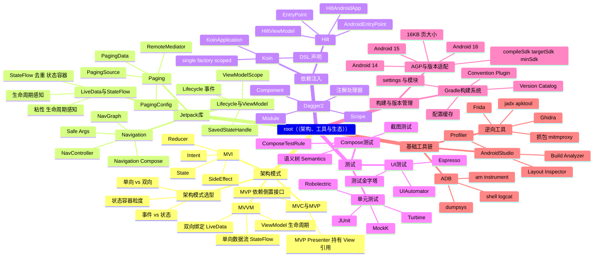

# 第 7 部分：架构、工具与生态

## 概览

本部分解决三个问题：**代码怎么组织**、**依赖怎么管理**、**质量怎么保证**。

- **架构模式**：MVC → MVP → MVVM → MVI 的演进主线，核心是"把变化的部分（UI、状态、副作用）分离出去"，让业务逻辑可测试、可复用。
- **Jetpack 库**：官方给出的 MVVM 标准件。Lifecycle 管"何时活"，ViewModel 管"活多久"，LiveData/StateFlow 管"数据往哪走"，Paging 管"分页"，Navigation 管"跳转"，Compose 管"怎么画"。
- **依赖注入**：Dagger2（编译期生成，无反射，性能与可追踪性最好）→ Hilt（Dagger2 的 Android 标准化封装，带作用域与聚合依赖）→ Koin（运行时 DSL，轻量，适合 Kotlin/Compose 与多模块）。
- **测试**：单元测试（纯 JVM，跑得快，覆盖逻辑）→ UI 测试（Espresso/Compose UI Test，跑得慢，验证交互）→ 端到端与截图回归。
- **构建与版本管理**：Gradle DSL、Version Catalog、Convention Plugin、AGP 版本对应关系、targetSdk 适配策略。
- **基础工具链**：Android Studio、ADB、逆向与抓包工具链。

> [!tip] 面试主线
> 中级 Android 岗高频考点集中在：**MVVM 的单向数据流**、**ViewModel 生命周期与进程重建**、**LiveData vs StateFlow**、**Hilt 的作用域与组件图**、**Dagger 编译期生成代码的原理**、**Compose 重组与状态管理**、**Paging 3 的 RemoteMediator**。

## 知识图谱（Mermaid）

## 子目录导航

| 子目录 | 说明 | 主要笔记 |
| --- | --- | --- |
| [[./架构模式/MVVM\|架构模式]] | 代码组织方式与状态管理哲学 | [[./架构模式/MVC与MVP]]、[[./架构模式/MVVM]]、[[./架构模式/MVI]]、[[./架构模式/架构模式选型]] |
| [[./Jetpack库/LiveData与StateFlow\|Jetpack库]] | 官方组件库 | [[./Jetpack库/Lifecycle与ViewModel]]、[[./Jetpack库/LiveData与StateFlow]]、[[./Jetpack库/Paging]]、[[./Jetpack库/Navigation]] |
| [[./依赖注入/Hilt\|依赖注入]] | 对象创建与解耦 | [[./依赖注入/Dagger2]]、[[./依赖注入/Hilt]]、[[./依赖注入/Koin]] |
| [[./测试/单元测试\|测试]] | 质量保障 | [[./测试/单元测试]]、[[./测试/UI测试]]、[[./测试/Compose测试]] |
| [[./构建与版本管理/Gradle构建系统\|构建与版本管理]] | 构建脚本与版本适配 | [[./构建与版本管理/Gradle构建系统]]、[[./构建与版本管理/AGP与版本适配]] |
| [[./基础工具链/ADB\|基础工具链]] | 开发调试与逆向 | [[./基础工具链/AndroidStudio]]、[[./基础工具链/ADB]]、[[./基础工具链/逆向工具]] |

## 笔记列表

### 架构模式

- [[架构模式/MVC与MVP]]
- [[架构模式/MVVM]]
- [[架构模式/MVI]]
- [[架构模式/架构模式选型]]

### Jetpack 库

- [[Jetpack库/Lifecycle与ViewModel]]
- [[Jetpack库/LiveData与StateFlow]]
- [[Jetpack库/Paging]]
- [[Jetpack库/Navigation]]

### 依赖注入

- [[依赖注入/Dagger2]]
- [[依赖注入/Hilt]]
- [[依赖注入/Koin]]

### 测试

- [[测试/单元测试]]
- [[测试/UI测试]]
- [[测试/Compose测试]]

### 构建与版本管理

- [[构建与版本管理/Gradle构建系统]]
- [[构建与版本管理/AGP与版本适配]]

### 基础工具链

- [[基础工具链/AndroidStudio]]
- [[基础工具链/ADB]]
- [[基础工具链/逆向工具]]

## 关联部分

- 前置：[[../06-系统原理与性能优化/README]]（渲染与内存决定了架构实现时的性能边界）
- 延伸：[[../08-企业级工程与运维/README]]（模块化、CI/CD、日志监控是本部分的工程化落地）
- 延伸：[[../10-软技能与技术领导力/README]]（架构选型需要 ADR 与技术决策记录）
