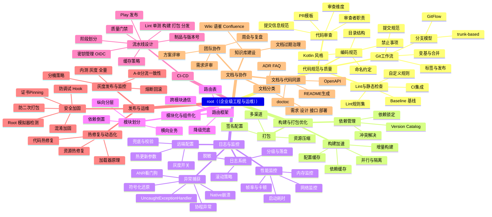

# 第 8 部分：企业级工程与运维

## 概览

前 7 部分讲的是"**一个 App 怎么写出来**"，第 8 部分讲的是"**一个 App 怎么持续地、稳定地、可控地交付到几百万用户手上**"。这是从"能写代码"到"能负责一个线上系统"的分水岭。

Android 客户端工程师的成长路径有一个残酷的现实：**你写的代码最终不是你一个人在用**。一个只能在自己手机上跑通的 Demo，放到 50 万 DAU 的产品上，会遇到五个全新的问题：

1. **规模问题**：一个模块被 20 个人同时改，一个 `build.gradle` 加一行依赖要等 15 分钟构建，一个方法有 3000 行没人敢动。
2. **质量问题**：没有 CI，代码靠口头约定合入；没有 Lint，崩溃率靠用户投诉才知道；没有 Code Review，线上问题靠回滚解决。
3. **发布问题**：一次发版影响全量用户，一个拼写错误导致 0.5% 的崩溃率飙升；不敢频繁发版，于是版本越拖越久，代码越积越烂。
4. **安全问题**：代码被 jadx 反编译出明文密钥，APK 被二次打包植入木马，接口被中间人抓包盗号。
5. **协作问题**：半年后没人知道当初为什么这么设计，新人接手要花两周才搞懂业务，隐性知识随人员流动全部丢失。

本部分按**"质量 → 构建 → 监控 → 交付 → 安全 → 协作"**的顺序组织，共 5 个子目录、13 篇笔记：

- **代码规范与质量**：把"代码好不好"的判断从个人口味变成**可自动执行的门禁**——编码规范、Lint 与静态检查、Code Review 规范、Git 分支与提交工作流。
- **构建与打包优化**：把"从代码到 APK"的 15 分钟压到 3 分钟——Gradle 配置缓存、增量构建、依赖缓存、构建加速。
- **日志与监控**：让线上问题从"用户投诉"变成"主动告警"——日志系统、异常捕获（崩溃/ANR）、性能监控（APM）、远端配置。
- **CI-CD**：把"构建、测试、打包、上传、分发"变成一条**每次提交自动跑、质量门禁自动拦、密钥不落盘**的流水线——流水线设计。
- **模块化与组件化**：把单体 App 拆成可并行开发、可独立测试、可按需加载的模块——模块划分、路由框架。
- **发布与运维**（根目录）：控制"谁在什么时候用什么代码"——灰度发布与监控、安全加固、热修复与动态化。

> [!tip] 面试主线
> 中级 Android 岗在本部分的高频考点：**Git 分支模型（GitFlow / trunk-based）**、**Lint 能查出哪些问题**、**Code Review 该看什么**、**Gradle 缓存与增量构建**、**崩溃率与 ANR 率怎么定义和统计**、**内存泄漏的排查手段**。
>
> 高级 / 资深岗的差异化考点（本部分的主战场）：**CI 流水线怎么设计才能既快又拦得住**、**密钥管理与 OIDC**、**灰度分桶的一致性怎么保证**、**A/B 实验分流与统计显著性**、**崩溃率自动熔断回滚**、**Frida / Xposed 检测的原理与局限**、**混淆与符号化的完整链路**、**线上事故的止损与复盘**。
>
> **区分度最高的一句话**：能说出"**我们用 1% 灰度跑 48 小时，崩溃率对比基线组上涨 0.03% 就自动回滚**"这种带数字、带机制的答案，而不是"我们做了灰度发布"——这就是资深与中级的差别。

## 知识图谱（Mermaid）

## 子目录导航

| 子目录 | 说明 | 主要笔记 |
| --- | --- | --- |
| [[./代码规范与质量/编码规范\|代码规范与质量]] | 把主观风格变成客观门禁 | [[./代码规范与质量/编码规范]]、[[./代码规范与质量/Lint与静态检查]]、[[./代码规范与质量/代码审查]]、[[./代码规范与质量/Git工作流]] |
| [[./构建与打包优化/构建加速\|构建与打包优化]] | 让构建从 15 分钟降到 3 分钟 | [[./构建与打包优化/构建加速]] |
| [[./日志与监控/日志系统\|日志与监控]] | 让线上问题主动暴露 | [[./日志与监控/日志系统]]、[[./日志与监控/异常捕获]]、[[./日志与监控/性能监控]]、[[./日志与监控/远端配置]] |
| [[./模块化与组件化/模块划分\|模块化与组件化]] | 支撑多人并行开发 | [[./模块化与组件化/模块划分]]、[[./模块化与组件化/路由框架]] |
| [[./CI-CD/流水线设计\|CI-CD]] | 自动化交付与质量门禁 | [[./CI-CD/流水线设计]] |
| [[./灰度发布与监控\|发布与运维]] | 灰度、安全与动态化 | [[./灰度发布与监控]]、[[./安全加固]]、[[./热修复与动态化]] |
| [[./文档与协作\|文档与协作]] | 隐性知识的显性化 | [[./文档与协作]] |

## 笔记列表

### 代码规范与质量

- [[代码规范与质量/编码规范]]
- [[代码规范与质量/Lint与静态检查]]
- [[代码规范与质量/代码审查]]
- [[代码规范与质量/Git工作流]]

### 构建与打包优化

- [[构建与打包优化/构建加速]]

### 日志与监控

- [[日志与监控/日志系统]]
- [[日志与监控/异常捕获]]
- [[日志与监控/性能监控]]
- [[日志与监控/远端配置]]

### 模块化与组件化

- [[模块化与组件化/模块划分]]
- [[模块化与组件化/路由框架]]

### CI-CD

- [[CI-CD/流水线设计]]

### 发布与运维

- [[灰度发布与监控]]
- [[安全加固]]
- [[热修复与动态化]]

### 文档与协作

- [[文档与协作]]

## 关联部分

- 前置：[[../07-架构、工具与生态/README]]（模块划分与依赖注入是模块化的前提；测试体系是质量门禁的输入）
- 前置：[[../06-系统原理与性能优化/README]]（内存、启动与渲染的原理决定了监控指标的阈值从何而来）
- 延伸：[[../09-跨平台与混合开发/README]]（跨平台工程的构建链路与 CI 集成更复杂）
- 延伸：[[../10-软技能与技术领导力/README]]（ADR、设计评审、事故复盘是本部分工程实践的"软技能"侧）
