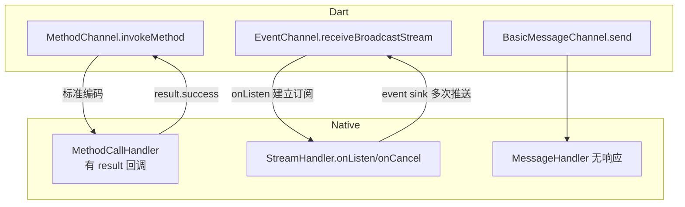

# PlatformChannel

## 一句话定义

Platform Channel 是 Flutter 官方提供的**原生与 Dart 双向通信机制**，底层依托 `BinaryMessenger`——一个**按 Channel 名索引的二进制消息路由表**。消息在发送侧被**编解码器**序列化成 `ByteData`，投递到对端的消息队列，再由对端解码成 Dart 的 `Object` 或 Java/Kotlin 的对象。业界按语义分成三大类：**MethodChannel（请求-响应）**、**EventChannel（单向事件流）**、**BasicMessageChannel（无响应消息）**。

## 核心原理

### 1. 底层机制：BinaryMessenger

```
┌──────────────────────── Dart 侧 (Flutter Engine) ───────────────────────┐
│                                                                          │
│   Dart Channel                Dart MessageHandler                       │
│   MethodChannel/EventChannel  ──►  BinaryMessenger.setMessageHandler()   │
│                                     │                                  │
│                          ┌──────────▼──────────┐                       │
│                          │  Platform Message   │  ← 编码后的 ByteData   │
│                          │  (channel, payload) │                       │
│                          └──────────┬──────────┘                       │
└─────────────────────────────────────┼──────────────────────────────────┘
                                      │  引擎内部队列（跨线程安全投递）
┌─────────────────────────────────────▼──────────────────────────────────┐
│                        Native 侧 (Android Embedding)                     │
│                                                                          │
│   BinaryMessenger ──► BinaryMessageHandler (按 channel 名索引)         │
│                          │                                               │
│                          ├─ MethodChannel.IncomingMethodCallHandler      │
│                          └─ EventChannel.StreamHandler                  │
└──────────────────────────────────────────────────────────────────────────┘
```

关键机制点：

1. **注册即路由**：`BinaryMessenger.setMessageHandler(channel, handler)` 把 handler 存入一张 `Map<String, BinaryMessageHandler>`；原生侧调用 `channel.send()` 时，按 channel 名查出对端 handler 并投递。
2. **跨线程安全**：Dart 侧 `invokeMethod` 可以从任意 isolate 线程调用，引擎会负责把消息投递到**平台线程（Android 主线程）**执行对端 handler。
3. **异步语义**：Native → Dart 是**异步**（Dart 侧 handler 返回 `Future`）；Dart → Native 的 `invokeMethod` 也是**异步**（原生 `result.success()` 回调完成 Future）。**没有同步阻塞调用**。
4. **无序列化反射**：消息体是 `ByteData`，由 `MessageCodec` 负责序列化，不走 JSON 反射。

### 2. 三大 Channel 对比表

| 维度 | **MethodChannel** | **EventChannel** | **BasicMessageChannel** |
| --- | --- | --- | --- |
| 通信模型 | 请求-响应（RPC） | 单向流（原生→Flutter） | 单向消息（无响应） |
| 方向 | **双向**（Dart→Native，Native→Dart） | Native → Dart | Dart → Native（也支持反向） |
| Dart 侧 API | `invokeMethod` / `setMethodCallHandler` | `receiveBroadcastStream` | `send` |
| 原生侧 API | `setMethodCallHandler` / `invokeMethod` | `setStreamHandler` | `setMessageHandler` |
| 有无返回值 | **有**（`result.success(data)`） | 有（事件载荷，异步多次） | **无** |
| 编解码器 | `StandardMessageCodec`（默认） | `StandardMessageCodec` | 任意 `MessageCodec`（默认 Standard） |
| 典型场景 | 调用原生能力：定位、支付、跳转、读通讯录 | 推送原生事件：网络状态、下载进度、扫码结果 | 单纯的数据投递、日志、事件上报 |



> [!tip] 记忆口诀
> **Method = 有问必有答；Event = 原生持续播报；Basic = 只管发，不等回执。**

### 3. 编解码器体系

| Codec | 编码格式 | 说明 |
| --- | --- | --- |
| `StandardMessageCodec` | Flutter 自定义的**二进制格式** | 默认。内部类型系统更丰富，支持 `int/double/String/bool/Null/List/Map/Uint8List/Float64List/Int32List` |
| `JSONMessageCodec` | UTF-8 JSON | 通用、可读、跨语言友好，但只支持 JSON 能表达的类型 |
| `StringMessageCodec` | UTF-8 字符串 | 最轻量 |
| `CustomMessageCodec` | 自定义 | 继承 `MessageCodec<T>`，自己实现 `encodeMessage` / `decodeMessage` |

`StandardMessageCodec` 相对 `JSONMessageCodec` 的优势：

- 支持 **64 位整数**（JSON 的 `number` 在 JS 侧有精度问题，但 Dart 的 JSON 没有；跨端时是优势）；
- 支持**二进制**（`Uint8List`），JSON 需要 Base64 编码，体积翻倍；
- 编码是**二进制紧凑格式**，比 JSON 文本更小、解析更快。

### 4. Pigeon：官方类型安全方案

手写 Channel 的三大痛点：

1. **无类型约束**：Dart 侧 `invokeMethod('getUserInfo')` 传 `Map`，原生侧 `call.arguments as Map<String, Any>`，参数名写错、类型写错都是**运行时**才发现。
2. **样板代码多**：每个方法都要写 `when (call.method) { ... }`。
3. **契约漂移**：Dart 与原生各写一份，没有单一事实来源。

Pigeon（`pigeon` 官方包）用**一份接口定义文件**生成两端代码：

```dart
// pigeons/user_api.dart
import 'package:pigeon/pigeon.dart';

@HostApi()                 // 原生实现，Dart 调用
abstract class UserHostApi {
  String getPlatformVersion();
  User? getUserById(String id);
}

@FlutterApi()               // Dart 实现，原生调用
abstract class UserFlutterApi {
  void onUserSelected(String id);
}

class User {
  String id;
  String name;
  int age;
}
```

生成的代码自动包含：常量化的方法名（字符串池，不再是字面量）、`StandardMessageCodec` 封装的消息结构、**双向回调**、错误处理（`PlatformException` 的 `code/message/details`）。

> 面试话术：**"Pigeon 解决了什么问题？"** —— 它把"跨端接口契约"变成**编译期可检查的东西**：接口定义在一个 `.dart` 文件里，通过 `flutter pub run pigeon --input pigeons/user_api.dart` 生成 Dart 与 Kotlin/Swift/ObjC 的强类型代码，参数类型、返回值类型、错误都编译期确定，改接口时两端同时被生成器强制同步。

### 5. 线程模型与线程约束

| 位置 | 执行线程 | 说明 |
| --- | --- | --- |
| Dart `invokeMethod` | Dart isolate 线程 | 发出即返回 `Future` |
| Native `MethodCallHandler` | **Android 主线程（Platform Thread）** | Flutter 引擎把消息派发到主线程 |
| Native `result.success()` 回调 | **Android 主线程** | 回到主线程，不能直接操作后台线程资源 |
| Dart `setMethodCallHandler` | Dart UI isolate 线程 | — |
| `EventChannel` `onListen` / `onCancel` | 主线程 | 订阅建立/取消 |

**结论：原生 handler 里的耗时操作会阻塞 UI 线程。**

```kotlin
// ❌ 错误：在主线程做网络/磁盘操作
MethodChannel(binaryMessenger, "app/api").setMethodCallHandler { call, result ->
    val users = db.queryAll()        // 阻塞主线程，ANR 风险
    result.success(users)
}

// ✅ 正确：切到 IO 线程，回调结果时 result.success 仍是线程安全的
MethodChannel(binaryMessenger, "app/api").setMethodCallHandler { call, result ->
    lifecycleScope.launch(Dispatchers.IO) {
        val users = withContext(Dispatchers.IO) { db.queryAll() }
        result.success(users)         // 引擎会处理回主线程投递
    }
}
```

> `result.success()` / `result.error()` 可以从**任意线程**调用，引擎会保证最终在 Dart 侧安全投递。

### 6. 性能开销分析

| 操作 | 大致开销 | 说明 |
| --- | --- | --- |
| 一次 `invokeMethod` 往返 | 几十到几百微秒 | 编码 + 队列投递 + 线程切换 + Dart isolate 调度 |
| 高频调用（如每帧调用） | **会明显掉帧** | 消息队列 + 序列化开销叠加 |
| 大对象（MB 级 JSON） | 编码耗时线性增长 | StandardMessageCodec 序列化本身也是 O(n) |
| 批量传 1 万条数据 | 一次调用优于 1 万次调用 | 消息头开销摊薄 |

**优化原则：**

1. **批量**：高频数据（如传感器采样）用 `EventChannel` 推流，或每 N ms 聚合一次。
2. **异步**：原生 handler 立刻返回结果句柄（如 Future），实际数据异步送达。
3. **避免主线程阻塞**：handler 内只做"取数据 + 立即返回"。
4. **减少类型转换开销**：大数据用 `Uint8List` 传二进制而不是 JSON 字符串。

## 代码示例

### 1. MethodChannel 双向通信（Android 侧）

```kotlin
package com.example.host.channel

import android.content.Context
import android.content.Intent
import android.provider.Settings
import io.flutter.plugin.common.MethodCall
import io.flutter.plugin.common.MethodChannel
import io.flutter.plugin.common.MethodChannel.MethodCallHandler
import io.flutter.plugin.common.MethodChannel.Result

/**
 * 设备能力通道：Dart 调用原生，原生也可以主动回调 Dart。
 * 注意：Handler 运行在 Android 主线程。
 */
class DeviceChannel(private val context: Context) : MethodCallHandler {

    companion object {
        const val CHANNEL = "com.example.host/device"
    }

    private var channel: MethodChannel? = null

    fun register(binaryMessenger: io.flutter.plugin.common.BinaryMessenger) {
        channel = MethodChannel(binaryMessenger, CHANNEL).apply {
            setMethodCallHandler(this@DeviceChannel)
        }
    }

    fun unregister() {
        channel?.setMethodCallHandler(null)
        channel = null
    }

    override fun onMethodCall(call: MethodCall, result: Result) {
        when (call.method) {
            // Dart -> Native：取平台信息
            "getPlatformInfo" -> {
                val info = mapOf(
                    "systemVersion" to android.os.Build.VERSION.RELEASE,
                    "model" to android.os.Build.MODEL,
                    "sdkInt" to android.os.Build.VERSION.SDK_INT
                )
                result.success(info)
            }

            // Dart -> Native：打开系统设置
            "openAppSettings" -> {
                val intent = Intent(Settings.ACTION_APPLICATION_DETAILS_SETTINGS).apply {
                    data = android.net.Uri.fromParts("package", context.packageName, null)
                    addFlags(Intent.FLAG_ACTIVITY_NEW_TASK)
                }
                context.startActivity(intent)
                result.success(null)      // 无返回值也要 success，否则 Dart 侧 Future 永不完成
            }

            // Dart -> Native：耗时操作，异步返回
            "readLargeFile" -> {
                val path = call.argument<String>("path") ?: ""
                // 交给线程池处理，避免阻塞主线程
                ThreadPoolExecutor.execute {
                    val content = runCatching { java.io.File(path).readText() }.getOrNull()
                    result.success(content)   // 可从任意线程调用
                }
            }

            else -> result.notImplemented()
        }
    }

    /** Native -> Dart：主动推送（比如登录态变化、网络恢复） */
    fun notifyLoginChanged(token: String) {
        channel?.invokeMethod("onLoginChanged", mapOf("token" to token))
    }
}
```

### 2. MethodChannel 双向通信（Dart 侧）

```dart
import 'package:flutter/services.dart';

/// 与 Android 侧 com.example.host/device 通道对应的 Dart 封装
class DeviceApi {
  DeviceApi._();

  static const MethodChannel _channel = MethodChannel('com.example.host/device');

  /// 注册原生 → Dart 的回调（原生调用 onLoginChanged 时会进这里）
  static void setNativeCallback({
    required void Function(String token) onLoginChanged,
  }) {
    _channel.setMethodCallHandler((call) async {
      switch (call.method) {
        case 'onLoginChanged':
          final args = call.arguments as Map<Object?, Object?>;
          onLoginChanged(args['token'] as String);
          return;
        default:
          throw MissingPluginException('未实现的原生方法: ${call.method}');
      }
    });
  }

  /// Dart → 原生：获取平台信息
  static Future<Map<String, Object?>> getPlatformInfo() async {
    final result = await _channel.invokeMethod<Map<Object?, Object?>>('getPlatformInfo');
    return result?.cast<String, Object?>() ?? const {};
  }

  /// Dart → 原生：打开系统设置
  static Future<void> openAppSettings() async {
    await _channel.invokeMethod<void>('openAppSettings');
  }

  /// Dart → 原生：带参数调用
  static Future<String?> readLargeFile(String path) async {
    return _channel.invokeMethod<String>('readLargeFile', {'path': path});
  }
}
```

### 3. EventChannel：原生持续推事件给 Flutter

```kotlin
package com.example.host.channel

import io.flutter.plugin.common.EventChannel
import io.flutter.plugin.common.EventChannel.EventSink
import io.flutter.plugin.common.EventChannel.StreamHandler

/**
 * 下载进度事件通道：原生 → Flutter 单向推送。
 * 关键：onListen 时才注册监听，onCancel 时必须解绑，否则泄漏。
 */
class ProgressChannel(private val onProgress: (Int, Int) -> Unit) : StreamHandler {

    companion object {
        const val CHANNEL = "com.example.host/progress"
    }

    private var sink: EventSink? = null
    private var listener: DownloadListener? = null

    override fun onListen(arguments: Any?, events: EventSink?) {
        sink = events
        listener = object : DownloadListener {
            override fun onProgress(downloaded: Int, total: Int) {
                // EventSink 不允许跨线程直接使用，必须切回主线程
                android.os.Handler(android.os.Looper.getMainLooper()).post {
                    sink?.success(mapOf("downloaded" to downloaded, "total" to total))
                }
            }
        }
        downloadManager.registerListener(listener!!)
    }

    override fun onCancel(arguments: Any?) {
        listener?.let { downloadManager.unregisterListener(it) }
        listener = null
        sink = null
    }
}
```

```dart
import 'package:flutter/services.dart';

class ProgressApi {
  static const EventChannel _channel = EventChannel('com.example.host/progress');

  /// 订阅原生进度事件。cancel() 会通知原生 onCancel，触发解绑。
  static Stream<DownloadProgress> get progress {
    return _channel.receiveBroadcastStream().map((event) {
      final map = event as Map<Object?, Object?>;
      return DownloadProgress(
        downloaded: map['downloaded'] as int,
        total: map['total'] as int,
      );
    });
  }
}

class DownloadProgress {
  const DownloadProgress({required this.downloaded, required this.total});
  final int downloaded;
  final int total;
  double get percent => total == 0 ? 0 : downloaded / total;
}
```

### 4. 协程友好的 Channel 封装（Kotlin 侧）

```kotlin
package com.example.host.channel

import io.flutter.plugin.common.BinaryMessenger
import io.flutter.plugin.common.MethodChannel
import io.flutter.plugin.common.MethodChannel.Result
import kotlinx.coroutines.channels.awaitClose
import kotlinx.coroutines.flow.Flow
import kotlinx.coroutines.flow.callbackFlow
import kotlinx.coroutines.suspendCancellableCoroutine
import kotlin.coroutines.resume
import kotlin.coroutines.resumeWithException

/**
 * 把 Flutter 的回调式 MethodChannel / EventChannel 包装成
 * 协程友好的 suspend 函数与 Flow，避免 "callback hell"。
 */
class FlutterBridge(private val binaryMessenger: BinaryMessenger) {

    /** 把 invokeMethod 包装成 suspend 函数 */
    suspend fun invoke(channel: String, method: String, args: Any? = null): Any? =
        suspendCancellableCoroutine { cont ->
            MethodChannel(binaryMessenger, channel)
                .invokeMethod(method, args, object : MethodChannel.Result {
                    override fun success(result: Any?) {
                        if (cont.isActive) cont.resume(result)
                    }

                    override fun error(code: String, message: String?, details: Any?) {
                        if (cont.isActive) {
                            cont.resumeWithException(
                                FlutterBridgeException(code, message, details)
                            )
                        }
                    }

                    override fun notImplemented() {
                        if (cont.isActive) {
                            cont.resumeWithException(
                                FlutterBridgeException(
                                    "not_implemented", "原生未实现 $method", null
                                )
                            )
                        }
                    }
                })
        }

    /** 把 EventChannel 包装成冷 Flow */
    fun events(channel: String): Flow<Any?> = callbackFlow {
        val handler = io.flutter.plugin.common.EventChannel.StreamHandler {
            // onListen
        }
        // 真实实现使用 EventChannel 的 StreamHandler：
        io.flutter.plugin.common.EventChannel(binaryMessenger, channel)
            .setStreamHandler(object : io.flutter.plugin.common.EventChannel.StreamHandler {
                override fun onListen(arguments: Any?, events: io.flutter.plugin.common.EventChannel.EventSink?) {
                    events?.success("first")   // 占位，实际由业务推送
                }

                override fun onCancel(arguments: Any?) {
                    // Flow 取消时通知原生解绑
                }
            })
        awaitClose {
            io.flutter.plugin.common.EventChannel(binaryMessenger, channel)
                .setStreamHandler(null)
        }
    }
}

class FlutterBridgeException(
    val code: String, val message: String?, val details: Any?
) : Exception("$code: $message")
```

### 5. 自定义编解码器

```kotlin
package com.example.host.channel

import io.flutter.plugin.common.BinaryCodec
import io.flutter.plugin.common.MessageCodec
import java.io.ByteArrayOutputStream
import java.nio.ByteBuffer

/**
 * 自定义 Codec：把一个简单的 Pair 编码为紧凑的二进制格式。
 * 继承 MessageCodec<Pair<String, Int>>，实现 encodeMessage / decodeMessage。
 */
class PairCodec : MessageCodec<Pair<String, Int>> {

    override fun encodeMessage(message: Pair<String, Int>?): ByteBuffer {
        val out = ByteArrayOutputStream()
        message?.let { (text, number) ->
            val textBytes = text.toByteArray(Charsets.UTF_8)
            out.write(textBytes.size shr 24)
            out.write(textBytes.size shr 16)
            out.write(textBytes.size shr 8)
            out.write(textBytes.size)
            out.write(textBytes)
            out.write((number shr 24) and 0xFF)
            out.write((number shr 16) and 0xFF)
            out.write((number shr 8) and 0xFF)
            out.write(number and 0xFF)
        }
        return ByteBuffer.wrap(out.toByteArray())
    }

    override fun decodeMessage(buffer: ByteBuffer): Pair<String, Int>? {
        if (!buffer.hasRemaining()) return null
        val len = ((buffer.get().toInt() and 0xFF) shl 24) or
                ((buffer.get().toInt() and 0xFF) shl 16) or
                ((buffer.get().toInt() and 0xFF) shl 8) or
                (buffer.get().toInt() and 0xFF)
        val bytes = ByteArray(len)
        buffer.get(bytes)
        val text = String(bytes, Charsets.UTF_8)
        val number = ((buffer.get().toInt() and 0xFF) shl 24) or
                ((buffer.get().toInt() and 0xFF) shl 16) or
                ((buffer.get().toInt() and 0xFF) shl 8) or
                (buffer.get().toInt() and 0xFF)
        return text to number
    }
}
```

### 6. Pigeon 接口定义与使用

```dart
// pigeons/user_api.dart —— 唯一的契约来源
import 'package:pigeon/pigeon.dart';

@HostApi()
abstract class UserHostApi {
  String getPlatformVersion();
  User? getUserById(String id);
  List<User> searchUsers(String keyword);
}

class User {
  User({required this.id, required this.name, required this.age});
  String id;
  String name;
  int age;
}
```

```bash
# 生成 Dart + Kotlin 代码
flutter pub run pigeon --input pigeons/user_api.dart \
  --dart_out lib/src/generated \
  --kotlin_out android/src/main/kotlin/com/example/host
```

```dart
// 生成的 Dart 侧用法（强类型，无需手写 MethodChannel）
import 'package:pigeon/pigeon.dart';
import 'user_api.g.dart';

class UserRepository {
  UserRepository(this._api);
  final UserHostApi _api;

  Future<User?> findUser(String id) async {
    try {
      return await _api.getUserById(id);
    } on PlatformException catch (e) {
      // Pigeon 生成的错误都是 PlatformException，code/message 结构化
      print('查询失败 ${e.code}: ${e.message}');
      return null;
    }
  }
}
```

```kotlin
// 生成的 Kotlin 侧：实现 Pigeon.UserHostApi 接口，方法名是强类型的
class UserHostApiImpl : UserHostApi {
    override fun getPlatformVersion(): String = "Android ${android.os.Build.VERSION.RELEASE}"

    override fun getUserById(id: String): User? = userDao.findById(id)

    override fun searchUsers(keyword: String): List<User> = userDao.search(keyword)
}
```

## 常见问题 / 面试要点

**读者问：Platform Channel 的底层到底是什么？消息是怎么从 Dart 传到 Java/Kotlin 的？**

**AI答：**

1. **四层结构**：
   - **第 1 层（用户 API）**：`MethodChannel` / `EventChannel` / `BasicMessageChannel`，语义封装。
   - **第 2 层（编解码）**：`MessageCodec`，把对象序列化成 `ByteData`（`StandardMessageCodec` / `JSONMessageCodec` / `CustomMessageCodec`）。
   - **第 3 层（路由）**：`BinaryMessenger`，一张 `channel 名 → BinaryMessageHandler` 的表，负责查找与投递。
   - **第 4 层（引擎传输）**：Dart 与原生在同一进程，引擎内部有一个**线程安全的消息队列**，负责跨线程切换与顺序保证。
2. **完整链路（Dart → Native）**：
   ```
   Dart invokeMethod("getUserById", {"id": "1"})
     → StandardMessageCodec.encodeMessage(参数) → ByteBuffer
     → BinaryMessenger.send(channel, ByteBuffer)
     → 引擎投递到 Android 主线程（Platform Thread）
     → 原生侧 BinaryMessageHandler 查表找到 MethodChannel 的 handler
     → onMethodCall(call, result)，call.method / call.arguments 已解码
     → result.success(值) → 编码回 ByteBuffer → 投递回 Dart isolate → 完成 Future
   ```
3. **关键结论**：
   - **不是** Binder / IPC / Socket——原生与 Dart 在**同一进程同一引擎内**，是进程内通信。
   - **没有反射**，序列化由手写的 codec 完成，性能远好于 JSON 反射。
   - **本质是"进程内的跨语言消息总线"**，Flutter 用它把平台能力开放给 Dart。
4. **面试话术**：**"Flutter 和原生通信有性能问题吗？"** —— 单次调用开销在几十到几百微秒，日常调用完全无感；问题是**高频调用**（每帧、滚动中每项回调）会打爆消息队列导致掉帧。解决手段是批量、节流、异步句柄、或改用 `Texture` 纹理直传（`TextureRegistry`）。

---

**读者问：MethodChannel 和 EventChannel 有什么区别？什么时候用哪个？**

**AI答：**

1. **MethodChannel = 请求-响应（RPC）**：
   - 有返回值；Dart 调 `invokeMethod` 得到 `Future<T>`；原生侧通过 `result.success/error/notImplemented` 回应。
   - **是双向的**：原生也可以 `invokeMethod` 调 Dart 侧注册的 handler。
   - 语义："**我问一次，你答一次**"。
2. **EventChannel = 单向事件流**：
   - 原生 → Flutter 推送，**没有请求方**，Dart 侧 `receiveBroadcastStream()` 得到 `Stream`。
   - 原生侧实现 `StreamHandler`：`onListen`（订阅建立时回调，此时拿到 `EventSink`）与 `onCancel`（取消订阅时回调）。
   - 语义："**我这儿有 ongoing 的数据流，你订阅或不订阅**"。
   - **反向的 EventChannel**（Dart → 原生）也存在，实现 `FlutterApi` 即可。
3. **选型**：
   - 需要**结果** → MethodChannel（如"调起支付，返回支付结果"）。
   - 需要**持续推送** → EventChannel（如"下载进度"、"位置变化"、"网络状态"）。
   - 用 EventChannel 模拟"轮询式请求"是**误用**——每次请求要新建 Stream，成本更高。
4. **关键坑**：
   - `EventSink` **不允许跨线程**使用，必须切回主线程调用 `success()`；
   - `onCancel` **必须解绑**原生资源，否则泄漏（最常见的 EventChannel bug）；
   - `receiveBroadcastStream()` 是**冷流**，每次 `listen` 都会触发一次原生 `onListen`；要共享用 `Stream.broadcast()` 或在 Dart 侧做单例缓存。
5. **面试话术**：**"EventChannel 的 onListen 和 onCancel 分别什么时候调？"** —— `onListen` 在**第一个 Dart 订阅者**订阅时调用（且只会调用一次，直到最后一个订阅者取消），`onCancel` 在**最后一个订阅者取消**时调用。原生侧要在 `onListen` 里注册监听器、在 `onCancel` 里反注册。

---

**读者问：BasicMessageChannel 和 MethodChannel 差在哪？什么场景用？**

**AI答：**

1. **差异**：
   - MethodChannel 有 `Result` 回调，能回传结果；BasicMessageChannel **没有返回值**，Dart 侧 `send()` 返回 `Future<void>`，原生侧 `MessageHandler` 只收不答。
   - BasicMessageChannel 的编解码器**完全可自定义**（可以传任意 `MessageCodec`），MethodChannel 的 codec 在构造时也能指定，但**默认 Standard**。
   - BasicMessageChannel 的消息是**双向**的（Dart → Native 与 Native → Dart 都可）。
2. **场景**：
   - **单向的、Fire-and-forget 的事件上报**（埋点、日志、崩溃信息上报）。
   - **需要自定义二进制协议**的高性能通道（如音视频帧元数据、IM 协议）。
   - **平台无关的简单通知**（如"原生告诉 Dart 屏幕旋转了"）。
3. **面试话术**：**"如果我要 Dart 调原生并拿到结果，为什么不用 BasicMessageChannel 再自己写回调？"** —— 因为 BasicMessageChannel 没有响应通道，原生想回传结果就得再开一条反向通道自己配对 requestId，复杂度高且容易出错。MethodChannel 的 `Result` 就是引擎内建的单次回调配对机制。

---

**读者问：Pigeon 解决了什么问题？它和手写 Platform Channel 比有什么区别？**

**AI答：**

1. **手写 Channel 的三个痛点**：
   - **无类型安全**：Dart 传 `Map`，原生 `call.arguments as Map<String, Any>`，参数名/类型写错是**运行时**才炸；
   - **样板代码多**：每个方法都要写一遍 `when(call.method)` 分支，方法多了不可维护；
   - **契约漂移**：Dart 与原生两份实现，接口变更极易漏改一边。
2. **Pigeon 的解法**：
   - 用**一份接口定义**（`pigeons/xxx.dart`）作为**唯一事实来源**；
   - 通过代码生成器产出 **Dart + Kotlin/Swift/ObjC** 的强类型实现；
   - 方法名**常量化**（不再散落字符串字面量，重构时编译期报错）；
   - 参数与返回值类型**编译期确定**，错误以结构化 `PlatformException(code, message, details)` 传递；
   - 支持**双向 API**（`@HostApi` 原生实现 + `@FlutterApi` Dart 实现）、**流式 API**（`@StreamChannel`）。
3. **代价**：
   - 引入**代码生成步骤**（CI 里要跑 `pigeon` 或挂到 Gradle task），构建变复杂；
   - 生成代码不好手改，出问题要看生成器版本；
   - 只适合**接口边界清晰**的场景，临时/低频调用用 MethodChannel 更快。
4. **面试话术**：**"什么时候你会建议用 Pigeon，什么时候手写？"** —— 涉及**跨端契约的长期模块**（登录、支付、推送、埋点）用 Pigeon，因为团队大、接口变更频繁，类型安全的收益远大于生成成本；一次性的小交互直接 MethodChannel。

---

**读者问：Platform Channel 的性能开销大吗？怎样避免成为性能瓶颈？**

**AI答：**

1. **单次开销**：编码 + 队列投递 + **跨线程切换**（Android 主线程 ↔ Dart isolate）+ isolate 调度，量级在**几十到几百微秒**。日常调用（几十次/页）无感。
2. **什么时候成为瓶颈**：
   - **高频调用**：滚动列表每项回调、每帧动画进度、传感器逐条上报；
   - **大对象**：一次传 MB 级 JSON，序列化 O(n) 且产生大量 GC 压力；
   - **主线程阻塞**：原生 handler 里做 IO。
3. **优化手段**：
   - **批量**：把 N 条数据合并成一次调用（`List<Map>`），摊薄消息头开销；
   - **节流/去抖**：滚动中每 100 ms 推一次位置，而不是每帧；
   - **异步句柄**：原生立即返回一个 `Future` 句柄，数据就绪后再推；
   - **二进制传输**：图片/大 blob 用 `Uint8List` 走 `BasicMessageCodec`，或干脆走 `TextureRegistry` 纹理直传；
   - **线程隔离**：原生 handler 立刻把任务丢到 IO 线程，不阻塞主线程；
   - **平台通道下沉到原生**：需要 60/120 fps 的场景（如视频、相机预览）应走 `Texture` 或 `SurfaceProducer`。
4. **面试话术**：**"你做过 Flutter 混合工程里掉帧的排查吗？"** —— 第一步用 DevTools 的 Performance 面板看 Frame Chart，如果掉帧集中在某几帧，看 Timeline 里是否有大量 `Dart`/`Platform Message` 事件；有高频 Channel 调用就改成批量或改走纹理直传。

---

**读者问：Channel 调用报 `MissingPluginException` 是什么原因？`PlatformException` 又是什么？**

**AI答：**

1. **`MissingPluginException`**：Dart 侧调 `invokeMethod` 时，**原生侧没有注册对应 channel 的 handler**。常见原因：
   - Channel 名不一致（大小写、下划线、中文标点差一个字符）；
   - **注册时机晚于首次调用**（`configureFlutterEngine` 未执行，或 handler 在异步回调里才注册）；
   - **R8 混淆把 handler 类移除/改名**（见 [[工程集成]] 的混淆章节）；
   - 使用了 aar 集成但**插件没有被打进包**；
   - **引擎与 View 不匹配**：handler 注册在引擎 A 上，调用发生在 attach 到引擎 B 的 View 上。
2. **`PlatformException`**：原生侧调用 `result.error(code, message, details)` 抛出的**业务异常**，Dart 侧 `catch (e) on PlatformException` 可拿到结构化的 `code/message/details`。它表示"**原生执行了，但失败了**"，与"没找到插件"是两回事。
3. **调试手段**：
   ```dart
   try {
     final v = await _channel.invokeMethod('foo');
   } on MissingPluginException catch (e) {
     debugPrint('插件未注册，检查 channel 名与注册时机: $e');
   } on PlatformException catch (e) {
     debugPrint('原生报错 ${e.code}: ${e.message}, details=${e.details}');
   }
   ```
4. **原生侧定位**：`logcat` 里 Flutter 引擎会打印 `Another exception was thrown` / `Channel not found`，也可以在 `setMethodCallHandler` 里加日志确认 handler 是否被调用。

---

**读者问：MethodChannel 的 handler 在哪个线程执行？能不能在里面做耗时操作？**

**AI答：**

1. **线程**：`MethodCallHandler.onMethodCall` 运行在 **Android 主线程（Platform Thread）**。Dart 侧 `setMethodCallHandler` 运行在 **Dart UI isolate 线程**。
2. **能不能做耗时操作**：**不能直接做**。主线程阻塞超过 5 秒会 ANR；即使 100 ms 也会掉帧。
3. **正确写法**：
   ```kotlin
   MethodChannel(binaryMessenger, CHANNEL).setMethodCallHandler { call, result ->
       lifecycleScope.launch {
           val data = withContext(Dispatchers.IO) { repository.load() }
           result.success(data)
       }
   }
   ```
   注意 `result.success()` **可以从任意线程调用**，引擎负责把回包投递到正确线程。
4. **坑**：
   - 如果在协程里 `result.success()` 抛异常或协程被取消而**从未调用 success/error**，Dart 侧的 `Future` 会**永远挂起**（`invokeMethod` 不超时）。这是"Flutter 侧 await 卡死"的常见原因。
   - 解法：用 `try/catch/finally` 保证 `result` 被终结，或用 `suspendCancellableCoroutine` 在协程取消时 `resumeWithException`。
5. **面试话术**：**"Flutter 那边一直卡在 loading，日志看不出错，可能是什么原因？"** —— 常见三种：① 原生 handler 没有调 `result.success/error`（协程被取消/异常吞掉）；② Dart `await` 的 Channel 名与原生不一致（会抛异常而不是卡住）；③ 原生 handler 里死锁或等待另一个 Channel 的响应。

---

**读者问：StandardMessageCodec 和 JSONMessageCodec 怎么选？标准编解码器支持哪些类型？**

**AI答：**

1. **`StandardMessageCodec` 支持的类型**：`null`、`bool`、`int`（32/64 位）、`double`、`String`、`Uint8List`（二进制）、`Int32List`、`Int64List`、`Float32List`、`Float64List`、`List`、`Map`（键必须是上述支持的类型）。
2. **`JSONMessageCodec`**：只支持 JSON 能表达的类型（`null/bool/int/double/String/List/Map`），**不支持二进制**——二进制需要 Base64，体积膨胀约 33% 且编解码更慢。
3. **选型**：
   - **默认用 Standard**：性能好、支持二进制、支持 64 位整数。
   - **需要跨语言可读/与后端调试对齐**时用 JSON（例如需要用抓包工具直接看内容）。
   - **需要自定义协议**时用 `CustomMessageCodec`。
4. **注意**：`StandardMessageCodec` 的 `int` 在 Dart 侧是 64 位，Java 侧映射成 `Long`；**而 JSON 里的数字在 JS 里是 double**，跨 JS 桥时大整数会丢精度——这是 JSON 方案的一个真实缺陷。
5. **面试话术**：**"StandardMessageCodec 是 JSON 吗？"** —— 不是，它是一套**自定义的二进制紧凑格式**：每个值先写 1 字节类型标记，再写内容，因此比 JSON 小也更快。类型标记保证了编解码无歧义。

## 关联笔记

- [[工程集成]]：三种集成模式、引擎复用、混淆规则
- [[混合栈管理]]：Channel 在页面跳转与传参中的实际使用
- [[性能优化]]：Channel 调用开销与优化策略
- [[调试与打包]]：Channel 问题的调试与日志
- [[../KotlinMultiplatform/KMP与原生集成]]：KMP 共享逻辑而非 Channel 的另一种跨端方案
- [[../ReactNative混合开发]]：RN Bridge / JSI 与 Platform Channel 的通信模型对比
- [[../README]]：第 9 部分总览

## 参考资料

- Flutter Platform channels 官方文档：https://docs.flutter.dev/platform-integration/platform-channels
- Flutter Platform channels 进阶（自定义编解码器、TaskQueue）：https://docs.flutter.dev/platform-integration/platform-channels#advanced-topics
- Pigeon 官方仓库：https://github.com/flutter/pigeon
- Flutter Engine 源码（platform_channel 相关）：https://github.com/flutter/flutter/tree/master/engine/src/flutter/shell/platform/common
- `BinaryMessenger` Android API 文档：https://api.flutter.dev/flutter/services/BinaryMessenger-class.html
