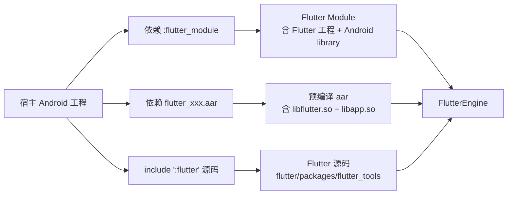
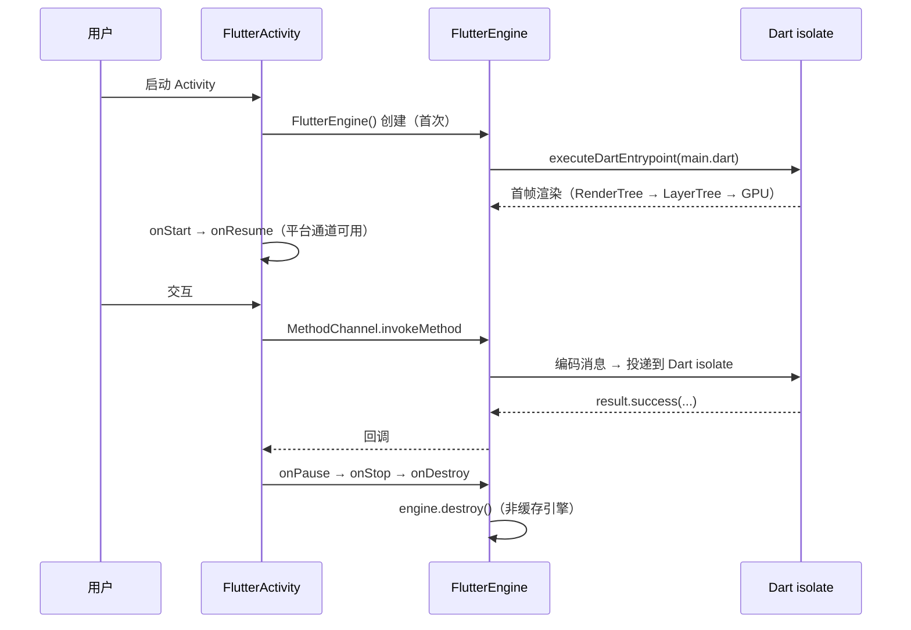

# Flutter 工程集成

## 一句话定义

把一个 Flutter 应用"嵌进"已有 Android 原生工程，本质是**让宿主 App 的进程里多出一套 Flutter 引擎（libflutter.so + Dart VM）**，两者通过 `PlatformChannel` 通信。集成的核心决策只有三个：**以什么形式依赖（aar / module / 源码）、引擎怎么创建与复用、产物怎么打包**。Google 官方推荐 **module 模式**，因为它在依赖、构建、团队协作、版本回退上都有最好的平衡点。

## 核心原理

### 1. Flutter 引擎架构概览

Flutter 不是"一套跨平台 UI 库"，而是**一个自绘引擎 + 一套 UI 框架**。它把渲染、动画、手势、绘制全部接管，绕开了 Android 原生的 View 体系，因此跨平台一致性和性能来自"自绘"。

```
┌─────────────────────────────────────────────────────────┐
│                    Flutter Framework (Dart)              │
│  Material / Cupertino │ Widgets │ Rendering │ Scheduler │
└───────────────────────┬─────────────────────────────────┘
                        │  只操作 Layer Tree
┌───────────────────────▼─────────────────────────────────┐
│                   Flutter Engine (C++)                   │
│                                                          │
│  ┌──────────────┐   ┌───────────────┐   ┌─────────────┐  │
│  │  Dart VM     │   │  Skia / Impeller│   │  Platform  │  │
│  │  (AOT 快照)   │   │  (GPU 渲染)    │   │  Channel   │  │
│  └──────────────┘   └───────────────┘   └─────────────┘  │
│      UI Thread          Raster Thread      Platform      │
└──────────────────────────────────────────────────────────┘
```

关键组成：

| 组件 | 作用 | 面试点 |
| --- | --- | --- |
| **Dart VM** | 运行 Dart 代码；**Debug 用 JIT（支持 hot reload），Release/Profile 用 AOT 快照** | AOT 意味着启动快、无 JIT 代码缓存写入、无法热重载 |
| **Flutter Framework** | Material/Cupertino、Widget、Rendering、Scheduler、Painting | Widget → Element → RenderObject 三棵树 |
| **Skia（Android 默认）** | 2D/3D 图形后端，把 Layer Tree 光栅化成 GPU 指令 | Skia 曾在 Android 上是系统库，Flutter 内置自己的一份 |
| **Impeller** | Flutter 3.10+ 引入的新渲染后端，Android 上逐步成为默认 | 用 Shader 直接驱动，避免 Skia 的 Intermediate Layer |
| **Platform Channel** | Dart 与 Java/Kotlin 之间的消息通道 | 基于 `BinaryMessenger`，本质是二进制消息队列 |

> [!important] 面试要点：Flutter 的 so 库为什么叫 `libflutter.so` 和 `libapp.so`？
> `libflutter.so` 是**引擎**（Dart VM + 渲染 + 平台线程，跨所有 Flutter App 共用一份代码），`libapp.so` 是**你的 App**（AOT 编译后的 Dart 业务代码 + assets）。两者分离的好处是：**引擎可以独立升级**，且 `libflutter.so` 在同一进程内多引擎共享时只加载一份。

### 2. 三种集成模式对比

| 维度 | **aar 集成** | **module 集成** | **源码依赖** |
| --- | --- | --- | --- |
| 依赖形态 | `implementation files('flutter_xxx.aar')` | `implementation project(':flutter_module')` | `include ':flutter'; project(':flutter').projectDir = ...` |
| Flutter 源码位置 | 宿主外（预先构建产物） | 宿主内独立 module | 宿主内独立 module（源码级） |
| 修改 Dart 代码 | 需要重新构建 aar | 需要重新构建 module（Gradle 自动感知） | 直接改，IDE 全文索引 |
| 调试器（断点） | 不可用 | 不可用（除非用 add-to-app 的 Flutter 调试） | 可用，Android Studio 直接下断点 |
| Flutter 插件依赖 | 受限，插件需预编译进 aar | 支持 | 支持 |
| 构建耗时 | 最短 | 中等 | 最长 |
| 适用场景 | 只发布二进制、**已有大型工程接入新 Flutter 页面** | **Google 官方推荐**，绝大多数生产项目 | 深度定制引擎、需要改引擎源码 |
| 团队协作 | 好（Flutter 团队独立交付） | 中等（Flutter 团队需能构建） | 差（Flutter 团队与原生团队耦合） |



> 面试话术：**"aar 集成适合什么场景？"**
> 答：适合**已有大型原生工程，想增量接入若干 Flutter 页面**，并且 Flutter 部分由独立团队/仓库维护、通过二进制交付的场景。优点是宿主构建完全不受 Flutter 源码影响，缺点是**Dart 侧的改动必须走"重新出包 + 集成"的发布流程**，无法本地断点调试，对插件依赖也有约束。

### 3. module 集成的完整步骤

```bash
# 1. 创建 Flutter module（注意不是 create --template=app）
flutter create --template=module --org com.example my_flutter
```

`--template=module` 与 `app` 的差别：module 模板生成的 Android 部分是一个 **library 模块**（`com.android.library`），且**不包含** `MainActivity` 与 `AndroidManifest` 中的 `<application>` 完整配置，宿主才是最终的 App。

**宿主 `settings.gradle.kts`：**

```kotlin
// settings.gradle.kts
pluginManagement {
    repositories {
        google()
        mavenCentral()
        gradlePluginPortal()
    }
}

// 把 Flutter module 作为一个 Gradle 模块引入
include(":my_flutter")
project(":my_flutter").projectDir = file("../my_flutter/android")
```

**宿主 `build.gradle.kts`（app 模块）：**

```kotlin
// app/build.gradle.kts
dependencies {
    // 关键：依赖的是 Flutter module，而不是 aar
    implementation(project(":my_flutter"))
}
```

**`my_flutter/android/build.gradle`（Flutter module 自身）：**

```groovy
// my_flutter/android/build.gradle
buildscript {
    repositories {
        google()
        mavenCentral()
    }
    dependencies {
        classpath "com.android.tools.build:gradle:8.5.0"
        // Flutter 插件需要与本地 Flutter SDK 版本匹配
        classpath "io.flutter:flutter_embedding_debug:1.0.0-<flutter.version>"
    }
}

apply plugin: "com.android.library"
apply plugin: "dev.flutter.flutter-gradle-plugin"

android {
    namespace "com.example.my_flutter"
    compileSdk 34

    defaultConfig {
        minSdk 21
    }

    compileOptions {
        sourceCompatibility JavaVersion.VERSION_1_8
        targetCompatibility JavaVersion.VERSION_1_8
    }
}
```

**宿主的 `MainActivity` 继承 `FlutterActivity`：**

```kotlin
package com.example.host

import com.example.my_flutter.MyFlutterActivity
import io.flutter.embedding.android.FlutterActivity

class MainActivity : FlutterActivity() {
    // 若需要自定义 Flutter 插件注册，可重写 configureFlutterEngine
    override fun configureFlutterEngine(flutterEngine: FlutterEngine) {
        super.configureFlutterEngine(flutterEngine)
        // 注册自定义 Platform Channel
        // MethodChannel(flutterEngine.dartExecutor.binaryMessenger, "app/channel")
        //     .setMethodCallHandler { call, result -> ... }
    }
}
```

> [!warning] 常见坑
> `flutter create --template=module` 生成的 `android` 目录下 **没有** `MainActivity`（原生 App 模板才有）。module 集成时宿主的 `MainActivity` 要**自己继承 `FlutterActivity` 或 `FlutterFragmentActivity`**，别去 module 里找。

### 4. FlutterEngine 的复用与生命周期

`FlutterActivity` 默认在 `onCreate` 里**新建**一个 `FlutterEngine`，`onDestroy` 时销毁。如果 App 里有多处 Flutter 页面，每次都新建引擎意味着：

- 每次都要初始化 Dart VM、加载 `libapp.so`（几十到上百 ms）；
- 每个引擎一份独立 Dart 堆，内存占用叠加；
- Flutter 页面之间的 Dart 状态无法共享。

解决方案：**缓存引擎（CachedEngine）+ `FlutterEngineGroup`**。

```kotlin
// 单例持有 FlutterEngine 与它的 Dart 入口点
object FlutterEngineCache {
    private val lock = Any()
    private var engine: FlutterEngine? = null

    /** 获取（必要时创建）全局共享的引擎 */
    fun requireEngine(context: Context): FlutterEngine = synchronized(lock) {
        engine ?: buildEngine(context).also { engine = it }
    }

    private fun buildEngine(context: Context): FlutterEngine {
        // 使用 FlutterEngineGroup：引擎组内引擎共享同一份快照与资源，
        // 多个引擎场景下能显著降低内存与初始化开销
        val loader = FlutterEngineGroup(context)
        val opts = FlutterEngineGroup.Options()
            .setAutomaticallyRegisterPlugins(true)
            .setRouteFactory(object : FlutterEngineGroup.Builder().let { null } ?: Any())
        // 实际使用中更常见的是下面这种写法：
        val engine = FlutterEngineGroup(context)
            .createEngine(context, FlutterEngineGroup.Options())
        engine.dartExecutor.executeDartEntrypoint(
            DartExecutor.DartEntrypoint(
                context.assets,   // 从宿主 assets 加载 flutter_assets
                "flutter_assets/main.dart"
            )
        )
        return engine
    }
}
```

> 上面这段刻意保留了"引擎组"与"缓存引擎"两个概念，实际生产代码请按官方 `CachedEngine` 写法来。

**关键 API 关系：**

| API | 作用 | 面试点 |
| --- | --- | --- |
| `FlutterEngine` | 一个 Dart VM 实例 + 平台通道注册表 | 一个引擎 = 一份 Dart 堆 = 独立状态 |
| `FlutterEngineGroup` | 引擎工厂，共享 VM 快照与 GPU 资源 | 多个引擎时避免重复加载快照 |
| `FlutterEngineCache` | 官方示例中的单例缓存 | 加 `FlutterEngine` 到 `AndroidManifest` 可预热 |
| `FlutterEngine.destroy()` | 释放引擎 | 进程级缓存的引擎通常**不应**销毁 |

### 5. 资源打包与 so 体积

Flutter 产物最终都落到 APK 里：

```
app.apk
├── lib/
│   ├── arm64-v8a/libflutter.so     # 引擎（AOT 后的 Dart VM + 渲染）
│   ├── arm64-v8a/libapp.so         # 你的 Dart 业务代码（AOT 产物）
│   ├── armeabi-v7a/libflutter.so
│   └── x86_64/libflutter.so
└── assets/
    └── flutter_assets/
        ├── AssetManifest.json
        ├── FontManifest.json
        ├── kernel_blob.bin        # Debug 模式的 JIT 快照
        ├── isolate_snapshot_data   # Release 下的 AOT 快照
        ├── vm_snapshot_data
        ├── assets/                # 你的图片、字体等
        └── packages/              # 依赖包的资源
```

| 产物 | 内容 | 体积影响 |
| --- | --- | --- |
| `libflutter.so` | 引擎，按 ABI 拆分，**每个 ABI 约 4–8 MB** | 四 ABI 全打会让包体暴涨 |
| `libapp.so` | AOT 后的 Dart 代码，与业务复杂度相关 | 大型应用可达 10–20 MB |
| `flutter_assets` | 图片、字体、依赖资源 | 通常是包体大头 |

**瘦身手段：**

```bash
# 只打主流 ABI（arm64-v8a + armeabi-v7a），减少约 30% 体积
flutter build apk --split-per-abi

# 或者用 App Bundle，由 Google Play 按设备下发对应 ABI
flutter build appbundle
```

```kotlin
// settings.gradle.kts 里配置 ABI 过滤（老工程常用）
android {
    defaultConfig {
        ndk {
            abiFilters.add("arm64-v8a")
            abiFilters.add("armeabi-v7a")
        }
    }
}
```

> [!tip] 面试话术：**"为什么 Flutter 要把 so 放在 jniLibs 目录而不是 assets？"**
> 答：因为 `libflutter.so` / `libapp.so` 是**原生 ELF 可执行库**，必须放在 `lib/<abi>/` 目录下才能被 Android 的 `ClassLoader`（`NativeLibraryLoader`）用 `dlopen` 加载；`assets` 目录是 APK 的 zip 条目，只能通过 `AssetManager` 以流的方式读取，无法被系统 linker 映射为可执行段。放错目录的典型症状是 `UnsatisfiedLinkError: couldn't find "libflutter.so"`。

### 6. 混淆与 R8

Flutter 的 Dart 代码在 build 时已经被 AOT 编译成 `libapp.so`，**不受 R8 影响**。但 Flutter 引擎的 Java 侧（`io.flutter.embedding.*`）以及你注册的 Platform Channel handler 类**会被 R8 处理**。

关键风险：**R8 可能把 `MethodChannel` 的 handler 类改名或移除，导致 Flutter 侧 `invokeMethod("xxx")` 找不到 handler，运行时抛 `MissingPluginException`**。

**官方推荐的 `proguard-rules.pro`：**

```proguard
# Flutter embedding（官方内置规则，可直接照抄）
-keep class io.flutter.app.** { *; }
-keep class io.flutter.plugin.**  { *; }
-keep class io.flutter.util.**  { *; }
-keep class io.flutter.view.**  { *; }
-keep class io.flutter.**  { *; }
-keep class io.flutter.plugins.**  { *; }

# 保留注解默认实现，保证 Flutter 插件反射可用
-keep class * extends io.flutter.plugin.** { *; }

# Dart 侧通过 MethodChannel 调用的原生类（自定义插件务必加上）
-keep class com.example.myflutter.** { *; }
```

> [!warning] 自定义 Platform Channel 的 handler 建议在 `AndroidManifest` 里用 `<meta-data>` 注册，而不是靠反射，这样 R8 会通过 manifest 保留类（manifest 里的类名会生成 keep 规则）。

### 7. add-to-app 完整生命周期时序



## 代码示例

### 1. 宿主 Application 中预热引擎（减少首屏白屏）

```kotlin
package com.example.host

import android.app.Application
import android.content.Context
import io.flutter.embedding.engine.FlutterEngine
import io.flutter.embedding.engine.FlutterEngineGroup
import io.flutter.embedding.engine.dart.DartExecutor

class HostApp : Application() {

    override fun onCreate() {
        super.onCreate()
        // 冷启动阶段就把引擎建起来，等用户点进 Flutter 页面时是"热"的
        FlutterEngineCache.prewarm(this)
    }
}

object FlutterEngineCache {

    @Volatile
    private var engine: FlutterEngine? = null

    private val group by lazy { FlutterEngineGroup(Dispatchers.Main) }

    @Synchronized
    fun prewarm(context: Context) {
        if (engine == null) {
            engine = group.createEngine(context, FlutterEngineGroup.Options())
                .also { e ->
                    e.dartExecutor.executeDartEntrypoint(
                        DartExecutor.DartEntrypoint(
                            context.assets,
                            "flutter_assets/main.dart"
                        )
                    )
                }
        }
    }

    /** 拿到共享引擎；宿主页面可用它注册自己的 Channel handler */
    fun requireEngine(): FlutterEngine =
        engine ?: error("prewarm 尚未执行，请先调用 prewarm(context)")
}
```

### 2. 宿主 Activity 使用缓存引擎

```kotlin
package com.example.host

import io.flutter.embedding.android.FlutterActivity
import io.flutter.embedding.engine.FlutterEngine

class CachedFlutterActivity : FlutterActivity() {

    /**
     * 关键：重写 provideFlutterEngine，返回缓存引擎，
     * FlutterActivity 就不再自己 new 引擎、也不会在 onDestroy 销毁它。
     */
    override fun provideFlutterEngine(): FlutterEngine =
        FlutterEngineCache.requireEngine()

    override fun shouldDestroyEngineWithHost(): Boolean = false
}
```

### 3. 自定义 Module 的 build.gradle（Flutter module 侧）

```groovy
// my_flutter/android/build.gradle
apply plugin: "com.android.library"
apply plugin: "dev.flutter.flutter-gradle-plugin"

android {
    namespace "com.example.my_flutter"
    compileSdk 34

    defaultConfig {
        minSdk 21
        consumerProguardFiles "consumer-rules.pro"   // 让使用方自动继承混淆规则
    }
}

dependencies {
    implementation "androidx.appcompat:appcompat:1.7.0"
}
```

```proguard
# my_flutter/android/consumer-rules.pro
# 这些规则会被传递给所有依赖本 module 的宿主 App
-keep class com.example.my_flutter.** { *; }
-keep class io.flutter.** { *; }
```

### 4. 混淆规则实操：防止 MissingPluginException

```kotlin
// 主工程 proguard-rules.pro
# Flutter embedding 全量保留（官方模板）
-keep class io.flutter.** { *; }

# 关键：所有通过 MethodChannel 暴露的 handler 所在类
# 只要类名或方法名可能被反射/字符串引用，就必须保留
-keep class com.example.host.channel.** { *; }
-keepclassmembers class * {
    @android.webkit.JavascriptInterface <methods>;
}
```

## 常见问题 / 面试要点

**读者问：Flutter 集成到已有 Android 工程有哪几种方式？分别适合什么场景？**

**AI答：**

1. **三种方式**：**aar 集成**（宿主依赖预编译的 `.aar`）、**module 集成**（宿主依赖 `project(':flutter_module')`，Flutter 工程作为 Gradle module 引入）、**源码依赖**（把 Flutter SDK 源码作为 Gradle module 直接引入，可改引擎源码）。
2. **aar 集成**：
   - 做法：`flutter build aar` 产出 `flutter_<name>.aar`，宿主 `implementation files('libs/flutter_xxx.aar')`。
   - 优点：宿主构建完全不受 Flutter 源码影响，Flutter 团队可独立发版；构建最快。
   - 缺点：**Dart 改动必须重出 aar 再集成**，本地无法断点调试；插件依赖需预先编进 aar。
   - 适用：**已有大型原生工程，增量接入几个 Flutter 页面**，Flutter 部分由独立团队二进制交付。
3. **module 集成（Google 官方推荐）**：
   - 做法：`flutter create --template=module`，宿主 `include` 并 `implementation project(':flutter_module')`。
   - 优点：Gradle 自动感知 Dart 源码变更并重建；可以写原生代码调试（虽然 Dart 侧仍需 `flutter attach`）；支持插件。
   - 缺点：宿主构建变慢；需要团队具备 Flutter 构建环境。
4. **源码依赖**：用于**需要修改 Flutter 引擎/框架源码**的场景（自定义渲染后端、私有补丁），成本最高。
5. **面试话术**：**"我们为什么选 module 而不是 aar？"** —— 我们需要频繁改动 Flutter 侧并做真机联调，module 模式能让 Gradle 感知 Dart 变更、可用 `flutter attach` 挂调试器，同时保留构建隔离；aar 更适合 Flutter 团队与原生团队分离交付的场景。

---

**读者问：Flutter 引擎为什么可以复用？复用有什么好处和风险？**

**AI答：**

1. **原理**：`FlutterEngine` 封装了一整套 **Dart VM isolate + 渲染管线 + 平台线程 + 通道注册表**。一个 `DartExecutor` 对应一个 isolate，isolate 之间状态完全隔离；引擎本身可以被多个 `FlutterView`（不同的 `AndroidView`）同时 attach。
2. **复用三种粒度**：
   - **同一个 Engine + 多个 FlutterView**：多个原生页面显示同一个 Flutter 应用，状态天然共享（同一 isolate）。
   - **EngineGroup + 多个 Engine**：每个 Engine 独立状态，但共享引擎组的 VM 快照与 GPU 资源，初始化更快、内存更低。
   - **EngineGroup + 多个 Engine + 多个 DartEntrypoint**：同一引擎跑多个 Dart 入口（多应用模式）。
3. **好处**：
   - **秒开**：省掉 Dart VM 初始化 + `libapp.so` 加载 + 首帧渲染，通常能省 100–500 ms。
   - **省内存**：多个 isolate 共享引擎的线程与资源。
   - **状态可共享**：Flutter 页面之间传数据不必走 Channel。
4. **风险 / 坑**：
   - **状态污染**：共享引擎意味着多个页面共享 Dart 全局变量、AOT 快照里的单例。
   - **Channel 冲突**：所有 attach 到同一引擎的页面共享通道注册表，同名 Channel 会被后注册者覆盖（`setMethodCallHandler` 是覆盖式）。
   - **生命周期不匹配**：缓存引擎的存活期 ≠ 任何单个 Activity，必须在 Application 级管理，进程被杀才释放。
   - **`shouldDestroyEngineWithHost()` 要返回 false**，否则宿主 Activity 销毁时会把缓存引擎一起干掉。
5. **一句话**：**复用引擎 = 共享 isolate + 共享生命周期**，因此必须用"进程级单例 + 显式销毁策略"来管理，否则会出现"页面关了但引擎没释放"或"两个页面互相污染状态"的问题。

---

**读者问：Flutter 的 so 库为什么放在 `lib/<abi>/` 目录？放 assets 会怎样？**

**AI答：**

1. **`libflutter.so` 与 `libapp.so` 是 ELF 原生库**，必须由系统 linker（`dlopen`）映射成可执行内存段并按符号解析依赖。
2. **Android 的加载机制**：`ClassLoader` 通过 `NativeLibraryLoader` 在 `nativeLibraryDir`（即 APK 解包后的 `lib/<abi>/`）中查找 so 文件。APK 内的 `lib/` 条目在安装时会被解压（或在 `extractNativeLibs=false` 时直接从 APK 内存映射）。
3. **放 assets 的后果**：assets 只能通过 `AssetManager.open()` 拿到一个 `InputStream`，是**未映射的字节流**，没有 ELF 头解析、没有程序头、无法 `mmap` 到可执行段，也不会有 `DT_NEEDED` 依赖解析。强行加载会报 `Invalid ELF header` 或 `dlopen failed: "not an ELF file"`。
4. **延伸**：Android 7.0 之后 `lib/<abi>/` 目录可以**不解压**直接从 APK 内 mmap（`android:extractNativeLibs="false"`），既省安装空间又加快加载。这要求 so 库的 `ExtractNativeLibs` 标记正确，且 16 KB 页大小设备上需要打包时对齐（见第 8 部分）。
5. **面试话术**：**"Flutter 为什么有两个 so？"** —— `libflutter.so` 是与业务无关的引擎（Dart VM + Skia/Impeller），所有 Flutter App 共用；`libapp.so` 是 AOT 后的业务代码。分离使引擎可独立升级，也是同一进程内多引擎共享 `libflutter.so` 的前提。

---

**读者问：Flutter 混合工程里 R8 混淆要注意什么？为什么会出现 `MissingPluginException`？**

**AI答：**

1. **Dart 代码不受 R8 影响**：Release 构建时 Dart 已被 AOT 成 `libapp.so` 里的机器码，混淆对它无效。Dart 侧自己的混淆由 `flutter build apk --obfuscate` + `--split-debug-info` 负责，是**独立的机制**。
2. **Java/Kotlin 侧受影响**：Flutter embedding、`MethodCallHandler` 实现类、插件类都可能被 R8 重命名/移除。
3. **`MissingPluginException` 的成因**：
   - handler 类被 R8 移除 → `DartExecutor` 按名字找 handler 找不到；
   - handler 类被改名 → 通过字符串/反射查找时名字对不上；
   - Channel 名不一致（Android 侧 `app/channel` 与 Dart 侧 `app/channel` 差一个空格）；
   - handler 注册时机晚于首次 `invokeMethod`（`configureFlutterEngine` 还没跑）。
4. **防范手段**：
   - `-keep class io.flutter.** { *; }`（官方模板）；
   - 自定义 handler 所在包整体 keep；
   - 用 `consumerProguardFiles` 让 Flutter module 把规则带给所有宿主；
   - 在 `AndroidManifest` 用 `<meta-data android:name="..." android:value="com.example.Handler"/>` 注册插件，避免反射；
   - CI 上跑 `flutter build apk --release` + 安装包做一次冒烟测试，防止"debug 正常 release 崩"。
5. **一句话话术**：**"Debug 能跑 Release 崩"在 Flutter 里的第一嫌疑就是 R8 或资源裁剪**，Flutter 的 `shrinkResources` 与 R8 联动，assets 里的动态路径资源（如 `AssetManifest` 之外的手写路径）容易被裁掉，需要 `tools:keep` 保留。

---

**读者问：module 集成时宿主 `MainActivity` 该怎么写？`FlutterActivity` 和 `FlutterFragmentActivity` 怎么选？**

**AI答：**

1. **`FlutterActivity` 继承自 `Activity`**（实际是 `ComponentActivity` 体系），直接以 Activity 形式承载 Flutter；适合"整个 Activity 就是 Flutter"。
2. **`FlutterFragmentActivity` 继承自 `FragmentActivity`**，支持在同一个 Activity 里用 `FlutterFragment` 混合原生 Fragment 与 FlutterFragment，适合"半屏 Flutter + 半屏原生"或 Tab 切换。
3. **写法要点**：
   - 宿主 `MainActivity : FlutterActivity()`，然后重写 `configureFlutterEngine(flutterEngine)` 注册自己的 Channel；
   - 如果只是想"新建一个 Flutter 页面"，其实不必把 `MainActivity` 改成 FlutterActivity，用 `FlutterFragment` 或 `FlutterView` 更干净（见 [[混合栈管理]]）。
4. **面试话术**：**"module 集成和 Activity 继承是一回事吗？"** —— 不是。module 集成解决的是**构建与依赖**问题，Activity 继承解决的是**运行时承载**问题。两者正交：你可以用 aar 集成 + `FlutterFragmentActivity`，也可以用 module 集成 + 纯原生 Activity + `FlutterView`。

---

**读者问：Flutter 混合工程的构建耗时问题怎么优化？CI 上怎么加速？**

**AI答：**

1. **耗时来源**：`flutter build apk` 会做 **Dart AOT 编译（慢）+ 打包 assets + 编译引擎 so（已有预编译产物）+ Gradle 打包**。Dart AOT 是大头。
2. **优化手段**：
   - **`--split-per-abi`**：按 ABI 分别构建，产物更小，但构建次数变多，注意取舍。
   - **`--no-tree-shake-icons`**：跳过图标 tree-shaking（可小幅提速）。
   - **`--dart-define` 分离环境**：避免每次改配置触发全量重建。
   - **Gradle 层**：开启 `org.gradle.caching=true`、`org.gradle.parallel=true`、配置缓存；`flutter build` 的中间产物缓存在 `build/`。
   - **CI 缓存**：缓存 `~/.pub-cache`（Dart 包）、`build/` 目录、Flutter SDK 目录；用 `actions/cache` 或 Jenkins 的 `stash`/`unstash`。
   - **只构建需要的架构**：CI 上验证阶段 `--target-platform android-arm64` 可减少约一半时间。
3. **风险点**：缓存了 `build/` 但 Flutter SDK 版本变了，会出现奇怪的编译错误——**缓存 key 必须包含 Flutter 版本与 Dart 版本**。

---

**读者问：为什么 Flutter 官方不建议在 `MainActivity` 里 `new FlutterEngine()`？**

**AI答：**

1. `FlutterActivity` 的默认实现（`FlutterActivityAndFragmentDelegate`）会在 `onCreate` 时通过 `FlutterEngine` 工厂创建引擎，并在 `onDestroy` 时销毁（`shouldDestroyEngineWithHost()` 默认 `true`）。
2. **手动 new 的两个问题**：
   - 你 new 出来的引擎**没有**执行 `DartEntrypoint` → Flutter 界面永远白屏，除非你手动 `executeDartEntrypoint`；
   - 它**不受生命周期管理** → 内存泄漏。
3. **正确做法**：要么用默认行为（让 `FlutterActivity` 管理），要么重写 `provideFlutterEngine()` 返回你的缓存引擎，并同时重写 `shouldDestroyEngineWithHost()` 返回 `false`。
4. **面试话术**：**"你说过 Flutter 页面白屏，除了没调 executeDartEntrypoint 还有什么常见原因？"**
   - ① Dart 侧 `main()` 抛异常（看 logcat 的 `flutter` tag）；
   - ② `libapp.so` 没打进包（`flutter_assets` 缺失）；
   - ③ Android 侧 16 KB 页对齐导致 so 加载失败（Android 15+）；
   - ④ Channel 未注册导致 Dart 侧 await 一直挂起，界面停在 loading。

## 关联笔记

- [[PlatformChannel]]：Dart 与原生通信的完整机制与三大 Channel 对比
- [[混合栈管理]]：`FlutterActivity` / `FlutterFragment` / `FlutterView` 的页面承载与路由
- [[性能优化]]：引擎复用、内存占用与渲染性能
- [[调试与打包]]：热重载限制、混淆与符号表上传
- [[../KotlinMultiplatform/KMP与原生集成]]：另一种跨平台路线——共享业务逻辑而非 UI
- [[../ComposeMultiplatform/ComposeMultiplatform]]：Compose 走向跨平台的方案
- [[../ReactNative混合开发]]：RN 新旧架构与 Flutter 的对比
- [[../README]]：第 9 部分总览

## 参考资料

- Flutter 官方 Add-to-app 文档：https://docs.flutter.dev/add-to-app
- Flutter Android embedding 源码（FlutterEngine / FlutterEngineGroup）：https://github.com/flutter/flutter/tree/master/engine/src/flutter/shell/platform/android
- Flutter 官方 Android 架构说明：https://docs.flutter.dev/resources/architectural-overview
- Flutter "Platform channels" 文档：https://docs.flutter.dev/platform-integration/platform-channels
- Android NDK 与 so 库加载规范（extractNativeLibs / 16 KB 页对齐）：https://developer.android.com/ndk/guides/abis
