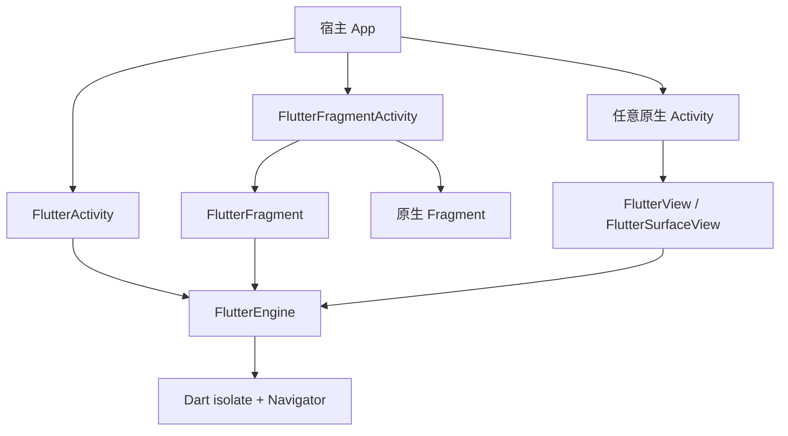

# 混合栈管理

## 一句话定义

混合栈管理解决的是"**原生页面和 Flutter 页面怎么共存、怎么互相跳转、怎么传数据、怎么共用引擎**"这一组问题。Android 侧的载体有三种：**`FlutterActivity`（整个 Activity 是 Flutter）**、**`FlutterFragment`（Fragment 容器，可与原生 Fragment 混排）**、**`FlutterView`（一个 View，可嵌入任意原生布局）**；底下由 **`FlutterEngine` / `FlutterEngineGroup`** 提供运行时支撑，由 **Platform Channel** 承担跨端数据交换。

## 核心原理

### 1. 三种承载方式对比

| 维度 | **FlutterActivity** | **FlutterFragment** | **FlutterView** |
| --- | --- | --- | --- |
| 类型 | Activity | Fragment（需 `FlutterFragmentActivity`） | View（继承 `FlutterView` 或 `FlutterSurfaceView`） |
| 宿主要求 | 直接继承即可 | 宿主 Activity 需继承 `FlutterFragmentActivity` | 任何容器（LinearLayout / CoordinatorLayout / Compose） |
| 独立导航栈 | 有（Flutter 内部自带 Navigator） | 有 | 有（需自己管理） |
| 与原生混排 | 弱（整个 Activity 都是 Flutter） | 强（Fragment 事务，可与原生 Fragment 并排） | 最强（View 级别嵌入） |
| 生命周期 | Activity 生命周期 | Fragment 生命周期（自动映射到 Flutter 引擎） | **需手动调用** `onAttachedToWindow` 等一系列生命周期方法 |
| 典型场景 | 纯 Flutter 页面 | Tab 切换、下半屏 Flutter | Flutter 卡片嵌入原生列表、Compose 中嵌入 |



### 2. 关键类解析

#### `FlutterActivity`

```text
FlutterActivity (extends ComponentActivity)
  └── FlutterActivityAndFragmentDelegate   ← 真正干活的中介
        ├── FlutterEngine (持有或从缓存取)
        ├── FlutterView (内部创建，含 FlutterSurfaceView)
        ├── 生命周期转发：onStart→引擎、onResume→onPause→onStop
        └── 导航：Flutter 内部 Navigator 与 Android back 键协调
```

- `FlutterActivity` 的 `onCreate` 中会 `setContentView(flutterView)`，整个屏幕就是 Flutter。
- **返回键处理**：Flutter 内部路由栈非空时，**消费返回键**并交给 Flutter 的 `Navigator.pop()`；栈空时才把返回键交给系统（退出 Activity）。这是 Flutter 与原生混排最容易困惑的点。

#### `FlutterFragment`

- 需要宿主 Activity 继承 **`FlutterFragmentActivity`**（或 `FlutterActivity`，它本身就是 `FlutterFragmentActivity` 的子类）。
- 生命周期自动映射：Fragment 的 `onResume` → Flutter 引擎 `onResume`；`onPause` → 引擎 `onPause`。
- **一个引擎可以同时被多个 Fragment 使用**（各自独立的 `FlutterView`，共享 Dart isolate 与状态）。

#### `FlutterView`

- 纯 View 形态，需要**手动管理生命周期**（否则引擎不会 pause/resume，会导致 Dart 代码在后台继续跑、浪费电量）。
- 手动转发的 API 一览：

```kotlin
// FlutterView 手动管理生命周期的完整清单
val flutterView = FlutterView(context)

override fun onAttachedToWindow() {
    super.onAttachedToWindow()
    flutterView.onAttachedToWindow()   // 之后才能 attach engine
}

override fun onDetachedFromWindow() {
    flutterView.onDetachedFromWindow()
    super.onDetachedFromWindow()
}

override fun onWindowFocusChanged(hasFocus: Boolean) {
    super.onWindowFocusChanged(hasFocus)
    flutterView.onWindowFocusChanged(hasFocus)
}

// 布局尺寸变化
override fun onSizeChanged(w: Int, h: Int, oldw: Int, oldh: Int) {
    super.onSizeChanged(w, h, oldw, oldh)
    flutterView.onSizeChanged(w, h, oldw, oldh)
}
```

### 3. 引擎复用与 CachedEngine

三种复用策略：

| 策略 | 做法 | 状态共享 | 适用 |
| --- | --- | --- | --- |
| **默认（每页一引擎）** | `FlutterActivity` 自动创建 | 不共享 | 只有一个 Flutter 页面 |
| **共享单引擎** | 重写 `provideFlutterEngine()` 返回单例 | **共享**（同一 isolate） | 多个 Flutter 页面间需要共享状态 |
| **EngineGroup 多引擎** | `FlutterEngineGroup.createEngine()` | 不共享，但共享 VM 快照 | 多 Flutter 页面、状态需隔离 |

**缓存引擎（官方 `CachedEngine` 模式）伪代码：**

```text
Application 启动
   └─ CachedEngine.getInstance()
        ├─ engine = FlutterEngine(context)
        ├─ engine.dartExecutor.executeDartEntrypoint(main.dart)
        └─ 存入静态 Map（key 可按"业务名"区分多份缓存）

任意 Flutter 页面
   └─ FlutterActivity.provideFlutterEngine() → 返回缓存的 engine
   └─ FlutterActivity.shouldDestroyEngineWithHost() → false（不让它被销毁）
```

> **注意**：`FlutterEngine` 只能 attach **一个** `FlutterView` 吗？答案：**不是**。同一个引擎可以 attach 多个 View（多个 Flutter 页面同时显示同一份 Flutter 应用，状态天然同步），但**不能同时把同一个引擎 attach 到两个不同的 Dart isolate**。

### 4. 页面跳转：原生 → Flutter → 原生

混合栈里最核心的三个方向：

| 方向 | 手段 | 说明 |
| --- | --- | --- |
| 原生 → Flutter | `startActivity(FlutterActivity)` / `FragmentTransaction.replace` / 嵌入 `FlutterView` | Flutter 页面作为一个"栈节点"进入 |
| Flutter → 原生 | ① `Navigator.push` 到一个**空路由**的原生占位 Activity（Flutter 官方 `FlutterActivity` 的 "transparent" 模式）；② Flutter 侧通过 MethodChannel 通知原生，原生 `startActivity` | 推荐 ② |
| Flutter → Flutter | Flutter 内部 `Navigator.push` | 纯 Dart 侧，与原生栈无关 |
| 原生 → 原生（跨过 Flutter） | Flutter 调 Channel → 原生 `finish()` 当前 Flutter Activity 并 `startActivity` 目标 | |

**Flutter 官方推荐的"透明 Activity"模式**（Flutter 页面内嵌原生页面的标准做法）：

```text
Flutter 路由栈
  [Flutter 页面 A]
       │ Navigator.push(TransparentActivityRoute)
       ▼
  [原生 Activity B]  ← 透明主题，看起来像 Flutter 页面里盖了一层
       │ finish()
       ▼
  [Flutter 页面 A 恢复]
```

Dart 侧（需要 `flutter add-to-app` 生成的 `flutter_assets` 模板支持）：

```dart
// 使用透明 Activity 承载原生页面
import 'package:flutter/material.dart';

class TransparentNativePage extends StatelessWidget {
  const TransparentNativePage({super.key, required this.routeName, this.arguments});

  final String routeName;
  final Map<String, dynamic>? arguments;

  @override
  Widget build(BuildContext context) {
    // 占位 widget，实际由原生透明 Activity 覆盖
    return const SizedBox.shrink();
  }
}
```

原生侧：

```kotlin
class TransparentNativeActivity : FlutterActivity() {
    override fun onCreate(savedInstanceState: Bundle?) {
        // 透明主题 + 无动画，让原生页面"盖"在 Flutter 之上
        setTheme(R.style.TransparentActivityTheme)
        super.onCreate(savedInstanceState)
        // 启动真正的原生页面
        startActivity(Intent(this, TargetNativeActivity::class.java))
    }
}
```

> 更常见更直接的方案是 **Channel 反向调用**：Flutter 侧 `await channel.invokeMethod('openNativePage', {...})`，原生 handler 里 `startActivity` 并返回结果，Flutter 侧用 `await` 拿到结果（相当于"原生 Activity for result"）。

### 5. 传参的三种方式对比

| 方式 | 实现 | 优点 | 缺点 |
| --- | --- | --- | --- |
| **Intent / Bundle 传参** | 原生 → Flutter：把参数放进 `FlutterActivity` 的 `Intent`；Flutter 通过 `MethodChannel("flutter/...")` 的内置通道 `getInitialRoute` 或 `invokedMethod` 读取 | 简单、原生侧直观 | Flutter 侧需要约定 Channel 名；**只能用于"进入页面"这一次** |
| **MethodChannel 传参** | 双向、随时可传、可回传结果 | 灵活 | 需要自己设计协议 |
| **Flutter 路由传参** | `Navigator.pushNamed(context, '/detail', arguments: {...})` | Dart 侧最自然 | **只存在于 Flutter 内部栈**，原生拿不到 |

**Flutter 内置的两个特殊 Channel**（很有用）：

| Channel 名 | 方向 | 用途 |
| --- | --- | --- |
| `flutter/navigation` | Native → Dart | 原生 `pushRoute` 到 Flutter 的某个具名路由；`popRoute` 请求 Flutter 返回 |
| `flutter/platform` | 双向 | `SystemChrome`、`SystemNavigator`、`Clipboard`、`HapticFeedback` 等平台能力 |
| `flutter/textinput` | 双向 | 文本输入（IME）的数据通路 |
| `flutter/lifecycle` | Native → Dart | 通知 Dart 侧 app 生命周期变化（AppLifecycleState） |

### 6. 生命周期同步

```
原生生命周期                Flutter 引擎回调              Dart 侧表现
─────────────────────────────────────────────────────────────
onCreate                 → 引擎创建 + executeDartEntrypoint
onStart                  → engineOnStart              → AppLifecycleState.resumed 之前
onResume                 → engineOnResumed            → WidgetsBindingObserver.resumed
onPause                  → engineOnPaused             → inactive
onStop                   → engineOnStopped            → paused / hidden
onDestroy                → engineOnDestroy            → detached
```

- **`FlutterFragmentActivity` 的 Fragment** 生命周期会转发给引擎，宿主**不需要**手写。
- **`FlutterView`** 必须手动转发，否则引擎状态与实际可见性不一致。
- **`onSaveInstanceState`**：Flutter 的页面状态（Navigator 栈、滚动位置）由引擎自己保存到 `SavedState`；宿主 Activity 被系统回收重建后，Flutter 页面会恢复到原来的路由。这依赖宿主 Activity 正确实现 `onSaveInstanceState` 与 `onRestoreInstanceState`。

### 7. 与 Flutter 内部 Navigation 的配合

Flutter 侧使用 `Navigator 1.0` 或 `go_router` 等。关键点：

- **返回键**：`FlutterActivity` 会让引擎监听 Android 返回键。若 `Navigator.canPop()` 为真，则弹出 Flutter 路由；否则事件上抛给 Activity 结束。
- **原生想"清空 Flutter 栈并跳到某路由"**：调用 `flutterEngine.navigationChannel.invokeMethod("pushRoute", "/home")`。
- **原生想"让 Flutter 退出当前页"**：调用 `flutterEngine.navigationChannel.invokeMethod("popRoute")`。
- **`FlutterFragment` 的返回键**：需要宿主是 `FlutterFragmentActivity`，并且 Fragment 在 `onResume` 时调用 `flutterFragment.setShouldPopFlutterOnBackPressed(true)`（默认行为）。

## 代码示例

### 1. FlutterFragmentActivity 承载原生 + Flutter 混排

```kotlin
package com.example.host

import android.os.Bundle
import androidx.fragment.app.FragmentTransaction
import com.example.host.flutter.DemoFlutterFragment
import com.example.host.native.NativeProfileFragment
import io.flutter.embedding.android.FlutterFragmentActivity

/**
 * 宿主 Activity 继承 FlutterFragmentActivity，
 * 之后就可以在布局里同时放 FlutterFragment 与原生 Fragment。
 */
class MainActivity : FlutterFragmentActivity() {

    companion object {
        private const val TAG_FLUTTER = "flutter_container"
    }

    override fun onCreate(savedInstanceState: Bundle?) {
        super.onCreate(savedInstanceState)

        if (savedInstanceState == null) {
            // 默认展示 Flutter 页面
            supportFragmentManager.beginTransaction()
                .replace(R.id.container, DemoFlutterFragment.newInstance())
                .addToBackStack(null)
                .commit()
        }
    }

    /** 切换到原生页面（Fragment 级别，保留 Flutter 栈） */
    fun showNativeProfile() {
        supportFragmentManager.beginTransaction()
            .replace(R.id.container, NativeProfileFragment())
            .addToBackStack("profile")
            .commit()
    }
}
```

```xml
<!-- res/layout/activity_main.xml -->
<FrameLayout xmlns:android="http://schemas.android.com/apk/res/android"
    android:id="@+id/container"
    android:layout_width="match_parent"
    android:layout_height="match_parent" />
```

### 2. 自定义 FlutterFragment（可传初始参数）

```kotlin
package com.example.host.flutter

import android.os.Bundle
import io.flutter.embedding.android.FlutterFragment

/**
 * 自定义 Fragment 以便携带初始化参数（如 userId）。
 * 注意：FlutterFragment 的 arguments 不会自动传到 Dart，
 * 需要通过 MethodChannel 在 onAttach 后主动传递。
 */
class DemoFlutterFragment : FlutterFragment() {

    companion object {
        private const val ARG_USER_ID = "user_id"
        private const val CHANNEL = "com.example.host/page"

        fun newInstance(userId: String) = DemoFlutterFragment().apply {
            arguments = Bundle().apply { putString(ARG_USER_ID, userId) }
        }
    }

    override fun onCreate(savedInstanceState: Bundle?) {
        super.onCreate(savedInstanceState)

        // 参数在引擎起来之后再传给 Dart
        flutterEngine?.dartExecutor?.executeDartEntrypoint(
            io.flutter.embedding.engine.dart.DartExecutor.DartEntrypoint(
                requireContext().assets,
                "flutter_assets/main.dart"
            )
        )

        val userId = arguments?.getString(ARG_USER_ID).orEmpty()
        MethodChannel(
            flutterEngine?.dartExecutor?.binaryMessenger!!,
            CHANNEL
        ).invokeMethod("onPageArgs", mapOf("userId" to userId))
    }
}
```

### 3. 共享引擎 + 缓存引擎（官方 CachedEngine 模式）

```kotlin
package com.example.host

import android.content.Context
import io.flutter.embedding.engine.FlutterEngine
import io.flutter.embedding.engine.dart.DartExecutor
import io.flutter.embedding.engine.renderer.FlutterRenderer

/**
 * 缓存引擎管理器：进程级持有若干 FlutterEngine，
 * 让多个 Flutter 页面复用同一个 Dart isolate。
 */
class CachedEngine private constructor(context: Context) {

    companion object {
        @Volatile
        private var instance: CachedEngine? = null

        fun getInstance(context: Context): CachedEngine =
            instance ?: synchronized(this) {
                instance ?: CachedEngine(context.applicationContext).also { instance = it }
            }
    }

    private val engines = mutableMapOf<String, FlutterEngine>()

    /** 按业务 key 缓存引擎；同一个 key 返回同一个引擎（状态共享） */
    fun obtain(key: String, context: Context): FlutterEngine = synchronized(engines) {
        engines.getOrPut(key) {
            val engine = FlutterEngine(context)
            engine.dartExecutor.executeDartEntrypoint(
                DartExecutor.DartEntrypoint(
                    context.assets,
                    "flutter_assets/main.dart"
                )
            )
            engine
        }
    }

    /** 释放指定引擎（业务下线时调用） */
    fun release(key: String) {
        synchronized(engines) {
            engines.remove(key)?.destroy()
        }
    }
}
```

```kotlin
package com.example.host

import io.flutter.embedding.android.FlutterActivity
import io.flutter.embedding.engine.FlutterEngine

/**
 * 使用缓存引擎的 FlutterActivity。
 */
class CachedFlutterActivity : FlutterActivity() {

    companion object {
        const val ENGINE_KEY = "main"
    }

    /** 返回缓存引擎，FlutterActivity 不会再自己创建 */
    override fun provideFlutterEngine(): FlutterEngine =
        CachedEngine.getInstance(applicationContext)
            .obtain(ENGINE_KEY, applicationContext)

    /** 返回 false：不要在 Activity 销毁时销毁这个共享引擎 */
    override fun shouldDestroyEngineWithHost(): Boolean = false
}
```

### 4. Flutter → 原生跳转并回传结果

```dart
// lib/pages/detail_page.dart
import 'package:flutter/material.dart';
import 'package:flutter/services.dart';

class DetailPage extends StatelessWidget {
  const DetailPage({super.key});

  @override
  Widget build(BuildContext context) {
    return Scaffold(
      appBar: AppBar(title: const Text('详情')),
      body: Center(
        child: ElevatedButton(
          onPressed: () async {
            // 调用原生页面，等待原生返回结果
            final result = await const MethodChannel('com.example.host/nav')
                .invokeMethod<String>('openNativePay', {'orderId': 'A1024'});
            if (!context.mounted) return;
            ScaffoldMessenger.of(context).showSnackBar(
              SnackBar(content: Text('原生返回：$result')),
            );
          },
          child: const Text('打开原生支付页'),
        ),
      ),
    );
  }
}
```

```kotlin
package com.example.host.channel

import android.content.Intent
import io.flutter.plugin.common.MethodChannel

/**
 * 导航通道：Flutter 请求打开原生页面，原生 startActivityForResult 后回传结果。
 */
class NavChannel(private val activity: android.app.Activity) {

    companion object {
        const val CHANNEL = "com.example.host/nav"
    }

    fun register(binaryMessenger: io.flutter.plugin.common.BinaryMessenger) {
        MethodChannel(binaryMessenger, CHANNEL).setMethodCallHandler { call, result ->
            when (call.method) {
                "openNativePay" -> {
                    val orderId = call.argument<String>("orderId").orEmpty()
                    // 用 Activity Result API 拿到原生页面回传的结果
                    activity.startActivityForResult(
                        Intent(activity, NativePayActivity::class.java).apply {
                            putExtra("orderId", orderId)
                        },
                        REQUEST_CODE_PAY
                    )
                    // 这里先不回 result，等 onActivityResult 时再回
                    pendingResult = result
                }
                else -> result.notImplemented()
            }
        }
    }

    private var pendingResult: MethodChannel.Result? = null

    fun onActivityResult(requestCode: Int, resultCode: Int, data: Intent?) {
        if (requestCode == REQUEST_CODE_PAY) {
            val payload = data?.getStringExtra("pay_result")
            pendingResult?.success(payload)
            pendingResult = null
        }
    }

    companion object {
        private const val REQUEST_CODE_PAY = 1001
    }
}
```

### 5. FlutterView 嵌入原生布局（含手动生命周期）

```kotlin
package com.example.host

import android.os.Bundle
import android.widget.FrameLayout
import io.flutter.embedding.engine.FlutterEngine
import io.flutter.embedding.engine.FlutterEngineCache
import io.flutter.embedding.android.FlutterView

/**
 * 把 FlutterView 嵌入原生布局（列表里的一张卡片、一块半屏区域）。
 * 代价是必须手动转发生命周期。
 */
class EmbeddedFlutterActivity : androidx.appcompat.app.AppCompatActivity() {

    private lateinit var flutterView: FlutterView

    override fun onCreate(savedInstanceState: Bundle?) {
        super.onCreate(savedInstanceState)

        flutterView = FlutterView(this)

        // 关键：attach 引擎（从缓存取，保证与其它页面共享状态）
        val engine: FlutterEngine = FlutterEngineCache.getInstance()
            .get("main") ?: FlutterEngine(this).also {
                FlutterEngineCache.getInstance().put("main", it)
            }
        flutterView.attachFlutterEngine(engine)

        setContentView(
            FrameLayout(this).apply {
                addView(
                    flutterView,
                    FrameLayout.LayoutParams(
                        FrameLayout.LayoutParams.MATCH_PARENT,
                        FrameLayout.LayoutParams.MATCH_PARENT
                    )
                )
            }
        )
    }

    // ---- 手动转发 FlutterView 的生命周期 ----

    override fun onAttachedToWindow() {
        super.onAttachedToWindow()
        flutterView.onAttachedToWindow()
    }

    override fun onDetachedFromWindow() {
        flutterView.onDetachedFromWindow()
        super.onDetachedFromWindow()
    }

    override fun onWindowFocusChanged(hasFocus: Boolean) {
        super.onWindowFocusChanged(hasFocus)
        flutterView.onWindowFocusChanged(hasFocus)
    }

    override fun onSizeChanged(w: Int, h: Int, oldw: Int, oldh: Int) {
        super.onSizeChanged(w, h, oldw, oldh)
        flutterView.onSizeChanged(w, h, oldw, oldh)
    }
}
```

### 6. 纯 Dart 侧的跨端路由管理

```dart
// lib/app_router.dart
import 'package:flutter/material.dart';
import 'package:flutter/services.dart';

/// 统一管理"原生 <-> Flutter"的路由跳转
class AppRouter {
  AppRouter._();

  static const MethodChannel _nav = MethodChannel('com.example.host/nav');

  /// 跳到 Flutter 内部路由
  static void pushFlutter(BuildContext context, String route, {Object? args}) {
    Navigator.of(context).pushNamed(route, arguments: args);
  }

  /// 跳到原生页面（原生会 startActivity）
  static Future<T?> pushNative<T>(String method, Map<String, Object?> args) async {
    final result = await _nav.invokeMethod<T>(method, args);
    return result;
  }

  /// 从原生推送到 Flutter 的具名路由（原生调用 flutter/navigation 通道）
  static void onNativePushRoute(String? route, Object? args) {
    final nav = Navigator.of(...);   // 实际工程中用全局 navigatorKey
    nav.pushNamed(route ?? '/', arguments: args);
  }
}

/// 用全局 navigatorKey 支持原生侧 pushRoute
final GlobalKey<NavigatorState> navigatorKey = GlobalKey<NavigatorState>();
```

```dart
// lib/main.dart
import 'package:flutter/material.dart';
import 'app_router.dart';

void main() {
  runApp(const MyApp());
}

class MyApp extends StatelessWidget {
  const MyApp({super.key});

  @override
  Widget build(BuildContext context) {
    return MaterialApp(
      navigatorKey: navigatorKey,
      initialRoute: '/',
      routes: {
        '/': (ctx) => const HomePage(),
        '/detail': (ctx) => const DetailPage(),
      },
    );
  }
}
```

## 常见问题 / 面试要点

**读者问：Flutter 页面怎么和原生页面混用？有哪几种方式？**

**AI答：**

1. **三种载体**：
   - **`FlutterActivity`**：整个 Activity 是 Flutter。适合"从原生跳到一个完整 Flutter 页面"。Flutter 内部路由栈自带，返回键先由 Flutter 消费。
   - **`FlutterFragment`**：宿主 Activity 继承 `FlutterFragmentActivity`，用 Fragment 事务承载 Flutter，可与原生 Fragment **在同一屏并排**。适合 Tab 切换、下半屏 Flutter。
   - **`FlutterView`**：一个 View，可放进任意原生布局（LinearLayout / CoordinatorLayout / 甚至 Compose 的 `AndroidView`）。灵活度最高，但**必须手动转发生命周期**（`onAttachedToWindow`/`onDetachedFromWindow`/`onWindowFocusChanged`/`onSizeChanged`）。
2. **选型建议**：
   - 追求简单、Flutter 页面完整 → `FlutterActivity`；
   - 需要与原生 Fragment 混排 → `FlutterFragment`；
   - 需要把 Flutter 嵌进复杂原生布局或 Compose → `FlutterView`。
3. **跳转方案**：
   - 原生 → Flutter：`startActivity(FlutterActivity::class.java)` 或 Fragment `replace`；
   - Flutter → 原生：**推荐 MethodChannel 反向调用**，原生 handler 里 `startActivity`，Flutter 侧 `await` 拿结果（等价于 `startActivityForResult`）；
   - 也可用 Flutter 官方的"透明 Activity"模式（Flutter 路由栈上盖一个透明主题的原生 Activity）。
4. **面试话术**：**"Flutter 页面返回键怎么和原生返回栈协调？"** —— Flutter Activity 会把返回键交给引擎：若 Flutter 的 `Navigator.canPop()` 为真，就由 Flutter 弹出路由（同时通知原生不回退）；栈空时才把返回键交回系统结束 Activity。混合栈里这层协调是 Flutter embedding 自动完成的，但自定义返回键（右上角箭头）时需要自己区分"回 Flutter 上一页"还是"回原生上一页"。

---

**读者问：FlutterActivity 和 FlutterFragment 有什么区别？各自的适用场景？**

**AI答：**

1. **类型不同**：`FlutterActivity` 继承 `ComponentActivity`；`FlutterFragment` 依赖宿主继承 **`FlutterFragmentActivity`**（`FlutterActivity` 本身就是 `FlutterFragmentActivity` 的子类，所以用 FlutterActivity 做宿主也能加 Fragment）。
2. **粒度不同**：Activity 是"整个屏幕"，Fragment 是"屏幕的一块"。
3. **生命周期管理**：
   - `FlutterActivity` 自动把 Activity 生命周期转发给引擎；
   - `FlutterFragment` 自动把 **Fragment** 生命周期转发给引擎，宿主不用写代码；
   - `FlutterView` **必须手写**转发。
4. **导航栈**：
   - `FlutterActivity` 拥有完整的 Flutter `Navigator`，支持 Flutter 内部路由与返回键；
   - `FlutterFragment` 也有自己的 Flutter Navigator，但被 Fragment 事务的返回栈**再套一层**——用户按返回时先退 Fragment 还是先退 Flutter 路由，取决于 `FlutterFragment.setShouldPopFlutterOnBackPressed` 的设置与实现版本，需要显式测试。
5. **混排能力**：只有 Fragment 方案能与原生 Fragment 在同一 Activity 里并排（Tab 布局、底部弹层）。
6. **面试话术**：**"我们项目用了 FlutterFragment 做 Tab 切换，返回键偶尔会先退出 Flutter 而不是切换 Tab，你们会怎么处理？"** —— 关键在于明确返回键优先级：可以在 `FlutterFragmentActivity` 的 `onBackPressed` / `OnBackPressedDispatcher` 里拦截，先判断当前 Tab 是否在首页、是否应该消费返回键，再决定是否 `super.onBackPressed()`。

---

**读者问：Flutter 引擎怎么复用？为什么复用能实现"秒开"？**

**AI答：**

1. **引擎是什么**：`FlutterEngine` = 一个 **Dart isolate**（独立 Dart 堆）+ 渲染管线 + 平台线程 + 通道注册表。isolate 之间状态隔离。
2. **复用方式**：
   - **重写 `provideFlutterEngine()`** 返回自己管理的单例引擎；
   - **同时重写 `shouldDestroyEngineWithHost()` 返回 `false`**，否则 Activity 销毁会把引擎销毁，缓存失效；
   - 用 `FlutterEngineCache` 或自建 `CachedEngine` 单例管理；
   - `FlutterEngineGroup` 用于多引擎场景（共享 VM 快照与 GPU 资源）。
3. **为什么能"秒开"**：
   - 省掉 **Dart VM 初始化**（创建 isolate、加载运行时）；
   - 省掉 **`libapp.so` 的 AOT 映射**（页映射 + 重定位）；
   - 省掉 **首帧渲染**（布局、绘制、GPU 上传）；
   - 预热后跳 Flutter 页面通常可以做到**无白屏/极短白屏**。
   - 量级上通常能省 **100–500 ms**，具体取决于设备与 App 复杂度。
4. **注意事项**：
   - **状态共享**：共享引擎意味着多个 Flutter 页面共享 Dart 全局变量，可能出现"上个页面的状态影响下个页面"；
   - **Channel 冲突**：同一引擎上 Channel 名唯一，后注册的 handler 会覆盖前一个（`setMethodCallHandler` 是覆盖式）；
   - **生命周期**：缓存引擎存活到进程结束，必须在 Application 级管理。
5. **面试话术**：**"引擎复用和用 add-to-app 的 transparent Activity 有什么区别？"** —— 引擎复用是**运行时的进程内复用**，共享状态、共享通道、共享内存，适合"Flutter 是应用主体"的场景；transparent Activity 是**页面级的叠加**，每个原生 Activity 各自持有自己的引擎（或共享缓存引擎），适合"Flutter 与原生深度互嵌"的场景。

---

**读者问：Flutter 页面和原生页面之间怎么传数据？参数在页面重建后还在吗？**

**AI答：**

1. **四种传参方式**：
   - **Intent/Bundle**：原生 → Flutter 启动时最常用。Flutter 侧通过内置的 `flutter/navigation` 通道的 `getInitialRoute` 或 `invokedMethod` 拿到初始参数；或宿主在 `configureFlutterEngine` 后主动 `invokeMethod("onPageArgs", args)` 推给 Dart。
   - **MethodChannel**：双向、随时、可回传结果，混合工程主力。
   - **Flutter 路由传参**：`Navigator.pushNamed(context, '/detail', arguments: {...})`，只在 Flutter 内部栈有效。
   - **共享引擎的 Dart 全局状态**：同一个引擎里两个 Flutter 页面可以直接读写 Dart 单例（无需序列化），最省事但耦合最高。
2. **进程重建后参数是否保留**：
   - `Intent` 里的 extras **会保留**（Activity 重建时 `onSaveInstanceState`/`onRestoreInstanceState` 保存）；
   - **MethodChannel 传的参数不会保留**（内存态），重建后需要重新推送；
   - Flutter 路由参数 `arguments` **不会保留**（不是 `RestorableRouteFuture` 机制），重建后为 null；
   - **Flutter 自身的导航栈会保留**（引擎会把 Navigator 状态写入 `SavedState`），但路由参数不随之保留。
3. **最佳实践**：把"页面定位所需的最小 ID"放进 Intent 或路由参数，**其余业务数据通过共享 Repository（原生或 Dart）按 ID 重新拉取**，不要指望参数带完整数据。
4. **面试话术**：**"Flutter 页面旋转屏幕后参数丢了怎么办？"** —— 路由参数本身不参与状态恢复；解决办法是把必要字段放进 Flutter 侧的 `RestorationMixin` / `RestorableInt` 等可恢复状态，或通过 `MethodChannel` 从原生 `SavedStateHandle` 重新取。

---

**读者问：多个 Flutter 页面共享同一个引擎时，Channel 怎么处理？会不会互相覆盖？**

**AI答：**

1. **会覆盖**。`MethodChannel.setMethodCallHandler` 在同一个 `BinaryMessenger` 上是**按 channel 名唯一**的：后注册的 handler 会**替换**先前注册的。
2. **因此设计原则**：
   - **Channel 名带上模块前缀**：`com.example.host/pay`、`com.example.host/user`，避免同名；
   - **不同业务用不同引擎**（`FlutterEngineGroup` 的不同 Engine），彻底隔离；
   - **Handler 注册放在 `configureFlutterEngine`**，而不是某个 Fragment 的 `onCreate`——否则 Fragment 重建会重复注册，且注册时机可能晚于首次调用；
   - **注销**：页面销毁时 `setMethodCallHandler(null)`，但如果引擎是共享的，**不要轻易注销**，因为别的页面还在用。
3. **替代方案**：用 **Pigeon** 生成强类型 API，方法名常量化，重名问题更早暴露；或者用 `EventChannel` 建立**广播**语义（多个 Dart 订阅者都能收到），而不是 handler 覆盖语义。
4. **面试话术**：**"EventChannel 能不能多订阅者？"** —— `receiveBroadcastStream()` 返回的是**广播流**（`Stream.broadcast`），多个 Dart 监听者都能收到原生的事件；但原生侧 `onListen` 会被调用多次（每个订阅者一次），`onCancel` 在**最后一个订阅者**取消时才调用——所以原生侧注册监听器时要做**引用计数**，否则会重复注册导致事件翻倍。

---

**读者问：Flutter 和原生混排时，返回键（Back）到底归谁管？**

**AI答：**

1. **FlutterActivity 的行为**：引擎监听返回键 → 询问 Dart 侧 `Navigator.canPop()`：
   - **能 pop**：Flutter 弹出路由，**消费**返回键（原生栈不动）；
   - **不能 pop**：返回键**上抛**给 Activity，按默认行为结束 Activity。
2. **FlutterFragment 的行为**：Fragment 层面的返回键与 Flutter 路由栈会"嵌套"。`FlutterFragment` 提供 `setShouldPopFlutterOnBackPressed(Boolean)` 控制是否让 Flutter 优先消费。默认实现下，用户在 Flutter Tab 内按返回，**先退 Flutter 路由**，再退 Fragment/Activity。
3. **自定义返回键（导航栏箭头）**时必须明确语义：
   - 若当前 Flutter 路由栈可回退 → 调 `Navigator.pop()`；
   - 否则 → 通过 Channel 通知原生，由原生决定 `finish()` 还是切 Tab。
4. **面试话术**：**"混合栈里用户反馈'按返回直接退出了整个 App'"** —— 大概率是 Flutter 的 `Navigator.canPop()` 返回 false（Flutter 页面是栈底），而 Tab 切换场景又用了 Fragment 事务的返回栈，两套返回栈各自消费了按键。解法：**统一返回键处理入口**（`OnBackPressedDispatcher`），按"Tab 是否可切 → Flutter 路由是否可退 → 退出 App"的优先级顺序处理。

---

**读者问：`FlutterView` 嵌入原生布局要注意什么？为什么它比 `FlutterFragment` 麻烦？**

**AI答：**

1. **要手动管理生命周期**。`FlutterFragment`/`FlutterActivity` 由框架自动把生命周期转给引擎；`FlutterView` 不行，必须手动调用：
   - `onAttachedToWindow()` / `onDetachedFromWindow()`
   - `onWindowFocusChanged(hasFocus)`
   - `onSizeChanged(w, h, oldw, oldh)`
   - 建议还有 `onVisibilityChanged`、`onWindowVisibilityChanged`
2. **不转发的后果**：
   - 引擎不知道 App 已退到后台 → **Dart 代码继续跑**（定时器、动画、轮询），耗电；
   - 窗口尺寸没更新 → Flutter 侧布局错误（黑边、错位）；
   - 焦点没更新 → 键盘、输入法行为异常。
3. **其它注意点**：
   - `attachFlutterEngine(engine)` 要在 View attach 之后；
   - 一个引擎可以 attach 多个 View（各页面共享同一份 Flutter 应用与状态）；
   - View 的 `LayoutParams` 尺寸必须是**确定值**，Flutter 侧才知道 viewport 尺寸；
   - 若嵌在 RecyclerView 里，**复用 ViewHolder 时要先 `detachFlutterEngine`** 否则会串页面。
4. **面试话术**：**"FlutterView 放在 RecyclerView 的 item 里会有什么问题？"** —— ViewHolder 复用导致同一个 `FlutterView` 被反复 attach 不同引擎状态，表现为"页面数据串了"；解决办法是每个 item 用独立引擎（成本高）或不复用（不可行），实践中更推荐把 Flutter 卡片渲染成**静态图片/快照**而非活的 FlutterView。

## 关联笔记

- [[工程集成]]：模块集成方式、引擎创建、混淆规则
- [[PlatformChannel]]：三种 Channel 的原理与选型、传参协议
- [[性能优化]]：引擎复用带来的内存与启动收益
- [[调试与打包]]：混合栈下的调试与崩溃定位
- [[../KotlinMultiplatform/KMP与原生集成]]：不做混合栈，而是共享逻辑层的另一种路线
- [[../ReactNative混合开发]]：RN 的 `ReactRootView` 与原生混合方式对比
- [[../../07-架构、工具与生态/Jetpack库/Navigation]]：原生侧 Navigation 与混合栈路由的配合
- [[../README]]：第 9 部分总览

## 参考资料

- Flutter Android embedding 源码（FlutterActivity / FlutterFragment / FlutterView）：https://github.com/flutter/flutter/tree/master/engine/src/flutter/shell/platform/android
- Flutter Add-to-app 文档：https://docs.flutter.dev/add-to-app
- Flutter "Integrating with Android" 文档：https://docs.flutter.dev/platform-integration/android
- Flutter 导航集成（flutter/navigation 通道）：https://docs.flutter.dev/platform-integration/android
- `FlutterEngine` API 文档：https://api.flutter.dev/flutter/services/FlutterEngine-class.html
