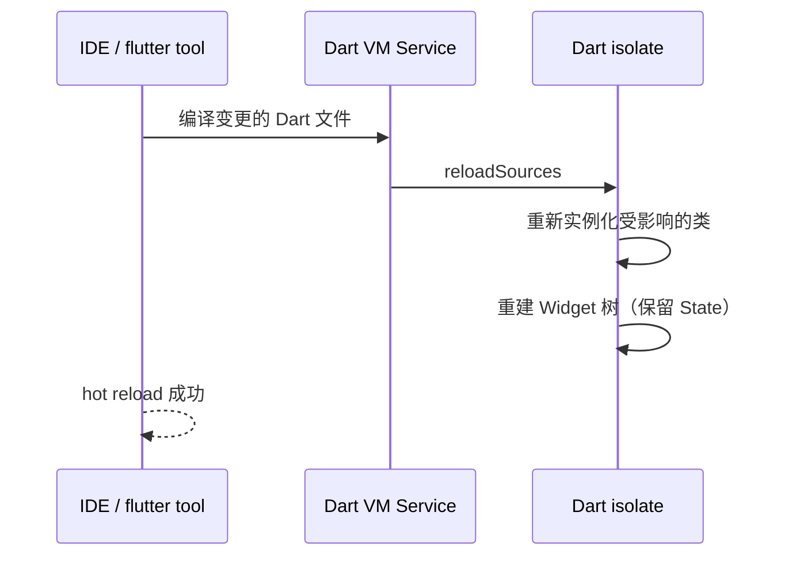

# 调试与打包

## 一句话定义

Flutter 混合工程的调试与打包有两条主线：**调试**——Dart 侧靠 **Dart VM Service** 与 **hot reload / hot restart**（本质是"往正在运行的 Dart isolate 里注入新代码"），原生侧照常用 Android Studio 与 logcat；**打包**——Dart 侧靠 **AOT + `--obfuscate`（生成符号表）**，原生侧靠 **R8/ProGuard** 与资源打包，两者**完全独立**。上线后崩溃要能还原 symbolized stack，必须**保管好混淆映射文件**。

## 核心原理

### 1. hot reload / hot restart 的原理

| 能力 | 原理 | 限制 |
| --- | --- | --- |
| **hot reload** | VM Service 通知 Dart isolate 重新加载变更的源码，**重建 Widget 树但保留运行时状态**（变量值、堆对象、isolate） | **不支持改变类结构**（增删字段、方法、改变泛型签名） |
| **hot restart** | 重新执行 `main()`，**重建整个 isolate**（状态全部重置），但**比冷启动快**（不需要重启原生 App、不需要重新加载 so） | 状态丢失 |
| **hot reload 后原生改动** | 原生代码变了必须**完全重启 App**（Dart VM Service 无法热替换 JVM 字节码） | — |



**关键结论**：**Dart 代码改了 → 热重载即可；原生（Kotlin/Java）代码改了 → 必须重启 App。** 这是混合工程调试体验的核心差异。

### 2. 混合工程下的调试方式

| 场景 | 工具 | 说明 |
| --- | --- | --- |
| **Dart 代码断点** | `flutter attach` + DevTools / IDE | 混合工程不能用 `flutter run` 直接启动（因为宿主是原生 App），要用 `flutter attach` 挂到运行中的 App |
| **原生代码断点** | Android Studio 直接跑宿主 App | 正常用 |
| **两边同时调试** | Android Studio（Run/Debug 宿主 App）+ `flutter attach`（另开终端） | 官方 add-to-app 文档推荐流程 |
| **查看 Dart 日志** | `flutter logs` / `adb logcat -s flutter` | |
| **查看原生日志** | `adb logcat` / Android Studio Logcat | |
| **性能分析** | DevTools Performance / Memory | 需要 `--profile` 模式 |
| **布局检查** | DevTools → Flutter Inspector | |
| **渲染调试** | `debugPaintSizeEnabled`、`debugPaintLayerBordersEnabled`、DevTools Rendering 面板 | |

**attach 流程：**

```bash
# 1. 先用 Android Studio 启动宿主 App（Debug 变体，包含 debug 引擎）
# 2. 找到 Dart VM Service 端口
adb forward tcp:8181 tcp:8181

# 3. 挂载调试器
flutter attach

# 或者直接指定 observatory URI
flutter attach --debug-url http://127.0.0.1:8181/
```

> [!warning] 关键点
> `flutter attach` 能连上的前提是宿主 App 用的是 **Debug 变体的 Flutter 引擎**（`io.flutter:flutter_embedding_debug`）。Release 变体没有 VM Service，**无法 attach、无法热重载、无法看 Dart 堆**。

### 3. 打包流程与产物

```bash
# ── APK ──
flutter build apk                          # 单一 ABI（arm64-v8a 默认？实际为 fat APK）
flutter build apk --split-per-abi          # 按 ABI 拆成多个 APK（体积最小）
flutter build apk --release --obfuscate --split-debug-info=./symbols
flutter build apk --profile                # profile 变体（性能接近 release，有调试符号）

# ── App Bundle ──
flutter build appbundle                    # AAB，Google Play 按设备下发
flutter build appbundle --obfuscate --split-debug-info=./symbols

# ── 其他 ──
flutter build aar                         # 产出 aar（add-to-app 场景）
flutter build apk --analyze-size          # 分析包体构成
flutter build ios --no-codesign            # iOS
```

**产物结构（Release APK）：**

```
app-release.apk
├── lib/
│   ├── arm64-v8a/
│   │   ├── libflutter.so       # 引擎（已 strip 符号）
│   │   └── libapp.so           # AOT 后的 Dart 代码（若 --obfuscate 则已混淆）
│   ├── armeabi-v7a/...
│   └── x86_64/...
├── assets/
│   └── flutter_assets/
│       ├── vm_snapshot_data        # VM 快照（AOT）
│       ├── isolate_snapshot_data   # isolate 快照（AOT）
│       ├── kernel_blob.bin        # Debug 模式才有（JIT 快照）
│       ├── AssetManifest.json
│       ├── FontManifest.json
│       ├── assets/                # 业务资源
│       └── packages/              # 依赖包资源
└── META-INF/                       # R8 产物、签名
```

### 4. 混淆机制：两套完全独立的系统

| 体系 | 作用对象 | 触发方式 | 产物 |
| --- | --- | --- | --- |
| **Dart AOT 混淆** | Dart 代码 | `flutter build apk --obfuscate` | `app.android-arm64.symbols` + `obfuscation_map.txt` |
| **Java/Kotlin R8** | 原生侧 Java/Kotlin 代码 + Flutter embedding | Gradle `minifyEnabled true` | `mapping.txt` |
| **资源混淆/裁剪** | `res/` 与 assets | `shrinkResources true` | — |

> **这是最容易混淆的面试点**：Flutter 的 `--obfuscate` **只混淆 Dart 代码**，跟 R8 一点关系都没有；R8 **混淆不到 Dart 代码**（因为 Dart 已经编译成机器码了）。

**Dart 混淆的原理：**

```text
Dart 源码
  │  dart2native (AOT)
  ▼
libapp.so（机器码）
  │  --obfuscate: 替换标识符为无意义短名（A/B/C...）
  ▼
libapp.so（符号被抹掉）
  │
  └─ 额外产物：
     • app.android-arm64.symbols   ← 调试符号（含原始名与地址映射）
     • obfuscation_map.txt         ← 混淆映射表（用于线上还原）
```

- `--obfuscate` 会**显著增大 so 体积**（约 +10–20%），因为符号表要额外存一份映射。
- `--split-debug-info=./symbols` 把调试符号**从产物中剥离到指定目录**，APK 里只留混淆后的代码。**这个目录必须安全保存**。
- 混淆后 **Release 模式下无法断点调试 Dart 代码**（除非有 symbols + DevTools 支持）。

### 5. 崩溃定位：native crash vs Dart exception

| 类型 | 表现 | 日志来源 | 定位工具 |
| --- | --- | --- | --- |
| **Dart Exception（未捕获）** | Flutter 框架捕获 → 灰屏/红屏（仅 Debug）或静默失败 | `logcat -s flutter` / `flutter logs` | **DevTools**（attach 到线上包需要 symbols）；`FlutterError.onError` / `PlatformDispatcher.instance.onError` 自定义上报 |
| **Dart 未捕获异步异常** | 同样进 `FlutterError` | 同上 | 同上 |
| **Native Crash（SIGSEGV / SIGABRT）** | 进程直接死，App 闪退 | `adb logcat -b crash` / tombstones | **Play Console / Crashlytics / Bugly** 的 native 符号化 |
| **Native 异常未捕获** | 抛到 `Thread.setDefaultUncaughtExceptionHandler` | `logcat` | 同上 |
| **ANR** | 应用无响应 | `adb shell dumpsys activity processes \| grep ANR`、traces.txt | ANR trace |
| **原生 → Dart 调用中的 Java 异常** | 被 Flutter 转成 `PlatformException` | logcat | Dart 侧 catch |

**关键：混合工程崩溃必须分开看。**

```bash
# 看 native crash（tombstone）
adb logcat -b crash

# 看 Dart 日志
adb logcat -s flutter

# 看 tag 为 DartVM 的日志
adb logcat -s DartVM
```

**Dart 侧全局异常捕获（生产必备）：**

```dart
import 'dart:async';
import 'dart:developer' as developer;
import 'package:flutter/foundation.dart';

void setupGlobalErrorHandler() {
  // ① 同步错误（build 期间的错误、setState 之后的问题）
  FlutterError.onError = (FlutterErrorDetails details) {
    developer.log(
      'FlutterError: ${details.exception}\n${details.stack}',
      name: 'flutter.error',
      stackTrace: details.stack,
    );
    // 上报到你们的监控平台（Crashlytics / Bugly / 自建）
    CrashReporter.report(details.exception, details.stack);
    // 在 Release 下也把错误打到 logcat，便于排查
    debugPrint('FlutterError: ${details.exception}');
  };

  // ② 异步错误（未 await 的 Future、Zone 内未捕获异常）
  PlatformDispatcher.instance.onError = (error, stack) {
    developer.log('Uncaught async error: $error', name: 'dart.async');
    CrashReporter.report(error, stack);
    return true;   // 返回 true 表示已处理，避免进程崩溃
  };

  // ③ Zone 级别的兜底
  runZonedGuarded(() {
    runApp(const MyApp());
  }, (error, stack) {
    CrashReporter.report(error, stack);
  });
}
```

### 6. 符号表（symbols）的上传与保管

**崩溃还原流程：**

```text线上崩溃 stack（混淆后的 A.b.C） 
   │
   ▼ 用 obfuscation_map.txt 还原
dart symbol names（原始函数名）
   │
   ▼ 需要配合 Play Console / Crashlytics 的 native 符号
完整可读的 Dart 堆栈
```

**CI 中的标准做法：**

```yaml
# 伪代码：CI 构建与上传
- name: Build Flutter AAB
  run: |
    flutter build appbundle \
      --release \
      --obfuscate \
      --split-debug-info=build/symbols
    # 产物：
    #   build/app/outputs/bundle/release/app-release.aab
    #   build/symbols/app.android-arm64.symbols
    #   build/symbols/obfuscation_map.txt

- name: Upload symbols to Crashlytics / Sentry
  run: upload-symbols build/symbols

- name: Archive symbols (long-term)
  run: |
    # 归档到制品库，按 build id 命名，必须长期保存
    archive build/symbols as "symbols-${BUILD_ID}.zip"
```

> [!danger] 严重后果
> **混淆符号文件一旦丢失，线上 Dart 崩溃将永远无法还原**。堆栈里只剩 `Closure.<anonymous closure>.A.b.C` 这种无意义符号，排查效率等于零。这是很多团队踩过的坑。

### 7. 打包配置要点

```kotlin
// app/build.gradle.kts
android {
    buildTypes {
        release {
            isMinifyEnabled = true       // 开启 R8
            isShrinkResources = true     // 开启资源裁剪
            proguardFiles(
                getDefaultProguardFile("proguard-android-optimize.txt"),
                "proguard-rules.pro"
            )
            ndk {
                // 混合工程建议只保留主流 ABI
                abiFilters += listOf("arm64-v8a", "armeabi-v7a")
            }
        }
        debug {
            // Debug 变体使用 debug 版 Flutter 引擎，支持 flutter attach
            isDebuggable = true
        }
    }

    packaging {
        resources {
            // Flutter assets 不能被资源裁剪误伤
            excludes += "/META-INF/{AL2.0,LGPL2.1}"
        }
    }
}
```

```proguard
# app/proguard-rules.pro

# ── Flutter 官方模板 ──
-keep class io.flutter.app.** { *; }
-keep class io.flutter.plugin.**  { *; }
-keep class io.flutter.util.**  { *; }
-keep class io.flutter.view.**  { *; }
-keep class io.flutter.**  { *; }
-keep class io.flutter.plugins.**  { *; }

# ── 自定义 Platform Channel handler 必须保留 ──
-keep class com.example.host.channel.** { *; }

# ── 自定义 Flutter Plugin 的入口类 ──
-keep class com.example.flutterplugins.** { *; }

# ── Kotlin 协程 ──
-dontwarn kotlinx.coroutines.**
-keepclassmembers class kotlinx.coroutines.** { volatile <fields>; }
```

**资源裁剪的坑**：`shrinkResources` 会删掉"看起来没被引用"的资源。Flutter 的 `flutter_assets` 里有些资源是**运行时按字符串路径动态加载**的（如 `Image.asset('assets/images/$name.png')`），静态分析看不到引用 → 被裁掉 → **Release 崩溃或图片不显示，Debug 正常**。

解法：保留 `res/raw/keep.xml`：

```xml
<!-- res/raw/keep.xml -->
<resources xmlns:tools="http://schemas.android.com/tools"
    tools:keep="@drawable/*,@raw/*,@mipmap/*" />
```

### 8. CI/CD 中的 Flutter 混合工程构建

```yaml
# 典型的 GitHub Actions 片段
name: Android Hybrid Build

on:
  push:
    branches: [main]

jobs:
  build:
    runs-on: ubuntu-latest
    steps:
      - uses: actions/checkout@v4

      - uses: actions/setup-java@v4
        with:
          distribution: temurin
          java-version: '17'

      - uses: subosito/flutter-action@v2
        with:
          channel: stable
          flutter-version: 3.24.0
          cache: true                 # 缓存 pub-cache

      - name: Cache Gradle & Flutter build
        uses: actions/cache@v4
        with:
          path: |
            ~/.gradle/caches
            build
            .dart_tool
          key: hybrid-${{ hashFiles('**/pubspec.lock') }}-${{ hashFiles('**/*.gradle*') }}

      - name: Build AAB
        run: |
          cd android
          ./gradlew assembleRelease \
            -Pdart-defines=baseUrl=https://api.example.com \
            --stacktrace

      - name: Upload symbols
        run: upload-symbols build/symbols
```

**CI 注意点**：

1. **Flutter 版本必须固定**：Flutter SDK 版本变化会导致产物行为变化（如 Impeller 默认开启）。
2. **缓存 key 必须包含 Flutter 版本 + Dart 版本 + pubspec.lock 哈希**。
3. **`--dart-defines` 区分环境**，避免每次改配置全量重建。
4. **符号文件上传到 Crashlytics/Sentry** 是**发布流程的必选项**，不是可选项。
5. **Release 包要跑冒烟测试**：`flutter build apk --release` + 安装 + 启动 + 关键路径点击，防止"Debug 正常 Release 崩"。

## 代码示例

### 1. Dart 全局异常捕获与上报

```dart
// lib/core/crash_reporter.dart
import 'dart:async';
import 'dart:developer' as developer;
import 'dart:io';

import 'package:flutter/foundation.dart';

/// 崩溃上报抽象：接入你们自己的平台（Crashlytics / Bugly / 自建）
class CrashReporter {
  static Future<void> report(Object error, StackTrace? stack) async {
    developer.log(
      'Crash: $error',
      name: 'crash',
      stackTrace: stack,
      error: error,
    );
    // 实际实现：调用平台通道交给原生上报
    try {
      await const MethodChannel('com.example.host/crash').invokeMethod(
        'report',
        {
          'message': error.toString(),
          'stack': stack?.toString() ?? '',
          'isFatal': false,
        },
      );
    } catch (_) {
      // 上报失败不能影响主流程
    }
  }
}

/// 统一的全局异常处理入口
void setupGlobalHandlers() {
  // ① Flutter 框架级错误（build 错误、setState 之后的问题）
  FlutterError.onError = (FlutterErrorDetails details) {
    developer.log(
      'FlutterError: ${details.exception}',
      name: 'flutter.error',
      stackTrace: details.stack,
      error: details.exception,
    );
    CrashReporter.report(details.exception, details.stack);
  };

  // ② 平台层未捕获的异步错误
  PlatformDispatcher.instance.onError = (error, stack) {
    developer.log('PlatformDispatcher error: $error', name: 'platform.error');
    CrashReporter.report(error, stack);
    return true;   // 已处理，不让进程崩溃
  };
}
```

### 2. 原生侧：Native 崩溃捕获 + Dart 崩溃桥接

```kotlin
package com.example.host

import android.util.Log
import io.flutter.plugin.common.MethodChannel

/**
 * 原生侧崩溃处理：
 * ① 接管 Thread.setDefaultUncaughtExceptionHandler 收集 native 崩溃
 * ② 注册 crash 通道接收 Dart 侧上报的异常
 */
object CrashBridge {

    private const val TAG = "CrashBridge"
    const val CHANNEL = "com.example.host/crash"

    private var previousHandler: Thread.UncaughtExceptionHandler? = null

    fun install() {
        previousHandler = Thread.getDefaultUncaughtExceptionHandler()
        Thread.setDefaultUncaughtExceptionHandler { thread, throwable ->
            // 上报 native 崩溃（交给 Crashlytics / Bugly 的原生 API）
            NativeCrashReporter.report(throwable, Thread.currentThread().stackTrace)

            // 继续交给系统默认处理，否则进程不会退出
            previousHandler?.uncaughtException(thread, throwable)
        }
    }

    /** 在宿主 Activity 里注册通道 */
    fun register(binaryMessenger: io.flutter.plugin.common.BinaryMessenger) {
        MethodChannel(binaryMessenger, CHANNEL).setMethodCallHandler { call, result ->
            when (call.method) {
                "report" -> {
                    val message = call.argument<String>("message").orEmpty()
                    val stack = call.argument<String>("stack").orEmpty()
                    Log.e(TAG, "Dart exception: $message\n$stack")
                    DartCrashStore.persist(message, stack)
                    result.success(null)
                }
                else -> result.notImplemented()
            }
        }
    }
}

/** Dart 崩溃的本地持久化（进程被杀后仍可读取） */
object DartCrashStore {
    private val file get() = java.io.File(
        android.os.Environment.getExternalStorageDirectory(), "dart_crashes.log"
    )

    @Synchronized
    fun persist(message: String, stack: String) {
        runCatching {
            file.appendText("$message\n$stack\n---\n")
        }
    }
}
```

### 3. Gradle：混合工程的 Release 配置

```kotlin
// android/app/build.gradle.kts
plugins {
    id("com.android.application")
    id("dev.flutter.flutter-gradle-plugin")
}

android {
    namespace = "com.example.host"
    compileSdk = 34

    defaultConfig {
        applicationId = "com.example.host"
        minSdk = 21
        targetSdk = 34
        versionCode = 100
        versionName = "1.0.0"

        // Flutter module 由 flutter 插件注入
    }

    buildTypes {
        debug {
            // Debug 变体使用 debug 版 Flutter 引擎（可 flutter attach）
            isMinifyEnabled = false
        }
        release {
            isMinifyEnabled = true
            isShrinkResources = true
            proguardFiles(
                getDefaultProguardFile("proguard-android-optimize.txt"),
                "proguard-rules.pro"
            )
            signingConfig = signingConfigs.getByName("release")
        }
    }

    packaging {
        jniLibs {
            // 只保留需要的 ABI（也可通过 abiFilters）
            useLegacyPackaging = false
        }
        resources {
            excludes += setOf("/META-INF/{AL2.0,LGPL2.1}", "META-INF/DEPENDENCIES")
        }
    }

    compileOptions {
        sourceCompatibility = JavaVersion.VERSION_17
        targetCompatibility = JavaVersion.VERSION_17
    }

    kotlinOptions {
        jvmTarget = "17"
    }
}
```

### 4. 构建脚本：产物归档 + 符号上传

```groovy
// android/app/build.gradle —— 构建后归档符号
def symbolDir = rootProject.file("../build/symbols")

android.applicationVariants.all { variant ->
    variant.outputs.all { output ->
        def taskName = "archive${variant.name.capitalize()}Symbols"
        def task = tasks.register(taskName, Copy) {
            // Flutter 的 --split-debug-info 产物路径
            from("${rootProject.projectDir}/../build/symbols") {
                include "**/*.symbols"
                include "**/obfuscation_map.txt"
            }
            into("${rootProject.buildDir}/archives/symbols/${variant.name}")
            doFirst { mkdir it.destinationDir }
        }
        // 把归档任务挂到 assemble 之后
        tasks.matching { it.name == "assemble${variant.name.capitalize()}" }.configureEach {
            finalizedBy task
        }
    }
}
```

```bash
# 完整的手工构建流程（与 CI 保持一致）
set -e

cd android

# 1. 拉取依赖
./gradlew :app:dependencies --configuration releaseRuntimeClasspath

# 2. 构建 Release AAB（带混淆 + 分离符号）
flutter build appbundle \
  --release \
  --obfuscate \
  --split-debug-info=../build/symbols \
  --dart-define=baseUrl=https://api.example.com

# 3. 校验符号文件存在（关键！构建失败必须中止）
test -f ../build/symbols/obfuscation_map.txt || (echo "缺少符号文件，中止" && exit 1)

# 4. 上传符号到崩溃平台
# upload-symbols ../build/symbols

# 5. 归档产物
cd ..
zip -r artifacts/hybrid-$(date +%Y%m%d-%H%M).zip \
    build/app/outputs/bundle/release/app-release.aab \
    build/symbols/
```

### 5. 混合工程的调试脚本

```bash
#!/usr/bin/env bash
# scripts/attach_flutter.sh —— 启动宿主 App 并 attach Dart 调试器
set -euo pipefail

PACKAGE="com.example.host"
ACTIVITY="com.example.host/.MainActivity"

echo "==> 启动宿主 App（Debug 变体）"
adb shell am start -n "$PACKAGE/$ACTIVITY"

echo "==> 等待 Dart VM Service 就绪"
for i in $(seq 1 20); do
  if adb shell "cat /proc/net/unix | grep -q dart_vm_service" 2>/dev/null; then
    echo "    VM Service 已就绪"
    break
  fi
  sleep 0.5
done

echo "==> 转发端口并 attach"
adb forward tcp:8181 tcp:8181
flutter attach --debug-url http://127.0.0.1:8181/
```

```bash
# 崩溃日志采集脚本
#!/usr/bin/env bash
# scripts/collect_crash.sh
echo "===== Native crash (tombstone) ====="
adb logcat -b crash -d | tail -200

echo ""
echo "===== Dart 日志 ====="
adb logcat -s flutter DartVM -d | tail -200

echo ""
echo "===== ANR traces ====="
adb shell dumpsys activity processes | grep -A 30 "ANR in" || true
```

## 常见问题 / 面试要点

**读者问：Flutter 混合工程怎么调试？为什么 Dart 的热重载在混合工程里"不好使"了？**

**AI答：**

1. **混合工程不能直接用 `flutter run`**：因为 App 的启动入口是原生的 `MainActivity`，`flutter run` 不知道该怎么启动它。所以要用 **`flutter attach`** 挂到已经在运行的 App 上。
2. **完整流程**：
   - 用 Android Studio 以 **Debug 变体**运行宿主 App（Debug 变体必须依赖 `io.flutter:flutter_embedding_debug`，否则没有 Dart VM Service）；
   - `adb forward tcp:8181 tcp:8181`；
   - `flutter attach`（或 IDE 的 Flutter 调试按钮）；
   - 之后就能在 Dart 代码里下断点、看日志、用 DevTools。
3. **热重载的限制**：
   - **Dart 代码改动** → 热重载**有效**（因为 attach 上了 VM Service）；
   - **原生代码改动** → **必须完全重启 App**（JVM 字节码无法热替换）；
   - **Flutter 插件/依赖升级** → 需要 `flutter pub get` + 重启；
   - **Dart 代码改了结构**（增删字段/方法）→ 热重载失败，需要 **hot restart**。
4. **两边同时调试**：Android Studio 负责原生断点，`flutter attach` 负责 Dart 断点，两者可以并行。
5. **面试话术**：**"混合工程里原生代码改了必须重启吗？"** —— 必须。原因是 **hot reload 的实现本质是"往 Dart VM 里注入新的 Dart 源码并重建 Widget 树"**，它只对 Dart VM 有效；原生代码运行在 **ART/Dalvik** 上，Flutter 工具链没有（也不应该有）替换 ART 字节码的能力。

---

**读者问：Flutter 的 `--obfuscate` 和 R8 是一回事吗？两套混淆怎么配合？**

**AI答：**

1. **完全不是一回事**：
   - **`--obfuscate`**：Dart AOT 之后的**符号混淆**——把 Dart 源码里的类名、方法名、字段名替换成 `A`、`B`、`C` 这类无意义短名，**只影响 `libapp.so`**。它的目的是保护源码逻辑不被反编译还原。
   - **R8（ProGuard）**：Java/Kotlin 侧的**代码混淆 + 优化 + 裁剪**，**影响 `io.flutter.embedding.*` 和你的 Kotlin 代码**，还可能删掉"看起来没人用"的类。
2. **两者互补、不冲突**：
   - Dart 侧被混淆的代码在 `libapp.so` 里，R8 根本看不到它；
   - Java/Kotlin 侧的代码 R8 会混淆，但 Flutter 官方模板里 `-keep class io.flutter.** { *; }` 把引擎保住了。
3. **必须做的配合**：**自定义 Platform Channel 的 handler 类必须 R8 keep**，否则 Release 下会 `MissingPluginException`（R8 把类删了或改名了）。
4. **副作用**：Dart 混淆会让 `libapp.so` **增大 10–20%**（需要内嵌符号表），也会让线上 Dart 崩溃堆栈不可读——除非有符号文件。
5. **面试话术**：**"Flutter 的混淆和 Android 的混淆能互相替代吗？"** —— 不能。Dart 代码 AOT 成机器码后，R8 完全管不到；Android 侧代码 R8 混淆后，Flutter 引擎的 Java API 调用是**按类名/方法名反射式查找**的（`MethodChannel` 的方法名是字符串），所以 R8 必须配合 keep 规则。**两套体系各管各的，都要单独配置。**

---

**读者问：Flutter 崩溃怎么定位？混淆后的堆栈怎么还原？**

**AI答：**

1. **先分清是哪一类崩溃**：
   - **Dart Exception**（未捕获异常）：Flutter 框架会捕获，Debug 下红屏，Release 下**可能静默失败**（取决于是否设置了 `FlutterError.onError`）。日志在 `logcat -s flutter`。
   - **Native Crash**（SIGSEGV/SIGABRT）：**进程直接死**，日志在 `logcat -b crash`（tombstone），需要 native 符号化。
   - **原生调用 Dart 时抛出的 Java 异常**：会被转成 `PlatformException` 传到 Dart。
2. **Dart 崩溃还原流程**：
   - 构建时用 `--obfuscate --split-debug-info=./symbols`，产出 `obfuscation_map.txt` 与 `.symbols`；
   - 把符号文件**上传到崩溃平台**（Crashlytics 支持 Dart 符号；Sentry 支持 `debug-id` 匹配）；
   - 线上堆栈（混淆名）由平台用 `obfuscation_map.txt` **自动还原成可读名**；
   - 若平台不支持，可手工用 `obfuscation_map.txt` 对照还原。
3. **符号文件丢失 = 永久无法还原**：堆栈只剩 `Closure.<anonymous closure>.A.b.C`。
4. **必备的线上兜底**：
   ```dart
   FlutterError.onError = (details) { /* 上报 */ };
   PlatformDispatcher.instance.onError = (error, stack) { /* 上报 */; return true; };
   ```
   否则 Release 下 Dart 异常会被 Flutter 框架"吞掉"，用户看到的是**界面卡住或功能失效**，但没有崩溃日志。
5. **面试话术**：**"线上 Dart 崩溃日志里全是 A.b.C，怎么处理？"** —— 说明 Release 构建用了 `--obfuscate` 但**符号文件没上传或没保存**。补救：① 检查 CI 产物归档里有没有 `obfuscation_map.txt`；② 有则手工上传到崩溃平台还原；③ 没有则这个版本的 Dart 崩溃**只能靠用户复现 + 关闭混淆的验证包**来定位；同时立刻把符号上传纳入发布流程的强制校验。

---

**读者问：热重载（hot reload）能热替换什么？不能热替换什么？为什么？**

**AI答：**

1. **能热替换**：
   - **Widget 的 `build` 方法体**；
   - **方法体内部的逻辑**；
   - **常量的值**（`const` 重新编译）；
   - **新增 Widget 类**（只要不影响已实例化对象的结构）。
2. **不能热替换**：
   - **类的结构变化**：增删字段、方法、改变构造函数签名、改变父类、改变泛型参数 → 热重载会失败（Flutter 会提示 "hot reload does not work with changed class definitions"），必须 **hot restart**；
   - **`main()` 里的一次性初始化逻辑**（如 `runApp` 之前的状态）→ hot reload 不会重跑，需要 hot restart；
   - **全局单例与静态变量的值** → hot reload 保留旧值（这正是 hot reload 相比 hot restart 的优势），需要手动重置或 hot restart。
3. **原因**：hot reload 的实现是"**向 Dart VM 发送新编译产物，isolate 重新加载源码，重新实例化受影响的类**"。Dart VM 能做到"替换方法体并保留对象状态"，但**无法在保持对象实例一致的前提下改变对象的内存布局**（字段变了，实例大小就变了）。
4. **工程实践**：
   - 改 UI 样式 → hot reload（秒级反馈）；
   - 改了数据模型或加了个字段 → hot restart（1–2 秒）；
   - 改了原生 Kotlin → **完全重启 App**；
   - 改了依赖（pubspec.yaml）→ `flutter pub get` + 重启。
5. **面试话术**：**"hot reload 和 hot restart 的区别，用一句话说清并说明适用场景。"** —— hot reload 是**替换方法体、保留运行时状态**，适合改 UI 和业务逻辑；hot restart 是**重建 isolate、重置状态**，适合改了类结构或全局初始化的情况。

---

**读者问：Release 包和 Debug 包行为不一致（Debug 正常 Release 崩），有哪些原因？**

**AI答：**

1. **R8 混淆/裁剪**：
   - **Platform Channel 的 handler 类被删/改名** → `MissingPluginException`；
   - 反射创建的类、插件入口类没 keep；
   - `shrinkResources` 裁掉了动态引用的资源（Flutter assets 里按字符串路径加载的图片）。
2. **Dart 侧差异**：
   - **Release 开启 AOT**，JIT 相关的 `assert` 全部失效——很多 bug 在 Debug 下被 assert 挡住，Release 才暴露；
   - **Release 开启 tree-shaking-icons**，未使用的字体图标会报错；
   - **`--obfuscate` 后反射/动态调用失败**：Dart 侧用 `dart:mirrors`（Release 不可用）或按字符串名查找的代码会挂。
3. **资源与 so**：
   - `flutter_assets` 未被打进包；
   - ABI 不匹配（设备是 `armeabi-v7a` 但只打了 `arm64-v8a`）→ `UnsatisfiedLinkError`；
   - Android 15+ 的 **16 KB 页大小**要求导致 so 加载失败。
4. **并发与时序**：Release 更快 → 竞态问题更容易暴露；`FutureBuilder` 在 build 里创建的问题在 Release 下才死循环。
5. **排查手段**：
   ```bash
   flutter build apk --release --obfuscate --split-debug-info=./symbols
   # 安装到真机复现
   adb logcat -c && adb install -r app-release.apk
   adb logcat | grep -E "flutter|AndroidRuntime|FATAL"
   ```
   也可用 `--profile` 变体（保留部分调试能力，性能接近 Release）。
6. **预防**：CI 上跑 **Release 包冒烟测试**（安装 + 启动 + 关键路径），把 R8 规则当成**代码**一样 review。

---

**读者问：混合工程的 CI/CD 应该怎么设计？有什么容易忽略的环节？**

**AI答：**

1. **标准流水线**：
   ```
   代码检查（Dart analyze + Kotlin lint）
     → 单元测试（Dart test + JVM test）
     → 构建 Release 产物（AAB + APK）
     → 产物符号校验（obfuscation_map.txt 存在，否则中止）
     → 符号上传（Crashlytics / Sentry）
     → Release 冒烟测试（安装、启动、关键路径）
     → 归档产物 + 符号到制品库
     → 分发（内测 / 灰度 / 应用商店）
   ```
2. **最容易忽略的三件事**：
   - **符号文件上传与长期归档**（没上传 = 线上 Dart 崩溃无法还原；没归档 = 未来想还原时已经找不到）；
   - **Flutter 版本固定**（SDK 升级会静默改变产物行为，如 Impeller 默认开启）；
   - **Release 冒烟测试**（Debug 跑得通不代表 Release 跑得通，R8 是最大的变数）。
3. **缓存策略**：缓存 `~/.pub-cache`、Gradle 缓存、`build/`、`.dart_tool/`；**cache key 必须包含 Flutter 版本 + pubspec.lock 哈希**，否则会出现"缓存了旧 SDK 的产物导致诡异编译错误"。
4. **环境变量与 `--dart-defines`**：
   ```bash
   flutter build appbundle \
     --dart-define=baseUrl=https://api.example.com \
     --dart-define=channel=release \
     --dart-define=buildNumber=$BUILD_NUMBER
   ```
   Dart 侧用 `String.fromEnvironment('baseUrl')` 读取。
5. **签名与密钥**：Flutter 的 `key.properties` 不进仓库；CI 用 Secret 注入；`upload-keystore` 谨慎配置。
6. **面试话术**：**"你觉得 Flutter 混合工程 CI 最容易出的纰漏是什么？"** —— 我的经验是**符号文件**。很多团队 Dart 崩溃线上无法定位，就是因为 build 时混淆了但没把 `obfuscation_map.txt` 上传到崩溃平台，也没归档。解法是把"符号文件存在性校验 + 上传"做成流水线里的**硬性步骤**，校验失败直接 fail build。

---

**读者问：为什么 Debug 包能 `flutter attach`，Release 包不行？Dart VM Service 是什么？**

**AI答：**

1. **Dart VM Service**（原名 Observatory）：Dart VM 内置的**调试协议服务**，通过 **WebSocket**（HTTP + JSON-RPC）暴露一组调试能力：
   - 设置断点、查看调用栈、查看变量；
   - 热重载（`reloadSources`）、热重启（`restart`）；
   - 获取 isolate 列表、Dart 堆快照（heap snapshot）、**VM Service 扩展**（如 `flutter.inspector`）；
   - **Timeline 事件流**（性能分析数据来源）。
2. **为什么 Release 不行**：
   - **Dart AOT 模式默认不包含 VM Service**（需要显式用 `--enable-vm-service` 之类的方式在启动时开启，而正式发版不应该开）；
   - 即使开启，**代码已被混淆且无符号**，断点与变量名都不可读；
   - VM Service 端口会暴露调试能力，**安全风险**（生产环境开启等于把调试器接口开放）。
3. **混合工程里的实际含义**：
   - 宿主 App 的 **Debug 变体必须依赖 `io.flutter:flutter_embedding_debug`**，Release 变体依赖 `flutter_embedding_release`（无 VM Service）；
   - 所以 `flutter attach` 只能连 Debug 包；
   - **线上问题只能靠日志与崩溃上报**，因此 Dart 侧的全局异常捕获（`FlutterError.onError` + `PlatformDispatcher.instance.onError`）是**生产环境必配项**。
4. **面试话术**：**"线上 Dart 异常为什么常常查不到？"** —— 因为 Release 包不带 VM Service，Flutter 框架默认会把 Dart 异常打到 logcat 但**线上用户设备没有 logcat**。必须在 App 内装全局异常捕获并上报到自己的监控平台，否则等于黑盒。

## 关联笔记

- [[工程集成]]：混淆规则、so 体积与构建配置
- [[PlatformChannel]]：Channel 注册与 `MissingPluginException` 排查
- [[混合栈管理]]：引擎生命周期与调试 attach 的关系
- [[性能优化]]：Profile 模式性能分析与 DevTools 使用
- [[../../07-架构、工具与生态/构建与版本管理/Gradle构建系统]]：Gradle 构建与缓存加速
- [[../../07-架构、工具与生态/基础工具链/ADB]]：logcat、anr、tombstone 等排查命令
- [[../README]]：第 9 部分总览

## 参考资料

- Flutter Add-to-app 调试与部署文档：https://docs.flutter.dev/add-to-app
- Flutter 构建产物与混淆文档：https://docs.flutter.dev/deployment/android
- Flutter Dart VM Service 文档：https://docs.flutter.dev/tools/vm-service
- Flutter 自定义 Platform Channel 调试：https://docs.flutter.dev/platform-integration/platform-channels
- Flutter 官方示例仓库（add-to-app）：https://github.com/flutter/samples/tree/main/add_to_app
