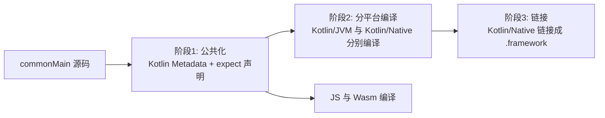

# KMP 与原生集成

## 一句话定义

Kotlin Multiplatform（KMP）是 **JetBrains 的 Kotlin 编译器"多平台后端"**，它让同一份 Kotlin 源码可以编译成 **JVM（Android/Desktop）、Native（iOS/macOS/Linux/Windows）、JS（浏览器/Node）、Wasm** 等多份本地二进制。KMP 共享的是**业务逻辑与数据层**（不是 UI），平台差异用 `expect` / `actual` 表达。它与 Flutter / React Native 的根本区别是：**UI 仍是各平台的原生 UI（Android 用 Compose/View，iOS 用 SwiftUI/UIKit），KMP 只共享"脑子"**。

## 核心原理

### 1. KMP 的核心价值主张

```text
┌──────────────────────────────────────────────────────────┐
│                    共享层 (commonMain)                     │
│   领域模型 · 用例 · 仓库接口 · 网络协议 · 数据模型 · 校验   │
│   ── 只依赖 kotlinx.* 与 KMP 官方库，不依赖任何平台 API ── │
└───────────────────────────┬──────────────────────────────┘
             ┌──────────────┼──────────────┐
             ▼              ▼              ▼
┌────────────────┐ ┌──────────────┐ ┌────────────────┐
│  androidMain   │ │   iosMain    │ │   jvmMain      │
│  OkHttp/Room   │ │  NSURLSession│ │  java.net.HttpURLConnection │
│  Android Log   │ │  os_log      │ │  java.util.logging          │
│  Context 依赖  │ │  UIKit       │ │  Swing                        │
└────────────────┘ └──────────────┘ └────────────────┘
        ▼                  ▼                 ▼
   Android APK        iOS .framework    Desktop .jar
```

| 维度 | KMP | Flutter | React Native |
| --- | --- | --- | --- |
| **共享什么** | **业务逻辑层** | **整个 UI + 逻辑** | **整个 UI（JSX）+ 逻辑** |
| **UI 技术栈** | 各平台原生（Compose / SwiftUI） | Flutter 自绘引擎 | React Native 组件（Fabric 自绘） |
| **一致性** | 交互与视觉**不完全一致**（各自原生） | **高度一致** | **高度一致** |
| **性能** | **等同原生**（编译成本地代码） | 自绘 60/120 fps | 新架构接近原生，旧架构有 Bridge 开销 |
| **学习成本** | 需要多套 UI 技术栈 | 一套 Dart | 一套 JS/TS |
| **UI 复用率** | 低（0%，UI 不共享） | 高（接近 100%） | 高（接近 100%） |

> **一句话区分**：**Flutter 是"一套 UI 画两边"，KMP 是"一套逻辑跑两边，UI 各自写"。**

### 2. 源码集（Source Set）结构

```
shared/
├── build.gradle.kts
└── src/
    ├── commonMain/kotlin/        ← 所有平台共享
    │   └── com/example/shared/
    │       ├── domain/            ← 领域模型、用例
    │       ├── data/              ← 仓库接口、DTO
    │       └── di/                ← 依赖注入接口
    ├── commonTest/kotlin/        ← 所有平台都能跑的测试
    ├── androidMain/kotlin/       ← 仅 Android
    │   └── AndroidPlatform.kt
    ├── iosMain/kotlin/            ← 仅 iOS（Kotlin/Native）
    │   └── IosPlatform.kt
    ├── jvmMain/kotlin/            ← 仅 JVM 桌面
    └── jsMain/kotlin/            ← 仅 JS
```

**层级结构（重要）**：中间源集（intermediate source set）可以进一步细分：

```text
commonMain
  ├── nativeMain          ← 所有 Native 平台共享（iosMain, macosMain, linuxMain...）
  │     ├── iosMain
  │     └── macosMain
  └── jvmCommonMain       ← JVM 系共享（androidMain + jvmMain）
        ├── androidMain
        └── jvmMain
```

- `jvmCommonMain` 是 KMP 1.9.20 引入的"默认层级模板"，让 Android 与 Desktop JVM 共享代码变得更自然。
- 也可以用 `applyDefaultHierarchyTemplate()` 之外的**自定义层级模板**（`applyHierarchyTemplate`）自由定义。

### 3. expect / actual 机制

**这是 KMP 最核心、也最容易被追问的知识点。**

```kotlin
// commonMain —— 声明"契约"（expect）
expect class PlatformContext() {
    val name: String
    fun log(message: String)
}
```

```kotlin
// androidMain —— 提供实现（actual）
actual class PlatformContext actual constructor() {
    actual val name: String = "Android"
    actual fun log(message: String) {
        android.util.Log.d("Shared", message)
    }
}
```

```kotlin
// iosMain —— 另一个实现
actual class PlatformContext actual constructor() {
    actual val name: String = "iOS"
    actual fun log(message: String) {
        NSLog("%@", message)
    }
}
```

**编译原理（三阶段）**：



1. **Metadata 编译（common）**：把 `commonMain` 编译成 **Kotlin Metadata**（`.kotlin_metadata`），里面只包含**声明**（expect 的签名），不含实现。这个 metadata 会被所有平台编译器读取。
2. **平台编译**：每个平台的编译器（Kotlin/JVM、Kotlin/Native、JS、Wasm）读取 metadata + 对应平台的 `actual` 实现，生成该平台的字节码 / 机器码。
3. **链接（Native 特有）**：`iosMain` 编译出的 `.klib` 与其他依赖一起**链接**成 `.framework` / `.xcframework`。

**关键结论**：

- `expect`/`actual` 是**编译期**机制，**不是运行时的多态分派**（没有 vtable、没有反射）→ **零运行时开销**。
- 编译器会**校验**：每个目标平台上，每个 `expect` 都必须有且只有一个对应的 `actual`（签名必须完全一致）→ 编译期报错，不会漏实现。
- `actual` 可以有**额外的成员**（平台特有 API），但 `expect` 声明的成员必须都实现。

### 4. 常见目标平台

| 目标 | Kotlin 编译器后端 | 产物 | 备注 |
| --- | --- | --- | --- |
| **Android** | Kotlin/JVM | `.aar` / `.jar` | 最成熟 |
| **JVM 桌面** | Kotlin/JVM | `.jar` / fat jar | |
| **iOS** | Kotlin/Native | `.framework` / `.xcframework` | 需 macOS + Xcode 构建 |
| **macOS** | Kotlin/Native | `.framework` | |
| **Linux / Windows / MinGW** | Kotlin/Native | 可执行文件 / `.klib` | |
| **JS (浏览器/Node)** | Kotlin/JS (IR) | `.js` | |
| **Wasm** | Kotlin/Wasm | `.wasm` + `.mjs` | 较新，实验到生产推进中 |

> Kotlin/Native 采用 **LLVM 后端**，编译期做**交叉编译**；但**iOS 的产物必须在 macOS 上用 Xcode 工具链链接**（Apple 的 SDK 与签名限制）。

### 5. 常见生态库

| 库 | 作用 | KMP 支持 |
| --- | --- | --- |
| **kotlinx-coroutines** | 协程 | ✅ 官方，跨全平台 |
| **kotlinx-serialization** | JSON / ProtoBuf 序列化 | ✅ 官方，插件多平台 |
| **kotlinx-datetime** | 跨平台日期时间 | ✅ 官方 |
| **kotlinx-io** | 跨平台 IO | ✅ 官方 |
| **kotlinx-coroutines-core** + `kotlinx-atomicfu** | 原子操作 | ✅ |
| **SQLDelight** | SQLite ORM（**Kotlin-first**） | ✅ 官方出品 |
| **Ktor** | 服务端 / 客户端 HTTP 框架 | ✅ JetBrains 出品 |
| **Ktor Client** | 跨平台 HTTP 客户端 | ✅ |
| **kotlinx-html** | HTML 解析 | ✅ |
| **Arrow** | 函数式错误处理 | ✅ |
| **kotlinx-serialization-json** | — | ✅ |
| **Coil**（图片加载） | 原本 Android only | ✅ 3.x 起支持 KMP |
| **Koin** | 依赖注入 | ✅ Koin 4.x 支持 KMP |
| **kotlin-native-assets** | 打包资源 | ✅ |

**KMP 生态的关键事实**：
- **Ktor / SQLDelight / Koin / Compose Multiplatform** 都是 JetBrains 自家或深度绑定的，**第一方支持最好**。
- **AndroidX 库大多不支持 KMP**（Room、Hilt 都不支持）——这是 KMP 的现实限制，需要用 SQLDelight 替代 Room，用手工 DI 或 Koin 替代 Hilt。
- **第三方 SDK**（支付、推送、地图）通常只支持 Android/iOS 原生，需要用 `expect/actual` 包一层。

### 6. 共享代码的边界（选型关键）

| ✅ 应该共享 | ❌ 不该共享 |
| --- | --- |
| **领域模型**（Entity、Value Object） | **UI 布局与样式** |
| **业务用例**（Use Case / Interactor） | **平台 SDK 的 UI 组件**（Dialog、Toast） |
| **仓库接口 + 领域层实现** | **权限请求、推送注册**等平台特定流程 |
| **网络协议**（DTO、序列化模型、API 定义） | **导航路由的具体实现** |
| **数据校验规则** | **本地化资源文件的组织方式**（可以共享 key，不共享内容） |
| **纯函数逻辑**（计算、排序、格式化规则） | **线程调度细节**（部分可用协程抽象） |
| **错误模型**（sealed class Error） | **动画与手势的具体实现** |
| **Use Case 层的缓存策略** | **数据库方言**（SQL 差异要用 expect/actual） |

> **判断标准**：这段代码里**有没有出现平台 API**？没有 → 放 `commonMain`；有但能抽象成 2–3 个变体 → 用 `expect/actual`；有且各平台差异巨大 → **留在平台层**，通过**接口反转**让 commonMain 依赖接口（依赖倒置）。

### 7. 测试策略

```text
commonTest   ──► 所有平台可跑的测试（纯 Kotlin 逻辑，秒级）
    │
    ├── androidUnitTest ──► Android 专属逻辑（JVM 上跑，带 Robolectric）
    ├── androidInstrumentedTest ──► 真机测试
    ├── iosTest ──► Xcode 模拟器（Kotlin/Native 测试运行器）
    └── jvmTest ──► 桌面 JVM
```

- **`commonTest` 是主力**：因为大部分业务逻辑不依赖平台，可以在 JVM 上跑，**毫秒级**，适合 TDD。
- 平台特定的 `actual` 实现需要各自的平台测试补齐。
- KMP 的测试仍可用 `kotlin-test`（`@Test` 注解）与 `kotlinx-coroutines-test`。

## 代码示例

### 1. KMP 模块的 Gradle 配置

```kotlin
// shared/build.gradle.kts
plugins {
    kotlin("multiplatform") version "2.0.21"
    kotlin("plugin.serialization") version "2.0.21"
    id("com.android.library")
}

kotlin {
    // 目标平台与层级模板
    applyDefaultHierarchyTemplate()

    androidTarget {
        compilations.all {
            compileTaskProvider.configure {
                compilerOptions {
                    jvmTarget.set(org.jetbrains.kotlin.gradle.dsl.JvmTarget.JVM_17)
                }
            }
        }
    }

    jvm("desktop") {
        // 桌面 JVM
    }

    iosX64()
    iosArm64()
    iosSimulatorArm64()

    // 共享源集
    sourceSets {
        val commonMain by getting {
            dependencies {
                implementation("org.jetbrains.kotlinx:kotlinx-coroutines-core:1.9.0")
                implementation("org.jetbrains.kotlinx:kotlinx-serialization-json:1.7.3")
                implementation("org.jetbrains.kotlinx:kotlinx-datetime:0.6.1")
                implementation("org.jetbrains.kotlinx:kotlinx-io-core:0.6.0")
            }
        }
        val commonTest by getting {
            dependencies {
                implementation(kotlin("test"))
                implementation("org.jetbrains.kotlinx:kotlinx-coroutines-test:1.9.0")
            }
        }
        val androidMain by getting {
            dependencies {
                implementation("io.ktor:ktor-client-okhttp:3.0.0")
                implementation("app.cash.sqldelight:runtime:2.0.2")
                implementation("app.cash.sqldelight:android-driver:2.0.2")
            }
        }
        val iosMain by getting {
            dependencies {
                implementation("io.ktor:ktor-client-darwin:3.0.0")
                implementation("app.cash.sqldelight:runtime:2.0.2")
                implementation("app.cash.sqldelight:native-driver:2.0.2")
            }
        }
    }
}

android {
    namespace = "com.example.shared"
    compileSdk = 34
    defaultConfig {
        minSdk = 21
    }
    compileOptions {
        sourceCompatibility = JavaVersion.VERSION_17
        targetCompatibility = JavaVersion.VERSION_17
    }
}
```

### 2. commonMain：领域模型 + 用例 + 仓库接口

```kotlin
// shared/src/commonMain/kotlin/com/example/shared/domain/Product.kt
package com.example.shared.domain

import kotlinx.serialization.Serializable

/**
 * 领域模型：完全平台无关，纯 Kotlin。
 */
data class Product(
    val id: String,
    val name: String,
    val priceCents: Long,     // 用最小货币单位避免浮点误差
    val stock: Int,
    val tags: List<String> = emptyList()
) {
    /** 领域规则：库存不足不能下单 */
    fun canOrder(quantity: Int): Boolean = quantity > 0 && quantity <= stock
}

/** 业务异常：sealed 建模，让各端统一处理 */
sealed class DomainError : Exception() {
    data class NotFound(val id: String) : DomainError()
    data class InsufficientStock(val productId: String, val want: Int, val have: Int) : DomainError()
    data class Network(val cause: String) : DomainError()
    data class Unknown(val cause: String) : DomainError()
}
```

```kotlin
// shared/src/commonMain/kotlin/com/example/shared/domain/ProductRepository.kt
package com.example.shared.domain

import kotlinx.coroutines.flow.Flow

/**
 * 仓库接口定义在 commonMain —— 依赖倒置：
 * 平台层实现它，commonMain 只依赖抽象。
 */
interface ProductRepository {
    /** 查询单个商品 */
    suspend fun getById(id: String): Result<Product>

    /** 搜索商品，返回流式结果（便于平台层做缓存/分页） */
    fun search(keyword: String): Flow<List<Product>>

    /** 下单 */
    suspend fun order(productId: String, quantity: Int): Result<Order>
}

data class Order(val id: String, val productId: String, val quantity: Int, val totalCents: Long)
```

```kotlin
// shared/src/commonMain/kotlin/com/example/shared/domain/GetProductUseCase.kt
package com.example.shared.domain

/**
 * 业务用例：完全可复用，是 KMP 共享的核心价值所在。
 */
class GetProductUseCase(private val repository: ProductRepository) {

    suspend operator fun invoke(id: String): Result<Product> =
        repository.getById(id).mapCatching { product ->
            // 领域校验：价格不能为负
            require(product.priceCents >= 0) { "非法价格" }
            product
        }.recoverCatching { error ->
            when (error) {
                is DomainError -> throw error
                else -> throw DomainError.Unknown(error.message ?: "unknown")
            }
        }
}
```

### 3. expect / actual：平台能力抽象

```kotlin
// shared/src/commonMain/kotlin/com/example/shared/platform/PlatformLogger.kt
package com.example.shared.platform

/**
 * expect：声明契约，各平台必须提供实现。
 * 编译器保证每个目标平台都有对应 actual，漏实现会编译失败。
 */
expect object PlatformLogger {
    fun d(tag: String, message: String)
    fun e(tag: String, message: String, throwable: Throwable? = null)
}

/** 期望值类：跨平台的"当前时间" */
expect fun currentTimeMillis(): Long

/** 期望函数：读平台配置 */
expect fun platformConfig(key: String): String?
```

```kotlin
// shared/src/androidMain/kotlin/com/example/shared/platform/PlatformLogger.kt
package com.example.shared.platform

import android.util.Log

actual object PlatformLogger {
    actual fun d(tag: String, message: String) {
        Log.d("Shared", "$tag: $message")
    }
    actual fun e(tag: String, message: String, throwable: Throwable?) {
        Log.e("Shared", "$tag: $message", throwable)
    }
}

actual fun currentTimeMillis(): Long = System.currentTimeMillis()

actual fun platformConfig(key: String): String? =
    android.content.ContextHolder.applicationContext
        ?.getSharedPreferences("app_config", 0)
        ?.getString(key, null)
```

```kotlin
// shared/src/iosMain/kotlin/com/example/shared/platform/PlatformLogger.kt
package com.example.shared.platform

import platform.Foundation.NSLog

actual object PlatformLogger {
    actual fun d(tag: String, message: String) {
        NSLog("[Shared][%@] %@", tag, message)
    }
    actual fun e(tag: String, message: String, throwable: Throwable?) {
        NSLog("[Shared][%@] %@ : %@", tag, message, throwable?.message ?: "")
    }
}

actual fun currentTimeMillis(): Long =
    (NSDate().timeIntervalSince1970 * 1000).toLong()

actual fun platformConfig(key: String): String? =
    NSUserDefaults.standardUserDefaults.stringForKey(key)
```

```kotlin
// shared/src/jvmMain/kotlin/com/example/shared/platform/PlatformLogger.kt
package com.example.shared.platform

import java.util.logging.Logger

actual object PlatformLogger {
    private val logger = Logger.getLogger("Shared")
    actual fun d(tag: String, message: String) {
        logger.info("[$tag] $message")
    }
    actual fun e(tag: String, message: String, throwable: Throwable?) {
        logger.severe("[$tag] $message", throwable)
    }
}

actual fun currentTimeMillis(): Long = System.currentTimeMillis()

actual fun platformConfig(key: String): String? = System.getProperty(key)
```

### 4. Android 侧：把 KMP 模块当作 Android 库依赖

```kotlin
// android/app/build.gradle.kts
plugins {
    id("com.android.application")
    id("org.jetbrains.kotlin.android")
}

dependencies {
    // 关键：KMP 模块的 android 产物就是一个普通 Android Library
    implementation(project(":shared"))
}
```

```kotlin
// android/app/src/main/kotlin/com/example/app/MainActivity.kt
package com.example.app

import android.os.Bundle
import androidx.activity.ComponentActivity
import androidx.activity.compose.setContent
import com.example.shared.di.ServiceLocator
import com.example.shared.domain.GetProductUseCase
import com.example.shared.platform.PlatformLogger

class MainActivity : ComponentActivity() {

    override fun onCreate(savedInstanceState: Bundle?) {
        super.onCreate(savedInstanceState)

        // Android 平台的依赖注入在这里组装（平台层负责）
        ServiceLocator.init(androidContext = applicationContext)

        setContent {
            // Compose UI（Android 原生 UI，不共享）
            ProductScreen(
                // 共享层提供的用例直接使用
                useCase = ServiceLocator.getProductUseCase()
            )
        }
    }
}
```

```kotlin
// shared/src/commonMain/kotlin/com/example/shared/di/ServiceLocator.kt
package com.example.shared.di

import com.example.shared.domain.GetProductUseCase
import com.example.shared.domain.ProductRepository

/**
 * 简单的服务定位器：接口在 commonMain，实现在平台层。
 * 生产项目可直接用 Koin 的 KMP 版本。
 */
object ServiceLocator {

    private var repository: ProductRepository? = null
    private var productUseCase: GetProductUseCase? = null

    fun init(androidContext: android.content.Context? = null) {
        // 平台层注入具体实现
        repository = androidContext?.let {
            com.example.shared.data.AndroidProductRepository(it)
        }
        productUseCase = repository?.let { GetProductUseCase(it) }
    }

    fun getProductUseCase(): GetProductUseCase =
        productUseCase ?: error("ServiceLocator 未初始化")
}
```

### 5. iOS 侧：产出 xcframework 并在 Swift 中调用

```bash
# 在 macOS 上构建 iOS 产物
./gradlew :shared:linkDebugFrameworkIosArm64
./gradlew :shared:linkReleaseFrameworkIosArm64

# 打成 xcframework（包含真机 + 模拟器）
xcodebuild -create-xcframework \
  -framework shared/build/bin/iosArm64/releaseFramework/shared.framework \
  -framework shared/build/bin/iosSimulatorArm64/releaseFramework/shared.framework \
  -output shared/build/xcframeworks/shared.xcframework
```

```kotlin
// shared/src/iosMain/kotlin/com/example/shared/ios/IosExport.kt
package com.example.shared.ios

import com.example.shared.domain.Product
import kotlinx.coroutines.runBlocking

/**
 * 导出给 Swift/Objective-C 的桥接层。
 * 策略：Kotlin 侧导出"业务能力"（而不是数据模型），
 * Swift 侧只调用能力方法，拿到的是 Kotlin 对象引用。
 */
class ProductBridge {

    private val useCase = com.example.shared.di.ServiceLocator.getProductUseCase()

    /** 同步导出给 Swift：Kotlin/Native 会生成对应的 Objective-C 头文件 */
    fun productName(id: String): String =
        runBlocking { useCase(id).getOrNull()?.name ?: "未知商品" }

    /** 返回平台无关的数据结构（Swift 侧拿到的是 Kotlin 对象的代理） */
    fun loadProduct(id: String): Product? =
        runBlocking { useCase(id).getOrNull() }
}
```

```kotlin
// shared/src/iosMain/kotlin/com/example/shared/ios/Exports.kt
package com.example.shared.ios

import kotlinx.cinterop.ExperimentalForeignApi

/**
 * 把 Kotlin 对象导出给 Objective-C / Swift。
 * @ObjCName 决定 Swift 侧看到的名字。
 */
@OptIn(ExperimentalForeignApi::class)
@ExportObjCName("SharedProductBridge")
class SharedProductBridge {
    fun productName(id: String): String = ""
}
```

```swift
// iOS 侧使用（在 Xcode 中引入 shared.xcframework）
import Foundation
import shared   // 模块名来自 Gradle 配置

class ProductViewModel {
    private let bridge = ProductBridge()

    func load(id: String) -> String {
        // 直接调用 Kotlin 导出的方法
        return bridge.productName(id: id)
    }
}
```

### 6. commonTest：跨平台业务逻辑测试

```kotlin
// shared/src/commonTest/kotlin/com/example/shared/domain/GetProductUseCaseTest.kt
package com.example.shared.domain

import kotlinx.coroutines.flow.Flow
import kotlinx.coroutines.flow.flowOf
import kotlinx.coroutines.test.runTest
import kotlin.test.Test
import kotlin.test.assertEquals
import kotlin.test.assertTrue

class GetProductUseCaseTest {

    @Test
    fun `成功返回商品`() = runTest {
        val repo = FakeProductRepository(
            products = listOf(Product("1", "iPhone", 599900, stock = 10))
        )
        val useCase = GetProductUseCase(repo)

        val result = useCase("1")

        assertTrue(result.isSuccess)
        assertEquals("iPhone", result.getOrNull()?.name)
    }

    @Test
    fun `商品不存在时抛出 NotFound`() = runTest {
        val useCase = GetProductUseCase(FakeProductRepository(emptyList()))

        val error = runCatching { useCase("missing") }.exceptionOrNull()

        assertTrue(error is DomainError.NotFound)
    }
}

/** Fake 实现：commonTest 里可以直接写，验证了"只依赖接口"的价值 */
private class FakeProductRepository(
    private val products: List<Product>
) : ProductRepository {
    override suspend fun getById(id: String): Result<Product> =
        products.firstOrNull { it.id == id }
            ?.let { Result.success(it) }
            ?: Result.failure(DomainError.NotFound(id))

    override fun search(keyword: String): Flow<List<Product>> =
        flowOf(products.filter { it.name.contains(keyword) })

    override suspend fun order(productId: String, quantity: Int): Result<Order> =
        Result.failure(DomainError.InsufficientStock(productId, quantity, 0))
}
```

### 7. 平台无关的 HTTP 层（Ktor Client）

```kotlin
// shared/src/commonMain/kotlin/com/example/shared/data/remote/ApiClient.kt
package com.example.shared.data.remote

import io.ktor.client.HttpClient
import io.ktor.client.call.body
import io.ktor.client.request.get
import io.ktor.client.request.parameter
import kotlinx.serialization.Serializable

@Serializable
data class ProductDto(
    val id: String,
    val name: String,
    val priceCents: Long,
    val stock: Int
)

/**
 * Ktor Client 是 KMP 的事实标准 HTTP 方案：
 * commonMain 写调用代码，平台层注入具体 engine（OkHttp / Darwin / Js）。
 */
class ApiClient(private val client: HttpClient) {

    suspend fun fetchProducts(keyword: String): List<ProductDto> =
        client.get("api/products") {
            parameter("keyword", keyword)
        }.body()
}
```

```kotlin
// shared/src/androidMain/kotlin/com/example/shared/data/remote/HttpClientFactory.kt
package com.example.shared.data.remote

import io.ktor.client.HttpClient
import io.ktor.client.engine.okhttp.OkHttp

actual fun createHttpClient(): HttpClient =
    HttpClient(OkHttp) {
        expectSuccess = true
    }
```

```kotlin
// shared/src/iosMain/kotlin/com/example/shared/data/remote/HttpClientFactory.kt
package com.example.shared.data.remote

import io.ktor.client.HttpClient
import io.ktor.client.engine.darwin.Darwin

actual fun createHttpClient(): HttpClient =
    HttpClient(Darwin) {
        expectSuccess = true
    }
```

## 常见问题 / 面试要点

**读者问：KMP 和 Flutter / React Native 有什么区别？什么时候选 KMP？**

**AI答：**

1. **本质区别——共享什么**：
   - **KMP**：只共享**业务逻辑层**（领域模型、用例、数据层、网络协议），**UI 完全不共享**——Android 用 Compose，iOS 用 SwiftUI，Desktop 用 Compose Desktop。
   - **Flutter**：共享 **UI + 逻辑**，一套 Dart 代码画遍所有平台。
   - **React Native**：共享 **UI（JSX）+ 逻辑**，一套 JS/TS 代码，但通过原生组件桥接。
2. **结果对比**：

| | KMP | Flutter | RN |
| --- | --- | --- | --- |
| UI 一致性 | 低（各平台原生） | 高 | 高 |
| 性能 | **等同原生**（本地代码） | 高（自绘） | 新架构接近原生 |
| UI 复用率 | ~0% | ~95% | ~90% |
| 包体增量 | **很小**（几 MB 逻辑库） | 大（引擎 10–20 MB） | 中 |
| 团队要求 | **需要两套 UI 技能** | 一套 Dart | 一套 JS |
| 原生新特性跟进 | **立刻可用**（各端原生） | 要等 Flutter 实现 | 要等 RN 实现 |
| 学习曲线 | 平缓（就是 Kotlin） | 陡（Dart + Flutter 框架） | 中 |
| 适用规模 | **中大型、有原生团队** | 中大型、追求一致性 | 中大型、团队已有 RN |

3. **选 KMP 的场景**：
   - **已有成熟的原生 iOS 与 Android 团队**，不想引入 Dart/JS；
   - **业务逻辑复杂且高度重复**（金融风控、电商规则、协议解析），复用收益大；
   - **UI 各平台差异大**（iOS 与 Android 设计语言本就不同，强行统一反而做不好）；
   - **必须极致性能 / 极小包体**（KMP 增量只有几 MB，Flutter 引擎要 10–20 MB）；
   - **要把 Kotlin 代码复用到 Desktop / 服务端**（Ktor 让同一份代码既跑客户端又能跑服务端）。
4. **选 Flutter 的场景**：
   - **追求 UI/交互强一致**（活动页、营销页、C 端 App）；
   - **团队愿意统一技术栈**；
   - **需要热重载提效**；
   - **要同时覆盖 Android/iOS/Web/嵌入式**。
5. **面试话术**：**"如果让你给一个已有 20 人原生团队的项目做跨端，你会怎么选？"** —— 我会先**画依赖边界图**：把业务规则、协议模型、缓存策略抽到 KMP 的 `commonMain`（这部分在 iOS/Android 上重复度最高），UI 保持原生；同时评估团队的学习成本与 UI 复用率。如果 UI 复用价值 > 团队成本，才考虑 Flutter。**KMP 和 Flutter 不是二选一**，实践中还可能是"KMP 共享逻辑 + 局部页面用 Flutter"。

---

**读者问：`expect` / `actual` 的原理是什么？为什么它没有运行时开销？**

**AI答：**

1. **编译期多态，不是运行时多态**：`expect` 声明的接口在 `commonMain` 里只有**签名**（编译进 Kotlin Metadata）；每个平台编译器在编译 `actual` 时把签名**替换为具体实现**，生成该平台的本地代码。
2. **三阶段编译**：
   - **阶段 1（公共化）**：`commonMain` 编译成 **Kotlin Metadata**（`.kotlin_metadata`），只有声明没有实现；
   - **阶段 2（平台编译）**：Kotlin/JVM、Kotlin/Native、JS、Wasm 编译器各自读取 metadata + 本平台的 `actual` 源码，生成字节码/机器码；
   - **阶段 3（链接，Native 专有）**：`.klib` 链接成 `.framework` / 可执行文件。
3. **为什么零开销**：
   - 编译期就把 `expect` 调用**静态绑定**到对应平台的 `actual` 实现；
   - 生成的代码里**没有接口表、没有 vtable、没有反射**；
   - 对比 Kotlin 的 `interface` + 多态（走 vtable 间接调用）或 Java 的动态代理（运行时生成 + 反射）——KMP 是**编译期直接内联/绑定**。
4. **编译期校验**：
   - 每个目标平台上，每个 `expect` 必须有**恰好一个** `actual`（签名完全一致），否则**编译失败**；
   - 这意味着"平台实现漏了"这种运行时崩溃在编译期就被拦下。
5. **`actual` 的额外能力**：`actual class` 可以**多出平台特有的成员**（如 `AndroidPlatform.getContext()`），平台代码能用，`commonMain` 用不了。这是"用抽象换灵活"的代价。
6. **面试话术**：**"expect/actual 和 Java 的 interface + 多态有什么区别？"** —— Java 的接口是**运行时多态**：对象有 vtable，每次调用是间接跳转；KMP 的 `expect/actual` 是**编译期绑定**：编译器在生成目标平台代码时就把调用替换成具体实现，**零间接调用、零运行时查表**。代价是"一个 `actual` 对应一个目标平台"，不能在运行时切换实现。

---

**读者问：KMP 适合什么项目？不适合什么项目？**

**AI答：**

1. **适合**：
   - **业务逻辑复杂、跨端重复度高**的项目（重复的收益 > 成本）；
   - **有 Kotlin 基础、有原生团队**的项目（迁移成本低）；
   - **UI 需求各平台差异大**的场景（KMP 不强制统一 UI）；
   - **需要多端复用同一套领域模型**（金融、电商、SaaS 客户端）；
   - **要复用已有 JVM 服务端代码**（Ktor 共享 Repository 与协议定义）。
2. **不适合**：
   - **UI 是产品核心竞争力、要求像素级一致**的场景（营销页、复杂动效）→ Flutter；
   - **团队没有 Kotlin 基础且不愿意学**（KMP 的学习曲线虽平缓，但跨端调试的心智负担不小）；
   - **规模很小**（几个页面）——KMP 的构建配置与心智成本不划算；
   - **强依赖 AndroidX 库**（Room、Hilt、WorkManager 都不支持 KMP），要么换库要么写 `actual` 包装，收益被侵蚀；
   - **需要 Web 端 + 服务端 + 客户端全共享**且团队只熟 JS/TS → React Native / Node 更顺。
3. **现实约束（面试加分项）**：
   - **AndroidX 生态基本不支持 KMP**——这是最大的现实障碍；
   - **第三方 SDK** 常常只支持单一平台，需要 `expect/actual` 包一层；
   - **iOS 构建必须在 macOS + Xcode** 上，CI 需要 Mac 节点（成本高于 Flutter）；
   - **Kotlin/Native 的二进制体积**比 Kotlin/JVM 大（需要链接运行时）；
   - **Compose Multiplatform 尚未成熟**（见 [[../ComposeMultiplatform/ComposeMultiplatform]]），所以 KMP 的 UI 层通常还是各写各的。
4. **面试话术**：**"KMP 的最大落地障碍是什么？"** —— **AndroidX 生态不支持**。Room → SQLDelight、Hilt → Koin/手工 DI、WorkManager → 自己写，这套替换本身就是成本。所以真实项目里，KMP 往往先从"纯逻辑模块"（协议解析、规则计算）切入，而不是全量迁移。

---

**读者问：KMP 里怎么依赖注入？Hilt 能用吗？**

**AI答：**

1. **Hilt 不支持 KMP**（Hilt 是 AndroidX 库，依赖 `android.content.Context` 与 Android 的组件体系）。
2. **常见选择**：
   - **Koin**：Koin 4.x 起支持 KMP，DSL 与 Android 版几乎一致，是 KMP 的主流选择；
   - **手工 DI / 服务定位器**：小项目够用，跨平台最简单；
   - **自定义轻量容器**：定义 `interface` + `object` 容器。
3. **架构建议**：**在 `commonMain` 定义接口，在平台层组装实现**（依赖倒置）。这正是 KMP 的天然优势——共享层不需要知道平台。

```kotlin
// commonMain：接口 + 容器
interface AppGraph {
    val productUseCase: GetProductUseCase
    val authRepository: AuthRepository
}

class DefaultAppGraph(
    override val productUseCase: GetProductUseCase,
    override val authRepository: AuthRepository
) : AppGraph
```

```kotlin
// androidMain：组装
fun createAppGraph(context: Context): AppGraph {
    val db = createDatabase(context)
    val api = ApiClient(createHttpClient())
    return DefaultAppGraph(
        productUseCase = GetProductUseCase(AndroidProductRepository(db, api)),
        authRepository = AndroidAuthRepository(context),
    )
}
```

4. **面试话术**：**"KMP 项目里 ViewModel 怎么放？"** —— 如果用 **Compose Multiplatform**，`ViewModel`（`androidx.lifecycle:lifecycle-viewmodel`）已经支持 KMP，可以放在 `commonMain`；如果 UI 仍是各端原生（Compose Android + SwiftUI），那 **ViewModel 也不共享**，只有 `commonMain` 的 UseCase 共享。**共享边界要一致**：要么 UI + ViewModel 都共享（Compose Multiplatform），要么只共享纯逻辑（KMP + 各端原生 UI），**不要出现"逻辑共享但 ViewModel 不共享"的半吊子状态**。

---

**读者问：KMP 的 `commonMain` 依赖了某个只支持 Android 的库，会编译失败还是运行时报错？**

**AI答：**

1. **编译期就失败**，报 `Unresolved reference` 或 `Cannot access 'android.content.Context': it is only available in Android` —— 因为 `commonMain` 编译成 metadata 时，Android 专有 API 不可见。
2. **这正是 KMP 的保护机制**：编译器强制你把平台特定代码隔离到 `androidMain`，避免"以为能共享、结果只有 Android 能编译"的隐藏问题。
3. **绕过方式（不建议）**：
   - 用 `expect/actual` 把平台类型包起来；
   - 极端情况下用反射（在 KMP 里很受限且不推荐）。
4. **正确做法**：**依赖倒置**——在 `commonMain` 定义 `interface`，平台层实现。
   ```kotlin
   // ❌ commonMain 里直接用 Android API —— 编译失败
   class Repo(private val context: Context)

   // ✅ commonMain 只依赖抽象
   interface KeyValueStore { fun get(key: String): String? }
   class Repo(private val store: KeyValueStore)
   ```
5. **面试话术**：**"怎么保证 commonMain 里不会不小心用到 Android API？"** —— 靠**编译器**：metadata 编译阶段就无法解析 Android 专有符号，构建直接失败。这是 KMP "编译期保证" 的典型体现，比 Flutter 的 Dart 代码（要等到平台实现缺失时才报错）更早暴露问题。

---

**读者问：KMP 生成的 iOS 产物怎么集成到 Xcode 工程？如何做 Swift 调用？**

**AI答：**

1. **产出物**：
   - Gradle 任务 `linkDebugFrameworkIosArm64` / `linkReleaseFrameworkIosArm64` 产出 `.framework`；
   - 用 `xcodebuild -create-xcframework` 合并真机（arm64）与模拟器（simulator arm64）→ **`.xcframework`**，这是上架 App Store 的标准格式。
2. **集成步骤**：
   - 把 `.xcframework` 拖进 Xcode 工程；
   - **General → Frameworks, Libraries, and Embedded Content** 选 **Embed & Sign**；
   - Swift 侧 `import shared`（模块名 = Gradle 里配置的 framework base name）。
3. **Swift 调用 Kotlin 代码的三种方式**：

| 方式 | 说明 | 适用 |
| --- | --- | --- |
| **直接导出 Kotlin 类** | Kotlin/Native 自动生成 Objective-C 头文件，Swift 可直接调用 | 简单能力 |
| **`@ObjCName` 定制导出名** | 控制 Swift 侧看到的类名/方法名 | 需要贴合 Swift 风格时 |
| **SKIE / KMP-Native 库** | 社区/第三方工具把 Kotlin API 包装成 idiomatic Swift（可选值、Swift 协议） | 追求 Swift 体验时 |

4. **Swift 侧的痛点**：
   - Kotlin 的 `null` 安全性在 Objective-C 桥接里变成 `NSString * _Nullable`，Swift 侧看到的是**可选**类型，可空性检查更啰嗦；
   - Kotlin 的 `suspend` 函数无法直接导出，需要用 `SKIE` 或 `Flow` + `callbackFlow` 包装；
   - Kotlin 的 `List`/`Map` 在 Objective-C 桥接里映射为 `NSArray`/`NSDictionary`，**泛型信息丢失**。
5. **推荐策略**：**KMP 导出"能力方法"而不是"数据结构"**——Swift 侧调用 `bridge.productName(id:)` 拿到 `String`，而不是拿一个复杂的 Kotlin 对象跨语言传递。跨语言的数据传递越少，桥接坑越少。
6. **面试话术**：**"KMP 在 iOS 侧怎么保证 API 的 Swift 体验？"** —— 基础方案是 Kotlin/Native 的 Objective-C 桥接，可用但可空性与泛型有损；进阶方案是用 **SKIE** 之类的工具生成 idiomatic Swift 包装；工程上最有效的手段是**设计边界**——Kotlin 侧只暴露"动词"（能力），不暴露"名词"（数据模型），把数据留在 Kotlin 侧。

---

**读者问：KMP 的测试怎么做？`commonTest` 真的能测到 iOS 的代码吗？**

**AI答：**

1. **`commonTest` 测的是"共享逻辑"**：所有目标平台都能编译并运行这些测试。**在 JVM 上跑 commonTest 是最快的（毫秒级）**，这也是 KMP 最大的工程价值之一——**一套测试，验证所有平台的共享逻辑**。
2. **测试分层**：

| 源集 | 运行位置 | 用途 |
| --- | --- | --- |
| `commonTest` | JVM（本地） | 纯业务逻辑、用例、校验 |
| `androidUnitTest` | JVM + Robolectric | Android 专有逻辑 |
| `androidInstrumentedTest` | Android 设备 | 真机行为 |
| `iosTest` | iOS 模拟器（Xcode） | iOS 专有逻辑（Native） |
| `jvmTest` | JVM | 桌面专有逻辑 |

3. **"commonTest 能不能测到 iOS 的代码"** —— **不能直接测 iOS 的 `actual` 实现**。因为 `commonTest` 编译成 JVM 代码，运行时绑定的是 **JVM 平台的 `actual`**。要测 iOS 实现，必须放到 `iosTest` 里，在 **iOS 模拟器**上跑（Kotlin/Native 测试运行器，通过 Xcode 驱动，CI 需要 Mac 节点）。
4. **实践策略**：
   - **业务逻辑尽量做成纯函数或依赖接口** → 全部落在 `commonTest`，秒级反馈；
   - **`actual` 实现保持极薄**（通常只是几行 API 调用），用少量平台测试覆盖；
   - **接口契约用 `commonTest` 测**（用 Fake 实现验证契约）。
5. **面试话术**：**"KMP 的测试成本比 Flutter 低还是高？"** —— 逻辑测试成本**更低**（`commonTest` 在 JVM 上跑，秒级，且不需要启动模拟器）；但**平台测试成本更高**（iOS 测试要 Mac + 模拟器，比 RN/Flutter 的 JS 测试环境重）。

---

**读者问：KMP 和 Compose Multiplatform 是什么关系？只用 KMP 能做 UI 吗？**

**AI答：**

1. **KMP 是"编译器能力"，Compose Multiplatform 是"基于 KMP 的 UI 框架"**：
   - KMP 提供**源码集、expect/actual、多目标编译**；
   - Compose Multiplatform（JetBrains）提供**跨平台的 `@Composable`**，并通过 **Compose 编译器插件的 fork** 让同一份 Composable 代码编译到 Kotlin/Native（iOS）、JVM（Desktop）、Wasm（Web）。
2. **只用 KMP（不带 Compose Multiplatform）能不能做 UI**：
   - **能**，但要**手写各平台 UI**：Android 用 Compose/View，iOS 用 SwiftUI/UIKit 桥接（通过 `UIKitView` / `ComposeUIViewController` 反向嵌入）。
   - 这是目前**最主流的 KMP 用法**——共享逻辑，UI 各写。
3. **加上 Compose Multiplatform 后**：
   - `commonMain` 里可以写 `@Composable` → 一套 UI 代码跑 Android/iOS/Desktop/Wasm；
   - 但 iOS 端的**生态差距明显**（详见 [[../ComposeMultiplatform/ComposeMultiplatform]]）。
4. **决策树**：
   ```text
   需要 UI 完全一致？ ──是──► Compose Multiplatform 或 Flutter
            │否
            ▼
   愿意学两套 UI 技术栈？ ──是──► 纯 KMP（逻辑共享，UI 各写）
            │否
            ▼
   想一套 UI 但团队只有 Kotlin？ ──是──► Compose Multiplatform
   ```
5. **面试话术**：**"KMP 能共享 UI 吗？"** —— **KMP 本身不能，它只提供编译器层面的多平台能力**。共享 UI 需要 **Compose Multiplatform** 这个额外的框架层，而且它依赖 **Compose 编译器插件的 Kotlin/Native fork**（Kotlin/Native 的 LLVM 后端尚不支持 Compose 需要的 IR 变换与内联），这也是它成熟度落后的根本原因。

## 关联笔记

- [[../ComposeMultiplatform/ComposeMultiplatform]]：KMP 之上的跨平台 UI 方案
- [[../Flutter与原生混合编译/工程集成]]：另一种跨端路线——共享整个 UI 层
- [[../Flutter与原生混合编译/PlatformChannel]]：Flutter 混合栈的通信机制（对比 KMP 的编译期方案）
- [[../ReactNative混合开发]]：RN 的 JSI 方案与 KMP 的编译期方案对比
- [[../../07-架构、工具与生态/架构模式/MVVM]]：KMP 共享层里的架构组织
- [[../../07-架构、工具与生态/Jetpack库/LiveData与StateFlow]]：KMP 中的响应式状态载体选择
- [[../README]]：第 9 部分总览

## 参考资料

- Kotlin Multiplatform 官方文档：https://kotlinlang.org/docs/multiplatform.html
- Kotlin Multiplatform 源码集与层级模板：https://kotlinlang.org/docs/multiplatform-discover-project.html
- Compose Multiplatform 官方文档：https://www.jetbrains.com/help/kotlin-multiplatform-dev/compose-multiplatform.html
- Kotlin/Native 文档：https://kotlinlang.org/docs/native.html
- SQLDelight 官方文档：https://sqldelight.github.io/sqldelight/
- Ktor 客户端文档：https://ktor.io/docs/client-create-multiplatform-application.html
