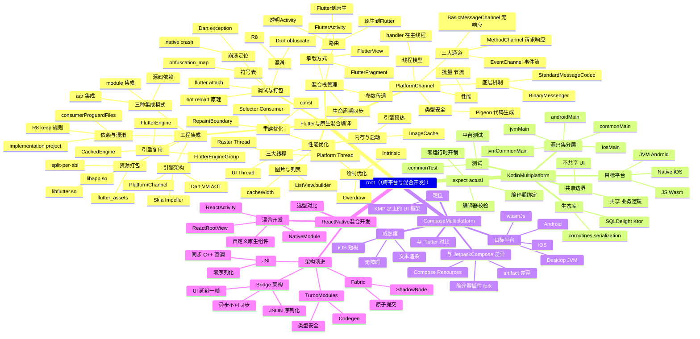

# 第 9 部分：跨平台与混合开发

## 概览

本部分解决一个核心问题：**一个 App 要同时跑在 Android 与 iOS（甚至桌面、Web）上，代码应该怎么组织、怎么通信、怎么调试、怎么交付**。

四条技术路线各有取舍：

- **Flutter 混合开发**：把 **Flutter 引擎嵌进原生 Android 工程**，UI 与业务逻辑由 Dart 写，原生与 Flutter 通过 **Platform Channel** 通信。适合"已有大型原生工程，增量接入 Flutter 页面"，也适合"Flutter 为主、原生补充平台能力"。
- **Kotlin Multiplatform（KMP）**：**只共享业务逻辑层**（领域模型、用例、数据层、协议），UI 仍用各平台原生技术栈（Compose / SwiftUI）。用 `expect` / `actual` 表达平台差异，**编译期绑定、零运行时开销**。适合 Kotlin 团队与逻辑高度重复的项目。
- **Compose Multiplatform**：**KMP 之上的跨平台 UI 框架**，把 `@Composable` 扩展到 Android / iOS / Desktop / Web。Android 端零成本（typealias 到 AndroidX），iOS 端依赖 **JetBrains 的 Compose 编译器插件 fork**，成熟度弱于 Flutter。
- **React Native**：从 **Bridge（异步 JSON 消息桥）** 演进到 **Fabric + TurboModules + JSI**（同步 C++ 直调、零序列化、类型安全）。生态与热更新能力是最大优势。

> [!tip] 面试主线
> 高级 Android 岗在第 9 部分的高频考点集中在：**Flutter 三种集成模式（aar / module / 源码）的取舍与选择理由**、**Flutter 引擎复用机制与 `FlutterEngineGroup`**、**PlatformChannel 三种通道的语义差异与线程模型**、**Pigeon 解决类型安全问题**、**Dart 混淆（`--obfuscate`）与 R8 是两套独立体系**、**混合工程的热重载限制与符号表保管**、**Flutter 卡顿的分线程排查法（UI Thread vs Raster Thread）**、**KMP 的 `expect/actual` 编译期绑定原理与源码集分层**、**RN 新旧架构（Bridge vs Fabric + TurboModules + JSI）的本质差别**。

> [!important] 三条路线的本质区别（记住这一句就够面试开题）
> **Flutter 是"一套 UI 画两边"，KMP 是"一套逻辑跑两边，UI 各自写"，RN 是"一套 JSX 画两边，靠原生组件或 Fabric 自绘"。**
> 通信模型也对应三种：**Flutter = 二进制消息通道（异步）**、**RN 旧 = JSON 消息桥（异步）、RN 新 = JSI 直调（同步）**、**KMP = 编译期静态绑定（同步、零开销）**。

## 知识图谱（Mermaid）

## 子目录导航

| 子目录 | 说明 | 主要笔记 |
| --- | --- | --- |
| [[./Flutter与原生混合编译/工程集成\|Flutter与原生混合编译]] | Flutter 引擎接入原生工程的完整方法论 | [[./Flutter与原生混合编译/工程集成]]、[[./Flutter与原生混合编译/PlatformChannel]]、[[./Flutter与原生混合编译/混合栈管理]]、[[./Flutter与原生混合编译/性能优化]]、[[./Flutter与原生混合编译/调试与打包]] |
| [[./KotlinMultiplatform/KMP与原生集成\|KotlinMultiplatform]] | 共享业务逻辑而非 UI 的跨平台路线 | [[./KotlinMultiplatform/KMP与原生集成]] |
| [[./ComposeMultiplatform/ComposeMultiplatform\|ComposeMultiplatform]] | Compose 走向 iOS / 桌面 / Web | [[./ComposeMultiplatform/ComposeMultiplatform]] |
| [[./README\|React Native 混合开发]] | RN 新旧架构与原生混合 | [[./ReactNative混合开发]] |

## 笔记列表

### Flutter 与原生混合编译

- [[Flutter与原生混合编译/工程集成]]：引擎架构、三种集成模式（aar / module / 源码）、依赖与混淆、引擎复用、资源打包
- [[Flutter与原生混合编译/PlatformChannel]]：`BinaryMessenger` 原理、MethodChannel / EventChannel / BasicMessageChannel、线程模型、Pigeon、性能开销
- [[Flutter与原生混合编译/混合栈管理]]：`FlutterActivity` / `FlutterFragment` / `FlutterView`、缓存引擎、混合栈路由、生命周期同步、传参
- [[Flutter与原生混合编译/性能优化]]：UI/Raster 线程模型、Widget 重建优化、Overdraw、图片与列表优化、内存与启动、DevTools 工具链
- [[Flutter与原生混合编译/调试与打包]]：hot reload 原理、`flutter attach`、Dart 混淆 vs R8、符号表上传、崩溃定位、CI/CD

### Kotlin Multiplatform

- [[KotlinMultiplatform/KMP与原生集成]]：源码集分层、`expect`/`actual` 原理、目标平台与生态库、共享边界、Android 与 iOS 集成、测试策略

### Compose Multiplatform

- [[ComposeMultiplatform/ComposeMultiplatform]]：与 Jetpack Compose 的关系、编译器插件 fork、目标平台与成熟度、优势劣势、与 Flutter 对比

### React Native 混合开发

- [[ReactNative混合开发]]：Bridge 架构瓶颈、JSI 原理、Fabric 与自定义组件、TurboModules、与原生混合、四种通信模型对比

## 关联部分

- 前置：[[../07-架构、工具与生态/README]]（MVVM、Hilt、Gradle、导航是跨端方案落地的基础设施）
- 前置：[[../06-系统原理与性能优化/README]]（渲染管线、内存与启动优化在跨端场景同样适用）
- 延伸：[[../08-企业级工程与运维/README]]（模块化、CI/CD、崩溃监控与灰度是跨端方案落地的工程保障）
- 延伸：[[../10-软技能与技术领导力/README]]（技术选型与 ADR：跨端路线是最需要"讲清楚权衡"的决策）
