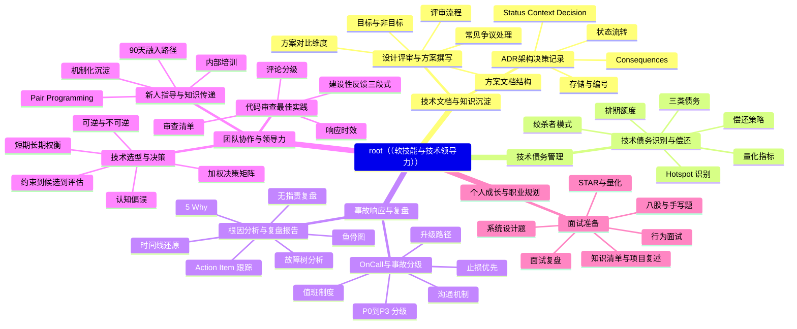

# 第 10 部分：软技能与技术领导力

## 概览

前 9 部分讲的是"**怎么把代码写好**"，第 10 部分讲的是"**怎么让代码持续写好**"。技术能力决定你能进哪扇门，软技能与领导力决定你能走多远、能不能带人。

这一部分的内容有三个特点：

- **可迁移**：不像 Kotlin 协程会过时，ADR、5 Why、STAR 这些方法论十年后依然有效。
- **有模板**：每篇都给出可以直接复制使用的文档模板（ADR 模板、复盘报告模板、方案模板），让你"照着就能写"。
- **要练口才**：本部分大量内容是"话术"——同一个技术事实，面试官听到的是"我照着文档念"还是"我经历过、我权衡过、我承担了后果"，差距极大。

三条主线：

- **技术文档与知识沉淀**：把脑子里的隐性知识变成团队可复用的显性资产（ADR、设计方案、知识库）。
- **技术债务与事故管理**：承认问题的存在，量化它、排期它、还清它；出事时能止损、能定位、能复盘。
- **团队协作与个人成长**：建设性反馈、技术选型权衡、带人、以及最现实的——**怎么把上面所有东西变成一份拿得出手的简历和一场答得漂亮的面**。

> [!tip] 面试主线
> 中高级 Android 岗与 Leader 岗的差异化考点集中在：**讲清一次技术选型的权衡过程**（不能只说结论）、**用 ADR 沉淀决策**（体现工程思维）、**讲一次事故复盘**（5 Why + Action Item）、**有量化结果的项目描述**（启动耗时 2.1s→800ms、崩溃率 0.8%→0.15%）、**能带人的证据**（带过 X 人、做过 Code Review 规范、沉淀过多少文档）。**高级面里，"你怎么做决定"比"你会不会写"更重要。**

## 知识图谱（Mermaid）

## 子目录导航

| 子目录 | 说明 | 主要笔记 |
| --- | --- | --- |
| [[./技术文档与知识沉淀/ADR架构决策记录\|技术文档与知识沉淀]] | 把决策上下文固化成资产 | [[./技术文档与知识沉淀/ADR架构决策记录]]、[[./技术文档与知识沉淀/设计评审与方案撰写]] |
| [[./技术债务管理/技术债务识别与偿还\|技术债务管理]] | 识别、量化、偿还技术债 | [[./技术债务管理/技术债务识别与偿还]] |
| [[./事故响应与复盘/OnCall与事故分级\|事故响应与复盘]] | 值班、分级、止损、复盘 | [[./事故响应与复盘/OnCall与事故分级]]、[[./事故响应与复盘/根因分析与复盘报告]] |
| [[./团队协作与领导力/代码审查最佳实践\|团队协作与领导力]] | 反馈、选型、带人 | [[./团队协作与领导力/代码审查最佳实践]]、[[./团队协作与领导力/技术选型与决策]]、[[./团队协作与领导力/新人指导与知识传递]] |
| [[./个人成长与职业规划/面试准备\|个人成长与职业规划]] | 把知识变成 offer | [[./个人成长与职业规划/面试准备]] |

## 笔记列表

### 技术文档与知识沉淀

- [[技术文档与知识沉淀/ADR架构决策记录]]
- [[技术文档与知识沉淀/设计评审与方案撰写]]

### 技术债务管理

- [[技术债务管理/技术债务识别与偿还]]

### 事故响应与复盘

- [[事故响应与复盘/OnCall与事故分级]]
- [[事故响应与复盘/根因分析与复盘报告]]

### 团队协作与领导力

- [[团队协作与领导力/代码审查最佳实践]]
- [[团队协作与领导力/技术选型与决策]]
- [[团队协作与领导力/新人指导与知识传递]]

### 个人成长与职业规划

- [[个人成长与职业规划/面试准备]]

## 关联部分

- 前置：[[../08-企业级工程与运维/README]]（工程化实践是软技能的载体：模块化、CI/CD、灰度发布都是协作与决策的产物）
- 前置：[[../07-架构、工具与生态/README]]（架构决策是 ADR 的主要来源）
- 延伸：[[../索引]]（回到总索引看面试冲刺路线）
