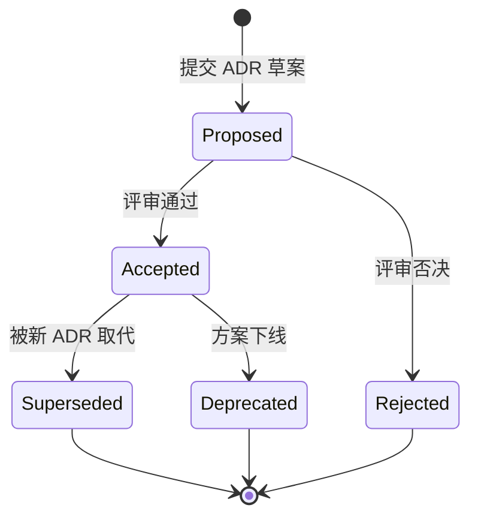

# ADR架构决策记录

## 一句话定义

ADR（Architecture Decision Record，架构决策记录）是一份**短小的、不可变的**文档，用来记录"某个架构决策**在什么背景下**被做出、**后果**是什么"，让半年后面对同样问题的同事知道当时为什么这么选。

## 核心原理

### 1. ADR 解决的真实问题

**问题不在于"没人知道结论"，而在于"没人知道上下文"。**

```
    半年后，新人问：为什么用 Room 不用直接写 SQLite？

    ❌ 没有 ADR 的回答：
       "因为当时说 Room 更好。"            ← 上下文丢失，无法判断今天还成不成立

    ✅ 有 ADR 的回答：
       "ADR-0007。背景：当时有 3 个 DataSource 要统一事务管理，
        团队只有 2 人熟悉 SQLite 扩展语法。我们选了 Room，
        代价是编译期多 8s，因为需要 kapt。
        今天如果团队扩到 5 人且需要复杂迁移，可以重新评估。"
```

**上下文（Context）才是决策的价值所在。** 结论会变，上下文决定了结论还成不成立。

### 2. ADR 的标准结构（Michael Nygard 模板）

```markdown
# ADR-0007: 使用 Room 作为本地持久化方案

- Status: Accepted          <!-- Proposed / Accepted / Deprecated / Superseded by ADR-0012 -->
- Date: 2026-03-14
- Deciders: 张三(技术负责人)、李四、四五
- Consulted: 六七(业务方)
- Related: ADR-0003(分层架构), ADR-0012(迁移到 KMP)

## Context
（背景与约束——决策时的客观事实，不是观点）

## Decision
（我们决定做什么，一句话用祈使句）

## Consequences
（后果——正面、负面、以及由此产生的新约束）

## Alternatives Considered
（考虑过但没选的方案，以及为什么没选）
```

**关键点**：

- **Status** 让 ADR 有生命周期，可以被"废弃"或"被新 ADR 取代"，而不是永远躺在那里误导人。
- **Context 必须是客观事实**，不是"因为 Room 更好"这种结论。事实包括：团队规模、人手技能、现有架构约束、时间窗、数据量级。
- **Consequences 必须包含负面**。没有负面后果的决策说明没想清楚，或者根本不是个决策。
- **Alternatives Considered** 是 ADR 里最被低估的部分——它记录了"你考虑过但放弃了什么"，避免后人重复劳动。

### 3. 状态流转



**关键规则**：

- **ADR 一旦 Accepted 就不可编辑**（immutable）。要改就写一条新 ADR，标注 `Superseded by ADR-XXXX`。
- 这条规则保证了 **Git 历史本身就是决策历史**——`git log` 能告诉你架构是怎么一步步演化的。
- 实践中很多人会直接改 ADR 内容，这等于抹掉了决策轨迹。**要改就新建。**

### 4. 什么该记，什么不该记

| ✅ 该记 ADR | ❌ 不该记 ADR |
| --- | --- |
| 引入/替换一个框架（Room、Hilt、Retrofit） | 每个需求单、每个 Bug 修复 |
| 影响模块边界的架构调整 | 变量重命名 |
| 影响数据格式/协议的兼容决策（序列化格式、API 版本） | 常规迭代需求 |
| 引入新的构建/发布流程 | 代码规范细节（用 lint 管） |
| 影响安全基线的决策（证书 pinning 开关） | 临时性的 workaround（要标注移除计划） |
| 引入新的第三方 SDK（数据采集合规） | 个人偏好类的实现细节 |

**判断标准**：*这个决策在 6 个月后还有人可能来问"为什么"吗？* 如果会，就记。

### 5. 存放位置与编号规范

```
docs/
└── adr/
    ├── 0001-使用-kotlin-and-kotlin-dsl.md
    ├── 0002-模块化分层结构.md
    ├── 0007-使用-room-作为持久化方案.md
    ├── 0010-引入-hilt-进行依赖注入.md
    └── 0012-使用-kmp-共享网络层.md
```

- **目录**：`docs/adr/`（也可放 `.github/adr/`）。
- **文件名**：`NNNN-短横线小写的标题.md`，编号**只增不减、永不复用**。
- **引用方式**：正文中写 `详见 [ADR-0007](adr/0007-使用-room-作为持久化方案.md)`。
- **索引**：维护一个 `docs/adr/README.md`，用表格列出全部 ADR 及状态。

| 编号 | 标题 | 状态 | 日期 |
| --- | --- | --- | --- |
| 0001 | 使用 Kotlin 和 Kotlin DSL | Accepted | 2026-01-08 |
| 0002 | 模块化分层结构（app/feature/core） | Accepted | 2026-01-20 |
| 0007 | 使用 Room 作为本地持久化方案 | Accepted | 2026-03-14 |
| 0010 | 引入 Hilt 进行依赖注入 | Accepted | 2026-05-02 |
| 0012 | 使用 KMP 共享网络层 | Superseded by ADR-0018 | 2026-07-21 |

### 6. ADR 与其他文档的区别

| 文档 | 时机 | 会不会变 | 回答什么问题 |
| --- | --- | --- | --- |
| **ADR** | 决策那一刻 | 不可变（新增取代） | **为什么这么选** |
| **设计文档 / 技术方案** | 方案设计期 | 会迭代 | **怎么做** |
| **需求文档** | 需求期 | 会变 | **要做什么** |
| **RFC** | 提案征求意见 | 会变 | **建议这样做，大家怎么看** |
| **Wiki/知识库** | 随时 | 持续更新 | **这个领域整体是怎样的** |
| **README** | 随时 | 持续更新 | **这个模块怎么用** |

**一个 ADR 引用一份设计文档**：ADR 说"我们选 A 方案"，设计文档说"A 方案具体怎么实现"。

### 7. 反模式

1. **事后补写**：项目做完了才补 ADR —— 价值大打折扣，因为上下文已经想不起来了。
2. **只记结论不记背景**：等于没写。
3. **写成技术方案**：塞了几千行实现细节进去，应该拆成 ADR + 设计文档。
4. **无人维护**：状态永远是 Accepted，包括那些早就废弃的决策。
5. **数量爆炸**：每个技术细节都写一条，ADR 目录变成垃圾场。宁缺毋滥。
6. **过度形式化**：一个只有 3 人的小团队为改个日志库写 ADR —— 仪式感大于价值。

## 代码示例

### 1. 一份完整的 ADR 模板（可直接复制）

```markdown
# ADR-{编号}: {决策标题}

- **Status**: Proposed | Accepted | Deprecated | Superseded by ADR-{编号}
- **Date**: {YYYY-MM-DD}
- **Deciders**: {决策人}
- **Consulted**: {被咨询的人}
- **Related**: {相关 ADR 编号}

## Context

**业务背景**
- {业务上的约束：用户量、数据量、迭代节奏、团队规模}

**技术背景**
- {现有架构的客观事实}
- {当前方案的具体痛点，用数据说话}

**约束**
- {硬性约束：工时、兼容性、合规、设备覆盖}

## Decision

我们决定 {采用什么方案}。

具体而言：
1. {关键点 1}
2. {关键点 2}

## Consequences

### 正面
- {收益，尽量量化}

### 负面
- {代价与新增成本，必须写}

### 后续约束
- {由此产生的、团队必须遵守的新规则}

## Alternatives Considered

### 方案 A：{名字}
- 优点：{...}
- 否决原因：{...}

### 方案 B：{名字}
- 优点：{...}
- 否决原因：{...}

## Validation
- {如何验证这个决策是有效的：监控指标、复盘时间点}
```

### 2. 一次真实的 Android ADR 示例

```markdown
# ADR-0010: 引入 Hilt 进行依赖注入，替代手写 Dagger

- **Status**: Accepted
- **Date**: 2026-05-02
- **Deciders**: 张三(技术负责人)、李四
- **Consulted**: 王五(业务开发)
- **Related**: ADR-0002, ADR-0015(单元测试覆盖率提升计划)

## Context

- 业务背景：App 有 3 个独立业务线，需求迭代频繁，预计年发版 8 次。
- 技术背景：
  - 目前使用手写 Dagger 2，每个模块要手写 `@Component` / `@Subcomponent`，
    新人平均需要 2 天才能理解组件依赖关系。
  - 手写 Dagger 的单测需要手动构建 Component 树，测试样板占单测代码约 30%。
- 约束：
  - 迁移工作量约 5 人日，需在 2 个版本内完成。
  - 不能影响现有线上功能的稳定性。

## Decision

我们决定使用 Hilt 作为唯一的依赖注入方案，逐步替换手写 Dagger。

具体而言：
1. 新代码一律使用 Hilt，不再手写 Component。
2. 存量 Dagger Component 在 2 个版本内迁移完毕。
3. 迁移期间允许 Dagger 与 Hilt 共存（Hilt 本身基于 Dagger，不冲突）。

## Consequences

### 正面
- 新增 Activity 的依赖注入从"写 Component + 改依赖图"变为"加一个注解"，预计节省 30% 单测样板代码。
- 官方 `@TestInstallIn` 让单测替换依赖从手写 Component 变为声明式。

### 负面
- 引入 KSP 注解处理器，**全量编译时间增加约 8s**（实测 95s → 103s）。
- 团队需要 1 周时间熟悉 Hilt 的组件层级概念。
- Hilt 对 `AppCompatActivity` 有基类要求，存量继承自 `Activity` 的类需要改造。

### 后续约束
- 新增的基类必须继承 `AppCompatActivity`，禁止直接继承 `Activity`。
- CI 上监控编译时长，超过阈值 120s 触发告警。

## Alternatives Considered

### Koin
- 优点：运行时 DSL，无需注解处理器，编译零开销，Kotlin 语法友好。
- 否决原因：编译期校验能力弱于 Dagger/Hilt；团队在 2024 年评估时对运行时
  依赖解析的性能与可追踪性有顾虑。

### 继续手写 Dagger
- 优点：完全可控，无学习成本。
- 否决原因：样板代码成本随模块数线性增长，已成主要开发摩擦点。

## Validation
- 迁移完成后，统计单测样板代码占比与编译时长；
- 2026-08 复盘一次，若编译时长成为瓶颈则评估 Koin 或 Dagger 注解处理器性能优化。
```

### 3. ADR 索引的自动生成脚本

```bash
#!/usr/bin/env bash
# scripts/gen-adr-index.sh —— 生成 ADR 索引表并提交
set -euo pipefail

ADR_DIR="docs/adr"
OUT="$ADR_DIR/README.md"

{
  echo "# Architecture Decision Records"
  echo
  echo "| 编号 | 标题 | 状态 | 日期 |"
  echo "| --- | --- | --- | --- |"
} > "$OUT"

for f in $(ls -1 "$ADR_DIR"/*.md | grep -v README | sort); do
  num=$(basename "$f" | cut -d- -f1)
  title=$(sed -n '1s/^# ADR-[0-9]*: //p' "$f")
  status=$(grep -m1 '^\- \*\*Status\*\*' "$f" | sed 's/.*: //' | tr -d '*` ')
  date=$(grep -m1 '^\- \*\*Date\*\*' "$f" | sed 's/.*: //' | tr -d '*` ')
  echo "| $num | $title | $status | $date |" >> "$OUT"
done

echo "generated: $OUT"
```

### 4. 在 PR 中引用 ADR

```markdown
## 变更说明

本次 PR 将网络层从 Retrofit 迁移到 Ktor，遵循 [ADR-0021](docs/adr/0021-使用-ktor-作为网络层.md)。

### Reviewer 关注点
- [ ] 迁移是否覆盖了 ADR 中列出的全部约束场景
- [ ] 是否需要补充新的 ADR（本次迁移衍生出「统一错误码体系」的决策）
```

## 常见问题 / 面试要点

**读者问：ADR 是什么？为什么需要它？**

**AI答：**

1. **定义**：ADR 是 Architecture Decision Record，一种**轻量级、不可变的架构决策记录**。一份 ADR 回答三个问题：
   - **Context**：当时是什么情况（客观约束与事实）
   - **Decision**：我们决定做什么
   - **Consequences**：这个决定带来什么后果（好的和坏的）
2. **为什么需要**：
   - **上下文会丢失**。半年后新人问"为什么不用 Koin"，如果只记了结论（"用 Hilt"），没人能判断这个结论今天还成不成立；记了上下文（"当时 2 人团队、Kotlin 1.9、要求编译 < 100s"），就能判断是否该重新评估。
   - **防止重复讨论**。同一个问题被反复讨论三遍，是团队最大的隐性成本之一。
   - **让决策可审计**。合规、安全、架构治理场景下，需要能回答"这个决定是谁拍的、依据是什么"。
   - **保留否决理由**。避免后人重新走一遍你已经走过的弯路。
3. **它不是什么**：ADR **不是**技术方案文档（方案会变，ADR 不变），**不是**会议纪要（纪要记录"讨论了什么"，ADR 记录"决定了什么、为什么"），**也不是**万能文档模板（小团队为改个日志库写 ADR 是浪费）。
4. **面试话术**："我们团队用 ADR 沉淀架构决策，主要是解决'技术债没有上下文'的问题。比如我们曾经因为编译时长要求放弃了某个 DI 方案，两年后团队扩编到 10 人、编译预算放宽了，ADR 里的 Context 直接告诉我们'这个决策的约束已经消失，可以重新评估'，避免了一次凭感觉的争论。"

---

**读者问：ADR 应该什么时候写？谁来写？多大的决策才值得写？**

**AI答：**

1. **什么时候写**：**在决策发生的当下**，最好在方案评审通过后 1-2 天内，趁上下文还热乎。事后补写价值大打折扣。
2. **谁来写**：**决策的负责人（Decider）本人**，而不是指定一个"文档同学"。写 ADR 本身就是理解决策的过程，交给别人写等于放弃了这个理解过程。团队可以提供模板和评审。
3. **粒度标准**（用三问法）：
   - ① 这个决定**是否难以逆转**？改起来要动多个模块/已上线数据 → 要记。
   - ② **6 个月后是否还有人可能问"为什么"**？会 → 要记。
   - ③ 这个决定**是否影响其他人**（架构边界、依赖方向、数据格式）？是 → 要记。
   - 三个都否 → 不用记，用 commit message 就行。
4. **数量控制**：一个活跃项目一年 **10-20 条** ADR 是健康的。超过 50 条说明粒度太细，应该合并或清理。
5. **面试话术**："我的判断标准是'难以逆转 + 影响他人 + 会被追问'。比如引入一个新框架要记，但改个工具类命名不用记。我们大约每季度梳理一次 ADR，把已经失效的标记为 Deprecated，保持索引可信。"

---

**读者问：ADR 不可变，那写错了怎么办？决策后来证明是错的怎么办？**

**AI答：**

1. **不可变的是"记录"，不是"事实"**：ADR 记录的是**某一时刻的决策与当时的认知**，它本就应该是一张历史快照。后来证明决策错了，这恰恰说明 ADR 起了作用——它把当时的上下文固定住了，让人能复盘"当时为什么这么判断、哪一步的假设失效了"。
2. **怎么改**：
   - **不修改原文件**。
   - 新写一条 ADR，`Status: Accepted`，在 `Related` 里指向被取代的 ADR。
   - 把旧 ADR 的 `Status` 改成 `Superseded by ADR-XXXX`（**这一处修改是允许的**，因为它反映的是"状态流转"这一元数据，不是篡改历史内容）。
   - 在新 ADR 的 `Context` 里写明"为什么当初的判断现在不成立了"——**这才是 ADR 体系最大的价值：决策的演化路径本身就是知识。**
3. **反面做法**：直接把旧 ADR 的内容改掉。这样做的问题是——你抹掉了"当时为什么这么选"的证据，下次同样的坑还会再踩一遍，而且没有任何人能看出架构是怎么演化的。
4. **面试话术**："我们踩过这个坑：早期直接编辑旧 ADR，后来 review 时大家发现我们根本看不出某个模块为什么从 Dagger 换成了 Hilt。所以改成'只追加、不修改'的规则后，架构演化的路径就变得非常清楚了。"

---

**读者问：ADR 和设计评审、技术方案文档是什么关系？会不会重复？**

**AI答：**

1. **三者分工**：
   - **技术方案文档**：回答"**怎么实现**"——详细设计、接口定义、时序图、改造步骤、排期。**会反复迭代**，直到开发完成。
   - **设计评审**：是**一个会议/流程**，用来在方案定稿前收集反馈、暴露风险。产出是"评审意见与结论"。
   - **ADR**：是**一份决策的永久记录**，回答"**为什么选这个方向**"——Context / Decision / Consequences。**一次决策一份，终身不改**。
2. **推荐流程**：
   ```
   需求 → 写技术方案(设计文档) → 设计评审(收集意见、改方案)
        → 决策确定 → 写 ADR(记录 Context/Decision/Consequences)
        → 开发落地 → 方案文档归档更新
   ```
   方案文档在项目结束后会**过期**（因为实现细节会变），但 ADR **永远有效**（因为它记录的是当时的判断依据）。
3. **会不会重复**：会有一部分重叠（方案文档里也会写"备选方案对比"）。**解决办法**：ADR 的 `Alternatives Considered` 写成**摘要 + 指向详细方案的链接**，不要在 ADR 里复制粘贴大段对比表。
4. **面试话术**："我们的实践是'方案文档管怎么做，ADR 管为什么'。方案文档建完就归档，ADR 是常驻的架构知识库。我会把 ADR 放在 `docs/adr/` 并在 PR 里引用，这样任何一次架构调整都能追溯到依据。"

---

**读者问：面试里怎么体现你有 ADR / 工程思维？**

**AI答：**

1. **不要空谈"我们团队有规范"**，要讲**具体产出与机制**：
   - "我们用 ADR 记录架构决策，放在 `docs/adr/`，编号只增不复用；Status 有 Proposed/Accepted/Deprecated/Superseded 四态，决策改变时新增 ADR 取代旧 ADR 而不是改旧的。"
   - "ADR 索引是脚本自动生成的，避免手工维护导致状态失真。"
2. **结合技术内容举例**（最有说服力）：
   - "比如我们从手写 Dagger 迁到 Hilt，写了 ADR-0010，里面明确写了代价：KSP 让全量编译从 95s 涨到 103s，并把'CI 编译时长超过 120s 告警'写成了后续约束。这样半年后任何人想再引入 DI 框架，都能直接看到边界在哪。"
3. **体现"决策有生命周期"**：
   - "我们每季度 review 一次 ADR 目录，把已下线的方案标 Deprecated。我们把 ADR 目录当成架构的 changelog——新同事能通过 `git log docs/adr/` 看到我们架构演进的每一步和当时的约束。"
4. **加分点**：讲一个**你推动改进**的例子，而不只讲"我们有"。比如"以前的 ADR 是事后补的，我会开会对齐模板和写作时机，从那以后改为评审通过后当天写"。
5. **避坑**：不要把 ADR 说成"写文档的负担"。把它讲成**降低重复讨论成本**的工具，面试官会认同。

## 关联笔记

- [[设计评审与方案撰写]]：ADR 的上游产出
- [[../团队协作与领导力/技术选型与决策]]：决策矩阵与 ADR 的关系
- [[../技术债务管理/技术债务识别与偿还]]：ADR 是技术债的"上下文来源"
- [[../事故响应与复盘/根因分析与复盘报告]]：复盘同样遵循"记录上下文"的思想
- [[../README]]：第 10 部分总览

## 参考资料

- Michael Nygard, "Documenting Architecture Decisions"（2011）：https://cognitect.com/blog/2011/11/15/documenting-architecture-decisions
- Michael Nygard, "ADR GitHub 仓库"（格式模板）：https://github.com/npryce/adr
- AWS 架构决策记录实践指南：https://docs.aws.amazon.com/prescriptive-guidance/latest/architectural-decision-records/
- 《重构》第 2 版 · "代码的坏味道与重构方向"中的"历史与意图"思想
- 《Team Topologies》第 4 版 · 技术决策与认知负荷
