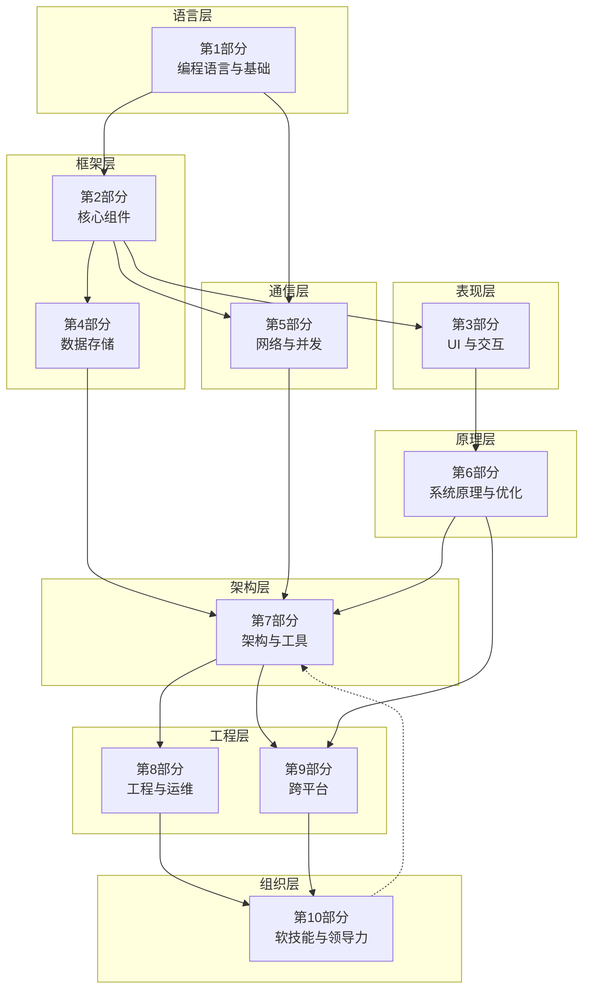

# 🕸️ 知识关联图谱

> 展示各部分之间的**依赖与交叉**，用于判断"学不懂 A 是不是因为 B 没学"。

## 全局依赖关系



## 跨部分的关键交叉点

> 面试中最常被"跨章"追问的地方 —— 这些地方最容易露怯。

| 交叉点 | 涉及部分 | 为什么重要 | 面试怎么问 |
| --- | --- | --- | --- |
| **Handler 消息机制** | 5（Handler） × 6（渲染/卡顿） × 3（动画） | Choreographer 本身就是通过 Handler 的同步屏障实现的 | "Choreographer 是怎么做到优先于普通消息的？" |
| **Binder** | 2（Binder/AIDL） × 6（启动流程） × 7（Hilt/Dagger） | AMS 调用 App 进程全靠 Binder；Hilt 底层也是 Dagger 的编译期生成 | "AMS 是怎么让 App 进程执行 onCreate 的？" |
| **Zygote 与 COW** | 6（启动） × 2（多进程） | 多进程应用的每个进程都是 Zygote fork 出来的 | "App 有 4 个进程，启动开销是几倍？" |
| **内存管理** | 6（内存/GC） × 3（Bitmap/绘制） × 4（Room/DataStore） | Bitmap 是内存崩溃的头号来源 | "一张 4K 图放进内存占多少？" |
| **渲染与掉帧** | 3（绘制流程） × 6（Choreographer） × 8（监控） | 掉帧排查要跨 UI 原理和 Systrace | "一个列表滚动掉帧，你的排查顺序是什么？" |
| **状态管理** | 7（MVVM/StateFlow） × 3（Compose 重组） × 5（Flow） | StateFlow 既是架构概念也是 UI 概念 | "StateFlow 值变了，Compose 一定会重组吗？" |
| **依赖注入** | 7（Hilt/Dagger） × 6（启动优化） × 8（模块化） | Hilt 的 `@Singleton` 初始化在 Application.onCreate，影响启动 | "Hilt 会不会拖慢启动？怎么优化？" |
| **序列化** | 4（Parcelable） × 2（Intent/Binder） × 6（内存） | Binder 传大对象会 TransactionTooLargeException | "Intent 传 2MB 的 List 会怎样？" |
| **分区存储** | 4（存储） × 2（ContentProvider） × 6（存储分区机制） | 同一个问题的三个层面 | "targetSdk 30 前后读图库有什么区别？" |
| **协程** | 1（协程） × 5（异步） × 7（ViewModelScope） × 6（卡顿） | 协程用错调度器会直接造成卡顿 | "为什么 `viewModelScope` 默认是 Main 调度器？" |
| **热修复与类加载** | 8（热修复） × 6（启动流程） × 2（Binder） | 热修复依赖 ClassLoader 查找顺序 | "热修复补丁是怎么生效的？" |
| **Flutter 通道** | 9（PlatformChannel） × 2（Binder） × 5（异步） | PlatformChannel 底层是消息通道 + 序列化 | "Flutter 的 MethodChannel 和 Binder 有什么异同？" |
| **技术债与架构** | 10（技术债） × 7（架构模式） × 8（模块化） | 模块边界是技术债的结构性来源 | "你们的模块化边界是怎么划的？代价是什么？" |
| **事故与监控** | 10（事故复盘） × 8（监控/APM） × 6（性能） | 复盘改进项要落到监控能力上 | "线上怎么发现启动崩溃率上升的？" |

## 学习时的"卡点自查"

```text
学不动？先检查前置：

第3部分 绘制流程   → 需要第2部分 Activity 生命周期
第3部分 Compose    → 需要第1部分 协程 + 第7部分 状态管理
第5部分 Handler    → 需要第1部分 线程基础
第6部分 启动流程   → 需要第2部分 Binder + Activity
第6部分 渲染机制   → 需要第3部分 绘制流程 + 第5部分 Handler
第6部分 内存管理   → 需要第1部分 JVM 内存模型
第7部分 MVVM       → 需要第3部分 UI + 第5部分 响应式
第7部分 Hilt       → 需要第1部分 泛型与反射
第8部分 模块化     → 需要第7部分 架构模式
第9部分 Flutter    → 需要第2部分 组件 + 第5部分 异步
第10部分 ADR      → 需要第7部分 架构决策的实际经验
```

## 关联

- [[../知识图谱总览]] — 全部 10 大部分的结构视图
- [[../索引]] — 面试冲刺路线
- [[学习进度总览]]
- [[待复习队列]]
