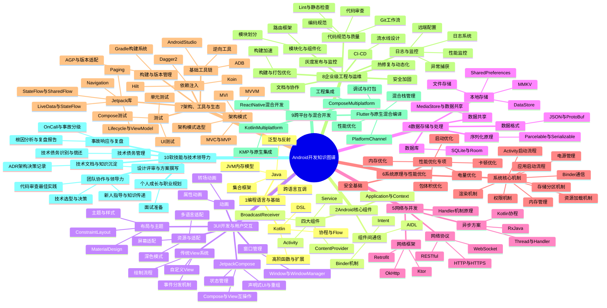
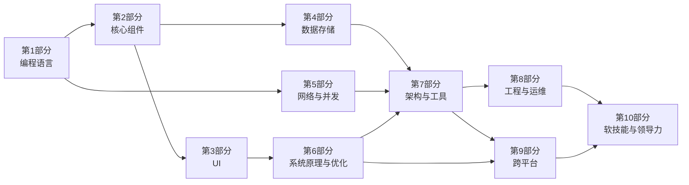

# 🧭 Android 开发知识图谱总览

> [[索引]] · 本页是全部 10 大部分的结构化视图，用 Mermaid 呈现知识之间的从属关系。

## 全景思维导图

## 知识依赖关系（学习顺序）

## 面试高频知识密度对照

| 层次                     | 部分             | 典型考察题                                                                                 |
| ------------------------ | ---------------- | ------------------------------------------------------------------------------------------ |
| **必答（高频）**   | 第 2、3、5、6、7 | 冷启动流程、Handler 消息机制、Binder 一次拷贝、View 绘制流程、MVVM 单向数据流、Hilt 组件树 |
| **常答（中级）**   | 第 1、4          | 协程取消机制、泛型擦除、Room 编译期校验、SP apply/commit                                   |
| **加分（高级）**   | 第 8、9          | 模块化边界、CI 质量门禁、Flutter PlatformChannel 原理、KMP expect/actual                   |
| **谈资（Leader）** | 第 10            | ADR、5 Why 复盘、技术选型权衡、带新人方法                                                  |

## 关联

- [[索引]] — 全部部分的入口与冲刺路线
- [[_Dashboard/学习进度总览]]
- [[_Dashboard/待复习队列]]
- [[_Dashboard/知识关联图谱]]
